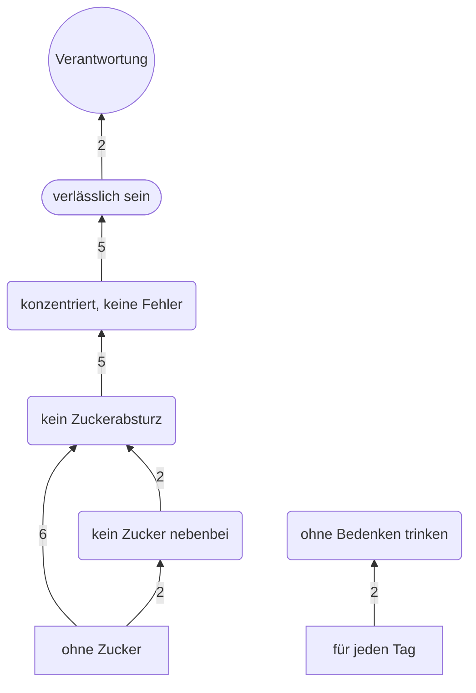

# Laddering: Hierarchical Value Map (HVM) – HOLY

> **KI-simuliert (Tool): 8 fiktive Befragte T1–T8, jede Person in einem eigenen Agenten-Lauf; keine echten Befragten, keine Aussagen über Signifikanz oder Repräsentativität. Hypothesen, keine Daten (Stenger, S. 78; dossier-buendel-b.md §7).**  
> Codierung und Auswertung vom 23.10.2026. Erzeugt von `auswertung/laddering.py` (nicht von Hand ändern; Skript erneut ausführen). Codierung: `codierung/leitern-codebuch.csv`, `leitern-zuordnung.csv`, `leitern-nebencodes.csv`.

**Cut-off:** Eine Verbindung steht in der HVM, wenn sie in mindestens 2 Leitern direkt vorkommt (je Leiter einmal, vor dem Rechnen festgelegt). Gezählt werden nur direkte Verbindungen; das ist die vereinfachte Form, mit der Vorlesung abgleichen. Pfeile zeigen von der Eigenschaft zum Wert, die Zahl am Pfeil ist die Zahl der Leitern.

**Stichprobe:** 10 Leitern von 8 KI-simulierten Personen; „ohne Zucker“: 8 Leitern, 0 Abbrüche · „für jeden Tag“: 2 Leitern, 6 Abbrüche.

Formen: Rechteck = Attribut (Eigenschaft) · abgerundet = funktionale Konsequenz · Kapsel = psychosoziale Konsequenz · Kreis = Wert.

## Knoten je Ebene (über dem Cut-off)

| Ebene | Knoten (Nennungen in Leitern) |
|---|---|
| Attribut | ohne Zucker (8) · für jeden Tag (2) |
| funktional | kein Zuckerabsturz (8) · konzentriert, keine Fehler (5) · kein Zucker nebenbei (2) · ohne Bedenken trinken (2) |
| psychosozial | verlässlich sein (5) |
| Wert | Verantwortung (2) |

## Verbindungen über dem Cut-off

| von | nach | Leitern | knapp am Cut-off | Leitern (Befragte · Startpunkt) |
|---|---|---|---|---|
| ohne Zucker | kein Zuckerabsturz | 6 | nein | T1 · ohne Zucker, T2 · ohne Zucker, T3 · ohne Zucker, T6 · ohne Zucker, T7 · ohne Zucker, T8 · ohne Zucker |
| kein Zuckerabsturz | konzentriert, keine Fehler | 5 | nein | T1 · ohne Zucker, T2 · ohne Zucker, T3 · ohne Zucker, T7 · ohne Zucker, T8 · ohne Zucker |
| konzentriert, keine Fehler | verlässlich sein | 5 | nein | T1 · ohne Zucker, T2 · ohne Zucker, T3 · ohne Zucker, T7 · ohne Zucker, T8 · ohne Zucker |
| für jeden Tag | ohne Bedenken trinken | 2 | ja | T1 · für jeden Tag, T6 · für jeden Tag |
| ohne Zucker | kein Zucker nebenbei | 2 | ja | T4 · ohne Zucker, T5 · ohne Zucker |
| kein Zucker nebenbei | kein Zuckerabsturz | 2 | ja | T4 · ohne Zucker, T5 · ohne Zucker |
| verlässlich sein | Verantwortung | 2 | ja | T2 · ohne Zucker, T7 · ohne Zucker |

Verbindungen unter dem Cut-off (je 1 Leiter): 24; alle stehen in `implikationsmatrix.csv` und in `hvm.json` unter „kanten_unter_cutoff“.

## Stärkste Leiter

**ohne Zucker → kein Zuckerabsturz → konzentriert, keine Fehler → verlässlich sein → Verantwortung**  
Kantenzahlen 6 · 5 · 5 · 2 (Engpass 2, Summe 18); endet bei einem Wert: ja. Vollständig und zusammenhängend in 2 Einzelleitern: T2 · ohne Zucker, T7 · ohne Zucker.

Regel: größte kleinste Kantenzahl, dann größere Summe, dann längerer Pfad (vor dem Rechnen festgelegt). Alle Pfade: `hvm.json`, „pfade“.

## Abbrüche („beim Kauf nicht wichtig“, keine Leiter)

| Startpunkt | Leitern | Abbrüche | Befragte mit Abbruch | Gründe (Befragte) |
|---|---|---|---|---|
| ohne Zucker | 8 | 0 | – | – |
| für jeden Tag | 2 | 6 | T2, T3, T4, T5, T7, T8 | Anrühren umständlich: T3, T4, T5, T7, T8 · nur bei Bedarf: T2, T4, T7, T8 · klingt nach Werbung: T3, T4, T5 · täglich bedenklich: T2, T7, T8 · trinkt eh täglich: T3, T5 |

## Häufige Codes außerhalb der HVM

Codes, die in mindestens 2 Leitern vorkommen, aber an keiner Verbindung über dem Cut-off beteiligt sind (die Vorgänger wechseln von Leiter zu Leiter; gezählt werden nur direkte Verbindungen):

- feste Routine (funktional, 2 Leitern: T1 · für jeden Tag, T6 · für jeden Tag); direkte Vorgänger: kein schlechtes Gewissen, ohne Bedenken trinken
- Job sichern (psychosozial, 2 Leitern: T5 · ohne Zucker, T8 · ohne Zucker); direkte Vorgänger: Führerschein behalten, verlässlich sein
- Kontrolle behalten (psychosozial, 2 Leitern: T4 · ohne Zucker, T6 · für jeden Tag); direkte Vorgänger: Halt im Alltag, sich wohlfühlen
- Selbstachtung (Wert, 3 Leitern: T1 · ohne Zucker, T7 · ohne Zucker, T8 · ohne Zucker); direkte Vorgänger: Selbstbestimmung, Verantwortung, verlässlich sein
- Selbstbestimmung (Wert, 3 Leitern: T1 · für jeden Tag, T6 · für jeden Tag, T8 · ohne Zucker); direkte Vorgänger: feste Routine, Job sichern, Kontrolle behalten

## Nebenaspekte und Abgleich (nur Information, zählen nicht in der Matrix)

| Code | Nebenaspekt in einer Stufe (Befragte) | Abgleich im Dialog (Befragte) |
|---|---|---|
| auch bei anderen | T5, T7 | T3, T4, T5, T7, T8 |
| Gewicht halten | T4, T5 | T1, T4, T5, T8 |
| Gesundheit | – | T2, T4, T5 |
| unsicher, ob gesund | – | T1, T4, T6 |
| Können zeigen | T8 | T8 |
| nicht so süß | T2 | T2 |
| kein schlechtes Gewissen | – | T1 |
| schmeckt schlechter | – | T8 |
| Verantwortung | T1, T2, T5 | – |
| kein Ärger | T1, T3 | – |
| Halt im Alltag | T1 | – |
| konzentriert, keine Fehler | T5 | – |
| Kopf frei | T6 | – |
| Selbstbestimmung | T4 | – |

Abgleich = erst nach der Hauptcodierung und nach dem Lesen von Anhang 2 des Dossiers gezielt in allen Dialogen gesucht (Folie-07-Knoten Genuss, Gewissen, Gesundheit; dazu Gewicht, Zweifel, „ohne Zucker“ auch bei anderen Marken). Fundstellen wörtlich in `codierung/leitern-nebencodes.csv`.

## Robustheit der Codierung

Für jede anders vertretbare Codierung (Alternative in `leitern-nebencodes.csv`) wurde neu gezählt.

| Variante | HVM | stärkste Leiter |
|---|---|---|
| T1 · für jeden Tag, Stufe 4: „feste Routine“ → „Halt im Alltag“ | unverändert | gleich |
| T1 · für jeden Tag, Stufe 5: „Selbstbestimmung“ → „Kontrolle behalten“ | unverändert | gleich |
| T2 · ohne Zucker, Stufe 3: „kein Zuckerabsturz“ → „gleichmäßig wach“ | kein Zuckerabsturz → konzentriert, keine Fehler: 5 → 4 | gleich |
| T4 · ohne Zucker, Stufe 3: „kein Zuckerabsturz“ → „Gewicht halten“ | − kein Zucker nebenbei → kein Zuckerabsturz (vorher 2) | gleich |
| T4 · ohne Zucker, Stufe 5: „Kontrolle behalten“ → „bewusst ernähren“ | unverändert | gleich |
| T4 · ohne Zucker, Stufe 6: „Gesundheit“ → „Selbstbestimmung“ | + Kontrolle behalten → Selbstbestimmung (2) | gleich |
| T5 · ohne Zucker, Stufe 4: „Führerschein behalten“ → „konzentriert, keine Fehler“ | kein Zuckerabsturz → konzentriert, keine Fehler: 5 → 6 | gleich |
| T5 · ohne Zucker, Stufe 6: „Sicherheit“ → „Verantwortung“ | unverändert | gleich |
| T6 · ohne Zucker, Stufe 3: „volle Leistung“ → „konzentriert, keine Fehler“ | kein Zuckerabsturz → konzentriert, keine Fehler: 5 → 6 | gleich |
| T6 · ohne Zucker, Stufe 6: „sich treu bleiben“ → „Selbstachtung“ | unverändert | gleich |
| T6 · für jeden Tag, Stufe 5: „Kontrolle behalten“ → „Kopf frei“ | unverändert | gleich |
| T8 · ohne Zucker, Stufe 6: „Selbstbestimmung“ → „Unabhängigkeit“ | unverändert | gleich |
| alle Alternativen zugleich | − kein Zucker nebenbei → kein Zuckerabsturz (vorher 2); kein Zuckerabsturz → konzentriert, keine Fehler: 5 → 6 | gleich |

## Hinweise des Skripts

- Ebene: T1 · für jeden Tag, Stufe 4: Simulation „psychosozial“, Code „feste Routine“ steht im Codebuch als „funktional“.
- Ebene: T2 · ohne Zucker, Stufe 4: Simulation „psychosozial“, Code „konzentriert, keine Fehler“ steht im Codebuch als „funktional“.
- Rückschritt der Ebene: T1 · für jeden Tag: „kein schlechtes Gewissen“ (psychosozial) → „feste Routine“ (funktional).
- R6: T2 · ohne Zucker: 6 Stufen, nach dem Zusammenfassen gleicher Folgecodes 5 Knoten.

## Stimmigkeit der Prüffrage „ohne Zucker“ (nur Information)

Prüffrage „Ist dir das beim Kauf wichtig?“ bejaht: 8 von 8 (T1, T2, T3, T4, T5, T6, T7, T8); davon eingeschränkt: 3 (T3, T7, T8). Ideal auf K01 in Gespräch 2 höchstens 4: 4 (T3, T5, T7, T8). Spannung (bejaht, Ideal ≤ 4 und Beleg aus Gespräch 1, in dem die gezuckerte Dose stärker ist): 4 (T3, T5, T7, T8). Einzelheiten: `leitern-wichtigkeit-pruefung.csv`; Codierung: `codierung/leitern-wichtigkeit.csv`.

Erste Frage des simulierten Interviewers schreibt die Eigenschaft HOLY zu („HOLY sagt“, „HOLY wirbt“): „ohne Zucker“: 2 von 8 (T4, T8) · „für jeden Tag“: 8 von 8 (T1, T2, T3, T4, T5, T6, T7, T8).

## Grenzen

- Alle Leitern stammen von KI-simulierten Personen: Hypothesen, keine Befunde über Kund:innen. KI-Personas ersetzen kein Kundengespräch (Stenger, S. 78).
- Die Ebenen (funktional, psychosozial, Wert) gibt die Leitfrage von P9 vor; die Simulation füllt sie erwartungsgemäß aus.
- Bei wenigen Leitern entscheidet oft eine einzelne Codierentscheidung, ob eine Verbindung den Cut-off erreicht (siehe Robustheit).
