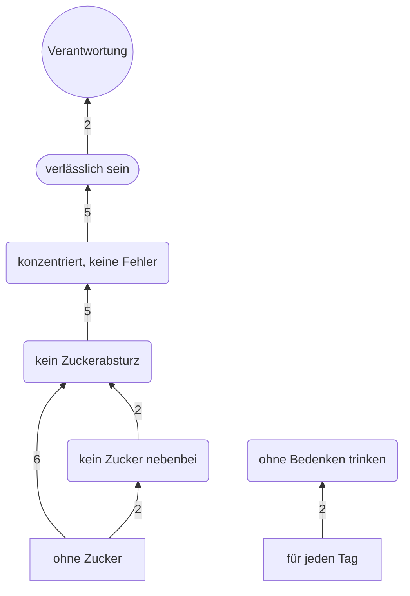

# Laddering → Markennutzen (Bündel B, KI-simuliert)

> **KI-simuliert.** 8 fiktive Befragte T1–T8, je Person ein eigener Agent (Workflow D25, im Auftrag von Yannick
> Heisler, 22.10.2026). Keine echten Interviews. Alle Leitern sind Hypothesen, ohne Aussagen über Signifikanz oder
> Repräsentativität. KI-Personas ersetzen kein Kundengespräch (Stenger, S. 78). Codiert hat ein KI-Tool, gezählt hat
> ein Python-Skript; Prüfung durch die Gruppe: ☐ offen.
> Nacharbeit 23.10.2026 nach drei Prüfberichten: Stimmigkeit der Prüffrage (§2), Echo der Idealmarke bei „für jeden
> Tag“ (§2), Persona-Block richtiggestellt (§6), Vorbehalte zum Nutzen (§4). HVM und Zahlen unverändert.

Vorlage: [`../methoden.md`](../methoden.md) §3 · Plan: [`../dossier-buendel-b.md`](../dossier-buendel-b.md) §3 (B2) ·
Ablauf und Prompt P9: [`simulation-protokoll.md`](simulation-protokoll.md) · Folien:
[`folienvorschlag.md`](folienvorschlag.md) Abschnitt 2 und 8. Methodenbegriffe nach Standardliteratur (Gutman 1982;
Reynolds & Gutman 1988) – mit den Vorlesungsfolien abgleichen.

## Auf einen Blick

- **Stichprobe:** 10 Leitern von 8 KI-simulierten Personen. „ohne Zucker“: 8
  Leitern, 0 Abbrüche · „für jeden Tag“: 2 Leitern (T1, T6 – die
  beiden Stammkund:innen), 6 Abbrüche.
- **Vorbehalt „ohne Zucker“:** 8 von 8 bejahen die Prüffrage, 3 davon eingeschränkt („so halb“, „irgendwie“). 4 von 8 (T3, T5, T7,
  T8) widersprechen damit ihren eigenen früheren Antworten: Ihr Ideal liegt auf K01 nur bei 3–4, und in Gespräch 1
  „knallt“ die gezuckerte Dose (§2). Die Kernkette ist deshalb eine schwache, KI-simulierte Hypothese.
- **Vorbehalt „für jeden Tag“:** Das ist der Name der Idealmarke, kein HOLY-Claim. Der simulierte Interviewer schreibt
  den Satz trotzdem in 8 von 8 Gesprächen HOLY zu („HOLY sagt …“) – ausgelöst durch den P9-Wortlaut „Eigenschaften der
  Marke HOLY“ (§2).
- **Stärkste Leiter:** ohne Zucker → kein Zuckerabsturz → konzentriert, keine Fehler → verlässlich sein →
  Verantwortung (Kanten 6 · 5 · 5 · 2 Leitern). Am Stück steht sie nur bei T2 und T7; die HVM setzt sie
  aus Teilstücken zusammen.
- **Markennutzen (aus der HVM):** sachlich-funktional „kein Zuckerabsturz, keine Fehler“, psychosozial „verlässlich
  sein“ – Wahrnehmungen der simulierten Personen, keine geprüften Produktwirkungen, eher ein Nutzen der Kategorie
  zuckerfreier Getränke; „verlässlich sein“ folgt vor allem aus den Berufsprofilen (§4).
- **Nicht gestützt:** die Kette der bisherigen Folie 07 „zuckerfrei → Genuss ohne Zucker → gutes Gewissen →
  Gesundheit“. Genuss ist in keiner Leiter eine Stufe, gutes Gewissen kommt einmal vor, Gesundheit einmal als Wert.
  Widerlegt ist Genuss damit nicht: Geschmack war kein Startpunkt.
- **„ohne Zucker“ unterscheidet kaum:** Fünf von acht sagen im Gespräch, das gebe es auch bei anderen Marken.

---

## 1. Vorlage methoden.md §3 – ausgefüllt

**Ziel:** Von den Startpunkten aus dem Repertory Grid über Konsequenzen zu persönlichen Werten (Means-End-Chain).

**Vorgehen, wie es gelaufen ist:**
1. **Startpunkte** = Ergebnis des Repertory Grids, wortgleich: „ohne Zucker“ und „für jeden Tag“. Beide sind
   **Startpunkte, keine Markeneigenschaften** – die Auswahlregel ergab kein Attribut (`repertory-grid.md` §2).
2. **Interviews:** je Person ein neuer Agent mit P0, Befragten-Block, Rückblick (Vorstellung, Auswahlfragen, Kauf aus
   Gespräch 1) und der P9-Abwandlung aus dem Dossier (Anhang 1): zuerst fragen, ob die Eigenschaft beim Kauf wichtig
   ist; wenn ja, wiederholt „Warum ist dir das wichtig?“ bis zum Wert, mindestens 3 Stufen, Dialog und Kette.
3. **Codieren:** gleichbedeutende Stufen je Ebene vereinheitlicht (Codes höchstens 3 Wörter, Attribut-Codes wortgleich
   mit den Startpunkten): `codierung/leitern-codebuch.csv` (41 Codes mit Definition und Beispielen),
   `leitern-zuordnung.csv` (eine Zeile je Stufe), `leitern-nebencodes.csv` (Nebenaspekte, Alternativen,
   Abbruchgründe, Abgleich – zählen nicht in der Matrix). Anhang 2 des Dossiers erst danach gelesen. **Blind war der
   Codierer nicht:** Sein Auftrag nannte vor dem Codieren schon die Beispielkette von Folie 07 („zuckerfrei → Genuss ohne
   Zucker → gutes Gewissen → Gesundheit“). Ein Bestätigungsfehler ist unwahrscheinlich, weil das Ergebnis dieser Kette
   widerspricht.
4. **Implikationsmatrix und HVM** per Skript `auswertung/laddering.py`: nur **direkte** Verbindungen
   aufeinanderfolgender codierter Stufen, jede Verbindung **je Leiter einmal**; Cut-off ≥ 2 Leitern (vor dem Rechnen
   festgelegt). Stärkste Leiter: größte kleinste Kantenzahl, dann größere Summe, dann längerer Pfad (vor dem Rechnen
   festgelegt).
5. **Markennutzen** sachlich-funktional und psychosozial aus der HVM formuliert (Abschnitt 4).

**Leitern** (Codes in der Reihenfolge der Leiter; Ebene laut Codebuch):

| Leiter | Kette (codiert, in Reihenfolge) | Attribut | Funktionale Konsequenz | Psychosoziale Konsequenz | Wert |
|---|---|---|---|---|---|
| T1 · ohne Zucker | ohne Zucker → kein Zuckerabsturz → konzentriert, keine Fehler → verlässlich sein → Selbstachtung | ohne Zucker | kein Zuckerabsturz → konzentriert, keine Fehler | verlässlich sein | Selbstachtung |
| T1 · für jeden Tag | für jeden Tag → ohne Bedenken trinken → kein schlechtes Gewissen → feste Routine → Selbstbestimmung | für jeden Tag | ohne Bedenken trinken → feste Routine | kein schlechtes Gewissen | Selbstbestimmung |
| T2 · ohne Zucker | ohne Zucker → kein Zuckerabsturz → konzentriert, keine Fehler → verlässlich sein → Verantwortung | ohne Zucker | kein Zuckerabsturz → konzentriert, keine Fehler | verlässlich sein | Verantwortung |
| T3 · ohne Zucker | ohne Zucker → kein Zuckerabsturz → konzentriert, keine Fehler → verlässlich sein → gern gesehen sein → Freundschaft | ohne Zucker | kein Zuckerabsturz → konzentriert, keine Fehler | verlässlich sein → gern gesehen sein | Freundschaft |
| T4 · ohne Zucker | ohne Zucker → kein Zucker nebenbei → kein Zuckerabsturz → sich wohlfühlen → Kontrolle behalten → Gesundheit | ohne Zucker | kein Zucker nebenbei → kein Zuckerabsturz | sich wohlfühlen → Kontrolle behalten | Gesundheit |
| T5 · ohne Zucker | ohne Zucker → kein Zucker nebenbei → kein Zuckerabsturz → Führerschein behalten → Job sichern → Sicherheit | ohne Zucker | kein Zucker nebenbei → kein Zuckerabsturz | Führerschein behalten → Job sichern | Sicherheit |
| T6 · ohne Zucker | ohne Zucker → kein Zuckerabsturz → volle Leistung → andere mitziehen → glaubwürdig sein → sich treu bleiben | ohne Zucker | kein Zuckerabsturz → volle Leistung | andere mitziehen → glaubwürdig sein | sich treu bleiben |
| T6 · für jeden Tag | für jeden Tag → ohne Bedenken trinken → feste Routine → Halt im Alltag → Kontrolle behalten → Selbstbestimmung | für jeden Tag | ohne Bedenken trinken → feste Routine | Halt im Alltag → Kontrolle behalten | Selbstbestimmung |
| T7 · ohne Zucker | ohne Zucker → kein Zuckerabsturz → konzentriert, keine Fehler → verlässlich sein → Verantwortung → Selbstachtung | ohne Zucker | kein Zuckerabsturz → konzentriert, keine Fehler | verlässlich sein | Verantwortung → Selbstachtung |
| T8 · ohne Zucker | ohne Zucker → kein Zuckerabsturz → konzentriert, keine Fehler → verlässlich sein → Job sichern → Selbstbestimmung → Selbstachtung | ohne Zucker | kein Zuckerabsturz → konzentriert, keine Fehler | verlässlich sein → Job sichern | Selbstbestimmung → Selbstachtung |

Hinweise des Skripts: Bei T1 „für jeden Tag“ folgt auf „kein schlechtes Gewissen“ (psychosozial) „feste Routine“
(funktional) – ein Rückschritt der Ebene. Bei T2 tragen Stufe 2 und 3 denselben Code und sind zusammengefasst (R6).
Zwei Stufen hat die Simulation selbst anders eingeordnet als das Codebuch (T1 „für jeden Tag“ Stufe 4, T2 Stufe 4).

---

## 2. Abbrüche („beim Kauf nicht wichtig“)

| Startpunkt | Leitern | Abbrüche | Befragte mit Abbruch | Gründe (Personen, Mehrfachnennung) |
|---|---|---|---|---|
| ohne Zucker | 8 | 0 | – | – |
| für jeden Tag | 2 | 6 | T2, T3, T4, T5, T7, T8 | Anrühren umständlich: 5 (T3, T4, T5, T7, T8) · nur bei Bedarf: 4 (T2, T4, T7, T8) · klingt nach Werbung: 3 (T3, T4, T5) · täglich bedenklich: 3 (T2, T7, T8) · trinkt eh täglich: 2 (T3, T5) |

Die Abbrüche sind ein eigenes Ergebnis: „für jeden Tag“ spricht nur die beiden simulierten Stammkund:innen an. Die
anderen sechs trinken Energy gezielt oder halten tägliches Trinken für bedenklich, und das Anrühren passt nicht in
ihren Alltag. Das deckt sich mit der Hürde „selbst anrühren“ im Repertory Grid. Eine der beiden Stammkund:innen-Stimmen
(T1) ist allerdings fast ein Echo der Persona „Marco, 28“ (gleiches Alter und Berufsfeld; Umstieg von Monster, Vorrat,
zwei Sorten wegen Rabatt, Freundin) – `simulation-protokoll.md` §8.

**„Für jeden Tag“ ist ein Echo der Idealmarke.** Der Startpunkt ist der rechte Pol von K09 und zugleich der Name der
Idealmarke („mein idealer Drink für jeden Tag“); in allen K09-Nennungen steht die Idealmarke auf diesem Pol
(`repertory-grid.md` §2). Im P9-Prompt heißen die Startpunkte – wie im Dossier vorgesehen – „Eigenschaften der Marke
HOLY“. Der simulierte Interviewer hat daraus in **8 von 8** Gesprächen zu „für jeden Tag“ eine Aussage von HOLY gemacht
(„HOLY sagt, das Getränk ist für jeden Tag gedacht“, „HOLY sagt von sich …“), bei „ohne Zucker“ in 2 von 8 („HOLY wirbt
damit“) – gezählt per Skript (`auswertung/hvm.json`, „zuschreibung_an_holy_erste_frage“). HOLY selbst spricht von „für
jede Lebenslage“ (Recherche-Dossier 2.7 ✔ [5]) und „Routinen im Alltag“ (✔ [13]), nicht wörtlich von „für jeden Tag“. Die
Abbrüche mit „klingt nach Werbung“ (3) reagieren also auf eine Zuschreibung der Simulation. Im Vortrag nie „HOLY sagt
…“.

**Stimmigkeit der Prüffrage bei „ohne Zucker“** (Nacharbeit 23.10.2026; Codierung `codierung/leitern-wichtigkeit.csv`,
Prüfung per Skript, Ausgabe `auswertung/leitern-wichtigkeit-pruefung.csv`):

| Befragte | Antwort auf „Ist dir das beim Kauf wichtig?“ (wörtlich) | eingeschränkt | Ideal auf K01 in Gespräch 2 (1 Zuckerbombe – 7 ohne Zucker) | Beleg aus Gespräch 1 (Triade 4, wörtlich) |
|---|---|---|---|---|
| T1 | „Ja, auf jeden Fall.“ | nein | 7 | – |
| T2 | „Ja, schon.“ | nein | 6 | – |
| T3 | „Schon irgendwie, ja.“ | ja | 3 | „Monster ist halt die volle Zuckerladung, aber dafür knallt's und schmeckt richtig.“ |
| T4 | „Ja, total.“ | nein | 7 | – |
| T5 | „Inzwischen ja.“ | nein | 4 | „Monster ist das Gegenteil: riesen Dose, Zucker ohne Ende, das haut richtig rein.“ |
| T6 | „Ja, total.“ | nein | 7 | – |
| T7 | „So halb.“ | ja | 4 | „Monster knallt richtig, da merkst du nach zehn Minuten was – auch wenn's nicht gesund ist.“ |
| T8 | „Inzwischen so halb – eher ja.“ | ja | 3 | „Monster ist halt richtig süß, eine Zuckerbombe, aber dafür knallt's auch.“ |

Laut Skript: 8 von 8 bejahen, 3 eingeschränkt (T3, T7, T8); 4 von 8 (T3, T5, T7, T8) setzen ihr Ideal auf K01 bei
höchstens 4 und beschreiben in Gespräch 1 die gezuckerte Dose als stärker. Diese vier widersprechen mit ihrem „wichtig“
den eigenen früheren Antworten; im Laddering nennen T3, T5 und T7 plötzlich eine zuckerfreie Dose als Gewohnheit („Bei
Monster nehm ich inzwischen meistens die weiße Dose“, T3; „Seit ein, zwei Jahren nehm ich meistens die zuckerfreie“, T5;
„Ich nehm meistens das weiße Monster, das ohne Zucker“, T7). Gründe: Der
Rückblick im P9-Prompt enthielt nur Vorstellung, Auswahlfragen und Kauf – nicht die Triaden und nicht die Bewertungen
(Workflow-Skript, Funktion `p9()`); und die Prüffrage lädt zum Ja ein. Die Leitern zu „ohne Zucker“ und damit die
Kernkette der HVM sind deshalb eine **schwache, KI-simulierte Hypothese**. Für einen späteren Lauf: Triaden und
K01-Bewertung in den Rückblick von P9 aufnehmen. Die Kanten selbst bleiben gezählt wie sie sind.

---

## 3. Implikationsmatrix und Hierarchical Value Map

**Verbindungen über dem Cut-off** (aus `auswertung/hvm.json`):

| von | nach | Leitern | genau am Cut-off | Leitern (Befragte · Startpunkt) |
|---|---|---|---|---|
| ohne Zucker | kein Zuckerabsturz | 6 | nein | T1 · ohne Zucker, T2 · ohne Zucker, T3 · ohne Zucker, T6 · ohne Zucker, T7 · ohne Zucker, T8 · ohne Zucker |
| kein Zuckerabsturz | konzentriert, keine Fehler | 5 | nein | T1 · ohne Zucker, T2 · ohne Zucker, T3 · ohne Zucker, T7 · ohne Zucker, T8 · ohne Zucker |
| konzentriert, keine Fehler | verlässlich sein | 5 | nein | T1 · ohne Zucker, T2 · ohne Zucker, T3 · ohne Zucker, T7 · ohne Zucker, T8 · ohne Zucker |
| für jeden Tag | ohne Bedenken trinken | 2 | ja | T1 · für jeden Tag, T6 · für jeden Tag |
| ohne Zucker | kein Zucker nebenbei | 2 | ja | T4 · ohne Zucker, T5 · ohne Zucker |
| kein Zucker nebenbei | kein Zuckerabsturz | 2 | ja | T4 · ohne Zucker, T5 · ohne Zucker |
| verlässlich sein | Verantwortung | 2 | ja | T2 · ohne Zucker, T7 · ohne Zucker |

**Verbindungen unter dem Cut-off** (24, je 1 Leiter; vollständige Matrix:
`auswertung/implikationsmatrix.csv`): feste Routine → Halt im Alltag (T6 · für jeden Tag); feste Routine → Selbstbestimmung (T1 · für jeden Tag); kein Zuckerabsturz → Führerschein behalten (T5 · ohne Zucker); kein Zuckerabsturz → sich wohlfühlen (T4 · ohne Zucker); kein Zuckerabsturz → volle Leistung (T6 · ohne Zucker); ohne Bedenken trinken → feste Routine (T6 · für jeden Tag); ohne Bedenken trinken → kein schlechtes Gewissen (T1 · für jeden Tag); volle Leistung → andere mitziehen (T6 · ohne Zucker); andere mitziehen → glaubwürdig sein (T6 · ohne Zucker); Führerschein behalten → Job sichern (T5 · ohne Zucker); gern gesehen sein → Freundschaft (T3 · ohne Zucker); glaubwürdig sein → sich treu bleiben (T6 · ohne Zucker); Halt im Alltag → Kontrolle behalten (T6 · für jeden Tag); Job sichern → Selbstbestimmung (T8 · ohne Zucker); Job sichern → Sicherheit (T5 · ohne Zucker); kein schlechtes Gewissen → feste Routine (T1 · für jeden Tag); Kontrolle behalten → Gesundheit (T4 · ohne Zucker); Kontrolle behalten → Selbstbestimmung (T6 · für jeden Tag); sich wohlfühlen → Kontrolle behalten (T4 · ohne Zucker); verlässlich sein → gern gesehen sein (T3 · ohne Zucker); verlässlich sein → Job sichern (T8 · ohne Zucker); verlässlich sein → Selbstachtung (T1 · ohne Zucker); Selbstbestimmung → Selbstachtung (T8 · ohne Zucker); Verantwortung → Selbstachtung (T7 · ohne Zucker).

**HVM** (Mermaid, aus `auswertung/hvm.md`; Pfeile von der Eigenschaft zum Wert, Zahl = Leitern):

**Knoten je Ebene:** Attribut: ohne Zucker (8), für jeden Tag (2) · funktional: kein Zuckerabsturz (8), konzentriert, keine Fehler (5), kein Zucker nebenbei (2), ohne Bedenken trinken (2) · psychosozial: verlässlich sein (5) · Wert: Verantwortung (2).

**Häufige Codes außerhalb der HVM:** Selbstachtung (3 Leitern) und Selbstbestimmung (3) erreichen den Cut-off nicht,
weil ihr direkter Vorgänger in jeder Leiter ein anderer ist; ebenso feste Routine, Job sichern, Kontrolle behalten (je
2). Indirekte Verbindungen sind nicht gezählt (vereinfachte Form, mit der Vorlesung abgleichen).

**Zwei Verbindungen liegen innerhalb der Ebene „funktional“** (kein Zucker nebenbei → kein Zuckerabsturz, kein
Zuckerabsturz → konzentriert, keine Fehler). P9 erlaubt mehrere Stufen derselben Ebene. Die Folienskripte für Folie 07
und B5 zeichnen solche Verbindungen bisher nicht (`folienvorschlag.md`, Entscheidung E4).

---

## 4. Markennutzen

| Nutzen | Formulierung | Herleitung aus der HVM |
|---|---|---|
| sachlich-funktional | **Wach bleiben ohne Zuckerabsturz – konzentriert, ohne Fehler bei Schicht, Arbeit oder Spiel.** Kurz für Folie: „Kein Zuckerabsturz, keine Fehler“ | ohne Zucker → kein Zuckerabsturz (6, dazu 2 über „kein Zucker nebenbei“) → konzentriert, keine Fehler (5) |
| psychosozial | **Verlässlich sein für die, die auf einen zählen.** Kurz: „Verlässlich sein“ | konzentriert, keine Fehler → verlässlich sein (5) → Verantwortung (2, knapp) |

**Vorbehalte:**
- Die Basis ist schwach: 4 der 8 Leitern zu „ohne Zucker“ stammen von Personen, deren „wichtig“ ihren eigenen
  früheren Antworten widerspricht (§2).
- „Kein Zuckerabsturz“ ist eine Wahrnehmung der simulierten Personen, kein geprüfter Produkteffekt. HOLY hat 2025
  unzulässige Gesundheitsversprechen entfernt (Recherche-Dossier 3.4 ✔ [81]); auf die Folien gehört es deshalb nur als
  Sichtweise der Befragten.
- Den Nutzen „ohne Zucker“ verbinden die simulierten Personen ausdrücklich auch mit anderen Marken (fünf von acht);
  er beschreibt eher die Kategorie zuckerfreier Getränke als HOLY allein.
- „Verlässlich sein“ folgt vor allem aus den Berufsprofilen: Die fünf Leitern mit diesem Knoten stammen von T1
  (Lager, Schicht), T2 (Pflege, Schicht), T3 (Student, Zocken im Team), T7 (Rettungsdienst, Schicht) und T8
  (Kfz-Werkstatt); die Spitze heißt dort Team, Patient:innen, Meister. Das ist ein Berufsbild der Simulation, kein
  HOLY-spezifischer Nutzen.
- Für „für jeden Tag“ trägt nur „ohne Bedenken trinken“ (2 Leitern,
  T1 und T6); ein Nutzen lässt sich daraus nicht ableiten.

---

## 5. Abgleich mit Anhang 2 (B2) und den bisherigen Beispieldaten von Folie 07

Anhang 2 wurde erst nach der Codierung gelesen. Fundstellen wörtlich in `codierung/leitern-nebencodes.csv` (Zeilen
„Abgleich“, nach dem Lesen von Anhang 2 gezielt gesucht; sie zählen nicht in der Matrix).

| Hypothese bzw. Beispieldaten | KI-simuliert | Lesart |
|---|---|---|
| Folie 07: zuckerfrei → **Genuss ohne Zucker** (7) | in keiner Leiter eine Stufe; Geschmack nur am Rand („nicht so pappsüß“, T2); T8: die zuckerfreie Dose schmeckt schlechter | nicht gestützt – aber auch nicht prüfbar: Geschmack war kein Startpunkt |
| Folie 07: → **gutes Gewissen** (7) | 1 Leiter (T1, bei „für jeden Tag“, nicht bei „ohne Zucker“) | nicht gestützt |
| Folie 07: → **Gesundheit** (6) | Wert nur bei T4; im Dialog nebenbei bei T2, T5; Zweifel, ob Süßstoff bzw. tägliches Trinken gesund ist: T1, T4, T6 | nicht gestützt |
| Folie 07: viele Sorten → Abwechslung → Spaß; Community-nah → mitreden → dazugehören | Sorten und Community waren keine Startpunkte (im Repertory Grid nie genannt) | nicht prüfbar |
| Anhang 2, Kette 1: zuckerfrei → ohne Zucker und Kalorien → gönnen ohne schlechtes Gewissen → Gesundheit, Selbstbestimmung | nur die erste Sprosse („kein Zucker nebenbei“, 2, knapp); Gewicht bei 4 Personen, aber als „Bonus“ bzw. „Nebensache“; Selbstbestimmung in 3 Leitern, aber über Routine bzw. Job | kaum gestützt |
| Anhang 2, Kette 2: Koffein → wach im Dienst, beim Zocken → mithalten, Leistung zeigen → Erfolg, Anerkennung | funktional passt sie zur Hauptkette; die Wachheit erklären die simulierten Personen aber mit dem fehlenden Zucker, nicht mit Koffein (kein Startpunkt); oben Verlässlichkeit und Verantwortung statt Erfolg; „Erfolg“ nie, Anerkennung nur als Nebenaspekt („Können zeigen“, T8) | teilweise, mit anderer Spitze |
| Anhang 2, Ketten Pulver, Sorten, Syrup, Hydration | keine Startpunkte | nicht prüfbar |
| Anhang 2: Taucht „Geiler Geschmack mit gutem Gewissen“ spontan auf? | nein | – |

**Was spontan kam:** der Zuckerabsturz und daraus Konzentration, Fehlervermeidung, Verlässlichkeit. **Was nie kam:**
Genuss (Geschmack war kein Startpunkt), Erfolg, Zugehörigkeit zu einer Szene. **Was neu ist:** Verlässlichkeit und Verantwortung gegenüber anderen
(Team, Patient:innen, Meister) als Spitze der Leiter; die Ablehnung von „für jeden Tag“.

---

## 6. Persona-Block und Kontrollgruppe

**Richtigstellung (Nacharbeit 23.10.2026):** Der P9-Prompt enthielt den Persona-Block **nicht** – genau wie im Dossier,
wo das Laddering in einem eigenen Chat B ohne Persona läuft. Jede Person bekam P0, ihren Befragten-Block (Profil) und
einen Rückblick auf das erste Gespräch (Vorstellung, Auswahlfragen, Kauf; `simulation-protokoll.md` §3.7). Der
Persona-Block kann die Leitern deshalb nur **mittelbar** prägen: über die Vorstellung und die Kaufantwort aus Gespräch 1,
die mit dem Block entstanden sind. Eine Kontrollgruppe für das Laddering gibt es nicht.

Plausibilitätsvergleich (Einschätzung der Synthese nach Regel R11 der Konstrukt-Codierung, keine Messung): Steht der
Inhalt eines HVM-Knotens im Persona-Block von Gespräch 1?

| Knoten | Ebene | im Persona-Block von Gespräch 1 angelegt? |
|---|---|---|
| ohne Zucker | Attribut | ja („ohne Zucker“) |
| für jeden Tag | Attribut | teils („mehrmals pro Woche“, „will gesünder leben“); vor allem Name der Idealmarke (§2) |
| kein Zucker nebenbei | funktional | ja („ohne Zucker“) |
| kein Zuckerabsturz | funktional | teils („will wach durch die Schicht kommen“) |
| konzentriert, keine Fehler | funktional | teils („wach durch die Schicht“) |
| ohne Bedenken trinken | funktional | teils („will gesünder leben“) |
| verlässlich sein | psychosozial | nein |
| Verantwortung | Wert | nein |

Wahrscheinlicher als der Block prägen die **Profile** die Hauptkette: Vier der acht arbeiten im Schicht- oder
Fahrdienst (T1, T2, T5, T7), dazu Werkstatt (T8) und Training (T6); mehrere unabhängige Agenten formulieren fast
wortgleich („nicht der … sein, wegen dem / bei dem …“ in 4 von 8 Laddering-Gesprächen, `auswertung/rohdaten-muster.csv`). Die
Leitern sind sehr gleichförmig gebaut (Attribut → funktional → funktional → psychosozial → psychosozial → Wert, 5 bis 7
Stufen), wie es die Vorlage von P9 nahelegt.

## 7. Robustheit der Codierung

Zwölf anders vertretbare Codierungen (Alternativen in `leitern-nebencodes.csv`) hat das Skript einzeln und alle
zugleich neu gezählt (`auswertung/hvm.md`, Abschnitt Robustheit). Die stärkste Leiter bleibt in jeder Variante
dieselbe; die Zahl bei „kein Zuckerabsturz → konzentriert, keine Fehler“ schwankt zwischen 4 und 6 (alle Alternativen
zugleich: 6). Die knappen Kanten (genau 2) hängen an einzelnen Entscheidungen, z. B. fällt
„kein Zucker nebenbei → kein Zuckerabsturz“ weg, wenn T4 Stufe 3 als „Gewicht halten“ codiert wird.

## 8. Grenzen

- KI-simuliert, keine echten Interviews (Stenger, S. 78; Dossier §7; prompts.md Teil C). Die Leiterfrage gibt die
  Ebenen vor; die Simulation füllt sie erwartungsgemäß aus. Widersprüche verschwinden (S. 78): 8 von 8 bejahen
  „ohne Zucker“, obwohl 4 von 8 in den Gesprächen 1 und 2 anders geantwortet haben (§2).
- Der P9-Rückblick enthielt weder Triaden noch Bewertungen; die Prüffrage lädt zum Ja ein (§2).
- „Für jeden Tag“ ist der Name der Idealmarke; der simulierte Interviewer schreibt ihn HOLY zu (§2).
- Der Codier-Auftrag nannte die Beispielkette von Folie 07 schon vor dem Codieren (§1).
- „Verlässlich sein“ spiegelt die Berufsprofile (§4); Klischees werden reproduziert (Stenger, S. 78).
- Wenige Leitern: 10, vier der sieben HVM-Kanten liegen genau auf dem Cut-off.
- Keine Kontrollgruppe für das Laddering, kein Persona-Block im P9-Prompt (§6); Startpunkte sind keine
  Markeneigenschaften.
- Codierung durch ein KI-Tool ohne menschliche Zweitcodierung.
- Nur direkte Verbindungen gezählt.

## Dateien

`rohdaten/leitern/T1–T8.json` (Dialoge und Ketten) · `codierung/leitern-codebuch.csv`, `leitern-zuordnung.csv`,
`leitern-nebencodes.csv`, `leitern-wichtigkeit.csv` · `auswertung/laddering.py` → `implikationsmatrix.csv`, `hvm.json`,
`hvm.md`, `leitern-wichtigkeit-pruefung.csv`.
