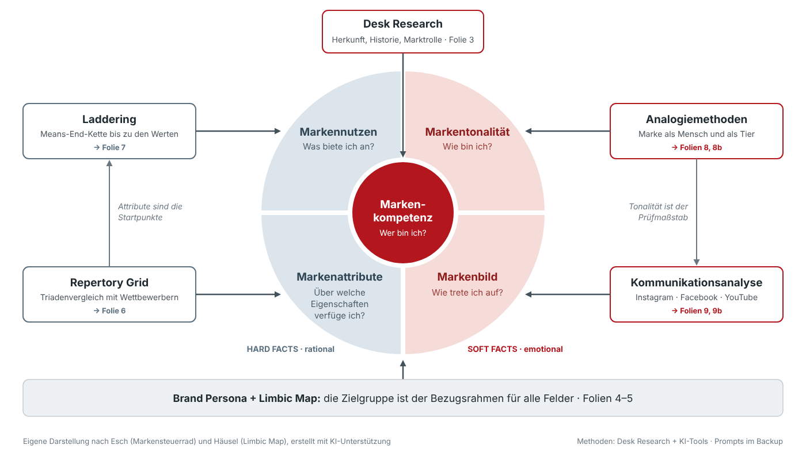
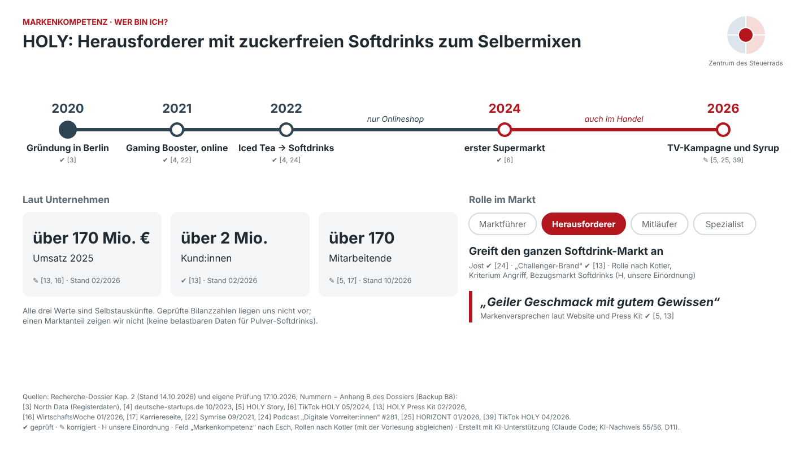
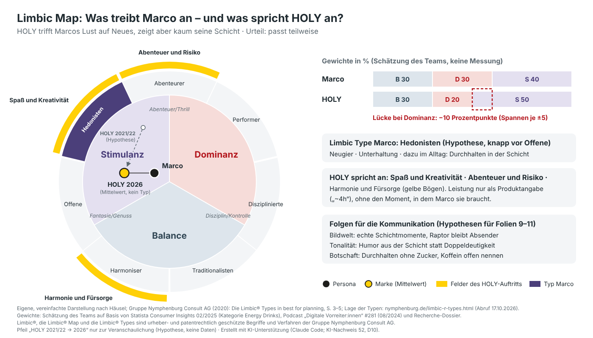

# Folienentwürfe – Fallstudie 1

Pro Folie: Titel als Kernaussage · Text auf der Folie · Visualisierung · Sprechtext · mögliche Rückfragen.
Die Gruppe überträgt die Entwürfe in den Folienmaster (Bündel C). Marke: HOLY (gewählt am 13.10.2026).

| Folie | Thema | Bündel | Status |
|-------|-------|---------|--------|
| 2 | Ausgangslage & Vorgehen | A | Entwurf ✔ (Rückfrage 2 ergänzt 19.10.; Methodenkarten und Rückfragen 2/3 nach der KI-Simulation 23.10.; 24.10. Sprechtext gekürzt, 0:45, Gründerbefragung in Klick 1) – Prüfung durch Yannick offen |
| 3 | Markenkern (bis 21.10.: Markenkompetenz) | A | Entwurf ✔ (17.10., Gründerbefragung eingearbeitet 19.10., Begriffe 21.10.) – Prüfung durch Yannick offen |
| 4 | Brand Persona | A | Entwurf ✔ (16.10., Gründerbefragung eingearbeitet 19.10.) – Prüfung durch Yannick offen |
| 5 | Limbic Map | A | Entwurf ✔ (17.10., Gründerbefragung eingearbeitet 19.10.) – Prüfung durch Yannick offen |
| 5b | Gründerbefragung: Innensicht (der Gründer über HOLY) | B spricht (Lukas), Auswertung A | Entwurf ✔ (24.10., Wunsch Lukas, Entscheidung Yannick; Web-Folie f05b) – Prüfung durch Yannick und Lukas offen |
| 6–7 | Repertory Grid, Laddering | B | Entwurf ✔ (23.10., KI-simulierte Befragung D25, Fremdbild) – Prüfung durch Yannick offen; Lukas liefert kein Material mehr |
| 8 | Analogien & Live-Umfrage | B (Inhalt Elias, C) | Entwurf ✔ (22.10. nach Elias' Ausarbeitung; 23.10. Papagei und Chamäleon gleichwertig) – Prüfung durch Elias und Yannick offen |
| 8b | Markentonalität (Aaker) | B | Entwurf ✔ (23.10., KI-simulierte Befragung D25, Fremdbild) – Prüfung durch Yannick offen |
| 9, 9b | Kommunikationsanalyse | C | Entwurf ✔ (22.10., nach Elias' Ausarbeitung) – Prüfung durch Elias und Yannick offen |
| 10 | Markensteuerrad | C (Inhalt A) | Entwurf ✔ (23.10.: Rad = Selbstbild, Abgleich mit dem KI-simulierten Fremdbild; parallel eingebaut, D26; 24.10. Gründer im Abgleich) – Prüfung durch Yannick und Elias offen |
| 11 | Fazit & Empfehlungen | C | nur Zeile 3 / Empfehlung 3 (22.10.); 23.10. Pille und Notizen nachgezogen (Titel unverändert); Rest offen |
| 12 | Danke & Fragen | alle | Vorgabe ✔ (23.10., Fazit und Sprungliste nach der KI-Simulation) – parallel eingebaut (D26), Prüfung durch Yannick offen |
| B4, B5 | Backup: Repertory Grid, Laddering | B | Entwurf ✔ (23.10., KI-simulierte Befragung D25) – Prüfung durch Yannick offen |
| B6 | Backup: Kanäle (Tabelle 1) | C | Entwurf ✔ (22.10., nach Elias' Ausarbeitung) – Prüfung durch Elias offen |

**Seit Sa, 24.10.2026 (Wunsch Lukas Welker, Entscheidungen Yannick „Eigene Folie + Folie 10 (Empfohlen)“ und „Ja,
als Innensicht vs. Außensicht (Empfohlen)“; Workflow D27):** Die Gründerbefragung hat eine eigene **Folie 5b
„Gründerbefragung: Innensicht“** zwischen Folie 5 und 6 (Eintrag unten) – Lukas spricht sie als Innensicht vor der
KI-simulierten Außensicht; auf Folie 10 trägt der Gründer im Abgleich die Seite des Selbstbilds mit. Dafür sind die
Sprechtexte von Folie 1 (0:30) und 2 (0:45) gekürzt (Zustimmung Yannick). Quelle nur
[`gruenderbefragung.md`](gruenderbefragung.md), Regeln 2.3. Maßgeblich ist die Web-Folie in `praesentation/index.html`.

**Seit Fr, 23.10.2026 (Entscheidungen Yannick, KI-Nachweis 135, Workflow D26):** Lukas Welker (Bündel B) liefert kein
Material mehr. Statt seiner Beispieldaten zeigen 06, 07, 08b, B4 und B5 eine **KI-simulierte Befragung** (Workflow
D25: acht fiktive, KI-simulierte Befragte T1–T8, je ein eigener Agent, Kontrollgruppe, Rechnung per Skript;
[`buendel-b/`](buendel-b/README.md)). Es gab **keine echten Interviews** – die Ergebnisse sind Hypothesen, ohne
Signifikanz oder Repräsentativität (Stenger, S. 78). Entscheidungen: (1) „Ehrlich einbauen“ – Titel als Kernaussage
nach den Daten, Pille „KI-simuliert“, Fußzeilen „KI-simulierte Befragung, n = 8 (T1–T8), keine echten Interviews“;
(2) „Rad = Selbstbild, Simulation als Abgleich“ – das Steuerrad auf Folie 10 zeigt die Identität (Selbstbild) aus
HOLYs eigenen Aussagen und Auftritt, die Befragungsfolien zeigen das KI-simulierte Fremdbild (Image) und führen zum
Abgleich auf Folie 10 (Identität = Selbstbild, Image = Fremdbild; Stenger, S. 60, 87); (3) Folie 08 „so wie Elias das
am wahrscheinlichsten wollte“ – Papagei und Chamäleon gleichwertig, der Papagei ersetzt in der Live-Abstimmung den
Fuchs; (4) die Hürde „selbst anrühren“ nur im Sprechtext (06, 10) und als Rückfrage; (5) Querverweise auf 02, 05
(Notizen), 12, B1, B2, B7, B8 nachziehen. Vorlage mit allen Daten, Sprechtexten und Rückfragen:
[`buendel-b/folienvorschlag.md`](buendel-b/folienvorschlag.md). Maßgeblich ist jeweils die Web-Folie in
`praesentation/index.html`; Folie 10, 12 und die Querverweise (02, 05, B1, B2, B7, B8) wurden beim Schreiben dieser
Einträge parallel gebaut – den Wortlaut nach dem Einbau dort abgleichen.

**Seit Do, 22.10.2026:** Einträge zu Folie 8, 9, 9b, 10 (Markenbild, Lücke 2), 11 (Zeile 3) und B6 nach den
Ausarbeitungen von Elias Knauber (Bündel C) – [`analogien.md`](analogien.md) und
[`kommunikationsanalyse.md`](kommunikationsanalyse.md), übertragen KI-gestützt (Claude Code, KI-Nachweis 119, Workflow
D24). Es sind Vorgaben des Hauptagenten zur Freigabe durch Yannick und Elias; der Einbau in die Web-Präsentation lief
parallel. Maßgeblich ist jeweils die Web-Folie in `praesentation/index.html`.

Stand der Folien 2–5: Mo, 19.10.2026. **GB** = Gründerbefragung: Gründer Mathias Horsch hat den Fragenkatalog der
Gruppe per Sprachnachricht beantwortet, zitiert als „Horsch 2026 (GB)“. Das ist eine Selbstauskunft (Innensicht,
n = 1), keine Aussage über die Kundschaft. Was er nicht nennt, heißt nur „nicht genannt“. Auswertung und Regeln:
[`gruenderbefragung.md`](gruenderbefragung.md). Name, Paraphrasen und kurze Zitate sind freigegeben (laut Yannick,
19.10.2026); „95 %“ nur mit dem Zusatz „laut Gründer, Datengrundlage nicht offengelegt“ und nie auf einer Hauptfolie.

**Begriffe seit Mi, 21.10.2026 nach der Vorlesung** (Abgleich Vorlesung, Befunde #15, #22, #27–#30, freigegeben von
Yannick; [`abgleich-vorlesung.md`](abgleich-vorlesung.md)): Mitte des Steuerrads „Markenkern“ (Stenger, S. 90–91; bis
dahin „Markenkompetenz“, so bei Esch selbst), Leitfragen in der Wir-Form (S. 88–89), Feld „Markeneigenschaften“
(S. 60, 90–91; bis dahin „Markenattribute“), Satz über dem Rad „Positionierung“ (S. 87, 94); Identität/Image nach
S. 60 und 87; KI-simulierte Befragte nach S. 78; Limbic Types und Gewichte als eigene Erweiterung (S. 69–71, 93).
In den Abschnitten unten nachgezogen, wo diese Begriffe vorkommen; die übrigen Inhalte sind unverändert.

---

## Folie 2 – Ausgangslage & Vorgehen

**Bündel:** A · **Zeit:** 0:45 (seit 24.10.2026; bis dahin 1:00) · **Backup-Bezug:** B1 Methodik & Begründung, B2 Prompt-Log

### Titel (Kernaussage)

> **Sechs Methoden, ein Modell: So leiten wir die Identität von HOLY her**

Alternativen:
- *Jede Methode füllt ein Feld des Markensteuerrads*
- *Vom Fakt zum Gefühl: unser Weg zur Markenidentität von HOLY*

### Text auf der Folie

- **Leitfrage** (eine Zeile unter dem Titel):
  *Wofür steht HOLY – und passt ihr heutiger Auftritt dazu?*
- **Grafik** (füllt den Rest der Folie, siehe unten)
- **Quellenzeile** (klein, unten links): *Eigene Darstellung nach Esch (Markensteuerrad) und Häusel (Limbic Map), erstellt mit KI-Unterstützung*

Mehr Text braucht die Folie nicht. Was die Grafik nicht zeigt, steht im Sprechtext.

### Visualisierung



*Arbeitsentwurf der Ausarbeitung – die Darstellung im Vortrag zeigt die Web-Präsentation (`praesentation/export/folien/`); Bildsprache und Farben weichen hier ab (Vermerk 21.10.2026, VORTRAGSREIFE Y31).*

Datei: [`grafiken/folie-02-vorgehen.svg`](grafiken/folie-02-vorgehen.svg) (Vorschau als PNG daneben)

- **Mitte:** Markensteuerrad nach Esch. Links die *hard facts* (Eigenschaften, Nutzen) in Blaugrau, rechts die *soft facts*
  (Tonalität, Bild) in Rot, in der Mitte der Markenkern (bis 21.10.2026: Markenkompetenz). Leitfragen in der Wir-Form
  wie Stenger, S. 88 (Grafik am 21.10.2026 neu erzeugt).
- **Außen:** die Methode, die das jeweilige Feld füllt, mit Verweis auf die Folie, auf der sie vorgestellt wird.
  Die Folie dient damit gleichzeitig als **Agenda**.
- **Graue Pfeile:** zeigen, wie die Methoden aufeinander aufbauen (Eigenschaften → Laddering, Tonalität → Kommunikationsanalyse).
- **Unten:** Brand Persona + Limbic Map als Bezugsrahmen für alle Felder.

**In PowerPoint einfügen:** *Einfügen → Bilder → Dieses Gerät* → SVG wählen. Danach Rechtsklick → *In Form konvertieren*:
Texte, Farben und Pfeile lassen sich dann einzeln bearbeiten und an den Master anpassen.

**Idee für den roten Faden:** Das Steuerrad als kleines Symbol oben rechts auf den Folien 3–9 wiederholen und jeweils
das Feld hervorheben, um das es gerade geht. Auf Folie 10 erscheint es dann groß und ausgefüllt.

### Sprechtext (ca. 1 Minute)

> Unsere Leitfrage lautet: Wofür steht HOLY – und passt ihr heutiger Auftritt dazu?
>
> Um das zu beantworten, nutzen wir das Markensteuerrad nach Esch. Es beschreibt die Identität einer Marke in fünf
> Feldern: links die harten Fakten, also Eigenschaften und Nutzen, rechts die weichen, also Tonalität und Markenbild, und
> in der Mitte der Markenkern.
>
> Für jedes Feld haben wir eine eigene Methode eingesetzt: Desk Research für den Markenkern, ein Repertory Grid für die
> Eigenschaften, Laddering für den Nutzen, Analogien für die Tonalität und eine Kommunikationsanalyse für das Markenbild.
> Die Methoden bauen aufeinander auf – die Eigenschaften aus dem Repertory Grid sind zum Beispiel die Startpunkte fürs Laddering.
>
> Den Rahmen bildet unsere Brand Persona, denn eine Marke wirkt nur über ihre Zielgruppe. Am Ende führen wir alles im
> Steuerrad zusammen und leiten daraus Empfehlungen ab.

### Mögliche Rückfragen

1. **„Warum gerade das Markensteuerrad?“**
   Es ist durch die Aufgabe vorgegeben – passt aber auch gut: Es trennt rationale und emotionale Bestandteile der
   Identität, und jede unserer Methoden lässt sich genau einem Feld zuordnen. Dadurch ist nachvollziehbar, woher jede
   Aussage im fertigen Steuerrad kommt.
2. **„Das Steuerrad erfasst doch die Identität – warum fragt ihr die Zielgruppe?“** (bis 21.10.2026: „Markenidentität
   ist das Selbstbild …“; neu gefasst am 23.10.2026 nach Entscheidung Yannick „Rad = Selbstbild, Simulation als
   Abgleich“)
   Die Aufgabe ordnet Repertory Grid, Laddering, Analogien und Kommunikationsanalyse der Markenidentität zu
   (Stenger, S. 60). Identität ist die Innensicht – „wer und was man sein möchte“; das Markenimage ist, „was
   wahrgenommen wird“ (S. 87). Deshalb trennen wir: Das Steuerrad zeigt die Identität, also das Selbstbild – nur
   Stichworte aus HOLYs eigenen Aussagen und Auftritt: Desk Research, Gründerbefragung (Horsch 2026, GB), Elias'
   Analogien und Kommunikationsanalyse. Repertory Grid, Laddering und der Aaker-Bogen fragen dagegen die Zielgruppe –
   bei uns KI-simuliert, echte Interviews gab es nicht –, sie zeigen also ein (simuliertes) Fremdbild. Das gleichen wir
   auf Folie 10 mit dem Selbstbild ab; wo beides auseinandergeht, setzen unsere Empfehlungen an. Die Gründerbefragung
   ist eine Selbstauskunft und wiederholt vieles aus Website und Press Kit; wir gewichten sie deshalb schwach.
3. **„Wie belastbar sind Ergebnisse mit KI-Tools?“** (neu gefasst am 23.10.2026)
   Die KI haben wir für Recherche, Strukturierung und eine KI-simulierte Befragung genutzt: acht fiktive Befragte,
   jede Person ein eigener Agent, dazu eine Kontrollgruppe, gerechnet per Skript (Workflow D25). Die Vorlesung sagt:
   KI beschleunigt die Ausarbeitung einer Persona, ersetzt aber nicht das Gespräch mit echten Kunden (Stenger, S. 78).
   Echte Interviews kamen nicht zustande; die simulierten Antworten sind deshalb Hypothesen, die echte Interviews
   prüfen müssten – und sie stehen nicht im Steuerrad, sondern nur im Abgleich. Fakten haben wir an den Quellen
   geprüft. Die Grenzen stehen im Backup (B1), alle Prompts im Prompt-Log (B2).

### Zu prüfen

- [x] `HOLY` durch HOLY ersetzt (17.10.)
- [ ] Anordnung der Felder mit der Grafik aus der Vorlesung abgleichen (die Grafik folgt der Standardliteratur)
- [ ] Farben und Schrift an den Folienmaster anpassen
- [ ] Sprechtext laut lesen und stoppen: Ziel ≤ 1:00
- [x] (23.10.) Rückfrage 3 final: Es gab keine echten Interviews; KI-simulierte Befragung D25 (siehe oben)
- [x] (23.10., Entscheidung 5 Yannick; eingebaut in der Web-Folie f02, Workflow D26) Methodenkarten nachgezogen –
  Wortlaut auf der Folie: Repertory Grid „Triaden: KI-simuliert, keine Interviews“, Laddering „Means-End-Chain:
  KI-simuliert, keine Interviews“, Analogiemethoden „Mensch, Tier: Selbstbild · Aaker: KI-simuliert“ (die Analogien
  selbst sind Elias' Ausarbeitung aus HOLYs Kommunikation), Kommunikationsanalyse „Vier Kanäle, eigene
  Bildschirmaufnahmen“ (bis 22.10.2026 „Instagram, Facebook, YouTube – KI hilft codieren“). Sprechtext Klick 3 jetzt
  „… Laddering für den Nutzen – beide mit KI-simulierten Befragten: ein Fremdbild, das wir am Ende mit dem Selbstbild
  abgleichen“; Rückfragen in den Notizen von f02 wie Rückfrage 2 und 3 oben. Etikett „Fremdbild“ auf den Karten
  Repertory Grid und Laddering bleibt (meint jetzt das KI-simulierte Fremdbild). Titel, Leitfrage, Fußzeile und Rad
  unverändert. Die Grafik `grafiken/folie-02-vorgehen.svg/.png` ist ein Arbeitsentwurf und nicht nachgezogen
- [ ] (23.10.) Yannick: Titel der Web-Folie – seit 24.10.2026 „Jede Methode gehört zu einem Feld des Steuerrads“ (vorher „Jede Methode füllt ein Feld des Markensteuerrads“); bestätigen oder zurückändern
  stimmt seit „Rad = Selbstbild“ nur noch im Sinn der Aufgabe (Zuordnung Methode → Feld); Eigenschaften und Nutzen im
  Rad tragen Selbstbild-Quellen, Repertory Grid und Laddering liefern den Abgleich. Vorschlag im Kasten „FOLIE 02“:
  „Jede Methode gehört zu einem Feld des Markensteuerrads“ – lassen oder ändern
- [x] (19.10.) Rückfrage 2 um die eigene Gründerbefragung ergänzt (`gruenderbefragung.md` K14); Grafik und
  Quellenzeile unverändert
- [x] (24.10., Workflow D27; Zustimmung Yannick) Web-Folie f02 auf **0:45** gekürzt, damit die neue Folie 5b in die
  15 Minuten passt – nur Wiederholungen und Füllwörter (124 → 86 gesprochene Wörter ≈ 45 s). Wortlaut auf der
  Web-Folie: „HOLY startete 2021 als Gaming-Booster, nur online. Heute: Softdrink im Supermarkt, mit TV-Werbung.
  Leitfrage: Wofür steht HOLY – und passt der Auftritt dazu?“ · „Das Markensteuerrad nach Esch zeigt die Identität,
  das Selbstbild: Desk Research und Gründerbefragung für den Markenkern, … Repertory Grid für die Eigenschaften,
  … Laddering für den Nutzen – beide KI-simuliert: das Fremdbild, … Analogien für die Tonalität … und
  Kommunikationsanalyse fürs Markenbild. KI hilft überall – geprüft, Prompts im Backup.“ · „Eigenschaften sind
  Startpunkte fürs Laddering, die Tonalität ist Prüfmaßstab.“ · „Den Rahmen bildet die Brand Persona: Marken wirken
  über ihre Zielgruppe.“ Methodenkarte Desk Research „Herkunft, Marktrolle + Gründerbefragung“ (bis dahin „Herkunft,
  Historie, Marktrolle“). Der Sprechtext oben ist der frühere Entwurf (ca. 1 Minute)
- [x] (24.10., nach der Prüfung D27 – der obige Wortlaut ist die verworfene erste Kürzung) Klick 1–5 jetzt: „Das
  Markensteuerrad nach Esch zeigt die Identität, das Selbstbild. Feld für Feld: Desk Research für den Markenkern –
  dazu die Gründerbefragung als Innensicht, … Repertory Grid für die Eigenschaften, … Laddering für den Nutzen – beide
  KI-simuliert: ein Fremdbild zum Abgleich, … Analogien für die Tonalität … und Kommunikationsanalyse fürs
  Markenbild.“ („KI hilft überall …“ gestrichen, das sagt die Fußzeile); 87 gesprochene Wörter ≈ 46 s, sieben Klicks.
  Die erste Kürzung ließ das Rad (Selbstbild) aus den Fremdbild-Methoden gefüllt klingen. Methodenkarte Desk Research
  bleibt **„Herkunft, Historie, Marktrolle“** – die Gründerbefragung ist eine Primärerhebung, keine Sekundärrecherche,
  und steht auf Folie 2 nur im Sprechtext
- [ ] (24.10.) Yannick: gekürzten Sprechtext laut lesen und stoppen (Ziel ≤ 0:45; mit sieben Klicks eher 0:50)
- [x] (21.10.) Begriffe nach der Vorlesung (Abgleich Vorlesung #27–#30, #15): Markenkern, Wir-Form,
  Markeneigenschaften in Visualisierung, Sprechtext und Grafik `grafiken/folie-02-vorgehen.svg/.png` (neu erzeugt);
  Rückfrage 2 mit Identität/Image (S. 60, 87), Rückfrage 3 mit S. 78. Quellenzeile unverändert (#4, #11, #13 offen)

---

## Folie 3 – Markenkern (bis 21.10.2026: Markenkompetenz)

> Seit Mi, 21.10.2026 (Abgleich Vorlesung, Befunde #27/#28): Das Feld heißt wie in der Vorlesung „Markenkern“
> (Stenger, S. 90–91; „Wer sind wir?“ mit Markenhistorie, Herkunft, Rolle im Markt, zentralen Markenassets, S. 88).
> Kicker „Desk Research · Wer sind wir?“. Inhalt unverändert; Rollen nach Kotler (#31) und Asset „HOLY Squad“
> (#35) noch offen.

**Bündel:** A · **Zeit:** 0:45 · **Backup-Bezug:** B7 Quellenverzeichnis. Rollenbegriffe und Zahlenreihen: *geplant* als eigene Backup-Folie (z. B. B1b „Markenkern: Rollen, Zahlenreihen“) oder als Verweis auf `markenkompetenz.md`; mit Elias und Account 2 klären, denn B1 enthält nur die KI-Methodik ·
**Ausarbeitung:** [`markenkompetenz.md`](markenkompetenz.md)

### Titel (Kernaussage)

> **HOLY: Herausforderer mit zuckerfreien Softdrinks zum Selbermixen**

Alternativen:
- *Vom Berliner Wohnzimmer zum Softdrink-Herausforderer* (Press Kit: „in einem Berliner Wohnzimmer“ [13], eigene Prüfung 17.10.2026, nicht im Dossier)
- *Vom Gaming Booster zur Softdrink-Marke: HOLY als Herausforderer* (✔ [22, 24, 25])

In der Web-Folie f03 (Muster „[Marke]: <Rolle> mit <Kernkompetenz>“): *HOLY: Herausforderer mit Softdrinks zum Selbermixen*. `kernkompetenz` hat 26 Zeichen (Richtwert ca. 24), Umbruch prüfen.
„Herausforderer“ ist unsere Einordnung nach Kotler: Kriterium Verhalten (Angriff), Bezugsmarkt Softdrinks (H). „Zuckerfreie Softdrinks zum Selbermixen“ ist HOLYs eigene Formulierung ✔ [13].
**Variante B** (nur falls die Vorlesung die Rollen nach Marktanteil vergibt): *HOLY: Spezialist mit Softdrinks zum Selbermixen*, Chip „Spezialist“ gefüllt, „Herausforderer“ umrandet (= Anspruch).

### Text auf der Folie

- **Kicker:** *Desk Research · Wer sind wir?* (bis 21.10.2026: *Wer bin ich?*)
- **Zeitleiste** (5 Einträge, Jahr + Text; Monate nur in den Notizen):

| Jahr | Text | Status | Quelle |
|---|---|:--:|---|
| 2020 | Gründung in Berlin | ✔ | [3] |
| 2021 | Gaming Booster, online | ✔ | [4, 22] |
| 2022 | Iced Tea → Softdrinks | ✔ | [4, 24] |
| 2024 | erster Supermarkt | ✔ | [6] |
| 2026 | TV-Kampagne und Syrup | ✎ | [5, 25, 39] |

  Nur in den Notizen: 2023 Series A ✔ [15], 11/2025 Umfirmierung zur HOLY Softdrinks GmbH ✎ [3].

- **Drei Kennzahlen**, darüber einmal die Überschrift *Laut Unternehmen*:

| Wert | Bezeichnung | Quelle (klein) |
|---|---|---|
| über 170 Mio. € | Umsatz 2025 | ✎ [13, 16] · 02/2026 |
| über 2 Mio. | Kund:innen | ✔ [13] · 02/2026 |
| über 170 | Mitarbeitende | ✎ [5, 17] · 10/2026 |

  Regel für alle drei: Bei mehreren Firmenangaben gilt die niedrigste aktuelle mit „über“. In der Web-Folie bleibt „laut Unternehmen“ in jeder Kachel, solange im HTML keine Überschrift steht (Dossier 9.4).

- **Marktrolle** (ohne Label): Chips *Marktführer · Herausforderer · Mitläufer · Spezialist*, nur „Herausforderer“ gefüllt, kein Zusatz-Chip. Die Rollenbegriffe folgen Kotler, „Spezialist“ entspricht dem Nischenanbieter; mit der Vorlesung abgleichen. Begründung (ein Satz): *Greift den ganzen Softdrink-Markt an*.
  Metazeile: *Jost ✔ [24] · „Challenger-Brand“ ✔ [13] · Rolle nach Kotler, Kriterium Angriff (H)*
- **Claim:** *„Geiler Geschmack mit gutem Gewissen“*. Metazeile: *Markenversprechen laut Website und Press Kit ✔ [5, 13] · auch laut Gründer Mathias Horsch (Befragung 10/2026)* (Zusatz seit 19.10.2026 auf Wunsch von Yannick; Bestätigung, kein unabhängiger Beleg). [5] belegt das Dossier 6.5; [13] stammt aus der eigenen Prüfung vom 17.10.2026 und wird in B7 vermerkt.
- **Fußzeile** (klein): *Quellen: Recherche-Dossier Kap. 2 (14.10.2026), eigene Prüfung 17.10.2026, Nr. 3–6, 13, 16, 17, 22, 24, 25, 39 → Backup B7 · Kennzahlen = Selbstauskünfte · ✔ geprüft · ✎ korrigiert · H unsere Einordnung · Rolle nach Kotler, Feld nach Esch*. In der Web-Folie setzt das Skript die Nummern aus den Daten ein. Die Namen der Quellen stehen nur in B7.
- **Textmenge:** Haupttext 58 Wörter, ohne Jahreszahlen und Zahlenwerte 47; dazu 14 Wörter Metazeilen und 21 Wörter Fußzeile. Das liegt über dem Richtwert von ~40 Wörtern, weil A1 Zeitleiste, 3 Kennzahlen, Rolle und Claim verlangt.
- **Nicht auf die Folie:** Marktanteil (nicht belegbar, Circana-Daten gibt es nur für Energy Drinks), „profitabel“ (Jahresabschluss 2024 ungeprüft), Verkaufsstellen (6.000 / 8.500 / 10.000+ widersprechen sich), Portionen, „2,5 Mio. Kund:innen“ (andere Definition), Umfirmierung (nur Notizen).

### Visualisierung

Die Folie selbst ist die Web-Folie f03. Dieselben Inhalte als Grafik (für PowerPoint bzw. Backup):



*Arbeitsentwurf der Ausarbeitung – die Darstellung im Vortrag zeigt die Web-Präsentation (`praesentation/export/folien/`); Bildsprache und Farben weichen hier ab (Vermerk 21.10.2026, VORTRAGSREIFE Y31).*

(Grafik am 21.10.2026 neu erzeugt: Kicker „MARKENKERN · WER SIND WIR?“ und Feldname in der Quellenzeile wie in der
Vorlesung; Inhalte unverändert. Dateiname bleibt.)

Datei: [`grafiken/folie-03-markenkompetenz.svg`](grafiken/folie-03-markenkompetenz.svg) (PNG daneben; erzeugt mit
`grafiken/folie-03-markenkompetenz.py`).

- **Oben, ganze Breite:** horizontale Zeitleiste 2020–2026 mit Abständen nach Jahren (Lücken 2023 und 2025 bleiben sichtbar), 2020 als Startpunkt hervorgehoben. Die Linie wechselt ab 2024 die Farbe: bis 2023 nur online, ab 2024 auch im Handel (belegt ✔ [4, 6]). Die drei „Etappen“ des Dossiers (Gaming Booster → Softdrinks → Massenmarkt) werden nicht als Bänder eingezeichnet, weil sie eine Hypothese sind; sie stehen nur in den Notizen bzw. im Backup, gekennzeichnet.
- **Unten links (7/12):** Überschrift „Laut Unternehmen“, darunter drei Kennzahl-Kacheln: große Zahl, darunter Bezeichnung und „Status Nummer · Stand“. Kein Diagramm: Drei Werte mit verschiedenem Bezug passen nicht auf eine Achse.
- **Unten rechts (5/12):** vier Rollen-Chips als gleichwertige Kategorien, nur „Herausforderer“ gefüllt; darunter der Begründungssatz mit Metazeile und der Claim als Zitat.
- **Fußzeile** mit Kurzlegende ✔ / ✎ / H.
- **Steuerrad-Symbol** oben rechts mit hervorgehobenem Zentrum (Idee aus Folie 2).

### Sprechtext (ca. 0:45, 82 Wörter)

> Drei Freunde gründen HOLY 2020 in Berlin, 2021 startet die Marke als Gaming Booster, nur online. Mit dem Iced Tea zielt HOLY ab 2022 auf den ganzen Softdrink-Markt: 2024 erster Supermarkt, 2026 große TV-Kampagne und Syrup.
>
> Laut Unternehmen: über 170 Millionen Euro Umsatz 2025, über zwei Millionen Kund:innen. Geprüfte Bilanzzahlen liegen uns nicht vor.
>
> Nach Kotler ist HOLY für uns ein Herausforderer: Es greift mit eigenem Format an – zuckerfreien Softdrinks zum Selbermixen. Für wen? Das zeigt unsere Persona, ein Energy-Trinker im Schichtdienst.

Nach den Sprechraten im Projekt (1,75–2,2 Wörter/s) dauert das 37–47 s; laut lesen und stoppen. Folie 4 beginnt wie geplant mit „Das ist Marco, 28“. Mitarbeitende, Umfirmierung, „Challenger-Brand“ und Claim stehen auf der Folie oder in den Notizen. Bei Variante B lautet der Satz: „Nach Kotler ist HOLY für uns ein Spezialist mit Herausforderer-Anspruch: …“.

### Mögliche Rückfragen

1. **„Wie belastbar sind die 170 Millionen?“**
   Es ist eine Selbstauskunft: Das Press Kit 02/2026 nennt „+170M Jahresumsatz (2025)“ [13], die WirtschaftsWoche schreibt „laut eigenen Angaben“ [16], Horsch spricht sogar von „€180m+“ [159]. Für 2025 ist noch kein Jahresabschluss offengelegt. Der letzte ist der Abschluss 2024, veröffentlicht am 31.03.2026 [3] (North Data, Abruf 17.10.2026). Unabhängig prüfen ließe sich also nur die Vorjahresangabe (laut Horsch „~€75m“ für 2024 [159]), und auch das nur, wenn die GuV Umsatzerlöse ausweist; bei verkürzter GuV fehlen sie (Modellwissen, § 276 HGB). Deshalb steht auf der Folie „über 170 Mio. €, laut Unternehmen“. [Ergebnis 2024 (Jahresergebnis, ggf. Umsatz) eintragen, sobald Yannick den Abschluss hat.]
2. **„HOLY taucht im Marktanteil gar nicht auf – warum Herausforderer?“**
   Wir trennen zwei Märkte. Im Energy-Drink-Handel (Deutschland, Circana MAT 08/2025, Daten aus einem Schulungsheft, das mit Red Bull entstand) fehlt HOLY in den Top 5, Red Bull hat rund 58 % des Umsatzes ✔ [26]. Nach Marktanteil wäre HOLY dort klein, also eher Spezialist (bei Kotler: Nischenanbieter). Wir ordnen aber nach dem Verhalten ein; so unterscheidet Kotler die Rollen hinter dem Marktführer (Modellwissen, mit der Vorlesung abgleichen). HOLY greift laut Jost den ganzen Softdrink-Markt an ✔ [24], das Leitbild ist „das Coca-Cola des 21. Jahrhunderts“ ✔ [14, 17, 46], dazu kommen Handel und die erste große TV-Kampagne ✔ [6, 25]. Auch Gründer Mathias Horsch nennt in unserer Befragung die großen Softdrinkmarken als Hauptkonkurrenz (Selbstauskunft, Horsch 2026, GB). Im Energy-Segment will HOLY „dauerhaft unter den Top 3“ sein ✔ [51]. Softdrink-Marktanteile nennen wir nicht, dazu haben wir keine Daten.
3. **„Gönrgy meldet Platz 3 – warum ist dann HOLY der Herausforderer?“**
   Das ist eine Eigenangabe von Gönrgy auf anderer Datenbasis (NielsenIQ, ohne Handelsmarken, nach Litern) ✔ [109]. Kotlers Rollen sind keine Rangliste mit je einem Platz: Herausforderer kann jede Marke hinter dem Marktführer sein, die angreift (Modellwissen). Gönrgy kann also ebenfalls Herausforderer sein.
4. **„Pulver-Softdrinks waren doch neu – warum nicht Pionier?“**
   HOLY war nicht der Erste. Symrise schrieb 2021, das Produkt „bewegt sich im trendigen Markt der Gaming-Booster“ ✔ [22]. LevlUp wurde schon 2018 gegründet und machte 2020 rund 19 Mio. € Umsatz (deutsche-startups.de, #DealMonitor 30.08.2021, eigene Prüfung). Zuckerfreie Energy Drinks gab es ebenfalls ✔ [65]. „Kein Pionier“ ist unsere Einordnung (H). Zum Begriff nur vorsichtig: In der Strategielehre meint „Pionier“ meist den Zeitpunkt des Markteintritts (z. B. welt-der-bwl.de, „Folgerstrategie“). Ob die Vorlesung ihn wie `methoden.md` als Rolle führt, klären wir noch.
5. **„Warum hat HOLY das Gaming aufgegeben?“**
   Laut Mitgründer Jost wurde HOLY „in der Regel gar nicht beim Gaming konsumiert“. Mit dem Eistee habe man erkannt, dass man den „gesamte[n] Soft-Drink-Markt“ angreifen wolle ✔ [24] (automatisches Transkript, im Audio prüfen). Den Start als „Gaming Booster“ belegen die Symrise-Mitteilung 2021 und die archivierte Startseite 2022 ✔ [22, 23]. Die Website erzählt die Herkunft heute ohne Gaming („2020 sind wir in einer kleinen WG …“ ✔ [5]).
6. **„Ist HOLY nun Energy Drink oder Softdrink?“**
   Im Selbstbild ein Softdrink: spätestens seit 08/2023 „healthier soft drink“ ✔ [15], heute „zuckerfreie Softdrinks zum Selbermixen“ ✔ [13]. Auch Gründer Mathias Horsch nennt HOLY in unserer Befragung eine Softdrink-Marke wie Red Bull, More Nutrition dagegen eher Nahrungsergänzung (Selbstauskunft, Horsch 2026, GB). Rechtlich ist HOLY Energy aber ein Nahrungsergänzungsmittel; deshalb gilt die Koffein-Höchstmenge für Erfrischungsgetränke nicht ✔ [56, 72] (Dossier S1). Das ist eine Spannung, kein Fehler; wir halten sie für Folie 10/11 bereit. Energy ist eine von fünf Linien (Dossier 3.1 ✔ [1, 30, 54]). Unsere Persona (Folie 4) nutzt HOLY vor allem als Energy. Den Rahmen für das Wettbewerbsset legt die Gruppe noch fest.
7. **„Gutes Gewissen – bei 160 mg Koffein?“**
   Das Versprechen steht unter Druck: 160 mg pro Portion ✔ [56], eine Warnung des VKI 12/2024 ✔ [27], Berichte von KONSUMENT und Stiftung Warentest 2026 ✔ [28, 29]. Online verkauft HOLY Energy seit 08–09/2026 erst ab 18 ✔ [12]. Mehr dazu auf Folie 9–11.
8. **„waterdrop macht das auch – warum ist Selbermixen HOLYs Kompetenz?“**
   Der Markenkern (bis 21.10.2026 „Markenkompetenz“) beschreibt, wer die Marke ist, keine Alleinstellung (bei Esch
   heißt sein Beispiel „Soll-Markensteuerrad“, W+; die Vorlesung zeigt das zusammengeführte Rad als „IST-Identität –
   Erster Entwurf zur Abstimmung“, Stenger, S. 91). Abgrenzen soll die Positionierung (S. 92). Gegenüber Dosen-Energy und Cola unterscheidet das Format klar; waterdrop ist ein Format-Zwilling. Belegte Unterschiede (Dossier 5.2): Pulver und Syrup statt Brausewürfel; 160 mg ✔ [56] statt ≈ 90 mg Koffein (Microenergy); kein Abo ✔ [30, 48], waterdrop dagegen mit Abo (✎ [7, 66, 116]).
9. **„Auf Folie 6 ist ‚selbst anrühren‘ eine Hürde – widerspricht das Folie 3?“**
   Nein, das ist ein Befund: Markenkern laut HOLY (Selbstbild, Folie 3), Hürde laut Befragten (Fremdbild, Folie 6). Diese Lücke wollen wir auf Folie 10/11 aufgreifen (geplant; Stand 21.10.2026 steht sie dort noch nicht – die Synthese entscheidet nach Lukas' Auswertung). Folie 6 zeigt derzeit Beispieldaten; nach Lukas' Auswertung am Mo 19.10. bestätigen oder streichen.
10. **„Wie viele aktive Kund:innen hat HOLY?“**
    Dazu gibt es keine Angabe. Das Press Kit nennt „2M+ loyale Kund:innen“ ohne Definition [13], HV Capital „>2.5M“ „since founding“ [14], die WiWo 2,5 Mio. ohne Definition [16]. Alles sind Selbstauskünfte.
11. **„Woher kommt die Kundschaft von HOLY – von Softdrinks oder von anderen Pulvern?“**
    Dazu haben wir nur eine Selbstauskunft. In unserer Befragung sagt Gründer Mathias Horsch, 95 % der Kund:innen nutzen HOLY als vollen oder teilweisen Ersatz für Red Bull, Monster, Coca-Cola oder Lipton Eistee (laut Gründer, Datengrundlage nicht offengelegt). Aus dem Sirup- und Pulverbereich komme nach den Firmendaten, die er nicht vorlegt, nur ein kleiner Teil (Horsch 2026, GB). Deshalb steht die Zahl nicht auf der Folie. Sie passt zu unserem Bezugsmarkt Softdrinks, belegt ihn aber nicht.

### Zu prüfen

- [ ] Yannick: Titel, Rolle (Herausforderer, Kriterium Angriff, Bezugsmarkt Softdrinks), Kernkompetenz, Zeitleiste (5 Einträge) und Kennzahlen freigeben (`markenkompetenz.md`)
- [ ] Rollendefinition in Kotler/Keller, *Marketing-Management* (Kapitel zum Wettbewerb), und in der Vorlesung nachlesen. Danach Variante A (so) oder B (Chips tauschen, Titel „Spezialist mit …“); „Pionier“ abgleichen; danach `rollen` festlegen. Feld abgeglichen am 21.10.2026: „Markenkern“ (Stenger, S. 88–91; bis dahin „Markenkompetenz“), „zentrale Markenassets“ = Befund #35, nicht freigegeben; die Vorlesung vergibt keine Wettbewerbsrollen (Befund #31, offen)
- [ ] Jahresabschluss 2024 (und 2023) im Unternehmensregister abrufen. In Rückfrage 1 nur Jahresergebnis 2024 und ggf. Umsatz 2024 eintragen. „Profitabel“ erst danach verwenden (ein ungeprüfter Aggregator-Auszug nennt für 2024 einen Fehlbetrag)
- [ ] Rahmen (Energy- oder Softdrink-Marke) mit dem Wettbewerbsset beschließen (`dossier-buendel-b.md` Abschnitt 10, Punkt 1) und auf Folie 3, 4 und 6 einheitlich nennen. Horsch 2026 (GB) nennt die großen Softdrinkmarken als Hauptkonkurrenz; das ist ein Hinweis, die Entscheidung trifft die Gruppe (`gruenderbefragung.md` K4)
- [x] (19.10.) Gründerbefragung eingearbeitet (`gruenderbefragung.md` K3, K5, K12): Rückfrage 2 (Hauptkonkurrenz laut Horsch), Rückfrage 6 (Selbstbild Softdrink-Marke ↔ Energy rechtlich Nahrungsergänzungsmittel ✔ [56, 72]), neue Rückfrage 11 (Herkunft der Kundschaft). Titel, Folientext und Daten für f03 unverändert; GB steht nicht auf
  der Folie, auch nicht in der Quellzeile des Claims (Prüfung 19.10.). Die Rückfragen 2, 6 und 11 stehen auch in den
  Notizen von f03 (`praesentation/index.html`)
- [ ] „95 %“ nur in Rückfrage 11 und nur mit dem Zusatz „laut Gründer, Datengrundlage nicht offengelegt“; nicht auf die Folie, nicht in die Daten für f03. Lukas fragt ggf. nach, worauf die Zahl beruht (K5)
- [ ] Folie 6 (Lukas): im Sprechtext auf Folie 3 zurückverweisen (Selbstbild „zum Selbermixen“ ↔ Hürde „selbst anrühren“); Rückfrage 9 nach der Auswertung am Mo 19.10. prüfen
- [ ] Folie 10 (C2): Feld `kompetenz` → „Herausforderer“, „Softdrinks zum Selbermixen“, „Berlin“; Notiz Schritt 1 und Beleg [3] anpassen; die Spannung Kompetenz ↔ Hürde als Lücke zeigen. Zusammen mit „Abenteurer“ → „Hedonisten“ in einem Durchgang erledigen, auf beiden Branches
- [ ] Jost-Zitate [24] im Audio prüfen (Kurswechsel mit dem Eistee, „gar nicht beim Gaming“); im TikTok-Video [6] nachsehen, ob es ein REWE-Markt ist
- [ ] Mitarbeitende und Kund:innen auf Website und Karriereseite kurz vor dem 26.10. neu ablesen
- [x] Grafik `grafiken/folie-03-markenkompetenz.svg` + PNG erstellt (17.10.)
- [ ] Web-Folie f03 austauschen: Daten (unten), Titel-Ersatztext („… mit Softdrinks zum Selbermixen“), Fußzeile (fester Text unten, mit Legende), Label „Marktrolle“ streichen, ggf. Überschrift „Laut Unternehmen“ ergänzen (dann `quelle` in den Kennzahlen leeren), Notizen = Sprechtext + Belegabsatz (komplett neu, unten), Markenname als `<span data-marke></span>`. Branch von Account 2 beachten
- [ ] Backup-Bezug mit Elias und Account 2 klären (B1b oder Verweis). In B7 vermerken, dass [13] für Claim und Herkunftszitat am 17.10.2026 selbst geprüft wurde; neue Quellen (DealMonitor 30.08.2021, ESCH-Präsentation, welt-der-bwl.de) ergänzen
- [x] (17.10.) Beim Einfügen in `folienentwuerfe.md`: Status von Folie 3 auf „Entwurf (17.10.) – Prüfung durch Yannick offen“; in Folie 2, Rückfrage 2, „Geschäftsbericht“ durch „Press Kit, Gründer-Interviews“ ersetzen; „[MARKE]“ durch HOLY ersetzen
- [ ] Sprechtext laut lesen und stoppen (Ziel ≤ 0:45); beim Probelauf den Pfeil „Iced Tea → Softdrinks“ (Alternative „Iced Tea: Kurs Softdrinks“) und den Umbruch des Titels prüfen

### Daten für f03 (Vorschlag)

`praesentation/index.html`, `<script class="daten">` in Folie f03. Wenn die Vorlesung die Liste aus `methoden.md` nutzt, bleibt `rollen` wie bisher (Pionier, Herausforderer, Spezialist, Marktführer). `rolleZusatz` ist bewusst leer.

```json
{
  "hinweis": "Fakten aus dem Recherche-Dossier (Stand 14.10.2026) und markenkompetenz.md (Prüfung 17.10.2026); Nummern = Anhang B; Rolle = Einordnung des Teams nach Kotler, Kriterium Angriff (H); rolleZusatz bewusst leer (kein zweiter Rollen-Chip)",
  "rolle": "Herausforderer",
  "rolleZusatz": "",
  "kernkompetenz": "Softdrinks zum Selbermixen",
  "rollen": ["Marktführer", "Herausforderer", "Mitläufer", "Spezialist"],
  "begruendung": {
    "text": "Greift den ganzen Softdrink-Markt an",
    "quelle": "Jost ✔ [24] · „Challenger-Brand“ ✔ [13] · Rolle nach Kotler, Kriterium Angriff (H)"
  },
  "proportional": true,
  "zeitleiste": [
    { "jahr": "2020", "text": "Gründung in Berlin",     "status": "✔", "nr": "[3]",         "detail": "GmbH-Vertrag 21.08.2020, eingetragen 09.11.2020" },
    { "jahr": "2021", "text": "Gaming Booster, online", "status": "✔", "nr": "[4, 22]",     "detail": "Marktstart April 2021, nur eigener Onlineshop" },
    { "jahr": "2022", "text": "Iced Tea → Softdrinks",  "status": "✔", "nr": "[4, 24]",     "detail": "Sommer 2022, zum Start koffeinfrei; Kurs auf den ganzen Softdrink-Markt" },
    { "jahr": "2024", "text": "erster Supermarkt",      "status": "✔", "nr": "[6]",         "detail": "Frühjahr 2024 Bad Endbach (TikTok 11.05.2024: „seit 2 Wochen“); 08/2024 Spar AT [7]; ab 01/2025 Rewe und Globus, Edeka in einzelnen Märkten [8, 9]" },
    { "jahr": "2026", "text": "TV-Kampagne und Syrup",  "status": "✎", "nr": "[5, 25, 39]", "detail": "01/2026 erste große Massenmedien-Kampagne ✔ [25]; 04/2026 Syrup zum 5. Jubiläum ✎ [5, 39]" }
  ],
  "kennzahlen": [
    { "praefix": "über", "wert": 170, "dezimalen": 0, "einheit": "Mio. €", "text": "Umsatz 2025",   "quelle": "laut Unternehmen", "status": "✎", "nr": "[13, 16]", "stand": "02/2026" },
    { "praefix": "über", "wert": 2,   "dezimalen": 0, "einheit": "Mio.",   "text": "Kund:innen",    "quelle": "laut Unternehmen", "status": "✔", "nr": "[13]",     "stand": "02/2026" },
    { "praefix": "über", "wert": 170, "dezimalen": 0, "einheit": "",       "text": "Mitarbeitende", "quelle": "laut Unternehmen", "status": "✎", "nr": "[5, 17]",  "stand": "10/2026" }
  ],
  "claim": { "text": "Geiler Geschmack mit gutem Gewissen", "quelle": "Markenversprechen laut Website und Press Kit", "status": "✔", "nr": "[5, 13]", "stand": "auch laut Gründer Mathias Horsch (Befragung 10/2026)", "platzhalter": false }
}
```

Das Skript sammelt daraus die Nummern 3–6, 13, 16, 17, 22, 24, 25, 39 (JSON geprüft).

**Fußzeile (fester Text im HTML):**

```html
<p class="quelle">Quellen: Recherche-Dossier Kap. 2 (14.10.2026), eigene Prüfung 17.10.2026, Nr. <span data-g2k="quellen">3–6, 13, 16, 17, 22, 24, 25, 39</span> → Backup B7 · Kennzahlen = Selbstauskünfte · ✔ geprüft · ✎ korrigiert · H unsere Einordnung · Rolle nach Kotler, Feld nach Esch</p>
```

**Notizen, Belegabsatz (komplett neu; im HTML „HOLY“ durch `<span data-marke></span>` ersetzen):**

> Belege (Recherche-Dossier, Stand 14.10.2026; „eigene Prüfung“ = selbst nachgelesen am 17.10.2026): Gründung – GmbH-Vertrag 21.08.2020, eingetragen 09.11.2020, Sitz Berlin ✔ [3]; Gründer und Geschäftsführer Jost, Horsch, Naß ✔ [2]. Marktstart April 2021 im eigenen Onlineshop als „Gaming Booster“ ✔ [4, 22]. Sommer 2022 Iced Tea, laut Jost Kurs auf den „gesamte[n] Soft-Drink-Markt“ ✔ [4, 24] (automatisches Transkript). 08/2023 Series A 10,5 Mio. € ✔ [15]. Frühjahr 2024 erster Supermarkt in Bad Endbach ✔ [6]; 08/2024 Spar Österreich ✔ [7]; ab 01/2025 Ausbau bei Rewe und Globus, Edeka nur in einzelnen Märkten belegt ✔ [8, 9]. 11/2025 Umfirmierung zur HOLY Softdrinks GmbH ✎ [3]. 01/2026 erste große Massenmedien-Kampagne „Mach's dir wie nie zuvor“ (TV, Streaming, DOOH) ✔ [25]; 04/2026 Syrup zum 5. Jubiläum ✎ [5, 39]. Kennzahlen, alles Selbstauskünfte: über 170 Mio. € Umsatz 2025 (Press Kit „+170M“, WiWo „laut eigenen Angaben“, Horsch „€180m+“) ✎ [13, 16, 159]; über 2 Mio. Kund:innen (Press Kit „2M+“) ✔ [13], HV Capital zählt „>2.5M“ seit Gründung [14]; über 170 Mitarbeitende (Karriereseite „170+“, Website „200-köpfiges Team“, beide 10/2026) ✎ [5, 17]. Die Jahresabschlüsse 2021–2024 sind offengelegt, aber nicht abgerufen; für 2025 gibt es noch keinen [3]. Einen Marktanteil zeigen wir nicht: In den Circana-Top-5 der Energy Drinks (DE, MAT 08/2025; Schulungsheft, das mit Red Bull entstand) fehlt HOLY, Red Bull hat ≈ 58 % ✔ [26]; vermutlich zählt Circana Pulver nicht zur Kategorie (H). Rolle: Selbstbild „Challenger-Brand“ ✔ [13]; Jost ✔ [24]; Leitbild „das Coca-Cola des 21. Jahrhunderts“ ✔ [14, 17, 46]; Herausforderer = unsere Einordnung nach Kotler, Kriterium Angriff, Bezugsmarkt Softdrinks (H); kein Pionier (H; Symrise 2021 [22], LevlUp seit 2018). Trending Topics [7] nur als Beleg für Spar AT, der Titel „fordert Coca-Cola, Red Bull und Co. heraus“ ist eine Zuspitzung der Redaktion. Claim: Markenversprechen ✔ [5], im Press Kit als Überschrift [13] (eigene Prüfung). Rollen nach Kotler, Feld „Markenkompetenz“ nach Esch (Standardliteratur) – mit den Vorlesungsfolien abgleichen.

---

## Folie 4 – Brand Persona

**Bündel:** A · **Zeit:** 1:30 · **Backup-Bezug:** B3 Datenquellen Persona (inkl. Wachstums-Persona „Lena“ und
Tabelle „Wer sagt was über wen“) · **Ausarbeitung:** [`persona-steckbrief.md`](persona-steckbrief.md)

### Titel (Kernaussage)

> **Ende 20, Schichtdienst – und Energie ohne Zucker**

*Geändert am 19.10.2026:* „Kern-Persona“ statt „Kernzielgruppe“. Marco steht für die heutige Kernkundschaft; so legt
das Dossier die Kern-Persona fest (4.3). Eine Zielgruppe beschreibt dagegen, wen eine Marke erreichen will. Der Titel
bleibt kurz wie auf der Web-Folie (Wortbudget, eine Zeile); „Kern-Persona“ steht sichtbar in der Zeile unter dem
Namen: „Kern-Persona · Hypothese · fiktiv“ (Entscheidung 19.10.2026, Yannick: „Mach was am schlausten ist“).

Alternativen:
- *Nicht der Teenie-Gamer: Marco, 28, trinkt HOLY im Schichtdienst*
- *Wach durch die Schicht, ohne Zucker: unsere Persona Marco*

### Text auf der Folie

- **Kopf:** Bild (links), daneben **Marco, 28** · „fiktive Person“ · Zitat als Eyecatcher:
  *„Ohne Zucker durch die Nachtschicht – und es schmeckt.“*
- **Fünf Blöcke** (je 2 Zeilen, Kennzeichnung **D** = Daten / **A** = Annahme):

| Block | Zeile 1 | Zeile 2 | Kennzeichnung | Quelle (klein) |
|---|---|---|---|---|
| Geografie | Großstadt, Mietwohnung | z. B. Dortmund | A (Tendenz Stadt und Miete: D) | Statista CI 2025; Annahme |
| Soziodemografie | männlich, 28 | Realschule + Ausbildung, Schichtdienst Logistik | D (Beruf: A) | VuMA 2021; Statista CI 2025; Jost [24] |
| Kaufverhalten | mehrmals pro Woche, vor der Schicht | Pulver online auf Vorrat, nutzt Rabatte | D | Kantar 2023; Jost [24]; Shop [1, 48] |
| Mediennutzung | Balken, siehe unten | | D (Kategorie) | Statista CI 2025 |
| Psychografie | gesünder leben – aber schnell | Erfolg etwas wichtiger als im Ø | D (Pains/Gains: A) | Statista CI 2025; Kundenstimmen [88, 89] |

- **Mediennutzung als Balken** (% regelmäßige Nutzung, Energy-Drink-Konsument:innen, mit Strich für den Ø aller
  Befragten): YouTube 73 (Ø 63) · Instagram 71 (Ø 58) · TikTok 58 (Ø 41)
- **Quellenzeile** (klein, unten): *Kategoriedaten Energy Drinks, nicht HOLY: VuMA 2022 (ab 14 J.); Kantar Media TGI
  2023; Statista Consumer Insights 02/2025 (Online, 18–64 J., n = 1.583). HOLY: Podcast „Digitale Vorreiter:innen“
  #281 (08/2024); de.holy.com. Person und Zitat fiktiv; Bild KI-generiert ([Tool], [Datum]).*

### Visualisierung

- **Steckbrief-Layout** wie in `methoden.md` §1: Bild links (ca. ⅓ der Breite), rechts Name, Zitat und die fünf Blöcke
  als Kacheln mit Icon.
- **Daten vs. Annahme sichtbar machen:** Kacheln mit Daten durchgezogen umrandet, Annahmen gestrichelt (so macht es die
  Web-Präsentation schon). Legende klein unten rechts.
- **Balken Mediennutzung:** drei horizontale Balken in der Markenfarbe, der Ø aller Befragten als dünner dunkler
  Strich im Balken. So sieht man auf einen Blick, dass TikTok am stärksten über dem Schnitt liegt.
- **Bild:** mit P6 erzeugen. Mann Ende 20 in Arbeitskleidung im Logistikzentrum, kurz vor Schichtbeginn, Shaker in der
  Hand; keine Stockfoto-Ästhetik, kein Gaming-Setting.

### Sprechtext (ca. 1:20)

> Das ist Marco, 28 – unsere Brand Persona. Marco ist erfunden, aber jede Angabe auf der Folie beruht entweder auf
> Daten oder ist als Annahme markiert.
>
> Marco ist Fachkraft für Lagerlogistik und arbeitet im Drei-Schicht-Betrieb. Das deckt sich mit dem, was HOLY selbst
> sagt: Laut Mitgründer Frederick Jost ist die Kundschaft meist zwischen 25 und 40, zu etwa zwei Dritteln männlich, und
> getrunken wird HOLY in der Regel nicht beim Zocken, sondern zum Beispiel im Schichtdienst.
>
> Die Marktdaten für Energy Drinks zeigen dasselbe Bild: Am stärksten überrepräsentiert sind die 20- bis 29-Jährigen,
> der häufigste Abschluss ist die Mittlere Reife, und gut 40 Prozent trinken mindestens zwei- bis dreimal pro Woche.
>
> Marco bestellt sein Pulver online auf Vorrat, weil die Portion dort am günstigsten ist, und nutzt Rabatte. Er ist auf
> YouTube, Instagram und TikTok – TikTok nutzen Energy-Drink-Trinker deutlich häufiger als der Durchschnitt.
>
> Was ihn antreibt: Er will wach durch die Schicht und gesünder leben, aber es muss schnell gehen. Auf Zucker kann er
> verzichten, auf Geschmack nicht. Welche Motive dahinterstecken, zeigt die Limbic Map.

### Mögliche Rückfragen

1. **„Laut Statista sind fast die Hälfte Frauen – warum ein Mann?“**
   Die Quellen messen Verschiedenes: 54 % Männer bei allen, die „regelmäßig“ Energy Drinks trinken (2025), 67,5 % bei
   denen, die mindestens mehrmals im Monat trinken (2021), bei HOLY laut Mitgründer Jost etwa zwei Drittel [24]. Männer
   sind überall die Mehrheit. Die Frauen haben wir nicht vergessen: Unsere Wachstums-Persona Lena steht im Backup.
   Auch Gründer Mathias Horsch nennt Männer und Frauen als Zielgruppe (Selbstauskunft, Horsch 2026, GB). Welche
   Gründerangabe sich auf wen bezieht, zeigt Backup B3.
2. **„Ist das nicht ein Klischee?“**
   Unser erster Entwurf war ein 21-jähriger Gamer. Den haben wir verworfen, weil er der Aussage von Mitgründer Jost
   widerspricht [24]. Gaming ist bei Marco nur ein Hobby – das ist in der Kategorie überdurchschnittlich häufig, aber
   laut Jost kein Trinkanlass.
3. **„Sind das Daten über HOLY?“**
   Nein, fast alle Zahlen beschreiben Energy-Drink-Konsument:innen allgemein. HOLY veröffentlicht keine Kundendaten;
   HOLY-spezifisch sind nur die Gründeraussagen. Deshalb gleichen wir mit Bewertungen und echten Interviews ab (geplant; Stand 21.10.2026 steht der Abgleich noch aus – erst danach in der Vergangenheitsform).
4. **„Warum Schichtdienst – ist das nicht eine Randgruppe?“**
   Laut Eurostat arbeiten 17 Prozent der Männer zwischen 25 und 49 in Deutschland in Schichten (2025), und die Gründer
   nennen Schichtberufe ausdrücklich [4, 24]. Auch Gründer Mathias Horsch nennt in unserer Befragung Pflege, Lkw,
   Polizei, Feuerwehr und Nachtschicht als Teil einer breiten Zielgruppe, neben Studierenden und Sportbegeisterten
   (Selbstauskunft, Horsch 2026, GB). Als Trinkanlass nennt die Schicht Mitgründer Jost [24]; ob das stimmt, zeigen
   Bewertungen und Lukas' Interviews.
5. **„Warum eine Energy-Persona, wenn HOLY sich als Softdrink-Marke sieht?“**
   Laut Mitgründer Jost (Podcast 2024) ersetzt die heutige Kundschaft vor allem Energy-Dosen [24]. HOLY sieht sich als
   Softdrink-Marke; die Wachstums-Persona Lena ist unsere Hypothese (H) und steht deshalb im Backup. Marco steht für
   die heutige Kernkundschaft, nicht für die ganze Zielgruppe.

### Zu prüfen

- [x] (19.10.) Gründerbefragung eingearbeitet (`gruenderbefragung.md` P1, P2, P4, P7): Titel „Kern-Persona“ statt
  „Kernzielgruppe“; Rückfrage 1 (Lena; Männer und Frauen auch laut Horsch) und 4 (Schichtberufe auch laut Horsch
  2026); neue Rückfrage 5 (Energy-Persona). „Laut Gründer“ mit [24] heißt jetzt „Jost“, auch in der Blocktabelle
  (wie die Blockquellen in f04). Quellenzeile der Hauptfolie ohne GB: Kein Inhalt der Folie stammt aus GB; GB steht
  nur in den Rückfragen, in B3 und B7 (Prüfung 19.10.). Sprechtext, Blöcke und Balken unverändert
- [ ] Titel „Unsere Kern-Persona …“ auch in f04 (`praesentation/index.html`) übernehmen; Branch von Account 2 beachten
- [x] (19.10., D14) Backup B3: Tabelle „Wer sagt was über wen“ aus `persona-steckbrief.md` Abschnitt 3, Punkt 6
  übernommen (Horsch 2023 [4], Jost 2024 [24], Horsch 2026 GB; `praesentation/index.html`, B3); beim Zusammenführen
  den Branch von Account 2 beachten
- [ ] Persona-Richtung in der Gruppe bestätigen (Kern „Marco“, Wachstum „Lena“ im Backup)
- [ ] Podcast-Zitate von Jost [24] im Audio gegenhören, Statista-Werte im Report gegenlesen
- [ ] Bild mit P6 erzeugen und kennzeichnen; Tool und Datum in die Quellenzeile
- [ ] Rückfrage 3 erst final formulieren, wenn Bewertungen und Interviews ausgewertet sind
- [ ] Sprechtext laut lesen und stoppen: Ziel ≤ 1:30
- [ ] Folieninhalt in der Web-Präsentation (`praesentation/index.html`, Folie f04) austauschen: dort stehen noch die
  Werte aus dem Dossier (ARD/ZDF 14–29 J.)

---

## Folie 5 – Limbic Map

**Bündel:** A · **Zeit:** 1:00 · **Backup-Bezug:** B1 Methodik & Begründung (Heuristik der Gewichte, Zählregel, Karte als SVG), B3 Datenquellen Persona ·
**Ausarbeitung:** [`limbic-map.md`](limbic-map.md)

### Titel (Kernaussage)

> **HOLY trifft Marcos Lust auf Neues, zeigt aber kaum seine Schicht**

Alternativen:
- *Passt teilweise: gleiche Neugier, doch Marcos Schicht fehlt im Auftritt*
- *HOLY verspricht Wirkung, zeigt aber kaum den Moment, in dem Marco sie braucht*

### Text auf der Folie

- **Kicker** (wie in der Web-Folie): *Limbic Map nach Häusel · Was treibt Marco an?*
- **Links:** Limbic-Map-Grafik (siehe Visualisierung)
- **Rechts, drei Blöcke:**

| Block | Inhalt | Kennzeichnung |
|---|---|---|
| Limbic Type der Persona | **Hedonisten** · Neugier · Unterhaltung | Hypothese (dass es knapp vor „Offene“ ist, steht in Notizen und Rückfrage 3); eigene Erweiterung, nicht in der Vorlesung (S. 69–71, 93) |
| Gewichte (zwei gestapelte Balken) | Marco B 30 / D 30 / S 40 · HOLY B 30 / D 20 / S 50 · Kennzahl **Dominanz −10 Pp.**, in den Balken markiert | Schätzung des Teams, keine Messung; eigene Erweiterung, nicht in der Vorlesung |
| Folgen für die Kommunikation | **Bildwelt:** Echte Schichtmomente · **Tonalität:** Humor aus der Schicht · **Botschaft:** Durchhalten ohne Zucker | Hypothesen für Folien 9–11; Langformen in Sprechtext und `limbic-map.md` §6 |

- **Metazeile** unter den Balken: *Pp. = Prozentpunkte · Gewichte: Schätzung des Teams*
- **Quellenzeile** (klein, unten; derselbe Wortlaut für Web-Fußzeile, SVG und PNG): *Eigene, vereinfachte Darstellung nach Häusel; Gruppe
  Nymphenburg Consult AG (2020): Die Limbic® Types in best for planning, S. 3–5; Lage der Typen: nymphenburg.de/limbic-r-types.html
  (Abruf 17.10.2026). Gewichte: Schätzung des Teams auf Basis von Statista Consumer Insights 02/2025 (Kategorie Energy Drinks), Podcast
  „Digitale Vorreiter:innen“ #281 (08/2024) und Recherche-Dossier. Limbic®, die Limbic® Map und die Limbic® Types sind urheber- und
  patentrechtlich geschützte Begriffe und Verfahren der Gruppe Nymphenburg Consult AG.*
- **Umfang:** rund 55 Wörter ohne Quellenzeile und Kartenbeschriftung (Richtwert ca. 40, C4). Kicker und Block-Überschriften stehen im
  HTML; weiter kürzen nur in Absprache mit Bündel C.

### Visualisierung

Die Folie ist die Web-Folie f05; sie baut die Karte aus den Daten. Dieselbe Karte für Backup B1 (und für PowerPoint):



*Arbeitsentwurf der Ausarbeitung – die Darstellung im Vortrag zeigt die Web-Präsentation (`praesentation/export/folien/`). Achtung, andere Kodierung: hier Persona schwarzer Kreis, Marke gelber Kreis; auf Folie 05 der Präsentation Marco brauner Kreis, HOLY schwarze Raute (Vermerk 21.10.2026, VORTRAGSREIFE Y31).*

Datei: [`grafiken/folie-05-limbic-map.svg`](grafiken/folie-05-limbic-map.svg) (PNG daneben; erzeugt mit
`grafiken/folie-05-limbic-map.py`, gleicher Rechenweg wie f05).

- **Karte:** Kreis mit drei Systemen: Stimulanz links oben (300°), Dominanz rechts oben (60°), Balance unten (180°). Am Rand die
  Mischbereiche Abenteuer/Thrill (oben), Disziplin/Kontrolle (rechts unten), Fantasie/Genuss (links unten); Lage nach [105] S. 3. Im Ring
  die sieben Typen in sieben gleich großen Sektoren, im Uhrzeigersinn ab oben: Abenteurer, Performer, Disziplinierte, Traditionalisten,
  Harmoniser, Offene, Hedonisten (Typen-Grafik nymphenburg.de/limbic-r-types.html, „Quelle: b4p 2016“). [105] S. 3 zeigt nur Felder, keine
  Typen. „Hedonisten“ markieren.
- **Typ-Winkel** (Sektormitten; eigene Pixelmessung der Typen-Grafik, ±1°, als eigene Messung kennzeichnen): Abenteurer 0, Performer 51,
  Disziplinierte 103, Traditionalisten 154, Harmoniser 206, Offene 257, Hedonisten 309. f05 nutzt derzeit 0/50/112/165/215/262/308.
- **Zwei Punkte** (Rechenweg aus `praesentation/js/folien/05-limbic-map.js`, Kartenrand = Profil 67/17/17): **Marco** bei 300°, 20 % des
  Radius (nah an der Mitte = schwach ausgeprägtes Profil). **HOLY** bei 281°, 53 % des Radius, beschriftet als „HOLY (Mittelwert)“: Der
  Punkt fällt knapp in den Sektor der Offenen, weil sich Abenteuer (oben) und Harmonie (unten) ausgleichen; er ist kein Typ der Marke.
  Dünne Verbindungslinie ohne Zahl (sie zeigt beide Abweichungen zugleich, Dominanz −10 und Stimulanz +10); die Kennzahl steht bei den
  Balken.
- **Marke als Felder:** die drei Felder des Auftritts als Bögen außerhalb des Typen-Rings leicht hinterlegen und mit den Feldnamen aus
  [105] S. 3 beschriften: Spaß und Kreativität, Abenteuer und Risiko, Harmonie und Fürsorge. Nicht die Typnamen im Ring einfärben, sonst
  liest man „Marke = Typ“. In f05 gibt es dafür kein Datenfeld; dort nennt der Sprechtext die Felder.
- **Nur Backup B1:** gestrichelter Pfeil „HOLY 2021/22 → 2026“ ohne Prozentangaben, mit dem Hinweis „Hypothese, keine Daten“.
- **Daten für f05** (`praesentation/index.html`, `<script class="daten">`; in „karte“ nur „typen“ ersetzen, Rest unverändert):

```json
"hinweis": "Gewichte: Schätzung des Teams (limbic-map.md), keine Messung; Lage der Typen nach Typen-Grafik nymphenburg.de (b4p 2016); mit der Vorlesungsfolie abgleichen",
"persona": { "beschriftung": "Marco",   "balance": 30, "dominanz": 30, "stimulanz": 40 },
"marke":   { "beschriftung": "[Marke]", "balance": 30, "dominanz": 20, "stimulanz": 50 },
"limbicType": "Hedonisten",
"typMotive": ["Neugier", "Unterhaltung"],
"kennzahl": "luecke",
"folgen": [
  { "bereich": "Bildwelt",  "text": "Echte Schichtmomente" },
  { "bereich": "Tonalität", "text": "Humor aus der Schicht" },
  { "bereich": "Botschaft", "text": "Durchhalten ohne Zucker" }
],
"typen": [
  { "name": "Abenteurer",       "winkel": 0 },
  { "name": "Performer",        "winkel": 51 },
  { "name": "Disziplinierte",   "winkel": 103 },
  { "name": "Traditionalisten", "winkel": 154 },
  { "name": "Harmoniser",       "winkel": 206 },
  { "name": "Offene",           "winkel": 257 },
  { "name": "Hedonisten",       "winkel": 309 }
]
```

### Sprechtext (ca. 1 Minute, rund 115 Wörter)

> Was treibt Marco an – und spricht HOLY dieselben Motive an? Die Limbic Map nach Häusel ordnet Motive drei Systemen zu: Balance,
> Dominanz, Stimulanz. Die Prozente sind unsere Schätzung, keine Messung.
>
> Marco ist leicht Stimulanz-betont: Technik, Neues, Zocken als Hobby. Am ehesten gehört er zu den Hedonisten. Dazu kommt Dominanz im
> Alltag: Er will die Schicht durchhalten.
>
> HOLY spricht vor allem Spaß und Kreativität an: Comic-Tiere, 31 Energy-Sorten, frecher Ton. Bei Balance passt das gute Gewissen:
> zuckerfrei. Die Lücke liegt bei Dominanz: HOLY verspricht Wirkung, zeigt aber kaum die Schicht.
>
> Unser Urteil: passt teilweise. Daraus folgen echte Schichtmomente, Humor aus der Schicht statt Doppeldeutigkeit und die Botschaft
> „Durchhalten ohne Zucker“. Wie die Zielgruppe HOLY sieht, zeigt Lukas.

### Mögliche Rückfragen

1. **„Wie kommt ihr auf die Prozentwerte?“**
   In den Quellen der Gruppe Nymphenburg, die wir geprüft haben, gibt es keine Prozentgewichte für Balance, Dominanz und Stimulanz einer
   Person; Prozente gibt es dort nur für die Verteilung der Typen in der Bevölkerung. Die Gewichte sind unsere Heuristik. Wir haben die
   Signale gezählt – aus Daten über Energy-Drink-Konsument:innen, Gründeraussagen und Kundenstimmen; leicht = 1, mittel = 2 Punkte:
   Stimulanz kommt auf 5, Dominanz und Balance auf je 3. Am deutlichsten weichen Videospiele (+12) und Technik (+7 Prozentpunkte) vom
   Durchschnitt ab (Statista Consumer Insights 2025). Daraus schätzen wir 40/30/30. Weil das eine grobe Schätzung ist, nennen wir eine
   Spanne von ±5 Punkten.
2. **„Warum Hedonisten und nicht Abenteurer?“**
   Für Risikofreude, Autonomie, Impulsivität oder Rebellion finden wir in den Daten kein Signal; nur Alter und Geschlecht sprechen laut
   Modell leicht dafür, und das sind Aussagen über Gruppen. Die Abenteuer-Hinweise in unserem ersten Entwurf kamen aus HOLYs Werbung
   (Limited Drops, „7 vs. Wild“, Humor), nicht aus Daten über die Zielgruppe. Das wäre ein Zirkelschluss gewesen.
3. **„Warum nicht Offene?“**
   Das ist knapp. Für die Offenen sprechen Geschmack und gutes Gewissen, aber nur über einzelne Kundenstimmen. Für die Hedonisten sprechen
   Kategoriedaten zu Neugier und Unterhaltung. Der Beschreibungstext passt zu keinem Typ ganz: Hedonisten gelten laut Gruppe Nymphenburg
   als „Trendsetter“, aber 85 % der Energy-Drink-Konsument:innen sind keine frühen Übernehmer. Die Auswertung der Bewertungen entscheidet.
4. **„Eine Marke hat doch keinen Limbic Type?“**
   Richtig. Typen beschreiben Menschen: Laut Gruppe Nymphenburg werden Befragte über das „Hauptemotionsfeld“ ihrer Persönlichkeit einem
   Typ zugeordnet. Den Auftritt von HOLY verorten wir über die Felder, die seine Signale ansprechen: Spaß und Kreativität, Abenteuer und
   Risiko, Harmonie und Fürsorge. Das Selbstbild stützt zwei der drei Felder: Gründer Mathias Horsch nennt Spaß und Zusammengehörigkeit
   (Selbstauskunft, Horsch 2026, GB); Provokation nennt er nicht (danach war nicht gefragt). Der Punkt ist nur ein Mittelwert. Er fällt zwischen die Felder, rechnerisch sogar knapp in den Sektor
   der Offenen – deshalb zeigen wir die Felder.
5. **„Stimulanz weicht doch genauso ab – und zeigt HOLY die Schicht wirklich nicht?“**
   Ja, beide je 10 Punkte; bei Dominanz fehlt etwas, bei Stimulanz ist eher zu viel da. Die Zahl ist nur eine Tendenz. Getragen wird das
   Urteil vom Anlass: In den vier belegten Bildmotiven kommt die Schicht nicht vor, in Texten nur vereinzelt und doppeldeutig, etwa
   „Damit bleibst du die ganze Nacht wach“. HOLY selbst nennt 2026 als Anlässe Alltag, Sport und Training (Press Kit). Auch Gründer
   Mathias Horsch nennt Wirkung in unserer Befragung nicht ausdrücklich unter den Kaufgründen, nur „funktionale Inhaltsstoffe je nach Use
   Case“ (Selbstauskunft, Horsch 2026, GB; nach Koffein oder Wachbleiben war nicht eigens gefragt). Die Wirkung bewirbt HOLY durchaus, mit
   „~4h“ auf jeder Produktseite, aber ohne den Moment, in dem man sie braucht.
6. **„Dominanz fehlt – warum dann weniger Provokation?“**
   Es fehlt nicht mehr Dominanz, sondern eine andere: Durchhalten statt Rebellion. Die Doppeldeutigkeiten sprechen Abenteuer und Risiko an;
   dafür haben wir bei Marco keine Daten. Den Humor behalten wir, nur aus der Schicht statt aus der Doppeldeutigkeit. Ob das stimmt,
   prüfen Lukas' Interviews.
7. **„Warum nicht Performer? Erfolg liegt doch über dem Durchschnitt.“**
   Dafür gibt es nur einen Datenpunkt („erfolgreich sein“ +5 Prozentpunkte), aber keine Status-Signale: Einkommen und Sparen liegen im
   Durchschnitt.
8. **„In der Vorlesung gibt es keine Typen – warum nutzt ihr sie?“** (neu 21.10.2026, Abgleich Vorlesung #22)
   Die Vorlesung verlangt, die Zielgruppe zu analysieren und die Marke im entsprechenden Limbic-Raum zu positionieren
   (Stenger, S. 93). Das tun unsere Gewichte; die Karte selbst folgt S. 69. Limbic Types und Prozentgewichte zeigt die
   Vorlesung nicht (S. 69–71, 93) – das ist unsere Erweiterung nach Gruppe Nymphenburg [105]. Der Typ gibt der Persona
   einen Namen; die Lücke rechnen wir aus den Gewichten, nicht aus dem Typ.

### Zu prüfen

- [ ] Gewichte, Typ (Hedonisten, knapp vor Offene) und Urteil „passt teilweise“ von Yannick freigeben lassen
- [x] (21.10., Abgleich Vorlesung #22) Typen und Gewichte als eigene Erweiterung gekennzeichnet – die Vorlesung zeigt
  keine Limbic Types und keine Prozentgewichte (Stenger, S. 69–71, 93). Web-Folie f05: Fußzeile Zeile 1 „Typen
  (nymphenburg.de) und Gewichte: Erweiterung, nicht in der Vorlesung“ (kürzer, weil ≤ ca. 1250 px; weicht damit von
  der Quellenzeile oben ab), neue Rückfrage „In der Vorlesung gibt es keine Typen – warum nutzt ihr sie?“ mit S. 93.
  Entschieden (Yannick, 21.10.2026): Der Typ bleibt die Hauptaussage. Grafik `folie-05-limbic-map` unverändert
  (Quellenzeile dort: Befund #12, nicht freigegeben)
- [x] (19.10.) Gründerbefragung eingearbeitet (`gruenderbefragung.md` P8, P10): Rückfrage 4 um das Selbstbild
  (Spaß, Zusammengehörigkeit; „Individualität“ erst nach Lukas' datierter Codeliste, `gruenderbefragung.md` K7),
  Rückfrage 5 um den Satz zur Wirkung. Gewichte, Typ, Folgen, Folientext und Quellenzeile unverändert
  (`limbic-map.md` §4.5, §5)
- [x] (19.10., D14) Notizen f05: Sätze aus Rückfrage 4 und 5 und Stand-Vermerk übernommen
  (`praesentation/index.html`, f05); beim Zusammenführen den Branch von Account 2 beachten
- [ ] Mit der Limbic-Map-Grafik der Vorlesung abgleichen: Map-Version, Feldnamen, Lage der Typen; bis dahin Typen-Grafik nymphenburg.de
  für die Typen und [105] S. 3 für die Felder (bei Verwendung der Originalgrafik den Vermerk „© Hans-Georg Häusel / Gruppe Nymphenburg
  Consult AG“ übernehmen)
- [x] Grafik `grafiken/folie-05-limbic-map.svg` + PNG für Backup B1 erstellt (17.10.)
- [ ] Web-Präsentation f05 (`praesentation/index.html`) austauschen: Daten inkl. Typ-Winkel und `hinweis` (siehe oben), Titel (statt
  „spricht Marcos Spaß an, kaum seinen Ehrgeiz“), Sprechernotizen aus dem Sprechtext oben (ohne „Überschneidung 90 %“, mit Überleitung zu
  Folie 06), Fußzeile = Quellenzeile oben; Branch von Account 2 beachten
- [ ] Account 2 bitten: `fitHinweis` („Gewichte: Hypothese (Dossier 4.4)“) und „– größte Lücke“ stehen fest im Skript
  (`js/folien/05-limbic-map.js` Z. 507, 522–523) → als Datenfelder anlegen (Vorschlag Kennzahl-Text: „Lücke“); Markenpunkt als
  „Mittelwert“ beschriftbar oder ausblendbar machen
- [ ] Folie 10 (Steuerrad, `index.html` Daten, Sprechtext und Belegzeile, auf beiden Branches): „Abenteurer“ → „Hedonisten“
- [x] (17.10.) Folie 4 angleichen: Sprechtext „oft im Schichtdienst“ statt „vor allem“; Psychografie „Erfolg etwas wichtiger als im Ø“ ohne „Spaß“;
  ebenso `persona-steckbrief.md` (Psychografie, Limbic Type)
- [ ] Auswertung der Bewertungen (K1, K3, K8) ~~und Lukas' echte Interviews~~ abwarten; Entscheidungsregel `limbic-map.md` 3.2 anwenden
  *(23.10.2026: echte Interviews gibt es nicht – Lukas liefert kein Material; die KI-simulierte Befragung D25 hat die
  Zusatzfragen zur Limbic Map nicht gestellt. Damit gilt auch Rückfrage 6 „Ob das stimmt, prüfen Lukas' Interviews“
  nicht mehr; ehrlich: „Das haben wir nicht erhoben.“)*
- [ ] Elias' Post-Stichprobe mit den Spalten „Anlass“ und „Wirkversprechen“ (bis So 18.10.); Schwelle für „Lücke bestätigt“ vorher festlegen
  – *Stand 22.10.2026:* Elias hat keine Stichprobe codiert, sondern Profile und neueste Inhalte qualitativ analysiert
  ([`kommunikationsanalyse.md`](kommunikationsanalyse.md) §2); die Spalten „Anlass“ und „Wirkversprechen“ gibt es
  nicht. Ob die Lücke beim Anlass Schicht ohne Stichprobe als Hypothese stehen bleibt, entscheidet Yannick.
- [ ] (neu 22.10.2026, Entscheidung Yannick – Folie 05 ist bisher nicht nachgezogen) Sprechtext „Comic-Tiere,
  31 Energy-Sorten, frecher Ton“ und die Folge „der Raptor bleibt Absender“ (Notizen f05, `limbic-map.md` §6) mit
  Elias' Kommunikationsanalyse abgleichen: Feld Markenbild jetzt „Streetwear-Look“, Adler laut Elias „so etwas wie das
  Maskottchen“, Empfehlung 3 „Ein Absender, ein Schlüsselbild“ (ein Name, eine Profilfarbe). „Comic-Tiere“ kann als
  Stimulanz-Signal bleiben (dort kein Markenbild-Stichwort); „Raptor bleibt Absender“ passt nicht mehr.
  *Stand 23.10.2026:* Entscheidung 5 Yannick – die **Notizen** von f05 werden im Workflow D26 auf den aktuellen Stand
  gezogen (Einbau parallel; Folie selbst, Titel und Daten bleiben). Ebenso `limbic-map.md` §1, 4.1 und §6 (Folge 1
  ohne „Raptor bleibt Absender“: den Absender regelt Empfehlung 3, „Ein Absender, ein Schlüsselbild“). Der Satz „Wie die Zielgruppe HOLY sieht, zeigt Lukas“ im Sprechtext
  oben gilt nicht mehr: Folie 06–08b zeigen das KI-simulierte Fremdbild. „Comic-Tiere“ und „31 Energy-Sorten“ sind
  weiter belegte Stimulanz-Signale (Dossier 3.1, 6.3 ✔); Elias beschreibt dieselben Signale als Tier-Illustrationen
  (Papagei: bunt) und fünf Produktlinien mit laufend neuen Sorten (Chamäleon), das Markenbild im Rad heißt seit
  22.10.2026 „Streetwear-Look“. Welche Wörter der Sprechtext von f05 nutzt, steht nach dem parallelen Einbau in den
  Notizen von f05 – den Sprechtext oben danach angleichen.
- [ ] Botschaft 3 mit zugelassenen Angaben abgleichen (Dossier 3.7, S1)
- [ ] Sprechtext laut lesen und stoppen: Ziel ≤ 1:00 (drei Klicks und die hochzählende Kennzahl einrechnen)

---

## Folie 5b – Gründerbefragung: Der Gründer über HOLY (Innensicht)

> **Neu am Sa, 24.10.2026** – Wunsch Lukas Welker (das Gründer-Interview „viel präsenter“ einbauen), Entscheidungen
> Yannick „Eigene Folie + Folie 10 (Empfohlen)“ und „Ja, als Innensicht vs. Außensicht (Empfohlen)“; gebaut KI-gestützt
> (Workflow D27) als Web-Folie f05b. Maßgeblich ist die Folie in `praesentation/index.html` (Kasten „FOLIE 05b“).
> Quelle **nur** [`gruenderbefragung.md`](gruenderbefragung.md) (Abschnitt 1, 2.1–2.3, 3, 4); das Transkript im
> Gruppenordner wurde nicht geöffnet. Prüfung durch Yannick und Lukas offen. Stand nach den Prüfungen D27 und D28
> (24.10.2026): Zuschreibung beim emotionalen Nutzen, Datum 10/2026, Rückfragen ergänzt.

**Bündel:** B spricht (Lukas Welker, hat die Befragung geführt), Auswertung A (Yannick) · **Zeit:** 0:35 ·
**Platz:** zwischen Folie 5 (Limbic Map) und 6 (Repertory Grid) – erst die Innensicht, dann die KI-simulierte
Außensicht (6, 7, 8b), Abgleich auf Folie 10 · **Backup-Bezug:** B1 (Methodik), B7 (Quelle GB)

### Titel (Kernaussage)

> **Laut Gründer verbindet HOLY Geschmack mit gutem Gewissen**

Paraphrase von Frage 1 (eine bessere Alternative zu normalen Softdrinks, die „geilen Geschmack mit gutem Gewissen“
verbindet) und Frage 9/10 (Mittelweg zwischen Geschmack und gutem Gewissen). „Laut Gründer“ kennzeichnet die
Selbstauskunft (Regel 2.3).

### Text auf der Folie (39 sichtbare Wörter)

- **Kicker:** Gründerbefragung · Mathias Horsch · Pille **„Innensicht · Selbstauskunft (n = 1)“**
- **Etikett über dem Steckbrief:** Steckbrief · laut Gründer (Metaangabe)
- **Steckbrief (Schritt 0):** Anspruch – *bessere Alternative zu normalen Softdrinks* (Frage 1) · Zielgruppe –
  *18–55 Jahre, Männer und Frauen* (Frage 2) · Wettbewerb – *die großen Softdrinkmarken* (Frage 3, **ohne „95 %“**)
- **Kaufgründe · seine Rangfolge (Schritt 1, Frage 5):** 1 *Geschmack* – „mit Abstand“ · 2 *wenig Zucker und Kalorien*
  · 3 *Preis*; Metazeile *Rangfolge laut Gründer nach Firmendaten – nicht vorgelegt*. Kaufgrund 2 ohne den Wortlaut
  des Gründers (unsichere Stelle, 2.2) und ohne „funktionale Inhaltsstoffe“ (keine Nutzenaussage, 4.3 K11)
- **Emotional · seine Sicht (Schritt 2, Frage 8/11 – stellvertretend für die Kund:innen beantwortet, also das Bild des
  Unternehmens von seiner Kundschaft, keine Kundenaussage, `gruenderbefragung.md` 2.1):** *Individualität
  (Selbermischen) · Zusammengehörigkeit (HOLY Squad)*
- **Ziel (Schritt 2, Frage 14):** „meistgeliebte Softdrink-Brand“
- **Verweis (Schritt 2):** → *Außensicht (KI-simuliert): Folien 06, 07, 08b · Abgleich Folie 10* (Folie 8 zeigt Elias'
  Analogien = Selbstbild und die Saal-Umfrage; die KI-simulierte Tierfrage steht dort nur im Sprechtext)
- **Metazeile links unten:** Fragenkatalog mit 14 Fragen, Antwort in zwei Sprachnachrichten; keine Rückfragen
  möglich, KI-Abschrift mit Einwilligung
- **Quellenzeile:** *Quelle: Horsch, M. (2026): Gründerbefragung, zwei Sprachnachrichten an L. Welker, 10/2026 –
  Selbstauskunft (Horsch 2026, GB)* (18.10.2026 ist nur das Dateidatum; genaues Datum nach Lukas' Bestätigung)

### Visualisierung

Editorial-Stil wie 09b: links ein Steckbrief im Zeitungsstil (Etikett über dem Wert, Linien dazwischen), rechts die
Kaufgründe als Rangliste – Platz 1 „Geschmack“ groß in der Titelschrift mit der Pille „mit Abstand“, danach bewusst
Abstand; darunter zwei Karten (emotionaler Nutzen, Ziel) und der Verweis auf die Außensicht wie die Übergabezeile auf
Folie 6. Kein Foto des Gründers, kein Logo. Kopfzeile „Selbstbild“ statt Mini-Rad (die Folie gehört zu keinem Feld –
sie zeigt das Selbstbild über alle Felder).

### Sprechtext (ca. 0:35, Lukas; 64 Wörter ≈ 34 s; zwei Klicks auf der Folie, der dritte führt zu Folie 6)

> [Schritt 0] Vorher die Innensicht: Gründer Mathias Horsch hat unsere Fragen per Sprachnachricht beantwortet.
> Für ihn ist HOLY eine bessere Alternative zu normalen Softdrinks.
>
> [Schritt 1] Als Kaufgründe nennt er zuerst den Geschmack – „mit Abstand“ –, dann wenig Zucker und Kalorien, dann
> den Preis.
>
> [Schritt 2] Emotional sieht er bei seinen Kund:innen Individualität durchs Selbermischen und Zusammengehörigkeit im
> HOLY Squad. Sein Ziel: die meistgeliebte Softdrink-Marke. Alles Selbstauskunft – jetzt die Außensicht, KI-simuliert.

Anschluss: Folie 5 endet mit „Wie HOLY von außen wirkt, zeigt eine KI-simulierte Befragung.“, Folie 6 beginnt mit
„Was unterscheidet HOLY vom Wettbewerb?“. Immer „laut ihm“ / „nennt er“ – nie „die Kund:innen kaufen wegen …“.

### Mögliche Rückfragen

1. **„Ist das nicht nur Werbung?“** – Zum Teil, und das sagen wir offen: Innensicht, Selbstauskunft, n = 1; vieles
   deckt sich mit Website und Press Kit ✔ [1, 5, 13]. Neu sind die Rangfolge der Kaufgründe, der Wettbewerb aus
   Firmensicht (vor allem die großen Softdrinkmarken – Sirup- und Pulveranbieter spielen laut ihm kaum eine Rolle) und
   die emotionale Deutung (`gruenderbefragung.md` 2.1). Deshalb steht die Folie als Selbstbild vor der
   Außensicht; Folie 10 gleicht beides ab.
2. **„Wie wurde befragt?“** – Fragenkatalog mit 14 Fragen, von Lukas über LinkedIn geschickt; Antwort in zwei
   Sprachnachrichten (1:40 und 3:30 Minuten), keine Rückfragen möglich – kein Interview, kein Laddering, kein
   Repertory Grid. KI-gestützte Abschrift mit Einwilligung; Transkript und Audio nur im Gruppenordner.
3. **„Und die 95 %?“** – Laut Gründer nutzen 95 % der Kund:innen HOLY als vollen oder teilweisen Ersatz für Red Bull,
   Monster, Coca-Cola, Lipton Eistee und Co. – laut Gründer, Datengrundlage nicht offengelegt. Deshalb auf keiner Folie.
4. **„Kaufen die Leute HOLY wirklich wegen des Geschmacks?“** – Das sagt der Gründer nach Firmendaten, die er nicht
   vorlegt. Die KI-simulierte Befragung prüft es nicht: „schmeckt natürlich – schmeckt künstlich“ nennen 2 von 8
   (Relevanz nicht erfüllt), HOLY 4,88 zu Ø 4,89 (`buendel-b/auswertung/repertory-grid-ergebnis.csv`, K10); drei von
   acht schildern den Geschmack kritisch, eine positiv, eine „okay“ (`analogien-haeufigkeiten.csv`: T3, T5, T6 · T6 ·
   T4) – Hypothesen, keine Kundenstimmen.
5. **„Selbermischen ist für ihn Individualität – eure Simulation sieht darin eine Hürde?“** – Ja, der deutlichste
   Unterschied zwischen Innen- und Außensicht: „aufmachen, fertig – selbst anrühren“ nennen 7 von 8 simulierten
   Personen (9 Nennungen; Kontrollgruppe ohne Persona-Text ebenfalls 7 von 8), Differenzierung 4,45, aber weit vom
   Ideal (Abstand 4,88) – eine Hürde (`repertory-grid-ergebnis.csv`, K03; Folie 6). Für den Gründer ist dasselbe
   Merkmal Individualität (Frage 8/11, Selbstauskunft). KI-simuliert, Hypothese – das müssten echte Interviews zeigen
   (`gruenderbefragung.md` 4.3 K7; `fragerunde.md` F39).
6. **„Warum nennt er kein Koffein?“** – Danach war nicht gefragt; „nicht genannt“ heißt nicht „abgelehnt“ (2.1).
7. **„Warum steht der Gründer nicht im Steuerrad?“** – Er steht dort als stützende Quelle: Positionierung, Nutzen
   („Genuss ohne Zucker“, „gutes Gewissen“, „dazugehören“) und „Community-nah“ – aber kein Stichwort allein aus der
   Befragung; n = 1 reicht dafür nicht (2.3 Punkt 4). Auf Folie 10 steht er im Abgleich auf der Seite des Selbstbilds.

### Quellen

`gruenderbefragung.md` Abschnitt 3 (Fragen 1, 2, 3, 5, 8, 9/10, 11, 14), 2.1–2.3, 4.3 (K11) und 4.4; Website und
Press Kit über das Recherche-Dossier ✔ [1, 5, 13], Vision ✔ [17, 31]; KI-simulierte Befragung nur für die Rückfrage
(Bündel B, Workflow D25). Quellenangabe in B7 („GB: Horsch, M. (2026) …“).

### Zu prüfen

- [ ] Yannick: Folie freigeben (Titel, Auswahl, Kennzeichnung, Platz und Nummer 5b, Fußzeile)
- [ ] Lukas: Sprechtext laut lesen und stoppen (Ziel ≤ 0:35); Paraphrasen mit dem Transkript abgleichen (Zuordnung
  der Fragen, `gruenderbefragung.md` §6); Versanddatum bestätigen
- [ ] Gruppe: Kürzel GB und Regel 2.3 Punkt 4 bestätigen (`gruenderbefragung.md` §6)

---

## Folie 6 – Repertory Grid

> **Neu am Fr, 23.10.2026** nach der KI-simulierten Befragung (Workflow D25, Ausarbeitung
> [`buendel-b/repertory-grid.md`](buendel-b/repertory-grid.md)) und den Entscheidungen Yannicks „Ehrlich einbauen“
> und „Rad = Selbstbild, Simulation als Abgleich“ (KI-Nachweis 135, Workflow D26). Vorlage:
> [`buendel-b/folienvorschlag.md`](buendel-b/folienvorschlag.md) §1 (E1, E2, E16). Hier der Stand der Web-Folie f06
> nach dem Einbau am 23.10.2026; maßgeblich ist die Folie selbst (Kasten „FOLIE 06“). Bis 22.10.2026 trug die Folie
> Beispieldaten (Titel „Drei Attribute heben HOLY vom Wettbewerb ab“).

**Bündel:** B (Lukas Welker; er liefert kein Material mehr – wer 06–08b vorträgt, legt die Gruppe fest) · **Zeit:**
1:20 · **Backup-Bezug:** B1 Methodik, B4 Repertory-Grid-Rohdaten · **Alle Werte KI-simuliert** (8 fiktive Befragte
T1–T8, keine echten Interviews)

### Titel (Kernaussage)

> **HOLY hebt sich ab – aber vor allem durch Hürden**

Nach der vorab festgelegten Auswahlregel (relevant: von mindestens 3 der 8 genannt; differenzierend: Abstand zum
Ø der fünf Wettbewerber ≥ 1,0; nah am Ideal: Abstand ≤ 1,0) erfüllt **kein** Konstrukt alle drei Kriterien. Die
Konstrukte mit der größten Differenzierung sind Hürden – nichts geschönt (E1). Alternativen: *Kein Konstrukt erfüllt
alle drei Kriterien* · *Anders als der Wettbewerb – aber nicht näher am Ideal*.

### Text auf der Folie

- **Kicker:** Repertory Grid nach Kelly, Pille **„KI-simuliert“** (statt „Beispieldaten“)
- **Triade** (Schritt 1): HOLY und Coca-Cola Zero „ohne Zucker“ ↔ Monster „Zuckerbombe“ – Triade 4, so bei 4 von 8
  KI-simulierten Befragten
- **Polaritätenprofil** (Schritt 2): die acht Konstrukte mit erfüllter Relevanz (alle zwölf auf B4), Nennungen links,
  Idealmarke gepunktet, stärkster Wettbewerber **Coca-Cola Zero** gestrichelt (kleinste mittlere Ideal-Distanz 0,98),
  HOLY durchgezogen
- **Ergebnis** (Schritt 3): Überschrift **„Fremdbild (KI-simuliert)“** (bis 22.10.2026 „Markeneigenschaften“), darunter
  „keine Markeneigenschaft – kein Konstrukt erfüllt alle drei Kriterien“, die drei Auswahlkriterien und die Zeile
  **„→ Abgleich Folie 10“**; im Profil Chips „Hürde“ bei *selbst anrühren*, *online bestellen*, *neu, Ausprobieren*,
  *Influencer-Zeug*. Die Startpunkte „ohne Zucker“ und „für jeden Tag“ tragen bewusst keinen Chip (E2)
- **Fußzeile:** *Quelle: KI-simulierte Befragung, n = 8 (T1–T8), keine echten Interviews · Mittelwerte per Skript ·
  nach Kelly (1955)*
- **Wortbudget:** `werkzeuge/pruefen.mjs` zählt 60 sichtbare Wörter (vorher 40; vor allem die Pole der acht
  Konstrukte) – Warnung bewusst hingenommen

### Visualisierung

Wie bisher: rechts die Triade aus drei Markenkarten (zwei rücken zusammen), links das Polaritätenprofil mit den drei
Linien; in Schritt 3 Hürden-Chips (Linie in Warnfarbe = Abstand HOLY zur Idealmarke) und rechts der Ergebnisbereich
mit der Übergabezeile zu Folie 10.

### Sprechtext (Wortlaut in den Notizen von f06; 149 Wörter ≈ 78 s, Soll 80 s, gezählt per Skript)

> Was unterscheidet HOLY vom Wettbewerb? Wir nutzen das Repertory Grid nach Kelly mit acht KI-simulierten Befragten –
> keine echten Interviews. Jede Person vergleicht drei Marken: Was verbindet zwei, was trennt die dritte?
>
> Vier simulierte Personen sagen hier: HOLY und Cola Zero sind ohne Zucker, Monster ist die Zuckerbombe. Aus 46
> Triaden wurden zwölf Konstrukte.
>
> Dann bewertet jede Person alle Marken von 1 bis 7. Gepunktet die Idealmarke, gestrichelt Coca-Cola Zero – am
> nächsten am Ideal –, durchgezogen HOLY.
>
> Eine Markeneigenschaft muss relevant sein, sich abheben und nah am Ideal liegen. Das schafft kein Konstrukt. HOLY
> hebt sich durch Hürden ab – die stärkste ist ausgerechnet „selbst anrühren“, quer zum Markenkern „Softdrinks zum
> Selbermixen“. Dazu neu, Influencer-Zeug und der Eindruck „nur online“, obwohl HOLY seit 2025 im Supermarkt steht.
> „Ohne Zucker“ trennt nicht von Cola Zero. Das ist simuliertes Fremdbild; den Abgleich zeigt Folie 10. Ins Laddering
> gehen „ohne Zucker“ und „für jeden Tag“.

„Selbst anrühren“ steht damit nur im Sprechtext (hier und auf Folie 10) – keine dritte Lücke (Entscheidung Yannick
„Nur im Sprechtext“).

### Mögliche Rückfragen

1. **„Warum KI-simulierte Befragte?“** – Echte Kurzinterviews waren geplant, kamen aber nicht zustande. Die Aufgabe
   verlangt KI-Tools als Methode (Stenger, S. 60); KI beschleunigt, ersetzt aber nicht das Gespräch mit echten Kunden
   (S. 78). Deshalb so streng wie möglich: acht Profile, jede Person ein eigener Agent ohne Dateizugriff, Rechnen per
   Skript, dazu eine Kontrollgruppe ohne Persona-Text – die zeigt aber nur, dass der Persona-Text die Konstrukte nicht
   allein erzeugt. Ergebnis sind Hypothesen, die echte Interviews prüfen müssten.
2. **„Zuckerfrei gibt es doch auch bei anderen?“** – Es unterscheidet nur zum Teil: vom Ø der fünf Wettbewerber
   2,67 Punkte, aber Coca-Cola Zero liegt mit 6,88 knapp vor HOLY (6,75); HOLY liegt über dem Ideal (5,13).
3. **„Warum fehlt ‚selbst anrühren‘?“** (im Steuerrad und als Lücke) – Es ist das häufigste Konstrukt (9 Nennungen von
   7 Personen) mit der größten Differenzierung (4,45), aber das Ideal liegt bei „aufmachen, fertig“ (1,63) – eine
   Hürde, keine Markeneigenschaft; auch die Kontrollgruppe nennt es (8-mal). Es steht quer zum Markenkern „Softdrinks
   zum Selbermixen“. Ins Rad gehört es nicht, weil das Rad das Selbstbild zeigt; eine dritte Lücke ist es nicht, weil
   es ein KI-simulierter Eindruck ist, den erst echte Interviews prüfen müssten.
4. **„HOLY gibt es doch längst im Supermarkt?“** – Stimmt: seit 05/2024 in einem ersten REWE-Markt, seit 01/2025 im
   Ausbau bei Rewe, Edeka und Globus (Dossier 2.5 ✔ [6, 8, 9]). „Online bestellen“ zeigt eher ein veraltetes Bild im
   Modell als eine geprüfte Wahrnehmung.
5. **„Wie genau sind die Werte?“** – Mittelwerte von acht KI-simulierten Personen, per Skript; Richtungen, keine
   Messwerte, ohne Signifikanz oder Repräsentativität. Alle zwölf Konstrukte auf B4.

### Quellen

KI-simulierte Befragung D25: [`buendel-b/repertory-grid.md`](buendel-b/repertory-grid.md), Zahlen aus
`buendel-b/auswertung/repertory-grid-ergebnis.csv` (Skript `repertory_grid.py`) · Supermarkt: Dossier 2.5 ✔ [6, 8, 9] ·
Kelly (1955) · Stenger, S. 60, 78, 87.

### Zu prüfen

- [ ] Yannick: Einbau freigeben (Titel nach E1, Chips nach E2/E16, Wortbudget 60 statt ≤ 40)
- [ ] Sprechtext laut lesen und stoppen (Soll 80 s, gezählt ≈ 78 s)
- [ ] Notizen von Folie 03 („Folie 6 zeigt derzeit Beispieldaten …“) nachziehen – nicht Teil dieses Einbaus
- [ ] Vortrag 06–08b: Wer spricht, wenn Lukas nichts mehr liefert? (Gruppe)

---

## Folie 7 – Laddering

> **Neu am Fr, 23.10.2026** nach der KI-simulierten Befragung (Workflow D25, Ausarbeitung
> [`buendel-b/laddering.md`](buendel-b/laddering.md)); Vorlage `buendel-b/folienvorschlag.md` §2 (E3, E4). Stand der
> Web-Folie f07 nach dem Einbau am 23.10.2026; maßgeblich ist die Folie selbst (Kasten „FOLIE 07“). Bis 22.10.2026
> Beispieldaten.

**Bündel:** B · **Zeit:** 1:30 · **Backup-Bezug:** B5 Laddering-Matrix · **Alle Werte KI-simuliert** (10 Leitern von
8 fiktiven Befragten)

### Titel (Kernaussage)

> **Ohne Zucker → kein Absturz → verlässlich sein**

Der Titel nennt nur, was die Leitern zeigen, ohne Gegenbehauptung (E3): „Genuss ohne Zucker“ ist in keiner Leiter eine
Stufe, aber Geschmack war auch kein Startpunkt. **Vorbehalt:** 8 von 8 nennen „ohne Zucker“ beim Kauf wichtig, 4 davon
(T3, T5, T7, T8) gegen ihre eigenen früheren Antworten – die Kernkette ist eine schwache, KI-simulierte Hypothese.
Nicht mehr haltbar: „HOLY steht für Genuss mit gutem Gewissen“ als Ergebnis des Laddering.

### Text auf der Folie

- **Kicker:** Laddering · Means-End-Chain, Pille **„KI-simuliert“**
- **Hierarchical Value Map** mit vier Ebenen: Attribute *ohne Zucker*, *für jeden Tag* (Startpunkte aus Folie 06, keine
  Markeneigenschaften) → funktional *kein Zucker nebenbei*, *kein Zuckerabsturz*, *konzentriert, keine Fehler*,
  *ohne Bedenken trinken* → psychosozial *verlässlich sein* → Wert *Verantwortung*; Linienstärke = Zahl der Leitern
  (ab 2). Stärkste Leiter 6 · 5 · 5 · 2 Leitern
- **Nutzen-Kästen** (Schritt 4): sachlich-funktional „Kein Zuckerabsturz, keine Fehler“, psychosozial „Verlässlich
  sein“, darunter **„Fremdbild (KI-simuliert) → Abgleich Folie 10“** (nicht mehr „ins Steuerrad“)
- **Fußzeile:** *Quelle: KI-simulierte Laddering-Interviews, n = 8 (T1–T8), 10 Leitern, keine echten Interviews ·
  Zählung per Skript · Gutman (1982), Reynolds & Gutman (1988)*

### Visualisierung

Leiter wie bisher; neu (E4): Zwei Verbindungen liegen innerhalb der Ebene „funktional“ (kein Zucker nebenbei → kein
Zuckerabsturz; kein Zuckerabsturz → konzentriert, keine Fehler) und erscheinen als flacher Bogen **unter** den Knoten
mit Pfeilspitze (P9 erlaubt mehrere Stufen derselben Ebene). In Schritt 4 färbt sich die stärkste Leiter.

### Sprechtext (Wortlaut in den Notizen von f07; 165 Wörter ≈ 87 s, Soll 90 s)

- **Schritt 0 (ca. 21 s):** Startpunkte aus dem Repertory Grid; „Warum ist dir das wichtig?“ bis zum Wert; acht
  KI-simulierte Personen, je ein eigener Durchlauf.
- **Schritt 1 (ca. 25 s):** Alle acht nennen „ohne Zucker“ wichtig – vier widersprechen damit ihren früheren
  Antworten; kein Zuckerabsturz, bei fünf daraus konzentriert, keine Fehler; „für jeden Tag“ war sechs von acht nicht
  wichtig, vor allem weil Anrühren umständlich ist.
- **Schritt 2 (ca. 9 s):** Fünf landen bei „verlässlich sein“ – für Kollegen, Patienten, das Team.
- **Schritt 3 (ca. 11 s):** Werte gehen auseinander (Verantwortung, Selbstachtung, Selbstbestimmung); Genuss, gutes
  Gewissen, Gesundheit tauchen kaum auf – Geschmack war kein Startpunkt.
- **Schritt 4 „Markennutzen als Fremdbild“ (ca. 21 s):** „Der Markennutzen, wie ihn die Simulation zeigt:
  sachlich-funktional kein Zuckerabsturz, keine Fehler; psychosozial verlässlich sein. Das ist simuliertes Fremdbild,
  kein geprüftes Produktversprechen – HOLY selbst verspricht ‚Geiler Geschmack mit gutem Gewissen‘. Den Abgleich zeigt
  Folie 10.“

### Mögliche Rückfragen

1. **„Warum KI-simulierte Befragte?“** – wie Folie 6 (Stenger, S. 60, 78).
2. **„Wie belastbar ist das?“** – Wenig, offen gesagt: 10 Leitern; vier der sieben Verbindungen genau auf dem Cut-off
   von 2; fast wortgleiche Formulierungen; die Kette über Schicht und Fehler spiegelt vor allem die Berufsprofile;
   keine Kontrollgruppe fürs Laddering; 4 von 8 widersprechen sich. Stabil gegenüber der Codierung ist nur die
   Kernkette (in allen zwölf alternativen Codierungen die stärkste Leiter).
3. **„Wo bleibt ‚Genuss mit gutem Gewissen‘?“** – In keiner Leiter ist Genuss eine Stufe. Die Positionierung auf Folie
   10 stützt sich auf HOLYs eigenes Versprechen ✔ [5] und die Gründerbefragung (GB) – sie gehört zum Selbstbild. Das
   simulierte Laddering stützt sie nicht; das zeigt der Abgleich auf Folie 10.
4. **„Ist ‚kein Zuckerabsturz‘ ein Gesundheitsversprechen?“** (Reserve) – Nein, eine Wahrnehmung der simulierten
   Personen; HOLY hat unzulässige Gesundheitsversprechen 2025 entfernt (Dossier 3.4 ✔ [81]) – deshalb nicht im Rad.
5. **„Sagt HOLY selbst ‚für jeden Tag‘?“** (Reserve) – Nicht wörtlich; das ist der Name unserer Idealmarke. HOLY
   spricht von „für jede Lebenslage“ (Dossier 2.7 ✔ [5, 13]).

### Quellen

KI-simulierte Befragung D25: [`buendel-b/laddering.md`](buendel-b/laddering.md), Zahlen aus
`buendel-b/auswertung/hvm.json` und `implikationsmatrix.csv` (Skript `laddering.py`) · Versprechen: Dossier 2.7, 6.5
✔ [5] · Gutman (1982), Reynolds & Gutman (1988) · Stenger, S. 60, 78, 87.

### Zu prüfen

- [ ] Yannick: Einbau freigeben (Titel E3, Bogen innerhalb der Ebene E4)
- [ ] In Bento die vier funktionalen Knoten auf Platz prüfen (eng gesetzt, keine Prüfwarnung)
- [ ] Sprechtext laut lesen und stoppen (Soll 90 s, gezählt ≈ 87 s)

---

## Folie 8 – Analogien & Live-Umfrage

> **Neu am Do, 22.10.2026** nach Elias Knaubers Ausarbeitung „HOLY – Analogien: Mensch und Tier“ (Stand 16.10.2026;
> KI-Nachweis 119, Workflow D24). **Geändert am Fr, 23.10.2026** nach Entscheidung Yannick zu Folie 08 und Live-Abstimmung:
> „So wie Elias das am wahrscheinlichsten wollte mit seinen Notizen“ (KI-Nachweis 135, Workflow D26). Elias schreibt:
> „Als Mensch ist HOLY ein Impro-Comedian, als Tier ein Papagei und ein Chamäleon. Die drei Analogien ergänzen sich“
> (Papagei = sein Tier 1, Chamäleon = Tier 2). Deshalb stehen **Papagei und Chamäleon gleichwertig** als unsere Analyse
> in Titel, Karte und Auflösung; der Papagei ersetzt in der Live-Abstimmung den Fuchs. Hier der Stand der Web-Folie
> f08 nach dem Einbau am 23.10.2026; maßgeblich ist die Folie selbst (Kasten „FOLIE 08“).

**Bündel:** B, Inhalt Elias Knauber (C) · **Zeit:** 1:10 inkl. Abstimmung · **Backup-Bezug:** B2 Prompt-Log ·
**Ausarbeitung:** [`analogien.md`](analogien.md) · **Abgleich:** KI-simulierte Befragung,
[`buendel-b/analogien-befragung.md`](buendel-b/analogien-befragung.md) (nur Sprechtext und Notizen)

### Titel (Kernaussage)

> **HOLY wäre Papagei und Chamäleon, kein Adler** (ab Schritt 2; in Schritt 0–1 steht die Frage „Wenn HOLY ein Tier
> wäre – welches?“; in allen drei Themen einzeilig)

Seit 23.10.2026 (Entscheidung Yannick, siehe oben). 20.–22.10.2026: „HOLY wäre ein Chamäleon, kein Adler“ – das
Chamäleon hatte Yannick am 20.10. nach Elias' Einordnung festgelegt (KI-Nachweis 94/95), der Papagei stand nur klein in
der Karte.

### Text auf der Folie

- **Tier-Karte** (zwei Drittel der Breite), zwei Tiere nebeneinander mit eigener Zeichnung, je zwei Zeilen
  Eigenschaft – Beleg; die erste Eigenschaft ist das Wort fürs Steuerrad:
  - **Papagei:** gesellig – Account „HOLY Squad®“ · bunt – Tier-Illustrationen
  - **Chamäleon:** wandelbar – fünf Produktlinien · kreativ – laufend neue Sorten
  - darunter gestrichelt: **Maskottchen · Adler**
  (Elias' Wörter; welcher Beleg neben welcher Eigenschaft steht, hat der KI-Agent zugeordnet – von Elias zu
  bestätigen. Elias' dritter Chamäleon-Beleg „anpassungsfähig – eigene Claims je Land“ steht wegen des Wortbudgets
  nur noch in den Notizen; bis 22.10.2026 auf der Karte)
- **Mensch-Karte Impro-Comedian** (ein Drittel): Humor – selbstironisch, frech · Auftreten – überdreht, nie planlos ·
  Umgang – lebt vom Publikum (Humor seit 23.10.2026 zuerst: „frech“ ist das Wort fürs Steuerrad)
- **Wörter fürs Steuerrad:** frech (Comedian), gesellig (Papagei), wandelbar (Chamäleon) – wortgleich im Feld
  Markentonalität auf Folie 10 („frech · gesellig · wandelbar“; das Skript prüft das)
- **Kontrast** (Schritt 3, klein, „(Beispiel)“): Red Bull – Löwe · waterdrop – Schwan (Dossier 5.2 **H**, Tiere
  Beispieldaten)
- **Fußzeile:** *Quelle: Analogien: Ausarbeitung E. Knauber, Stand 16.10.2026 (Belege aus HOLY-Website, -Kanälen,
  TV-Spot 2026) – Hypothesen (H) · … · Maskottchen: Dossier Kap. 6.3 ✔ · Wettbewerber: Kap. 5.2 H, Tiere Beispiel ·
  Umfrage: Stimmungsbild* – ohne Tiernamen (steht schon während der Abstimmung auf der Folie)
- Keine Pille „Beispieldaten“; Endzustand 40 Wörter (`werkzeuge/pruefen.mjs` warnt ab 41). Die Zeile „Echte
  Kundschaft · laut Mitgründer“ entfällt aus Platzgründen und steht in den Notizen. Die Fußzeile ist seit dem
  22.10.2026 unverändert; sie nennt auch die KI-simulierte Befragung nicht (Empfehlung folienvorschlag §3).

### Live-Abstimmung (Schritt 0–1)

- **Optionen** (`marke.js → umfragen.tier.optionen`): Adler, Löwe, Chamäleon, **Papagei**, Schwan – der Papagei steht an
  der Stelle des Fuchses (Option Nummer 3, Ziffer 4). Das Google-Skript speichert nur die Nummer; dort ist nichts zu
  ändern, aber `marke.js` und `js/abstimmen.js` müssen vor dem Vortrag auf GitHub stehen, sonst zeigen die Handys
  noch den Fuchs (`praesentation/live-abstimmung/ANLEITUNG.md`).
- **Unsere Antwort:** `unsereAntwort: ['Papagei', 'Chamäleon']` – beide Zeilen werden in der Auflösung umrahmt und als
  „Unsere Analyse“ markiert; die große Zahl zählt beide zusammen: „x % sehen HOLY wie wir: als Papagei oder Chamäleon“
  (ohne Stimme für beide: „Papagei oder Chamäleon: keine Stimme“). Runde, Live-Quelle und Zeitfenster unverändert.

### Visualisierung

- Schritt 0–1: Live-Umfrage (QR-Code, Balken, Auflösung mit beiden Tieren umrahmt). Die Handy-Seite zeigt die
  Papagei-Zeichnung in der Liste und auf der „Danke“-Karte.
- Ab Schritt 2: Tier-Karte (zwei Drittel) mit Papagei | Chamäleon nebeneinander, Trennlinie dazwischen, darunter der
  kleine Adler als Maskottchen; daneben die Mensch-Karte (ein Drittel, Mensch am Mikrofon). Eigene Strichzeichnungen,
  keine Fotos, keine Bilder aus Elias' PDF.
- Schritt 3: Kontrastzeile klein und zurückgenommen (Red Bull – Löwe, waterdrop – Schwan, „(Beispiel)“).

### Sprechtext (Kernpunkte; Wortlaut in den Notizen von f08; 114 Wörter ≈ 60 s + Abstimmung)

- **Schritt 1 (ca. 10 s):** „Unsere Analyse: Papagei und Chamäleon – [x %] sehen das auch. Hier vorgegeben –
  abgeleitet aus HOLYs eigener Kommunikation.“
- **Schritt 2 „Warum Papagei und Chamäleon?“ (ca. 26 s):** „Das Maskottchen ist ein Adler. Im Auftritt zeigen sich
  aber ein Papagei – gesellig, bunt, die ‚Squad‘ – und ein Chamäleon: fünf Produktlinien, laufend neue Sorten. Als
  Mensch: ein Impro-Comedian – frech, nah am Publikum. Unsere KI-simulierten Befragten nennen offen meist den Papagei,
  fünf von acht, das Chamäleon nie – Abgleich auf Folie 10.“ Der Befund der Simulation steht **nur** hier und in den
  Notizen, nicht auf der Folie (sie zeigt Elias' Analyse, also das Selbstbild).
- **Schritt 3 (ca. 10 s):** Kontrast; „HOLY: frech, gesellig, wandelbar – das geht ins Steuerrad. Und wie wirkt das von
  außen?“ (Überleitung zu 08b).
- Zeitangaben zusammen 76 s gegen 70 s Soll. Kürzungsvorrat (Kommentar über Schritt 1 in index.html): in Schritt 2
  „die ‚Squad‘“ und „– Abgleich auf Folie 10“ (−6 Wörter ≈ −3 s), Schritt 1 „Hier vorgegeben …“ nur auf Nachfrage.

### Mögliche Rückfragen

1. **„Kommen Papagei und Chamäleon aus eurer Befragung?“** – Nein, aus Elias' Ausarbeitung (Analogien, also
   Hypothesen, belegt mit HOLYs eigener Kommunikation – unser Selbstbild). In der KI-simulierten Befragung haben wir
   offen gefragt: Papagei 5 von 8, je einmal Fuchs, Delfin und Pfau, niemand ein Chamäleon oder einen Adler. Beim
   Papagei treffen sich Selbst- und Fremdbild, beim Chamäleon nicht – das zeigt der Abgleich auf Folie 10. Echte
   Interviews fehlen (Stenger, S. 78).
2. **„Sie haben die Tiere doch vorgegeben?“** – Ja, hier im Raum, damit es schnell geht. In der KI-simulierten
   Befragung haben wir offen gefragt, ohne Vorgaben.
3. **„Warum steht jetzt der Papagei in der Umfrage – und wo ist der Fuchs?“** – Beide Tiere aus Elias' Ausarbeitung
   stehen seit 23.10.2026 gleichwertig in Titel und Umfrage; der Papagei hat den Platz des Fuchses übernommen
   (Entscheidung Yannick). Offen gesagt: Er ist auch die häufigste Antwort der simulierten Befragten, und ein buntes,
   bekanntes Tier kann Stimmen anziehen – ein Stimmungsbild, keine Messung.
4. **„Warum zwei Tiere?“** – Elias nennt beide („als Tier ein Papagei und ein Chamäleon“) und sie ergänzen sich:
   Comedian für Humor und Frechheit, Papagei für Auftreten und Gemeinschaft, Chamäleon für Wandelbarkeit.
5. **„Tarnt sich ein Chamäleon nicht? Ist es nicht ein Einzelgänger?“** – Elias' Gegenargument: Chamäleons wechseln
   die Farbe vor allem, um mit Artgenossen zu kommunizieren (seine Aussage, ohne Quelle). Für die Gemeinschaft steht
   der Papagei („HOLY Squad®“). Und der Auftritt ist alles andere als getarnt: „auffälliges und knalliges Design“
   (Lebensmittel Zeitung, Dossier 6.3 ✔ [8]).
6. **„Und der Adler?“** – Er bleibt das Maskottchen (Elias: Shaker-Kopf, Pixelfigur, Kostüm; Dossier 6.3 ✔ [54, 71]
   „Raptor“). Den Wechsel soll ein fester Absender zusammenhalten: ein Name, eine Profilfarbe (Empfehlung 3, Folie 11).
7. **„Was ist an einem Chamäleon frech?“** – Nichts: „frech“ trägt der Comedian (und der Papagei), das Chamäleon
   „wandelbar“; zusammen ergeben sie das Feld Tonalität „frech · gesellig · wandelbar“.
8. **„Ist der Comedian eure Persona?“** – Nein, die Analogie beschreibt die Marke als Person. Die Kundschaft ist laut
   Mitgründer meist 25–40 (Dossier Kap. 1/4.1 ✔ [7, 24]).

### Quellen

Ausarbeitung E. Knauber „Analogien“ (16.10.2026; Elias' Quellen: HOLY-Website, Stellenanzeigen, Instagram, Facebook,
X, TV-Spot 2026, abgerufen 16.10.2026) · Dossier 6.3 ✔ [54, 71], 5.2 **H** · KI-simulierte Befragung D25,
`buendel-b/auswertung/analogien-haeufigkeiten.csv` (nur Notizen und Sprechtext) · KI-Nachweis 94/95, 119, 135.

### Zu prüfen

- [ ] Elias: Belege je Zeile (Papagei: „HOLY Squad®“, Tier-Illustrationen; Chamäleon: fünf Produktlinien, laufend
  neue Sorten), Kürzung auf zwei Zeilen je Tier, Mensch-Profil mit Humor zuerst und den Titel mit beiden Tieren
  bestätigen (`analogien.md` §10)
- [ ] Yannick: Einbau freigeben; vor dem Vortrag `marke.js` und `js/abstimmen.js` auf GitHub (Papagei auf den Handys)
- [ ] Sprechtext in der Generalprobe stoppen (Zeitangaben 76 s gegen 70 s Soll; Kürzungsvorrat siehe oben)
- [x] (23.10.) Ergebnis der Tierfrage aus Bündel B: KI-simulierte Befragung D25, offen gefragt – Papagei 5 von 8,
  Chamäleon und Adler 0 von 8 (`buendel-b/analogien-befragung.md`); echte Interviews gab es nicht
- [x] (23.10.) Papagei in der Live-Umfrage: ja, an der Stelle des Fuchses (Entscheidung Yannick)

---

## Folie 8b – Markentonalität (Aaker)

> **Neu am Fr, 23.10.2026** nach der KI-simulierten Befragung (Workflow D25, Ausarbeitung
> [`buendel-b/analogien-befragung.md`](buendel-b/analogien-befragung.md)) und den Entscheidungen Yannicks „Ehrlich
> einbauen“ und „Rad = Selbstbild, Simulation als Abgleich“ (KI-Nachweis 135, Workflow D26); Vorlage
> `buendel-b/folienvorschlag.md` §4 (E7, E8). Stand der Web-Folie f08b nach dem Einbau am 23.10.2026; maßgeblich ist
> die Folie selbst (Kasten „FOLIE 08b“). Bis 22.10.2026 Beispieldaten (Titel „HOLY spricht wie ein frecher Kumpel“).

**Bündel:** B · **Zeit:** 0:50 · **Alle Werte KI-simuliert** (8 fiktive Befragte; waterdrop n = 4)

### Titel (Kernaussage)

> **HOLY wirkt wie ein witziger Kumpel – der verkaufen will**

Kumpel 8 von 8, witzig 6 von 8, Verkaufsabsicht (Rabattcodes) 8 von 8 – alles KI-simuliert (E7). **Vorbehalt:** „Kumpel,
der verkaufen will“ steht in allen acht Agenten fast wortgleich („verkaufen“ in 7 von 8 Antworten auf die
Beziehungsfrage), und die Frage legt eine Verkaufsbeziehung nahe – ein gemeinsames Bild des Modells, kein starker
Befund. Der Titel läuft in allen Themen auf zwei Zeilen (Freigabe offen). Nicht mehr haltbar: „spricht wie ein
frecher Kumpel“ – frech nennt nur eine simulierte Person.

### Text auf der Folie

- **Kicker:** Analogien → Markentonalität, Pille **„KI-simuliert“**
- **Profil nach Aaker** (Skala 1–5; HOLY, Red Bull R, waterdrop W): Spannung 3,91 (Red Bull 4,13), Aufrichtigkeit 3,19
  (Red Bull 2,34), Kompetenz 3,00, Kultiviertheit 2,19, Robustheit 1,88; Legende mit „KI-simuliert: n = 8, waterdrop
  n = 4“
- **Merkmale** (Schritt 3): gut gelaunt, jung, witzig, locker, gesellig (7, 7, 6, 6, 5 von 8)
- **Ergebnisbereich** (Schritt 4): **„Fremdbild (KI-simuliert)“** mit „witziger Kumpel“, darunter **„→ Abgleich mit dem
  Selbstbild: Folie 10“** (bis 22.10.2026 „Ins Steuerrad“); Markenemotionen *Neugier, Skepsis* (Gefühle der
  simulierten Nicht-Kund:innen, E8); Markenbeziehung *Kumpel, der verkaufen will*; Markenerlebnisse *mit anderen, oft
  bei der Arbeit*
- **Fußzeile:** *Quelle: KI-simulierte Befragung, n = 8 (T1–T8; waterdrop n = 4), Aaker-Bogen mit 15 Facetten,
  1 = trifft nicht zu, 5 = trifft voll zu – keine echten Interviews · Aaker (1997)*
- **Wortbudget:** 41 Wörter (`pruefen.mjs` warnt ab 41, wie vor dem Umbau)

### Sprechtext (Wortlaut in den Notizen von f08b; 99 Wörter ≈ 52 s, Soll 50 s)

- **Schritt 0:** „Und von außen? Acht KI-simulierte Personen bewerten HOLY mit Aakers fünf Dimensionen – keine echten
  Interviews.“
- **Schritt 1–3:** Spannung 3,9 vor Aufrichtigkeit 3,2; Red Bull fast überall höher, bei Spannung gleichauf; von Red
  Bull hebt sich HOLY nur durch Aufrichtigkeit ab, von waterdrop durch Spannung; als Person gut gelaunt, jung, witzig,
  locker, gesellig – „Frech nennt nur eine simulierte Person.“
- **Schritt 4 „Fremdbild → Folie 10“:** „Das simulierte Fremdbild: ein witziger, gut gelaunter Kumpel – der in allen
  acht Gesprächen auch verkaufen will. Nicht-Kunden bleiben neugierig und skeptisch. Den Abgleich mit unserem
  Selbstbild zeigt Folie 10.“

### Mögliche Rückfragen

1. **„Warum KI-simulierte Befragte?“** – wie Folie 6 (Stenger, S. 60, 78); dazu: Deshalb steht diese Folie nicht im
   Steuerrad, sondern im Abgleich – das Rad zeigt die Identität (Selbstbild), die Simulation steht für das Image
   (Fremdbild; S. 60, 87).
2. **„Warum haben KI-simulierte Personen den Aaker-Bogen ausgefüllt?“** – Es gab keine echten Befragten. Die Werte zeigen
   vor allem gemeinsame Bilder des Modells (keine Facette streut über mehr als 2 Skalenpunkte); gemessen mit einem
   Wort je Facette, nicht mit den 42 Items (Aaker 1997).
3. **„Wo sind ‚frech‘ und das Chamäleon?“** – Frech nannte eine simulierte Person, ein Chamäleon niemand. Beide stehen
   trotzdem im Rad: Sie kommen aus Elias' Analyse von HOLYs eigener Kommunikation (Folie 8) – das Selbstbild. Wo sich
   Selbst- und Fremdbild treffen (Papagei, gesellig) und wo nicht (frech, Chamäleon), zeigt Folie 10.
4. **„Ist ‚Kumpel, der verkaufen will‘ nicht hart?“** – Ja, mit Vorbehalt (siehe Titel).
5. **„Warum hebt sich HOLY durch Aufrichtigkeit von Red Bull ab?“** (Reserve) – vor allem „fröhlich“ (4,38 gegen 3,13)
   und „gesund“ (3,38 gegen 1,00); „gesund“ eher Produkteigenschaft als Charakterzug.

### Quellen

KI-simulierte Befragung D25: `buendel-b/auswertung/aaker-folie-08b.csv`, `aaker-facetten.csv`,
`analogien-haeufigkeiten.csv`, `rohdaten-muster.csv` · Aaker (1997) · Stenger, S. 60, 78, 87.

### Zu prüfen

- [ ] Yannick und Elias: zweizeiligen Titel (E7) und „nur ‚witziger Kumpel‘“ im Fremdbild (ohne „gut gelaunt“,
  Wortbudget) freigeben
- [ ] Sprechtext stoppen (≈ 52 s gegen 50 s Soll; Kürzungsvorrat im Kommentar über den Notizen)
- [ ] Wettbewerbsset (Red Bull, waterdrop) ist weiter nicht beschlossen (Dossier 5.3)

---

## Folie 9 – Kommunikationsanalyse: Kanäle & Bildwelt

> **Neu am Do, 22.10.2026** nach Elias Knaubers Kommunikationsanalyse (eigene Bildschirmaufnahmen vom 20. und
> 21.10.2026; KI-Nachweis 119, Workflow D24). Vorgaben des Hauptagenten, zur Freigabe durch Yannick und Elias;
> maßgeblich ist die Web-Folie f09. Alle gezeigten Werte sind Elias' Werte – keine Beispieldaten mehr.

**Bündel:** C · **Zeit:** 1:00 · **Backup-Bezug:** B6 Kanäle (Tabelle 1) · **Ausarbeitung:**
[`kommunikationsanalyse.md`](kommunikationsanalyse.md)

### Titel (Kernaussage)

> **Vier Kanäle, vier Rollen – kein festes Schlüsselbild** (Stand der Web-Folie f09 nach der Nacharbeit am
> 22.10.2026; beim Einbau ohne „festes“ – das spitzte Elias' Befund zu: „ein festes Schlüsselbild fehlt“)

Alternativen:
- *Jeder Kanal hat seine Rolle – ein festes Schlüsselbild fehlt* (Vorgabe des Hauptagenten, mit Elias' „festes“)
- *HOLY verteilt die Rollen gut, ein festes Schlüsselbild fehlt*

Kicker: *Kommunikationsanalyse · Instagram, Facebook, TikTok, YouTube* (ohne Pille „Beispieldaten“).

### Text auf der Folie

- **Vier Kanal-Spalten** in Elias' Reihenfolge, je Profilname, Follower bzw. Abos mit Reichweitenbalken, eine
  Zusatzkennzahl und die Rolle:

| Kanal | Profilname | Follower / Abos | Zusatz | Rolle im Kanalmix |
|---|---|---|---|---|
| Instagram | „HOLY Squad®“ | 383 Tsd. Follower („383 Tsd.“ in der großen Zahl) | 1.184 Beiträge | Schaufenster & Verkauf |
| Facebook | „HOLY“ | 126.651 Follower | Gruppe: ≈ 40.000 Mitglieder | Zweitverwertung & Anzeigen |
| TikTok | „HOLY Softdrinks“ | 272.170 Follower | 2 Mio. Likes | Reichweite & Community |
| YouTube | „HOLY®“ | 20.700 Abos | 360 Videos | Archiv & Zweitverwertung |

  Darunter klein: *Follower und Abos als Indiz für Reichweite – Insights-Daten lagen nicht vor*. Beiträge pro Woche,
  Ø Engagement-Rate und die Formel entfallen (keine vergleichbaren Daten).
- **Schritt 1 – „Fünf Bildwelten, je Kanal unterschiedlich stark“** (ohne Anteile; rechts die Spalte *vor allem auf*,
  nur wo Elias einen Kanal nennt): Produkt-Pop – freigestellte Produkte vor Vollfarbflächen · *Instagram* · Szene &
  Event – Gamescom, Festivals, Wacken, Motorsport – überall Gast · *TikTok* · Alltag & Insider – Team, Büro,
  Einblicke in die Produktion · Geliehene Welten – Lizenzen, Kooperationen – Simpsons verdrängen zeitweise eigene
  Figuren · *Instagram* · Ironie & Retro – Werbeparodien, Meme-Formate
- **Schritt 2 – „Schlüsselbild?“:** kein festes Schlüsselbild; Kandidat *Produkt in der Hand* (Chip „Kandidat“) –
  „kommt überall vor, aber nicht einheitlich“
- **Fußzeile:** *Quelle: Kommunikationsanalyse E. Knauber, eigene Bildschirmaufnahmen 20./21.10.2026 ·
  Facebook-Gruppe: Desk Research 16.10.2026 (HOLY „Our Story“) · Schlüsselbild nach Kroeber-Riel (1993)*

### Visualisierung

- **Zone 1:** vier gleich breite Spalten mit neutralen Linien-Icons (keine Plattform-Logos); die Zahl zählt hoch, der
  Reichweitenbalken misst sich am größten Kanal (Instagram), darunter die Rolle in einer Zeile.
- **Schritt 1:** fünf gleich große Listenzeilen mit Kurzbeschreibung – **keine Balken**, weil es keine Anteile
  gibt; rechts in Textgröße mit Kanal-Icon, wo die Bildwelt laut Elias vor allem vorkommt (Produkt-Pop und
  geliehene Welten Instagram, Szene & Event TikTok – Kap. 5.2 und Abb. 3). Beim Einbau stand nur die
  Instagram-Gewichtung, klein in der Metazeile.
- **Schritt 2:** rechts ein eigenes Piktogramm „Produkt in der Hand“ (Mensch mit Shaker) mit **durchgezogenem**
  Rahmen (gestrichelt und schraffiert heißt im Deck „Platzhalter/Beispielwert“), die Bildwelten treten zurück.
  **Kein Screenshot** (Rechte, Personen; `praesentation/QUELLEN.md` §4).
- Icons neutral und je Kanal verschieden (TikTok „gruppe“, YouTube „video“).

### Sprechtext (Kernpunkte; Wortlaut in den Notizen von f09)

- **Schritt 0 (ca. 17 s):** Vier Kanäle, jeder mit eigener Rolle: Instagram verkauft, TikTok holt Reichweite,
  Facebook verwertet und wirbt, YouTube archiviert. TikTok ist dabei, obwohl die Aufgabe drei Kanäle nennt – mit über
  272.000 Followern ist es der zweitgrößte. Die Zahlen sind nur Indizien.
- **Schritt 1 (ca. 16 s):** fünf Bildwelten; auf Instagram überwiegt Produkt-Pop, auf TikTok stehen Menschen und
  Events im Mittelpunkt (Elias, Abb. 3: „personen- und eventgetriebene Videowelt“); zeitweise verdrängen die
  Simpsons-Grafiken auf Instagram die eigenen Figuren.
- **Schritt 2 (ca. 27 s):** Ein Schlüsselbild ist ein wiederkehrendes Motiv, das die Positionierung über Medien und
  Zeit gleich bündelt. Ein festes Schlüsselbild hat HOLY nicht – eine Gruppe von Motiven übernimmt die Aufgabe. Am
  häufigsten ist das Produkt in der Hand – unser Kandidat, und Ansatz für Empfehlung 3. (Nicht verkürzen zu „HOLY hat
  kein Schlüsselbild“: Elias schreibt „kein einzelnes“ bzw. „kein festes“, Kap. 5.1 und 8.)

### Mögliche Rückfragen

1. **„Warum TikTok? Die Aufgabe nennt drei Kanäle.“** – Elias hat TikTok zusätzlich aufgenommen: über 272.000
   Follower, Rolle als Reichweiten- und Community-Motor. Seine Begründung „junge Kernzielgruppe“ ist offen
   (`kommunikationsanalyse.md` §13, Frage 1) – bis dahin nur mit der Reichweite begründen.
2. **„Wo sind die Engagement-Raten?“** – Ohne Insights und ohne Stichprobe nach `methoden.md` §5 rechnen wir keine.
   Elias hat Interaktionen nur an Einzelbeiträgen notiert (vier Beiträge auf Instagram und TikTok, dazu die
   Facebook-Beiträge in der Suchansicht): Auf Instagram reagieren rund 0,4–0,6 Prozent der Follower, auf Facebook
   selbst bei den stärksten Beiträgen rund 0,3 Prozent (Elias' Werte, keine Stichprobe).
3. **„Ist der Raptor kein Schlüsselbild?“** – Laut Elias ist der Adler „so etwas wie das Maskottchen der gesamten
   Marke“ (Shaker-Kopf, Pixelfigur, Kostüm); ein einzelnes, über Medien und Zeit gleiches Schlüsselbild findet er
   nicht. Als Schlüsselbild-Kandidaten prüft er den Adler nicht. Unsere Folgerung (H, nicht Elias' Befund): Die
   Raptor-Hypothese des Dossiers (6.4) tragen wir nicht weiter. Mit der Vorlesung: Ein Maskottchen ist zunächst ein
   Präsenzsignal (stützt die Bekanntheit), ein Schlüsselbild stützt das Image (Stenger, S. 97).

### Quellen

Kommunikationsanalyse E. Knauber (Bildschirmaufnahmen 20./21.10.2026; Desk Research 16.10.2026, HOLY „Our Story“) ·
zum Vergleich Dossier 6.1 ✔ [19, 20, 122–124] (Stand 14.10.2026) · Kroeber-Riel (1993) – nicht in der Vorlesung
(`abgleich-vorlesung.md` #14).

### Zu prüfen

- [ ] Elias: Kurzformen der Rollen, Bildwelt-Beschreibungen und Schlüsselbild-Satz freigeben
- [ ] Elias: Zielgruppen-Begründung für TikTok klären (`kommunikationsanalyse.md` §13, Frage 1)
- [ ] Follower kurz vor dem 26.10. neu ablesen oder Stand 20./21.10.2026 in der Fußzeile lassen
- [ ] Kroeber-Riel (1993) gegen die Literaturliste der Vorlesung abgleichen (#14)

---

## Folie 9b – Markenbild: Corporate Design & Fit

> **Neu am Do, 22.10.2026** nach Elias Knaubers Kommunikationsanalyse (KI-Nachweis 119, Workflow D24). Vorgaben des
> Hauptagenten, zur Freigabe; maßgeblich ist die Web-Folie f09b.

**Bündel:** C · **Zeit:** 0:55 · **Backup-Bezug:** B6, B7 · **Ausarbeitung:**
[`kommunikationsanalyse.md`](kommunikationsanalyse.md) Abschnitte 4–6, 9

### Titel (Kernaussage)

> **HOLY trifft den Ton, wirkt aber zersplittert** (unverändert – passt zu Elias' Fazit)

### Text auf der Folie

- **Datenblatt (links):**

| Zeile | Inhalt (Stand der Web-Folie f09b beim Abgleich am 22.10.2026) | Quelle |
|---|---|---|
| Logo | Wortmarke · extrafette, kursive Versalien; Zusatz: Profilbild in drei Farben (gemeint: Schriftzug „Holy Squad“ – violett, hellblau, pastellrosa) | EK Kap. 3.1; Dossier 6.3 ✔ [1]; Bild `holy-logo-wortmarke.png` |
| Claims & Schrift | „Die Softdrink Revolution“ (Dachclaim, auf allen vier Kanälen); „Geiler Geschmack mit gutem Gewissen“ (Versprechen, Instagram und TikTok); „+ viele weitere“ – ehrlich ohne Zahl, im Tooltip Handels-Claim „Änder nix. Nur dein Drink.“ und Kampagnen- und Merch-Sprüche; Schriften (Web) ObviouslyNarrow Black / PP Agrandir als Ersatzschriften* | EK Kap. 4; Dossier 6.5 ✔, 6.3 ✔ [1] |
| Farben | Logo & Akzent: Gelb `#FFD007`, Schwarz `#1D1D1B` (Dossier 6.3 ✔ [1]; laut Elias ist Gelb faktisch die Leitfarbe); Shop-Flächen Creme, Türkis, Hellblau (Dossier) bleiben vorerst – keine HEX-Werte für Elias' Sortenpalette erfinden | EK Kap. 3.2; Dossier |
| Bildwelt | Piktogramme „Produkt in der Hand“ und Schachbrett; Text „Streetwear-Look, Produkt in der Hand“, Verweis „→ Folie 09“ (Schachbrett und Drops nur in den Notizen) | EK Kap. 3.4, 5, 8 |

- **Fit (rechts, Schritte 1–3; Begründung je höchstens ca. 8 Wörter):**
  1. zur Tonalität – **passt**: *Überall frech, schnell, nah dran.*
  2. zur Persona – **teilweise**: *Stimulanz passt, Auftritt zu jung.* (Folie 10 und 11 sagen bei Lücke 2 „Bildwelt
     zu jung“ – bei der Freigabe ein Wort für alle drei Folien wählen)
  3. über die Kanäle – **Bruch**: *Vier Namen, drei Profilfarben, kein festes Schlüsselbild.* (seit der Nacharbeit
     mit „festes“ und festen Leerzeichen; Folie 38 Wörter)
- **Ins Steuerrad · Markenbild (Schritt 4):** Streetwear-Look · Gelb & Schwarz · knallig
- **Fußzeile:** *Quelle: Logo © HOLY Softdrinks GmbH, de.holy.com (Abruf 16.10.2026) · Kommunikationsanalyse
  E. Knauber (Bildschirmaufnahmen 20./21.10.2026) · Dossier Kap. 6.3 ✔ [1] (Web-CSS, kein Styleguide), 6.5 ✔, Kap. 1
  ✔ [7, 24] · „knallig“: LZ ✔ [8] · Bewertung: eigene (H) · …*

### Visualisierung

Aufbau wie bisher: links das Datenblatt, rechts die Fit-Karte; zu jeder Fit-Zeile leuchten links die Belege auf
(Tonalität → Claims, Bildwelt; Persona → Bildwelt, Akzentfarben; Kanäle → Logo mit Profilbild-Zusatz, Bildwelt).
Die ✗-Zeile ist die Brücke zu Folie 11.

### Sprechtext (Kernpunkte; Wortlaut in den Notizen von f09b)

- **Schritt 0:** Fette, kursive Wortmarke; Gelb als Leitfarbe, Schwarz als Kontrast, in den Kanälen volle Sättigung
  – nur der Shop ist ruhiger. Als Profilbild steht nicht die Wortmarke, sondern „Holy Squad“ in drei Farben (nur in
  den Notizen).
- **Schritt 1:** Tonalität passt – überall frech, schnell und nah an der Zielgruppe (Elias).
- **Schritt 2:** Persona teilweise – die Stimulanz passt, aber der Streetwear-Auftritt ist jung und laut, die
  Kundschaft laut Mitgründer meist 25–40.
- **Schritt 3:** Bruch – vier Anzeigenamen, drei Profilbildfarben, kein festes Schlüsselbild.
- **Schritt 4:** Ins Steuerrad: Streetwear-Look, Gelb und Schwarz, knallig.

### Mögliche Rückfragen

1. **„Waren es nicht sechs Claims?“** – Das war die Hypothese des Dossiers (6.5 **H**). Elias' Befund: ein Dachclaim
   auf allen vier Kanälen, dazu ein Versprechen, ein Handels-Claim und viele Kampagnensprüche – neben der
   „Softdrink Revolution“ setzt sich keine zweite Kernbotschaft fest.
2. **„Warum Streetwear?“** – Drops, Datumsteaser, Merch, Schachbrettmuster und der Name „Squad“: HOLY inszeniert sich
   nach dem Vorbild von Streetwear-Labels (Elias, Kap. 3.4 und 8).
3. **„Bestätigt ihr euch nicht selbst?“** – Teilweise: Analogien und Kommunikationsanalyse stammen von derselben
   Person und beruhen beide auf HOLYs eigener Kommunikation. „Passt“ ist eine Stimmigkeitsprüfung, keine unabhängige
   Bestätigung (H).

### Quellen

Kommunikationsanalyse E. Knauber · Dossier 6.3 ✔ [1, 8], 6.5 ✔, Kap. 1/4.1 ✔ [7, 24] · Logo © HOLY Softdrinks GmbH,
de.holy.com (Abruf 16.10.2026).

### Zu prüfen

- [ ] Elias und Yannick: Fit-Begründungen und „Streetwear-Look“ freigeben; ein Wort für die Persona-Lücke auf 9b,
  10 und 11 („Auftritt zu jung“ oder „Bildwelt zu jung“)
- [ ] Gruppe: Shop-Flächen (Pastell, Dossier 6.3) neben Gelb/Schwarz behalten? Elias untersucht nur Social Media
  (`kommunikationsanalyse.md` §13, Frage 10)

---

## Folie 10 – Markensteuerrad (Synthese)

> **Vorgabe vom Fr, 23.10.2026** – Entscheidung Yannick „Rad = Selbstbild, Simulation als Abgleich“ (KI-Nachweis 135,
> Workflow D26). **Die Web-Folie f10 wurde parallel zu diesem Eintrag gebaut** (Synthese-Schritt von D26). Unten die
> Vorgabe und – nachgetragen beim Abgleich am 23.10.2026 abends – der Stand der Web-Folie; der Synthese-Schritt war da
> noch nicht abgeschlossen geprüft. Maßgeblich ist die Folie (Kasten „FOLIE 10“). Synthese: Yannick (C2), Vortrag:
> Elias.

**Bündel:** C (Inhalt A) · **Zeit:** 1:15 · **Ausarbeitungen:** alle Methoden; Vorlage für die Felder aus der
Simulation: [`buendel-b/folienvorschlag.md`](buendel-b/folienvorschlag.md) §5 – mit Abweichung (siehe unten)

### Grundsatz: Das Rad zeigt das Selbstbild

Identität = Selbstbild („wer und was man sein möchte“), Image = Fremdbild („was wahrgenommen wird“; Stenger, S. 60,
87). Das Steuerrad zeigt die **Markenidentität als Selbstbild** – nur Stichworte aus Quellen über HOLYs eigene Aussagen
und Auftritt: Desk Research und Recherche-Dossier (**DR**, Faktenstatus ✔), Gründerbefragung (**GB**, Selbstauskunft
Horsch 2026), Elias' Analogien (**AN**) und seine Kommunikationsanalyse (**KA**) aus HOLYs eigener Kommunikation, dazu
die Limbic Map (**LM**) für die Persona. Die KI-simulierte Befragung (Folien 06, 07, 08b) zeigt ein **Fremdbild** und
steht nicht im Rad, sondern im neuen Schritt „Abgleich“. Damit weicht die Folie bewusst von
`buendel-b/folienvorschlag.md` §5 ab (dort: Stichworte der Simulation mit Kürzeln LA-KI und AN-KI im Rad, E9, E10, E17).

### Felder (Vorgabe; Quellen in den Notizen)

| Feld | Stichworte | Quelle | Änderung |
|---|---|---|---|
| Markenkern | Herausforderer · Softdrinks zum Selbermixen | DR | unverändert |
| Brand Persona | Marco, 28 · Hedonisten | DR, LM | unverändert |
| Markeneigenschaften | zuckerfrei · Community-nah · Energy: 160 mg Koffein | zuckerfrei DR, Community-nah KA, Energy DR (bis 22.10. RG, RG, DR) | Stichworte bleiben, Herkunft jetzt Selbstbild: zuckerfrei und 160 mg Koffein aus dem Dossier, Community aus HOLYs eigenem Auftritt („HOLY Squad“) |
| Markennutzen | Genuss ohne Zucker · gutes Gewissen · dazugehören | Genuss ohne Zucker DR, gutes Gewissen DR, dazugehören KA (bis 22.10. alle LA); GB stützt | alle drei behalten – jedes trägt eine Selbstbild-Quelle (HOLYs Versprechen ✔ [5], Auftritt), Belege in den Notizen von f10 |
| Markentonalität | **frech · gesellig · wandelbar** | AN | neu (bis 22.10.2026 „frecher Kumpel · wandelbar · Spaß“): je ein Wort aus Elias' drei Analogien – Comedian (Humor und Frechheit), Papagei (Auftreten und Gemeinschaft), Chamäleon (Wandelbarkeit); wortgleich auf Folie 08 |
| Markenbild | Streetwear-Look · Gelb & Schwarz · knallig | KA | unverändert (seit 22.10.2026, siehe unten) |
| Positionierung (Band über dem Rad) | Genuss mit gutem Gewissen | DR ✔ [5], GB | unverändert |

### Konsistenzprüfung und Abgleich

- **Lücken bleiben:** Lücke 1 „Koffein vs. gutes Gewissen“, Lücke 2 „Bildwelt zu jung“; Titel von Folie 10 und 11
  bleiben („zwei Lücken“).
- **Neu nach der Konsistenzprüfung:** ein kompakter Schritt **„Abgleich: Selbstbild ↔ Fremdbild (KI-simuliert)“** mit
  3–4 Paaren aus den Folien 06, 07, 08 und 08b, je höchstens etwa sechs Wörter, mit Zeichen für Abweichung bzw.
  Übereinstimmung. Vorgabe (Beispielpaare Yannicks; umgesetzter Wortlaut in der Tabelle darunter):

  | Selbstbild (Rad) | Fremdbild (KI-simuliert) | Folie | Zeichen |
  |---|---|---|---|
  | zuckerfrei | Cola Zero gleichauf | 06 | Abweichung |
  | Genuss mit gutem Gewissen | verlässlich, kein Zuckerabsturz | 07 | Abweichung |
  | frech | witziger Kumpel, der verkaufen will | 08b | Abweichung |
  | Papagei & Chamäleon | Papagei 5 von 8 | 08 | Übereinstimmung (beim Papagei) |

  **Umgesetzt (Web-Folie f10, Schritt 9 „Abgleich · Selbstbild ↔ Fremdbild“, Stand 23.10.2026 abends):** legt sich über
  Band und Rad; Spalten „Selbstbild · Identität, unsere Analyse“ und „Fremdbild · Image, KI-simuliert“; Zeichen
  ≠ weicht ab, ≈ teils, = stimmt überein; Methodenknöpfe springen zu 06, 07, 08b, 08:

  | Selbstbild | Zeichen | Fremdbild (KI-simuliert) | Methode |
  |---|:-:|---|---|
  | zuckerfrei | ≠ | Cola Zero knapp vorn | Repertory Grid (06) |
  | Genuss mit gutem Gewissen | ≠ | kein Absturz → verlässlich sein | Laddering (07) |
  | frech | ≠ | witziger Kumpel, der verkaufen will | Analogien, Aaker (08b) |
  | Papagei & Chamäleon | ≈ | Papagei 5 von 8, Chamäleon nie | offene Tierfrage (08) |

  Abweichungen von der Vorgabe (zur Entscheidung durch Yannick, Kasten „FOLIE 10“): Zeile 1 „knapp vorn“ statt
  „gleichauf“ (Cola Zero 6,88 zu HOLY 6,75); Zeile 4 „≈ teils“ statt „Übereinstimmung“, weil nur der Papagei trifft.
  Möglicher weiterer Punkt: „gesellig“ steht im Selbstbild (Papagei) und im simulierten Fremdbild (Merkmal, 5 von 8) –
  eine Übereinstimmung („=“). Die Skripte von 06, 07, 08 und 08b prüfen beim Laden, ob die
  Fremdbild-Wörter „Cola Zero“, „verlässlich“ und „witziger Kumpel“ auf Folie 10 stehen und ob im Rad noch Quellen RG
  oder LA stehen (Warnung in der Konsole und in `pruefen.mjs`); die Wörter im Feld Tonalität müssen auf Folie 08 stehen.
- **Letzter Schritt** bleibt der optionale Wortwolken-Abgleich (nur mit Folie 01b; jetzt Schritt 10).
- **Pille:** „teils KI-simuliert“ statt „Beispieldaten“ (das Rad trägt keine Beispieldaten mehr; KI-simuliert ist nur der
  Abgleich). **Fußzeile** zweizeilig: *Quelle: Selbstbild: Dossier Kap. 1–4, 6, 8, Folien 03–05, 08, 09b · Energy-Koffein:
  Dossier 3.1 ✔ [56] · Lücken: eigene Bewertung (H) / Abgleich: KI-simulierte Befragung, n = 8 (T1–T8), keine echten
  Interviews (Folien 06–08b)*. Titel unverändert: *HOLY: stimmige Identität – bis auf zwei Lücken*.

### Sprechtext (Vorgabe)

- War schon vor dem Umbau zu lang (ca. 186 Wörter ≈ 98 s bei 1,9 Wörtern/s, Soll 75 s). **Umgesetzt:** 146 Wörter
  ≈ 77 s (Soll 75 s), davon der Abgleich 40 Wörter ≈ 21 s; gekürzt vor allem Schritt 3–8 (Konsistenzprüfung ca.
  17 s statt 25–37 s; Zählung im Kommentar über den Notizen von f10). Abgleich (Schritt 9): „Von außen, KI-simuliert,
  sieht es anders aus: Bei zuckerfrei liegt Cola Zero knapp vorn, statt Genuss zählt Verlässlichkeit, statt frech ein
  witziger Kumpel, der verkaufen will. Stärkste Hürde ist das Selbstanrühren – quer zum Markenkern. Nur beim Papagei
  treffen sich beide.“
- Schritt 3–5 nennen die Herkunft der Felder als Selbstbild (Desk Research, HOLYs Versprechen, Elias' Analogien).
- „**Selbst anrühren**“ – die stärkste Hürde der Simulation, quer zum Markenkern „Softdrinks zum Selbermixen“ – nur im
  Sprechtext nennen (Entscheidung Yannick „Nur im Sprechtext“), keine dritte Lücke.
- Abgleich: knapp sagen, wo das simulierte Fremdbild abweicht (zuckerfrei, Positionierung, frech) und wo es sich trifft
  (Papagei, gesellig) – als Hypothesen für echte Interviews.

### Mögliche Rückfragen (Vorgabe)

1. **„Warum steht die Befragung nicht im Rad?“** – Das Rad zeigt die Identität, das Selbstbild (Stenger, S. 60, 87). Die
   Befragung ist KI-simuliert und zeigt ein Fremdbild; wir gleichen beides ab, statt es zu vermischen.
2. **„Woher kommt die Positionierung, wenn euer Laddering sie nicht zeigt?“** – Aus HOLYs eigenem Versprechen „Geiler
   Geschmack mit gutem Gewissen“ ✔ [5] und der Gründerbefragung (GB) – Selbstbild. Das simulierte Laddering zeigt
   Verlässlichkeit; Genuss konnte es nicht prüfen (Geschmack war kein Startpunkt). Das ist eine Abweichung im Abgleich.
3. **„Warum fehlt ‚selbst anrühren‘?“** – Es ist im Repertory Grid eine Hürde (Ideal „aufmachen, fertig“), keine
   Markeneigenschaft, und ein KI-simulierter Eindruck. Es steht quer zum Markenkern; wir nennen es im Sprechtext,
   als dritte Lücke bräuchte es echte Interviews.
4. **„Warum ‚frech‘, wenn nur eine simulierte Person es nennt?“** – Es ist Elias' Ergebnis aus HOLYs eigener
   Kommunikation (Comedian), also Selbstbild; das Fremdbild sagt „witziger Kumpel, der verkaufen will“ – genau diese
   Abweichung zeigt der Abgleich.

### Stand 22.10.2026: Feld Markenbild und Lücke 2 (gilt weiter)

- **Feld Markenbild:** *Streetwear-Look · Gelb & Schwarz · knallig* (alle KA) – wortgleich mit „Ins Steuerrad ·
  Markenbild“ auf 9b; bisher „Comic-Tiere · Gelb & Schwarz · knallig“.
- **Lücke 2 „Bildwelt zu jung“:** markiert jetzt *Streetwear-Look* ↔ *Marco, 28* (bisher „Comic-Tiere“ ↔ „Marco, 28“).
  Bewertung der Gruppe (H): Elias beschreibt den Auftritt als „jung, laut“, die Kundschaft ist laut Mitgründer meist
  25–40 (Dossier Kap. 1/4.1 ✔ [7, 24]).
- **Feld Tonalität:** ~~*frecher Kumpel · wandelbar · Spaß* bleibt~~ – überholt am 23.10.2026: „frech · gesellig ·
  wandelbar“ (siehe oben).
- **Sprechtext Schritt 6:** „Die Kommunikationsanalyse: Streetwear-Look, Gelb und Schwarz, knallig.“ (gleiche
  Wortzahl wie bisher). **Schritt 8:** „Zweitens: Der Streetwear-Look wirkt jünger als Marco und die Kundschaft von
  25 bis 40 …“ statt „Die Comic-Bildwelt wirkt jünger …“ (gleiche Wortzahl; so in den Notizen von f10).
- **Belege:** Streetwear-Label und Gelb als Leitfarbe – Kommunikationsanalyse E. Knauber; „knallig“ – Lebensmittel
  Zeitung ✔ [8], gestützt durch Elias' Prinzip „volle Sättigung, harte Kontraste“. Die Lücken bleiben Bewertung der
  Gruppe (H) – Lücke 1 und 2 auf Basis des Dossiers (Kap. 8, S1–S3), Lücke 2 seit 22.10.2026 zusätzlich mit dem
  Stichwort aus Elias' Kommunikationsanalyse.
- **Rückfrage „Wodurch grenzt sich die Positionierung ab?“ (Ergänzung 22.10.2026):** Elias hat in der Facebook-Suche
  (21.10.2026) eine Anzeige des Wettbewerbers Fyl für ein Sirup-Starterset gesehen – mit „Spare Geld & Zucker!“, laut
  Elias „einem Versprechen, das dem von HOLY sehr nahekommt“ (Kap. 6.2). Format und Versprechen allein grenzen also
  kaum ab; ehrlich sagen und auf die Verbindung aus Format, Sortenvielfalt und Ton verweisen (unsere Einordnung, H).
  Außerdem vermittelt HOLY die „Softdrink Revolution“ laut Elias „über Haltung und Tempo, kaum über Argumente zum
  Produkt“ (Kap. 8).

### Zu prüfen

- [ ] Yannick (C2): „Streetwear-Look“ im Rad und die neue Markierung von Lücke 2 freigeben
- [ ] Yannick: Ein Wort für die Persona-Lücke auf 9b, 10 und 11 („Bildwelt zu jung“ oder „Auftritt zu jung“)
- [ ] (23.10.) Yannick und Elias: Einbau „Rad = Selbstbild“ prüfen – Herkunft je Stichwort (keine Quelle RG oder LA
  mehr), Feld Nutzen (was trägt eine Selbstbild-Quelle?), Abgleich-Paare, Pille, Sprechtext gezählt und gestoppt
  (Soll 75 s); danach `pruefen.mjs`: keine Warnungen „Abgleich mit Folie 10“ mehr aus 06, 07, 08, 08b
- [ ] (23.10.) Dieser Eintrag: nach dem Einbau den endgültigen Wortlaut aus `praesentation/index.html` übernehmen
- [x] (24.10., Workflow D27; Entscheidung Yannick „Eigene Folie + Folie 10“) **Gründer im Abgleich:** Spaltenkopf
  „Selbstbild · Auftritt & Gründer“ (bis dahin „Selbstbild · Identität, unsere Analyse“), Zeile 2 beschriftet
  „Positionierung · Website & Gründer“ (Genuss mit gutem Gewissen ≠ ohne Zucker → verlässlich sein), Sprechtext
  Schritt 9 „Ohne Zucker heißt dort verlässlich sein – nicht gutes Gewissen wie beim Gründer.“ (+3 Wörter; Folie 146
  Wörter ≈ 77 s), Fußzeile „Folien 03–05b“. Keine fünfte Zeile „Geschmack ‚mit Abstand‘ ↔ …“ – die simulierten Daten
  tragen sie nur schwach (K10: 2 von 8, HOLY 4,88 zu Ø 4,89), steht als Rückfrage auf 5b und 10
- [x] (24.10., nach der Prüfung D27) Zeile 2 heißt „Positionierung · wie Gründer“ („Genuss mit gutem
  Gewissen“ ist unsere Verdichtung) und ist ein Knopf „· Folie 05b →“ zur Innensicht (Datenfeld `folieSelbst`);
  Notizen: Zeilen 3 und 4 links = Elias' Deutung (H), gutes Gewissen in der Simulation 2 von 8 (T1, T2; im Persona-Text angelegt, womöglich davon angestoßen),
  Selbermischen = Individualität laut Gründer ↔ Hürde „selbst anrühren“; Absatzkopf Schritt 9 „ca. 21 s“
- [ ] (24.10.) Yannick und Elias: Spaltenkopf und Zeile 2 freigeben; Elias spricht den Halbsatz „wie beim Gründer“

---

## Folie 11 – Fazit & Empfehlungen (nur Zeile 3)

> **Geändert am Do, 22.10.2026** nach Elias' Kommunikationsanalyse – nur Zeile 3. Empfehlungen 1 und 2 bleiben
> unverändert (nicht Teil von Elias' Material); der übrige Entwurf von Folie 11 steht noch aus.

**Bündel:** C · **Ausarbeitung:** [`kommunikationsanalyse.md`](kommunikationsanalyse.md) Abschnitte 10–11

- **Befund (Knopf „Bruch · Folie 09b“):** *Uneinheitlicher Absender* (bisher „Sechs Claims parallel“)
- **Empfehlung 3:** *Ein Absender, ein Schlüsselbild* (bisher „Ein Dachclaim, ein Raptor“)
- **Wie:** *Ein Name, eine Profilfarbe, Produkt in der Hand* (so auf der Web-Folie f11, Stand 22.10.2026; Kurzform
  bei Platzmangel: „Ein Name, eine Farbe, Produkt in der Hand“)
- **Kanal-Chips:** nur *überall* (der Chip „Shop“ entfällt – Elias' Empfehlung betrifft die Social-Media-Kanäle)
- **Sprechtext Schritt 3 (ca. 20 s), Kernpunkte:** gegen den uneinheitlichen Absender ein Anzeigename und eine
  Profilbildfarbe auf allen Kanälen – das kostet wenig (Elias); dazu ein Schlüsselbild: das Produkt in der Hand, das
  heute schon überall vorkommt, bewusster und einheitlicher einsetzen. Der Adler bleibt Maskottchen.
- **Rückfragen:** „Und der Raptor?“ – bleibt Maskottchen; als Schlüsselbild schlägt Elias das häufigste wiederkehrende
  Motiv vor, das Produkt in der Hand. „Warum nicht TikTok?“ ist überholt: TikTok ist auf Folie 09 analysiert.
- **Belege:** Kommunikationsanalyse E. Knauber, Kap. 8 (Schwächen, Empfehlungen).
- **Zu Lücke 1 (Ergänzung 22.10.2026, nur Notizen):** Elias kritisiert das Versprechen selbst: „Worauf sich das gute
  Gewissen stützt, lässt er allerdings offen“ (Kap. 4); dazu passen die provokanten Shorts-Titel „schlecht“ zum
  „guten Gewissen“ (Kap. 6.4, 8). Beides stützt Lücke 1 und Empfehlung 1 von der Seite der Kommunikation.
- **Sprechtext-Wortlaut:** wie Elias im Konjunktiv und Komparativ – „müsste es nur bewusster und einheitlicher
  einsetzen“ (Kap. 8; so in den Notizen von f11 seit der Nacharbeit am 22.10.2026), nicht „muss es bewusst und
  einheitlich einsetzen“ (das klänge, als setze HOLY das Motiv bisher gar nicht bewusst ein).

### Zu prüfen

- [ ] Elias: Empfehlung 3 und den Wie-Satz freigeben (Elias nennt beides als eigene Empfehlungen)
- [ ] Prüfen, ob der Wie-Satz in einer Zeile passt; sonst die Kurzform
- [ ] (23.10.) Titel, Befunde, Empfehlungen und Sprechtext bleiben (Entscheidung Yannick). Nachgezogen in der Web-Folie
  f11 (Synthese-Schritt D26, parallel zu diesem Eintrag): Pille „Beispieldaten“ im Kicker gelöscht (Folie 10 trägt keine
  Beispieldaten mehr); Belege „frech im Ton“ = Feld Tonalität aus Elias' Analogien und „getragen von der Community“ =
  „Community-nah“ aus seiner Kommunikationsanalyse (beides Selbstbild); Rückfragen „Was ist mit ‚selbst anrühren‘?“
  (KI-simuliert, quer zum Markenkern, keine dritte Lücke) und neu „Ist die Positionierung wirklich klar, wenn eure
  Befragung etwas anderes zeigt?“ („klar“ meint das Selbstbild; das simulierte Fremdbild stützt sie nicht). Elias liest
  die Rückfrage-Antwort vor der Generalprobe (Kasten „FOLIE 11“)

---

## Folie 12 – Danke & Fragen

> **Vorgabe vom Fr, 23.10.2026** (Entscheidung 5 Yannick: Querverweise nachziehen; KI-Nachweis 135, Workflow D26).
> **Die Web-Folie f12 wurde parallel gebaut** (Synthese-Schritt); unten die Vorgabe und – nachgetragen beim Abgleich –
> was auf der Folie steht. Maßgeblich ist die Folie (Kasten „FOLIE 12“).

**Bündel:** alle · **Zeit:** – (Fragerunde)

- **Fazit-Zeile** oben rechts: Positionierung von Folie 10 „Genuss mit gutem Gewissen – jetzt muss der Auftritt
  nachziehen“ bleibt. **Umgesetzt:** Pille „Beispieldaten“ am Fazit gelöscht – Folie 10 zeigt das Selbstbild aus
  Quellen (Pille dort „teils KI-simuliert“, nur wegen des Abgleichs), Folie 11 ist ohne Pille; 06, 07, 08b, B4, B5
  tragen „KI-simuliert“.
- **Liste „Ergebnisse“:** Die Folien 06, 07 und 08b zeigen jetzt das KI-simulierte Fremdbild; Beschriftungen so
  wählen, dass sie nicht als Felder des Rads erscheinen. **Umgesetzt:** „Fremdbild (Aaker)“ statt „Tonalität (Aaker)“
  (Sprung zu 08b; die Hervorhebung des Felds Tonalität beim Zeigen bleibt).
- **Notizen (Sprungziele):** „Ersetzen KI-Befragte echte Kunden?“ → B1 (keine echten Interviews; KI-simulierte
  Befragung D25, Hypothesen; Stenger, S. 78); „Warum Papagei und Chamäleon?“ → Folie 8; „Warum steht die Befragung
  nicht im Rad?“, „Selbstbild oder Fremdbild?“ → Folie 10 (Abgleich; S. 60, 87); „Warum fehlt ‚selbst anrühren‘?“ →
  Folie 6 und 10; „Wie wurden die Markeneigenschaften ausgewählt?“ → Folie 6 und B4 (kein Konstrukt erfüllt die
  Regel; die Eigenschaften im Rad stammen aus dem Selbstbild). **Umgesetzt** in den Notizen von f12 (Wortlaut dort).

### Zu prüfen

- [x] (23.10.) Nach dem Einbau: Fazit, Pille und Sprungliste mit Folie 10 und 11 abgeglichen (Fazit-Satz unverändert,
  Pille weg, „Fremdbild (Aaker)“)
- [ ] Yannick: „(Aaker)“ in der Sprungliste und im Titel von 08b kürzen oder lassen (`fragerunde.md`, Liste am Ende)
- [x] (24.10., Workflow D27) Liste „Ergebnisse“ um „Innensicht (Gründer)“ → Folie 5b ergänzt (sechs Einträge, ohne
  Feld); Notizen: Sprungziel für Rückfragen zum Gründer

---

## Backup B4 – Repertory-Grid-Rohdaten

> **Neu am Fr, 23.10.2026** nach der KI-simulierten Befragung D25; Vorlage `buendel-b/folienvorschlag.md` §7 (E15).
> Stand der Web-Folie B4 nach dem Einbau; maßgeblich ist die Folie selbst. Bis 22.10.2026 Beispieldaten („Nur drei
> Konstrukte erfüllen alle drei Kriterien“).

**Bündel:** B · **Ausarbeitung:** [`buendel-b/repertory-grid.md`](buendel-b/repertory-grid.md)

### Titel (Kernaussage)

> **Kein Konstrukt erfüllt alle drei Kriterien**

### Text auf der Folie

- **Kicker:** Backup · Repertory Grid · Mittelwerte, Pille **„KI-simuliert“**
- **Tabelle:** alle zwölf Konstrukte (die acht von Folie 06, dann die vier mit verfehlter Relevanz) mit M, W1–W5
  (W5 = Coca-Cola Zero, stärkster Wettbewerber), I, Ø W, Differenzierung und Ideal-Distanz; Hinweis-Pillen „Hürde“
  (vier Konstrukte) und „Startpunkt“ (ohne Zucker, für jeden Tag; neutral gestaltet)
- **Rundung (E15, Variante a):** Die Folie zeigt die fertigen Werte `differenzierung` und `idealDistanz` aus
  `repertory-grid-ergebnis.csv` mit zwei Stellen und vergleicht sie ungerundet mit den Schwellen – Folie, CSV und
  Notizen zeigen dieselben Zahlen (z. B. „für jeden Tag“ 0,98 statt früher gerundet „1,0“)
- **Fußzeile:** *Quelle: KI-simulierte Befragung, n = 8 (T1–T8), keine echten Interviews · Mittelwerte per Skript ·
  Kelly (1955) · Skala 1 = linker, 7 = rechter Pol* (ohne Skriptnamen, sonst zweizeilig neben „Zu Folie 06“)

### Notizen (Kernpunkte)

Alle Werte KI-simuliert (8 Personen, je ein eigener Agent; gemittelt per Skript). Attribut wird nur, was alle drei
Kriterien erfüllt – das schafft kein Konstrukt; vier Hürden, zwei Startpunkte. 46 gültige von 64 Triaden. Neuer Absatz
„Abgleich mit dem Desk Research“: „online bestellen“, „weniger Kick“, „eher teuer“ und Gönrgy „nicht zuckerfrei“
widersprechen dem Recherche-Dossier – eher veraltetes Modellwissen als Wahrnehmung. Rückfragen: Warum ist „ohne
Zucker“ keine Markeneigenschaft? Habt ihr die Regel nach dem Rechnen angepasst? (Nein; vor der ersten simulierten
Antwort festgelegt, 22.10.2026.)

---

## Backup B5 – Laddering-Matrix

> **Neu am Fr, 23.10.2026** nach der KI-simulierten Befragung D25; Vorlage `buendel-b/folienvorschlag.md` §8 (E4).
> Stand der Web-Folie B5 nach dem Einbau; maßgeblich ist die Folie selbst. Bis 22.10.2026 Beispieldaten.

**Bündel:** B · **Ausarbeitung:** [`buendel-b/laddering.md`](buendel-b/laddering.md)

### Titel (Kernaussage)

> **Die stärkste Leiter führt von „ohne Zucker“ über Verlässlichkeit zur Verantwortung**

### Text auf der Folie

- **Kicker:** Backup · Laddering · Implikationsmatrix, Pille **„KI-simuliert“**
- **Leitern** (Auszug, sechs von zehn: T2, T7, T3, T4, T5, T6) mit Legende „alle KI-simuliert“ (das frühere
  „● Interview“ entfällt); markiert sind die Leitern, die die stärkste Kette am Stück enthalten (T2, T7)
- **Implikationsmatrix** mit eigenem Block für Verbindungen innerhalb der Ebene „funktional“ (E4); leere Zeilen und
  Spalten entfallen (`matrixKompakt`); Cut-off „ab 2 Leitern“
- **Codierung:** drei Original-Formulierungen der Simulation mit ihrem Code
- **Fußzeile:** *Quelle: KI-simulierte Laddering-Interviews, n = 8 (T1–T8), 10 Leitern, keine echten Interviews ·
  nach Gutman (1982), Reynolds & Gutman (1988)*

### Notizen (Kernpunkte)

Cut-off: 24 Verbindungen kamen nur einmal vor. Stärkste Kette 6 · 5 · 5 · 2 Leitern, am Stück nur bei T2 und T7.
Vorbehalt: 4 der 8 Leitern zu „ohne Zucker“ stammen von Personen, deren „wichtig“ ihren früheren Antworten
widerspricht. Robustheit: in allen 12 alternativen Codierungen dieselbe stärkste Leiter. Rückfragen: Warum Leitern statt
Nennungen? Fehlen indirekte Verbindungen? (Ja – deshalb stehen Selbstachtung und Selbstbestimmung, je 3 Leitern, nicht
in der HVM.)

### Zu prüfen (B4, B5)

- [ ] Yannick: Einbau freigeben; B5 – der Block „innerhalb funktional“ ist in der Ecke wie funktional → psychosozial
  beschriftet (Unterschied nur über die Spaltenköpfe und die Notizen)

---

## Backup B6 – Profilmerkmale der Kanäle (bis 22.10.2026: Raster Kommunikationsanalyse)

> **Neu am Do, 22.10.2026:** Statt der Beispiel-Codiertabelle (Raster P12) zeigt B6 Elias' Tabelle 1, gekürzt. Elias
> hat **keine** einzelnen Beiträge nach Raster P12 codiert, sondern Profilköpfe und neueste Inhalte qualitativ
> analysiert (`kommunikationsanalyse.md` Abschnitt 2). Hier der Stand der Web-Folie B6 beim Abgleich am 22.10.2026;
> maßgeblich ist die Folie selbst.

**Bündel:** C · **Ausarbeitung:** [`kommunikationsanalyse.md`](kommunikationsanalyse.md) Abschnitt 3.1

### Titel (Kernaussage)

> **Vier Namen, drei Profilfarben, vier Rollen** (seit der Nacharbeit am 22.10.2026)

Beim Einbau stand *Dieselben Kernbotschaften, vier Namen, vier Rollen* – nach Elias: „HOLY tritt auf allen vier
Plattformen mit denselben Kernbotschaften auf, gewichtet die Kanäle aber unterschiedlich“ (Kap. 2). Die
Kernbotschaften belegt die sichtbare Tabelle aber nicht (Spalte „Bio / Claim“ nur in den Notizen); der neue Titel
bezieht sich auf die sichtbaren Spalten. Alternative: *Klare Rollen, aber vier Namen und drei Profilfarben*. Kicker: *Backup ·
Kommunikationsanalyse · Profilmerkmale der Kanäle* (ohne Pille „Beispieldaten“).

### Text auf der Folie

- **Tabelle** (Zeilen = vier Kanäle, Zellen gekürzt aus Elias' Tabelle 1):

| Kanal | Anzeigename | Kennzahlen | Profilbild | Inhaltlicher Schwerpunkt | Rolle im Kanalmix |
|---|---|---|---|---|---|
| Instagram | „HOLY Squad®“ | 383 Tsd. Follower, 1.184 Beiträge | „Holy Squad“ auf Violett | Launches, Rabattaktionen, Handel, Lizenzkampagnen, Events | Schaufenster und Verkaufskanal |
| Facebook | „HOLY“ + Länderseiten | 126.651 Follower, 88 % Empfehlungen; Gruppe 40.000* | wie Instagram | wie Instagram und TikTok, Anzeigen, Länderseiten | Zweitverwertung, Anzeigen, Auslandsmärkte |
| TikTok | „HOLY Softdrinks“ | 272.170 Follower, 2 Mio. Likes | Gelb auf Hellblau, Comic-Sterne | Challenges, Umfragen, Gewinnspiele, Eventserien | Reichweiten- und Community-Motor |
| YouTube | „HOLY®“ | 20.700 Abonnenten, 360 Videos | auf Pastellrosa | ältere Spots, Musikvideos; Shorts wie TikTok | Archiv und Zweitverwertung |

  \* Desk Research 16.10.2026 (HOLY „Our Story“)
- **Drei Infokästen:** *Datengrundlage* – Profilköpfe und neueste Inhalte, Bildschirmaufnahmen 20./21.10.2026 ·
  *Kennzahlen als Indizien* – Follower, Likes, Aufrufe; keine Insights, keine Engagement-Raten · *Ergebnis → Folie
  09* – vier Rollen; kein festes Schlüsselbild, Kandidat: Produkt in der Hand
- **Schritt 1:** Die Spalten „Anzeigename“ und „Profilbild“ werden markiert – vier Namen, drei Profilbildfarben, die
  Brücke zum Bruch auf 9b und zu Empfehlung 3.
- **Fußzeile:** *Quelle: Kommunikationsanalyse E. Knauber, Tabelle 1 (eigene Bildschirmaufnahmen 20./21.10.2026),
  gekürzt · * Gruppe: Desk Research 16.10.2026 (HOLY „Our Story“) · Vorlage: methoden.md Abschn. 5*

### Visualisierung

Tabelle über die ganze Breite, darunter die drei Infokästen; in Schritt 1 sind zwei Spalten hervorgehoben;
Sprungknopf „Zu Folie“ (09) wie bisher.

### Notizen (Kernpunkte)

Wann zeigen: Rückfrage „Wie habt ihr die Kanäle ausgewertet?“ oder „Wo sind Engagement-Raten?“. Ehrlich sagen: Wir
haben keine Stichprobe nach Raster P12 codiert und keine Engagement-Raten gerechnet; Elias hat Profilköpfe und neueste
Inhalte qualitativ ausgewertet und Interaktionen nur an Einzelbeiträgen notiert (vier Beiträge mit allen
Interaktionszahlen, dazu Facebook-Reaktionen aus der Suchansicht). Schritt 1: vier Namen, drei
Profilbildfarben – der Bruch auf 9b, Ansatz von Empfehlung 3.

### Quellen

Kommunikationsanalyse E. Knauber, Tabelle 1 und Kap. 1–2 · Vorlage `methoden.md` §5.

### Zu prüfen

- [ ] Elias: gekürzte Zellen freigeben
- [ ] Gruppe: Falls noch Zeit ist, Engagement-Raten nach `methoden.md` §5 in Sheets rechnen – dann B6 ergänzen, sonst
  bleibt die ehrliche Angabe „keine Engagement-Raten“
