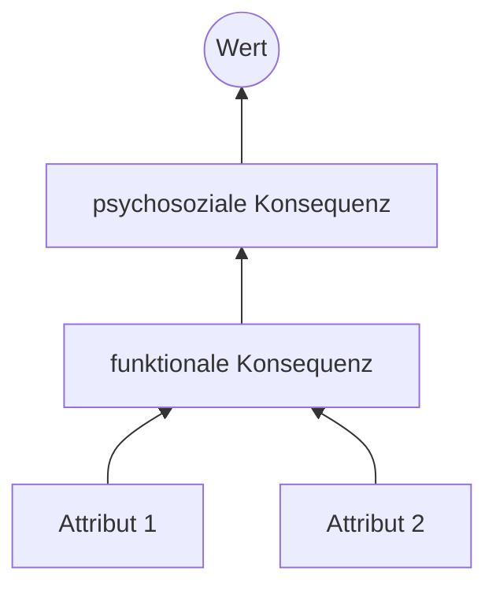

# Methoden & Ausfüllvorlagen – Fallstudie 1

Pro Methode: Ziel · Vorgehen · Vorlage zum Ausfüllen · Hinweis für die Folie.
Die passenden Prompts stehen in [`prompts.md`](prompts.md) (Verweis jeweils als **P-Nummer**).

---

## 0. Markenkompetenz (Desk Research)

**Ziel:** Zentrum des Markensteuerrads – *Wer bin ich?* Herkunft, Historie, Rolle im Markt, Kernkompetenz.

**Quellen:** Unternehmenswebsite (Über uns, Presse), Geschäfts- und Nachhaltigkeitsbericht, Pressemitteilungen,
Fachpresse (z. B. Horizont, W&V, Lebensmittel Zeitung, je nach Branche), Statista, Wikipedia nur als Einstieg.
Prompts: **P1**, **P2**

| Merkmal | Inhalt | Quelle |
|---------|--------|--------|
| Gründung / Herkunft | | |
| Meilensteine (3–5) | | |
| Eigentümer / Konzern | | |
| Kennzahlen (Umsatz, Mitarbeitende, Marktanteil) | | |
| Portfolio & Preisniveau | | |
| Rolle im Markt (Pionier, Herausforderer, Spezialist, Marktführer …) | | |
| Selbstverständnis (Mission, Vision, Werte, Claim) | | |
| **Wettbewerbsset** für das Repertory Grid (5–6 Marken) | W1: · W2: · W3: · W4: · W5: | |

**Folie:** Timeline der Markenhistorie + 3 Kennzahlen + ein Satz zur Marktrolle.

---

## 1. Brand Persona

**Ziel:** Eine realistische, datengestützte Person, die die Kernzielgruppe verkörpert. Sie ist später auch die
Grundlage für die simulierten Befragten (Repertory Grid, Laddering, Analogien).

**Vorgehen**
1. Daten sammeln (**P3**) – jede Zahl mit Quelle, Jahr, Stichprobe.
2. Persona formulieren (**P4**) – jede Angabe als *Daten* oder *Annahme* kennzeichnen.
3. Auf der Limbic Map verorten (**P5**, siehe unten).
4. Bild erzeugen (**P6**) und auf der Folie als KI-generiert kennzeichnen.

**Schritt-für-Schritt-Anleitung mit Zugangswegen (geprüft 15.10.2026):** [`persona-datenerhebung.md`](persona-datenerhebung.md)

**Datenquellen (Deutschland):** Statista (Campuslizenz über die Hochschulbibliothek), VuMA, best for planning (b4p),
ARD/ZDF-Medienstudie, Sinus-Milieus, Destatis, Eurostat, Mediadaten der Plattformen, Geschäftsberichte,
Kundenbewertungen (Google, Trustpilot, Amazon), Kommentare auf den Social-Media-Kanälen der Marke, Google Trends.

| Dimension | Inhalt | Daten / Annahme + Quelle |
|-----------|--------|--------------------------|
| Name, Alter, Zitat | | |
| **Geografie** – Wohnort, Stadt/Land, Region | | |
| **Soziodemografie** – Geschlecht, Bildung, Beruf, Haushaltsnetto, Haushalt | | |
| **Kaufverhalten** – Anlässe, Frequenz, Kanäle, Preissensibilität, Entscheidungskriterien, Markentreue, Infoquellen | | |
| **Mediennutzung** – Plattformen, Nutzungsdauer, Formate, Tageszeiten, Influencer/Medien | | |
| **Psychografie** – Werte, Lebensstil, Interessen, Ziele, Pains & Gains, Einstellung zur Kategorie | | |
| **Limbic Type** | | |

**Folie:** Steckbrief-Layout mit Bild links, fünf Dimensionen als Blöcke, Zitat als Eyecatcher.

### Limbic Map (nach Häusel / Gruppe Nymphenburg)

Drei zentrale Motiv- und Emotionssysteme:

| System | Motive / Emotionen |
|--------|--------------------|
| **Balance** | Sicherheit, Geborgenheit, Harmonie, Tradition, Ordnung |
| **Dominanz** | Status, Macht, Leistung, Durchsetzung, Autonomie |
| **Stimulanz** | Neugier, Abwechslung, Spaß, Kreativität, Individualität |

Mischbereiche: **Abenteuer/Thrill** (Dominanz × Stimulanz), **Disziplin/Kontrolle** (Dominanz × Balance),
**Fantasie/Genuss** (Stimulanz × Balance).

Limbic Types: Traditionalisten · Harmoniser · Offene · Hedonisten · Abenteurer · Performer · Disziplinierte

**Vorgehen:** Persona gewichten (Balance / Dominanz / Stimulanz, Summe 100 %), Limbic Type bestimmen, **zusätzlich die
Marke** auf der Map verorten und den Fit prüfen. Daraus 3 Konsequenzen für Bildwelt, Tonalität und Botschaften ableiten.

| | Balance | Dominanz | Stimulanz | Limbic Type |
|-|---------|----------|-----------|-------------|
| Persona | % | % | % | |
| Marke (Auftritt) | % | % | % | |

**Folie:** Die Limbic-Map-Grafik aus der Vorlesung verwenden, Persona und Marke als zwei Punkte einzeichnen.

---

## 2. Repertory Grid → Markenattribute

**Ziel:** Herausfinden, mit welchen Eigenschaften die Zielgruppe Marken der Kategorie unterscheidet – und wo die
eigene Marke relevant und differenzierend ist. Grundlage: Kelly (1955), Theorie der persönlichen Konstrukte.

**Elemente (7):** eigene Marke **M**, Wettbewerber **W1–W5**, **I** = „meine Idealmarke“

**Triaden** (jedes Element kommt mind. 3-mal vor):

| # | Triade | | # | Triade |
|---|--------|-|---|--------|
| 1 | M – W1 – W2 | | 5 | W2 – W3 – W4 |
| 2 | M – W3 – I | | 6 | M – W4 – I |
| 3 | W1 – W4 – I | | 7 | W1 – W3 – W5 |
| 4 | M – W5 – W2 | | 8 | M – W5 – I |

**Vorgehen**
1. **Konstrukte erheben:** Pro Triade fragen: *„In welcher wichtigen Hinsicht sind sich zwei ähnlich und unterscheiden
   sich von der dritten?“* → bipolares Konstrukt, z. B. *innovativ – traditionell*. 5 simulierte Befragte (**P7**) plus
   3–5 echte Kurzinterviews (Kommiliton:innen aus der Zielgruppe, ca. 10 Min.).
2. **Konsolidieren:** Dubletten zusammenfassen, Häufigkeit zählen → 8–12 Konstrukte.
3. **Raten:** Alle Elemente auf allen Konstrukten bewerten, Skala 1–7 (**P8**). Mittelwerte **selbst** in Excel/Sheets
   rechnen, nicht von der KI.
4. **Auswerten** je Konstrukt:
   - Relevanz = Häufigkeit der Nennung
   - Differenzierung = |M − Ø W1–W5|
   - Ideal-Nähe = |M − I| (klein = gut)
5. **Markenattribute** = Konstrukte mit hoher Relevanz, großer Differenzierung und geringer Ideal-Distanz (3–5 Stück).

| Konstrukt (Pol 1 – Pol 7) | Nennungen | Ø M | Ø W | Ø I | Differenzierung | Ideal-Distanz | Attribut? |
|---------------------------|-----------|-----|-----|-----|-----------------|---------------|-----------|
| | | | | | | | |

**Folie:** Polaritätenprofil (Linien für M, stärksten Wettbewerber, Ideal) – die ausgewählten Attribute farbig markieren.

---

## 3. Laddering → Markennutzen

**Ziel:** Von den Markenattributen über die Konsequenzen bis zu den persönlichen Werten der Zielgruppe gelangen
(Means-End-Chain, Gutman 1982; Reynolds & Gutman 1988).

```
Attribut  →  funktionale Konsequenz  →  psychosoziale Konsequenz  →  Wert
(Eigenschaft)   (sachlich-funktionaler Nutzen)  (psychosozialer Nutzen)   (instrumentell / terminal)
```

**Vorgehen**
1. Startpunkte = die 3–5 Attribute aus dem Repertory Grid.
2. Pro Attribut wiederholt *„Warum ist dir das wichtig?“* fragen, bis ein Wert erreicht ist (**P9**).
   3–5 simulierte Befragte, wenn möglich zusätzlich 2–3 echte.
3. Leitern codieren, Implikationsmatrix erstellen (wie oft führt A direkt zu B), Cut-off wählen (z. B. ≥ 2).
4. **Hierarchical Value Map (HVM)** zeichnen (**P10**).
5. Markennutzen formulieren: sachlich-funktional und psychosozial.

| Leiter | Attribut | Funktionale Konsequenz | Psychosoziale Konsequenz | Wert |
|--------|----------|------------------------|--------------------------|------|
| 1 | | | | |

HVM-Gerüst (Mermaid, rendert u. a. auf GitHub):



**Folie:** HVM als Grafik, rechts daneben die abgeleiteten Markennutzen in zwei Kästen (funktional / psychosozial).

---

## 4. Analogiemethoden → Markentonalität

**Ziel:** Emotionale Markencharakteristika sichtbar machen, die direkte Fragen nicht erfassen. Esch fasst unter
Markentonalität: Markenpersönlichkeit, Markenbeziehung, Markenerlebnisse.

**Vorgehen**
1. **Personifizierung:** *„Wenn die Marke ein Mensch wäre …“* – Alter, Geschlecht, Beruf, Wohnort, Kleidung, Hobbys,
   Sprache, Auto, Verhalten auf einer Party, Beziehung zu Kund:innen (Freund, Mentor, Entertainer, Dienstleister …).
2. **Tier-Analogie:** Welches Tier und warum (3 Gründe)?
3. Dasselbe für 2 Wettbewerber → Kontrast macht die Eigenart sichtbar.
4. KI-Ergebnis (**P11**) mit den Antworten aus der Gruppe und 3–5 Personen vergleichen.
5. 4–5 Persönlichkeitsmerkmale und die dominanten Markenemotionen ableiten; optional den Dimensionen der Brand
   Personality Scale nach Aaker (1997) zuordnen (Aufrichtigkeit, Spannung, Kompetenz, Kultiviertheit, Robustheit).

| Analogie | Marke M | W1 | W2 |
|----------|---------|----|----|
| Mensch (Kurzprofil) | | | |
| Tier + Begründung | | | |
| Beziehung zu Kund:innen | | | |

| Markentonalität M | |
|-------------------|-|
| Persönlichkeit (4–5 Adjektive) | |
| Markenemotionen | |
| Markenbeziehung | |
| Markenerlebnisse | |

**Folie:** Zwei Bildkacheln (Mensch, Tier) mit je 3 Stichworten, darunter die abgeleitete Tonalität.

---

## 5. Kommunikationsanalyse → Markenbild

**Ziel:** Beschreiben, *wie die Marke tatsächlich auftritt*, und prüfen, ob der Auftritt zur Tonalität und zum Nutzen
passt. Hier entstehen die Lücken, aus denen ihr Empfehlungen ableitet.

**Vorgehen**
1. Pro Kanal (Instagram, Facebook, YouTube) die letzten 15–20 Beiträge erfassen (Screenshots, Datum notieren).
2. Kennzahlen notieren; Engagement-Rate selbst berechnen:
   `(Likes + Kommentare) / Follower × 100`, gemittelt über die erfassten Posts.
3. Posts nach Raster codieren (**P12** mit Screenshots).
4. Corporate Design und Schlüsselbilder beschreiben (Begriff Schlüsselbild nach Kroeber-Riel: wiederkehrendes,
   inhaltlich prägendes Bildmotiv der Marke).
5. **Meta-Werbebibliothek** (facebook.com/ads/library) prüfen – zeigt aktuell laufende Anzeigen der Marke.
6. Bewerten: Passt das Markenbild zur Tonalität und zur Persona (Limbic Map)? Wo gibt es Brüche zwischen den Kanälen?

| Kanal | Follower | Posts/Woche | Hauptformate | Ø Engagement-Rate | Themen-Cluster |
|-------|----------|-------------|--------------|-------------------|----------------|
| Instagram | | | | | |
| Facebook | | | | | |
| YouTube | | | | | |

| Corporate Design | Beschreibung |
|------------------|--------------|
| Logo (Wort-/Bildmarke, Entwicklung) | |
| Farben (HEX) | |
| Typografie | |
| Slogan / Claim | |
| Schlüsselbilder | |
| Bildwelt (Motive, Personen, Settings, Licht) | |
| Tonalität der Texte (Du/Sie, Humor, Emojis) | |
| Akustische Elemente (Jingle, Sound-Logo) | |

| Fit-Bewertung | Passt | Bruch / Lücke |
|---------------|-------|---------------|
| Markenbild ↔ Markentonalität | | |
| Markenbild ↔ Persona / Limbic Type | | |
| Konsistenz über die Kanäle | | |

**Folie:** Collage typischer Posts + Farbpalette + Logo/Claim; rechts drei Bewertungspunkte (✓ / ✗).

---

## 6. Markensteuerrad (Synthese)

Je Feld 3–5 prägnante Stichworte. Hinter jedes Stichwort ein Kürzel der Quelle: **DR** Desk Research · **RG**
Repertory Grid · **LA** Laddering · **AN** Analogien · **KA** Kommunikationsanalyse · **LM** Limbic Map.
Prompt: **P13**

| Feld | Leitfrage | Inhalt |
|------|-----------|--------|
| **Markenkompetenz** (Zentrum) | Wer bin ich? | |
| **Markenattribute** | Über welche Eigenschaften verfüge ich? | |
| **Markennutzen** | Was biete ich an? | |
| **Markentonalität** | Wie bin ich? | |
| **Markenbild** | Wie trete ich auf? | |

**Markenkern in einem Satz:** _…_

**Konsistenzprüfung:** Passen Attribute ↔ Nutzen ↔ Tonalität ↔ Bild zusammen? Widersprüche sind kein Fehler, sondern
der Ausgangspunkt für die Empfehlungen.

**Empfehlungen (2–3):** Was genau, auf welchem Kanal, warum (mit Verweis auf die Analyse).

---

## Literatur

- Esch, F.-R.: *Strategie und Technik der Markenführung*. München: Vahlen (aktuelle Auflage).
- Häusel, H.-G.: *Think Limbic!* bzw. *Brain View*. Freiburg: Haufe. Limbic® Map ist eine Marke der Gruppe Nymphenburg.
- Kelly, G. A. (1955): *The Psychology of Personal Constructs*. New York: Norton.
- Gutman, J. (1982): A Means-End Chain Model Based on Consumer Categorization Processes. *Journal of Marketing*, 46(2), 60–72.
- Reynolds, T. J. & Gutman, J. (1988): Laddering Theory, Method, Analysis, and Interpretation. *Journal of Advertising Research*, 28(1), 11–31.
- Aaker, J. L. (1997): Dimensions of Brand Personality. *Journal of Marketing Research*, 34(3), 347–356.
- Kroeber-Riel, W. (1993): *Bildkommunikation*. München: Vahlen.

Für die Präsentation zusätzlich die Vorlesungsfolien als Quelle angeben – die Bewertung fragt nach *Inhalten aus der Vorlesung*.
