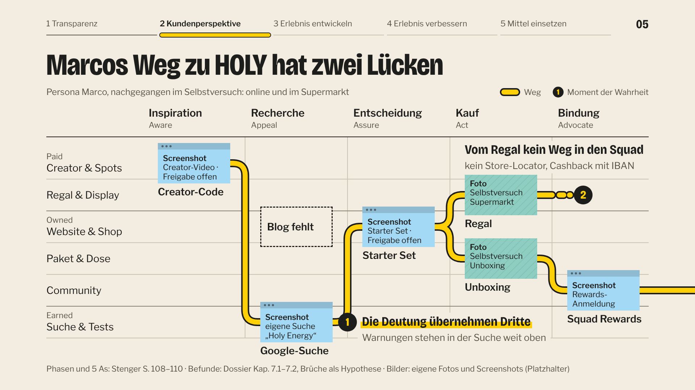
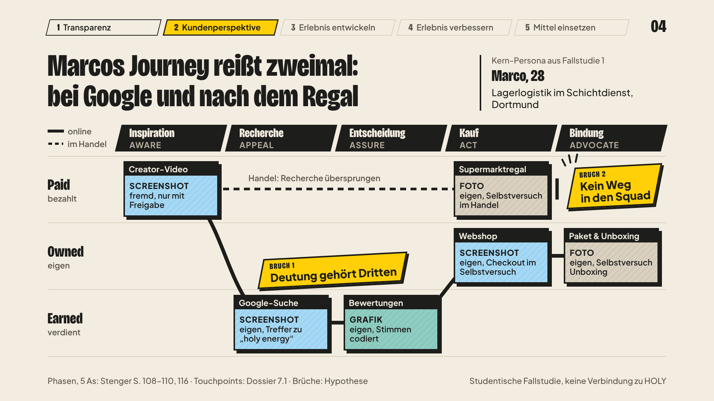
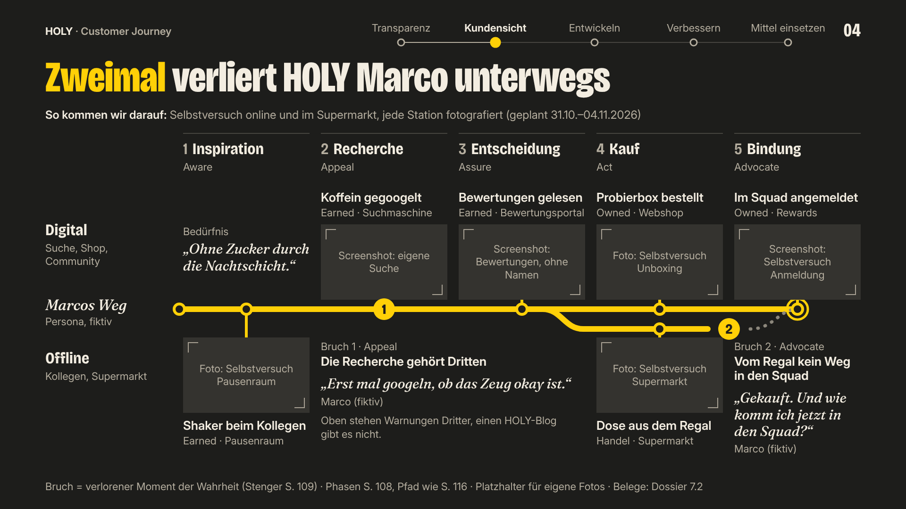

<!-- Erzeugt am 30.10.2026 im Workflow zu Fallstudie 2 (KI-Nachweis FS2, Eintrag 04 / Delegation D02), nach den
Urteilen zweier Jurys über drei Gestaltungsrichtungen. KI-gestützt erstellt, Prüfung durch die Gruppe offen.
Klicks, Sollzeiten, Jury-Punkte und Kontraste sind per Skript nachgerechnet (Abschnitt 14.4).
Die Korrekturen der Schlussprüfung vom 30.10.2026 sind danach eingearbeitet und in Abschnitt 15 aufgeführt.
Am 03.11.2026 nach der Aufgabenfolie (A1–A7) und den Entscheidungen von Yannick umgebaut (Workflow „fs2-bau“,
KI-Nachweis FS2, Eintrag 11 / Delegation D05); Klicks und Sollzeiten erneut per Skript nachgerechnet (14.4).
Am 03.11.2026 abends nach der Abnahme von D05 korrigiert (Ü1 „wackelt“, Logo-Freigabe, Veröffentlichung, X-IDs,
Schrift-Ausnahme 3.4; KI-Nachweis FS2 Eintrag 11).
Am 03.11.2026 spät nach der Abnahme von D07 (Delegation D08): Veröffentlichung der Fremdbilder als bewusste Abweichung
ohne Genehmigung der Rechteinhaber vermerkt (0 Nr. 4, 1.1 R3, 1.2, 4 mit b05, b08, b14, b21, v01, 7.3, 7.4, 9.5, 11.2,
11.5, 12 M8, 13.1 Nr. 9 und 11, 13.2 Nr. 16, 13.3). -->

Modul Unternehmenskommunikation · Prof. Dr. Daniel Stenger · Hochschule Kaiserslautern

# Gestaltungsplan – Präsentation Fallstudie 2 „Customer Journey“

HOLY · Persona Marco (FS1) · Präsentation **Di, 10.11.2026**, 15 Minuten · Stand Di, 03.11.2026 · Umbau nach der
Aufgabenfolie · **Entwurf, Prüfung durch die Gruppe offen**

> **Änderungsvermerk (Stand 03.11.2026).** Umgebaut nach der Aufgabenfolie vom 03.11.2026 (A1–A7, Wortlaut in
> [`README.md`](README.md)) und den Entscheidungen von Yannick vom selben Tag: (1) zentraler Weg = Online-Weg laut
> Persona, Handel als gestrichelter Nebenweg; (2) neuer Folienplan mit neun Hauptfolien (alte Folie 02 „Vorgehen“
> entfällt, neu: 05 Überleitungen, 07 Best Practice → Maßnahme, 08 Konzept-Webseite); (3) kein Blog-Beitrag mehr,
> der „Koffein-Check“ bleibt als Seite der Konzept-Webseite; (4) Vortrag Di 10.11., Änderungsstopp Mo 09.11., 20:00.
> Geändert: 0, 1.1 (R1–R5), 1.2, 1.3, 2, 3 (Folienbezüge; neu in 3.6: Wegbeschriftung, Brücke), 4 (Folienbezüge,
> b02, b07, b12–b15, neu b20/b21), 5.1–5.3 (neu), 6 (Journey-Map jetzt Folie 04, neu 6.7 Überleitungen), 7 (neu:
> Konzept-Webseite und Mock-ups), 8.1 (neu: Bewertungszeile je Phase), 9.1–9.5 (Folienbezüge, Zeit), 10, 11.2–11.5,
> 12, 13, 14.1, 14.3, 14.4. Abschnitt 15 bleibt als Stand vom 30.10.2026.

**KI-gestützt erstellt.** Grundlage sind drei Gestaltungsentwürfe, zwei Jury-Urteile und das Recherche-Dossier
[`recherche-customer-journey.md`](recherche-customer-journey.md) (kurz: „Dossier“). Fakten über HOLY stehen nur mit
Befund-ID und Status aus dem Dossier (✔ bestätigt · ✎ korrigiert · ~ unsicher · **H** Hypothese). „Vorl. S. n“ =
Vorlesung Prof. Stenger, Seite n. Literatur hinter den Vorlesungsseiten ist nur „zitiert nach Stenger“. Rechtliche
Einordnungen sind Einschätzungen von Studierenden und **keine Rechtsberatung**. **Für Fallstudie 2 ist noch nichts
verteilt:** Dieser Plan ordnet keiner Person Aufgaben zu; wer was übernimmt, legt die Gruppe fest.

**Inhalt**

0. Kurzfassung
1. Die Regeln für FS2 und wie der Plan sie umsetzt
2. Antwort auf jeden Kommentar von Prof. Stenger
3. Leitidee und Gestaltungssystem
4. Bildplan
5. Folienplan (5.2: Top 3 je Phase im SOLL)
6. Herzstück: die Journey-Map (Folie 04) und die vier Überleitungen im IST (Folie 05, Abschnitt 6.7)
7. Konzept-Webseite und Mock-ups (Folie 08)
8. Moodboard und IST-Bewertung (Folie 03)
9. Interaktion und Vortrag
10. Zeitkonzept und Generalproben
11. Technik und Prüfung
12. Meilensteine bis Di, 10.11.2026
13. Offene Entscheidungen und Fragen an Prof. Stenger
14. Herkunft
15. Korrekturen aus der Schlussprüfung (30.10.2026)

---

## 0 Kurzfassung

1. **Gliederung = Aufgabenfolie vom 03.11.2026** (A1–A7, [`README.md`](README.md)); den Prozess von S. 111 trägt die
   Laufleiste. Gestaltet wird weiter in der Richtung **„Der Journey-Pfad – Editorial mit Bildern“**, die beide Jurys
   auf Platz 1 setzen (Jury „Bewertung nach Prof. Stenger“, simuliert: 8,60 nachgerechnet, laut Jury 8,65; Jury
   „Machbarkeit“: 7,6), mit den Pflicht-Übernahmen aus Markenwelt und Reise: gelbe Vollflächen (jetzt 01, 08, 09),
   echte Fotos mit 4-px-Kontur, Farbproben, Handzeichen-Trichter mit der echten Dose, Herleitungszeile „So kommen wir
   darauf: …“, Bildunterschriften als Protokoll, Raster von S. 129 auf Folie 06, Zeitwächter mit Kürzungsplan.
2. **Zentraler Weg (IST) = Marcos Online-Weg** (Entscheidung 03.11.; Persona: „HOLY online, 50er-Pulverdose auf
   Vorrat; im Notfall … Rewe oder Edeka“, `persona-steckbrief.md`, fiktiv): Creator-Video mit Code → eigene Suche →
   Produktseite/Shop → Starter Set online, Lieferung/Unboxing → SQUAD Rewards. Der Handel ist ein gestrichelter
   Nebenweg. Die vier Überleitungen bewerten wir vorläufig mit **trägt · bricht · wackelt · wackelt**; am
   Übergang vom Nachlesen zum Entscheiden bricht der Weg (HOLY antwortet knapp, verstreut und oft nur als Bild). Vom
   Regal in den Squad bricht der Nebenweg (6.7).
3. **SOLL: Top 3 je Phase** aus Persona und Dossier (5.2); Platz 1 je Phase bildet den gelben „Zentraler Weg (SOLL)“:
   Creator-Kurzvideo mit Code und klarer Weiterleitung · eigene Antwortseite „Koffein-Check“ · Produktseite mit Preis je
   Portion, Bewertungen und einheitlicher Garantie · mobiler Warenkorb/Checkout mit klarer Lieferzeit · Willkommens-
   und Nachkauf-Strecke mit SQUAD Rewards. Je Phase ein Vorbild aus einer anderen Branche → Maßnahme (Folie 07; die
   Fälle stehen im Dossier Kap. 7a, X01–X17; auf Folie 07: X01, X04, X08, X12, X14, Nebenweg X16).
4. **Mock-ups = eigene HOLY-Webseite als Konzept** (`konzept-website/`, eine Seite je Top-Touchpoint, gekennzeichnet
   als studentisches Konzept, `noindex`, HOLY-Wortmarke nur im Kopf (Freigabe 03.11.), keine Bestellung möglich; seit
   03.11.2026 in der Fassung mit Bildern mit HOLY-Produktbildern – Veröffentlichung von der Gruppe beschlossen,
   KI-Nachweis FS2 Nr. 17, keine Genehmigung der Rechteinhaber eingeholt, 7.3), auf Folie 08 als Strecke
   in Handyrahmen und live zeigbar (Abschnitt 7). Ein Blog-Beitrag wird nicht mehr verlangt; der „Koffein-Check“ bleibt
   als Seite der Konzept-Webseite.
5. **Neun Hauptfolien, 23 Klicks, 11:50 Sollzeit plus 0:40 Reserve = 12:30**, mit der Videobotschaft des Gründers am
   Schluss (9.5). Jede Bildkachel hat einen Rückfall, Fakten stehen nur mit Dossier-Status auf den Folien. Termine:
   Bildschluss Do 05.11., Datenschluss Fr 06.11., Generalproben Sa 07.11. und Mo 09.11., **Änderungsstopp Mo 09.11.,
   20:00**, Beamer-Test und Vortrag **Di 10.11.**

---

## 1 Die Regeln für FS2 und wie der Plan sie umsetzt

### 1.1 Festgelegte Regeln R1–R5

Herkunft aller fünf: Plan vom 27.10.2026, aus Stengers Kritik an FS1 abgeleitet (`ki-nachweis/ki-nachweis-fallstudie-2.md`,
Eintrag 01).

| Regel | Umsetzung im Plan | Abweichung (begründet) |
|---|---|---|
| **R1 Sofort klären:** Mail an Prof. Stenger, Bildfreigaben bei pr@holy.com und beim Gründer | Mail mit den Fragen vom 30.10. (ob versendet, trägt die Gruppe ein); seit der Aufgabenfolie vom 03.11. eine Mail heute mit den neuen Fragen aus 13.2 (SOLL-Touchpoints neu? Konzept-Webseite als Mockups? „branchenübergreifend“? Übung S. 128/129 weiter erwartet?), Antwort erbeten bis **Do 05.11.**; Freigabe-Mail an pr@holy.com (nur Funktionsadresse, Dossier 12.3); der Gründer hat am 02.11. mit einer Videobotschaft geantwortet (v01, 9.5). Jede Bildkachel kennt drei Zustände: frei · Freigabe offen · Rückfall (Abschnitt 4) | keine |
| **R2 Echtes Material statt KI** | Selbstversuch online und im Handel, jede Station fotografiert, Protokoll mit Datum, Ort, Kanal (Backup B1), **dazu ein Übergangsprotokoll für die vier Überleitungen des zentralen Wegs** (6.7: Anschluss? Wechsel von Medium oder Gerät? Klicks? stimmen Preis, Lieferzeit und Alter überein?); eigene Produktfotos; 5 offene Kurzinterviews (mindestens 3), anonym, mit Einwilligung, mit der Frage „Wo zuerst gesehen, wo informiert, wo gekauft?“; 20–30 Bewertungen plus kritische, von zwei Personen nach K1–K11 codiert (Dossier 12.4, **H** B36). Keine KI-Bilder, keine KI-simulierte Befragung | Persona Marco bleibt die fiktive Kern-Persona aus FS1 und ist so gekennzeichnet. Ihre KI-gestützte Illustration erscheint nur in B7. Die Bewertungs-Stichproben im Dossier (A–E) stammen von einem Recherche-Agenten (~ B20–B24) und erscheinen höchstens im Backup, bis die eigene Codierung vorliegt. Die Urteile zu den Überleitungen (6.7) sind bis zum Selbstversuch vorläufig |
| **R3 Gestaltung:** HOLY-Farben, ein Bild je Folie, Journey-Map mit Bildern wie S. 116, Moodboard, **optimierte Touchpoints als Mock-ups und Konzept-Webseite** (vorher: Blog als Mock-up), weniger Fußnoten | Gelb #FFD007, Schwarz #1D1D1B, Creme #F3EDE1 unverdünnt, **kein Ocker** (Ursache in FS1: Deckelung in `tokens.css`, ✔ G13). Je Hauptfolie ein großes eigenes Bild; Journey-Map mit Bildkacheln (Folie 04); Moodboard (03); Mock-ups der optimierten Touchpoints als eigene Konzept-Webseite, auf Folie 08 als Strecke in Handyrahmen (Abschnitt 7). Je Folie **eine** Quellzeile (22 px), alle Einzelbelege in B8 | Journey-Map und Moodboard sind Bildwände mit mehreren Bildern: gewollt, so zeigt es Stenger auf S. 116 (✔ L15). Gelb nie als Schrift oder Linie auf Creme (1,26 : 1, ✔ G12). #1D1D1B ist HOLYs Logo- und Druck-Schwarz, im Web steht #000000 (✔ G07, ✎ G06); wir bleiben bei #1D1D1B wie in R3 festgelegt (Entscheidung 13.1 Nr. 4). Die Konzept-Webseite zeigte bis 03.11.2026 keine Fotos, nur eigene Zeichnungen und Platzhalter; seit 03.11.2026 zeigt sie in der Fassung mit Bildern auch HOLY-Produktbilder (7.3) |
| **R4 Inhalt nach Aufgabenfolie A1–A7 (03.11.2026) und Prozess S. 111, Herleitungen sichtbar** (vorher: S. 111 und Übung S. 128/129) | **Gliederung = A1–A7:** 03 = A1 IST-Analyse, 04 = A2 zentraler Weg (IST), 05 = A3 Überleitungen, 06 = A4 Top 3 je Phase und zentraler Weg (SOLL), 07 = A5 Best Practices + A6 Maßnahmen, 08 = A7 Mockups, 09 = Fazit und Messung. **Laufleiste S. 111** auf jeder Inhaltsfolie: 03 = Schritt 1, 04/05 = Schritt 2, 06 = Schritt 3, 07/08 = Schritt 4, 09 = Schritt 5; auf 02 (Persona) ohne aktiven Schritt (5.1). Herleitungen: Zeile „So kommen wir darauf: …“ unter jedem Titel, Belegzeile an jeder Überleitung, Kriterienzeile auf 06 (Persona · Zielfrage S. 109 · Bruch im IST · von HOLY gestaltbar), Auswahlkriterien der Vorbilder auf 07, Workshop-Foto | Die Übung S. 128/129 (Top 2, 20 Aktivitäten) ist nicht mehr Gliederung, sondern Backup B2 (5.2.3); A4 verlangt Top 3. Folie 02 trägt keinen Schritt, weil die Persona der Blickwinkel für alle fünf Schritte ist; so springt die Laufleiste nicht von 2 auf 1 zurück. Die Zeilen der Journey-Map (04) sind gegenüber S. 129 verdichtet; die Zuordnung steht in 6.3 und B8 |
| **R5 Zeit:** ≤ 9 Hauptfolien, ≤ 25 Klicks, 12:30 Soll, Zeitwächter, zwei Generalproben, Änderungsstopp, Position neben der Leinwand | 9 Hauptfolien · 23 Klicks (Schritte + Folienwechsel, Zählweise wie FS1) · Soll 11:50 + 0:40 Reserve = 12:30 · Referentenuhr der FS1-Engine plus eine Person als Zeitwächter · Leseprobe Do 05.11., Generalproben Sa 07.11. und Mo 09.11. · Änderungsstopp Mo 09.11., 20:00 · sprechende Person links neben der Leinwand, Pfad läuft von links nach rechts · Live-Demo der Konzept-Webseite nur aus der Reserve (7.4) | keine |

### 1.2 Bestehende Gruppenregeln

| Regel | Herkunft | Umsetzung im Plan | Abweichung (begründet) |
|---|---|---|---|
| Fakten über HOLY nur mit Quelle und Faktenstatus; keine Zahlen ohne Quelle | `CLAUDE.md` (Abschnitt Marke) | Jede Quellzeile nennt Dossier-IDs mit Symbol; die beiden Lücken sind als Hypothese markiert; eigene Zählungen stehen bis zur Erhebung als „n = …“ | keine |
| Social-Media-Bilder und Screenshots von HOLY-Social-Media nur nach Zustimmung des Betreuers | FS1 `praesentation/QUELLEN.md` §4; `kommunikationsanalyse.md` | Kachel „Creator-Video“ nur mit Zustimmung; sonst eigene Grafik mit Kanal, Datum, Beschreibung (so geplant; seit 03.11.2026 abweichend, siehe rechts) | **Abweichung (Stand 03.11.2026):** Die Fassung mit Bildern zeigt das Vorschaubild eines Creator-Shorts (YouTube, Kanal nonstopniels; Kachel „Creator-Video“ auf 03, 04, 05, 09; `praesentation/fremdbilder/register.js`, Schlüssel `m03-creator`, `k1-creator-…`) öffentlich im Repository und auf GitHub Pages – Beschluss der Gruppe (KI-Nachweis FS2 Nr. 17); keine Zustimmung des Betreuers und keine Genehmigung der Rechteinhaber eingeholt; bewusste Abweichung von dieser Regel und von der eigenen Einschätzung (✎ G21, **H**); keine Rechtsberatung. Frage an Prof. Stenger: 13.2 Nr. 6 |
| Keine HOLY-Produktfotos aus fremden Quellen ohne Freigabe | FS1 `QUELLEN.md` §4 (dort noch strenger: „Keine Produktfotos oder Social-Media-Bilder von HOLY“) | Nur eigene Fotos selbst gekaufter Ware. Shop- und Rewards-Screenshots zeigen HOLY-Produktfotos: im Hörsaal nur als Bildzitat mit Belegfunktion nach Stengers Antwort, öffentlich nur mit HOLY-Freigabe, sonst nachgezeichnetes Wireframe (**H** G32, ✔ G23) – so geplant; seit 03.11.2026 abweichend, siehe rechts | Eigene Produktfotos sind in FS2 ausdrücklich gewollt (R2, R3). Ob Fotos mit **sichtbarer Verpackung** in öffentliche Exporte dürfen, ist offen (**H** G24) – die Gruppe legt heute eine Regel fest (13.1 Nr. 3). **Screenshots mit HOLY-Produktfotos** weichen von der Regel ab: nur im Hörsaal als Bildzitat nach Stengers Antwort; öffentlich nur mit Freigabe von HOLY (Einschätzung, keine Rechtsberatung). **Abweichung davon (Stand 03.11.2026):** HOLY-Produkt- und Werbebilder, Community-Fotos sowie Shop- und Rewards-Screenshots stehen in der Fassung mit Bildern öffentlich im Repository und auf GitHub Pages (Präsentation 01–05, 08, 09; Konzept-Webseite) – Beschluss der Gruppe (KI-Nachweis FS2 Nr. 17); keine Genehmigung von HOLY bzw. der Rechteinhaber, keine Zustimmung des Betreuers eingeholt; bewusste Abweichung von dieser Regel und von der eigenen Einschätzung (✎ G21, **H**); keine Rechtsberatung |
| Keine personenbezogenen Daten übernehmen oder in KI-Werkzeuge geben | KI-Richtlinie der HSKL Nr. 6 (`fallstudie-1-brand-persona/arbeitsplan.md` Z. 105) | Bon, Paketaufkleber, Rewards-Konto, Cashback-Formular schwärzen, bevor eine Datei in den Gruppenordner oder ins Repository geht; echte Fotos und Screenshots gehen gar nicht in KI-Werkzeuge (Arbeitsweise in Abschnitt 4, Regeln für alle Fotos); keine Gesichter, nur Hände; Bewertungen nur sinngemäß oder kurz und anonym; Rohdaten mit Vornamen nicht ins Repository (Dossier 5.3) | keine |
| KI-Simuliertes als „KI-simuliert“ kennzeichnen | FS1-Praxis, Workflow-Vorgabe | Keine simulierte Befragung geplant | keine |
| KI-Bilder kennzeichnen („Bild KI-generiert (Tool)“) | `prompts.md` Z. 113, `methoden.md` Z. 55 (laut **H** G31) | Keine KI-Bilder geplant. Die FS1-Illustration „Marco“ nur in B7, mit der Kennzeichnung aus FS1 `QUELLEN.md` §4 (Zeile `persona-marco.svg`): „Illustration: eigene Gestaltung, KI-gestützt (Claude Code), 19.10.2026 – als SVG-Code erzeugt; fiktive Person, kein Foto“ | Wortlaut wie in FS1 statt „Bild KI-generiert (Tool)“: Werkzeug und Datum stehen dabei, „als SVG-Code erzeugt“ sagt genauer, was die KI gemacht hat; keine Modellbezeichnung |
| Jede KI-Nutzung dokumentieren | `CLAUDE.md` (Pflicht: KI-Nachweis) | Einträge in `ki-nachweis-fallstudie-2.md`; Auszug in B9 | keine |
| Statista-Werte nur wie in `persona-daten.md` | Gruppenregel; ✔ P94 | Folie 02 nutzt nur „YouTube 73 %, Instagram 71 %, TikTok 58 % (Ø 63/58/41 %), Statista CI 2025“ (`persona-daten.md` Z. 25), Kategorie Energy Drinks, nicht HOLY | keine |
| Selbst gebaute Web-Präsentation mit der FS1-Engine | `CLAUDE.md`; FS1 `LIESMICH.md` | Abschnitt 11 | keine |
| Ansprache des Publikums mit „Sie“ | FS1 `LIESMICH.md` §8 (`anrede`) | Alle Folien und Sprechtexte siezen | Die Konzept-Webseite duzt, weil sie HOLYs Stimme zeigt (Ton „frech im Rahmen, nüchtern im Kern“, **H** M32; HOLYs Tonregel für Agenten ✔ M90); jede Seite ist als studentisches Konzept gekennzeichnet (7.3) |
| Repository ist öffentlich | `CLAUDE.md`, FS1 `QUELLEN.md` §4; Startseite `index.html` („Gehostet bei GitHub Pages“) | Jeder Push veröffentlicht sofort (GitHub Pages; Commit und Push nach jedem Arbeitsschritt laut `CLAUDE.md`; `.gitignore` schließt seit 02.11. `praesentation/intern/` aus). Deshalb: Fußhinweis „Studentische Fallstudie, keine Verbindung zu HOLY“ auf jeder Folie (seit 03.11.2026 „nicht im Auftrag von HOLY“); keine HOLY-Logos (Ausnahme seit 03.11.2026: gelbes Oval auf 01 und 09, 3.7); ungesichtete eigene Fotos, Rohdownloads und zurückgehaltene Bilder liegen nur im Gruppenordner oder in `praesentation/intern/`, ins Repository kommen nur Rückfälle und Bilder, deren Veröffentlichung die Gruppe beschlossen hat; vor jedem Push `git status` prüfen (11.5). Der Schalter `data-status` ändert nur die Anzeige und hält nichts zurück. **Konzept-Webseite** (`konzept-website/`): bis 03.11.2026 nur eigene Gestaltung, keine fremden Bilder; seit 03.11.2026 in der Fassung mit Bildern mit HOLY-Produktbildern (7.3); jede Seite mit nicht ausblendbarem Hinweisbalken, `noindex`, ohne Bestellmöglichkeit (7.3). Sie ist seit dem Push vom 03.11.2026 über GitHub Pages erreichbar, bevor Stenger geantwortet hat (13.1 Nr. 9, 13.2 Nr. 16). **Seit 03.11.2026:** die ausgewählten Fremdbilder (`praesentation/fremdbilder/`, `konzept-website/fremdbilder/`) sind veröffentlicht – Beschluss der Gruppe (KI-Nachweis FS2 Nr. 17, Yannick: „Du darfst die Sachen online auf github posten für die online pages ich erlaube es dir“); eine Genehmigung der Rechteinhaber (HOLY Softdrinks GmbH, Lebensmittel Zeitung, YouTube, Trustpilot, Apple, OTTO, zooplus, Philips, P&G, Urheber der Community-Fotos) wurde **nicht** eingeholt. Das Gründer-Video (`praesentation/video/`) mit Zustimmung des Gründers, auch öffentlich online (laut Yannick, Nr. 18); das HOLY-Logo mit Einverständnis (Nr. 12). Nicht kommerziell, für die Lehrveranstaltung, mit Bildnachweis; keine eigenen Fotos der Gruppe. `praesentation/intern/` enthält nur noch Rohmaterial und zurückgehaltene Bilder (ausgeschlossen) | Die Konzept-Webseite trägt den Namen HOLY als schlichten Text und zeigt Preise und Produktdaten aus dem Dossier; damit sie nicht als HOLY-Seite durchgeht, gelten die Kennzeichnungsregeln in 7.3 (Einschätzung, keine Rechtsberatung). **Fremdbilder (Stand 03.11.2026):** bewusste Abweichung von der eigenen Einschätzung (Abschnitt 4, ✎ G21, **H**), Einzelheiten in den Zeilen „Social-Media-Bilder“ und „Keine HOLY-Produktfotos“ oben; keine Rechtsberatung |
| Keine Bezeichnungen von KI-Modellen in Dateien | Workflow-Vorgabe | Auf Folien und in Dateien „KI-gestützt“; wo die Gruppenregel das Werkzeug verlangt (KI-Bilder), steht der Werkzeugname wie in FS1, nie eine Modellbezeichnung | keine |

### 1.3 Prinzipien aus „Der rote Faden“ (Vorschlag, geprüft)

Herkunft: Neugestaltung vom 29.10.2026 für ein anderes Modul (Kopf von `css/folien/recap.css`, `marke.js` der
Recap-Präsentation). Das Dossier rät: Methode übernehmen, Vokabular an HOLY anpassen (**H** G14).

| Prinzip | Umsetzung | Abweichung (begründet) |
|---|---|---|
| Ein durchgehendes Leitmotiv | **Der Journey-Pfad**: auf der Titelfolie Startstrich, in der Laufleiste die fünf Schritte (S. 111), auf 04 Marcos „Zentraler Weg (IST)“ mit gestricheltem Nebenweg Handel, auf 05 seine vier Überleitungen (trägt · wackelt · bricht), auf 06 der gelbe „Zentraler Weg (SOLL)“ durch die Top-Touchpoints, auf 08 die Strecke der Konzept-Webseite, auf 09 geschlossen von Rand zu Rand | keine; der Pfad trägt Inhalt (IST → Überleitungen → SOLL), er ist kein Schmuck |
| Je Folie genau **eine** Schlüsselaussage in der Akzentfarbe | Gelbe Marker-Fläche unter schwarzer Schrift (11,48 : 1); auf gelben Bühnen umgekehrt: schwarzes Band, gelbe Schrift | Die Akzentfarbe ist eine Fläche, keine Schriftfarbe: Gelb auf Creme hat nur 1,26 : 1 |
| Magazin-Disziplin: Satz-Titel, Weißraum, asymmetrisches 12er-Raster, keine Kästen, keine Pillen, keine Versalien | Übernommen: Satz-Titel als Kernaussage, Raster wie recap.css §2d, keine Karten, Pillen, Icon-Abzeichen, Kicker | (a) Bildkacheln tragen eine 4-px-Kontur: ein Bildrahmen, kein Textkasten, abgeleitet von HOLYs schwarzen Konturen (✎ G10). (b) Die gestrichelte Leerstelle „Antwortseite fehlt“ (04) ist Inhalt. (c) Versalien nur für „HOLY“ und die 5 As, so wie sie auf S. 109 stehen (AWARE … ADVOCATE). (d) Harter Versatzschatten nur an den Mock-up-Rahmen (08) und am Titelfoto (01), nie an Text |
| Geprüfte Kontraste (Text ≥ 4,5 : 1, Grafik ≥ 3 : 1, hell und dunkel) | Alle Paare per Skript nachgerechnet (3.3); zwei Paare fallen durch und sind deshalb verboten | keine |
| Bühne 1920 × 1080 | FS1-Engine (unverändert) | keine |
| Automatische Prüfung mit `werkzeuge/pruefen.mjs`, Wortbudget rund 40 | `pruefen.mjs` ist in FS1 und Recap zeilengleich und läuft unverändert (Abschnitt 11.3). Herleitungs-, Quell- und Fußzeile tragen `data-meta` | Folie 03 (rund 50 Wörter, Bewertungszeile je Phase), 04 (rund 60), 05 (rund 80, vier Urteile mit Belegzeile), 06 (rund 90, 15 Touchpoints) und 07 (rund 80, fünf Zeilen Vorbild → Maßnahme) liegen über dem Budget. Alle bauen sich in Schritten auf, je Schritt höchstens rund 30 neue Wörter; die Warnung von `pruefen.mjs` wird in `LIESMICH.md` als bewusste Ausnahme vermerkt |
| *Nicht übernommen* | – | Die Bildlosigkeit („keine Logos, keine fremden Bilder“, alles SVG) und die kühle Palette Kreide/Karmin: beides wäre wieder nüchtern und widerspräche R3 |

---

## 2 Antwort auf jeden Kommentar von Prof. Stenger

Kommentare im Wortlaut aus der FS1-Bewertung; „[...]“ wie im Bewertungsbogen.

| # | Kriterium (Punkte) | Kommentar | Maßnahme in FS2 | Folie |
|---|---|---|---|---|
| 1 | Problemverständnis (9/10) | „Problem der Fallstudie gut verstanden und strukturiert angegangen.“ | Beibehalten und geschärft: Gliederung nach der Aufgabenfolie A1–A7 (je Folie eine Teilaufgabe, 5.1), Stengers Prozess (S. 111) als Laufleiste; die eigene Folie „Vorgehen“ entfällt, die Methode steht in Laufleiste und Herleitungszeilen | alle |
| 2 | Modelle (8/10) | „Persona Modell gut angewendet.“ | Marco bleibt Blickwinkel (**H** P35); aus seinem Kaufverhalten leiten wir den zentralen Weg ab (online auf Vorrat, `persona-steckbrief.md`) und aus der Persona die Top 3 je Phase (A4, 5.2) | 02, 04, 06 |
| 3 | Modelle | „Detaillierte Analyse zur Mediennutzung, Markennutzung, etc. wäre hilfreich.“ | Eigene Hauptfolie: Statista-Werte nur aus `persona-daten.md`, dazu ARD/ZDF 2026 für 14- bis 29-Jährige (✔ P11, ✔ P18); Markennutzung aus Selbstversuch und Kurzinterviews; Mediennutzung je Phase in B7; Persona und Mediennutzung sind sichtbares Kriterium auf 06 (wie Persona Kathrin, S. 128, ✔ P01) | 02, 06, B7 |
| 4 | Modelle | „Limbic Map - Match zwischen Marke und Holy muss passen, sonst ist die Persona nicht richtig.“ | HOLY als Territorium zeigen, Marco liegt darin (wie S. 71, **H** P07); ein Satz auf 02, Herleitung in B7. Was „Marke und Holy“ meint, fragen wir nach (13.2 Nr. 5; **H** P06) | 02, B7 |
| 5 | Modelle | „Repertory Grid nicht ganz korrekt angewendet.“ | Jedes Modell genau wie auf der Vorlesungsseite und mit Seitenzahl: Phasen S. 108, 5 As S. 109 (Versalien wie dort), Prozess S. 111 mit vollen Begriffen, Raster S. 129 wörtlich. Abweichungen werden benannt (ASSURE statt „ask“ bei Kotler, ✔ L08; Paid/Owned/Earned in der Vorlesung uneinheitlich, ✔ L13; Top 3 nach Aufgabenfolie statt Top 2 nach S. 128) | 04, 05, 06, B8 |
| 6 | Modelle | „Laddering korrekt umgesetzt.“ | Keine Maßnahme nötig; Laddering kommt in FS2 nicht vor | – |
| 7 | Modelle | „Assoziationstechnik gut und interaktiv umgesetzt.“ | Interaktiver Einstieg bleibt, jetzt als Handzeichen-Trichter nach den 5 As; dazu die Live-Demo der Konzept-Webseite, wenn die Zeit reicht (7.4) | 01, 08, 09 |
| 8 | Modelle | „Die geschlossene Befragung zu Assoziationen gibt wenig Mehrwert.“ | Keine geschlossene Befragung; offene Kurzinterviews (Leitfaden, n, Codes in B5); auf Folien nur kurze anonyme O-Töne | 02, B5 |
| 9 | Modelle | „Kommunikationsanalyse umfassend umgesetzt.“ | Beibehalten: vollständige Touchpoint-Inventur nach dem Muster Intersport (S. 113): 13 Paid, 30 Owned (3 fehlen), 11 Earned (Dossier 4.2, Zuordnung **H**), jetzt mit Bewertung je Phase (A1) | 03, B3 |
| 10 | Analyse (9/10) | „Interview mit Gründer super!“ | Gründer erneut angefragt; Antwort am 02.11. als Videobotschaft (v01), gezeigt am Schluss mit seiner Zustimmung (9.5). Offen bleibt die Frage nach den Kanalanteilen (13.3), die den zentralen Weg stützen würde | 09 |
| 11 | Analyse | „Wie kommt ihr auf die Wettbewerber Monster und Coca Cola?“ | Herleitungszeile „**So kommen wir darauf:** …“ unter jedem Titel; Begründung des zentralen Wegs (6.5); Maßstab und Belegzeile an jeder Überleitung (6.7); Kriterienzeile auf 06; Auswahlkriterien der Vorbilder auf 07 (andere Branche, belegt, übertragbar); Workshop-Foto; Sprungziele für Rückfragen | alle, 04–07, B2, B4, B6 |
| 12 | Lösung (7/10) | „Markenidentität viel viel ausführlicher darstellen in allen Facetten. [...]“ | In FS2 nicht Hauptthema. Die Gestaltung trägt die Identität sichtbar mit (Farben, Formen, eigene Produktfotos); die Konzept-Webseite zeigt Identität und Tonalität an fünf Touchpoints (Farben, Formen, Du-Ton „frech im Rahmen, nüchtern im Kern“, **H** M32); Verweis auf das FS1-Steuerrad in B7 | 03, 08 |
| 13 | Lösung | „Kommunikationsanalyse besser visualisieren“ | Moodboard statt Tabelle, nach Paid/Owned/Earned (S. 112), Bildgröße = wie oft die Kurzinterviews den Touchpoint nennen | 03 |
| 14 | Lösung | „und im Ergebnis in der Identität Farben/ Formen/ Produktabbildungen zeigen.“ | Farbproben mit Hex-Wert und Status, Formproben (Kontur, Kreis, Schachbrett), eigene Produktfotos; gelbe Bühnen 01, 08, 09 | 01, 03, 08 |
| 15 | Vermittlung (9/10) | „Guter interaktiver Einstieg, freier Vortrag.“ | Einstieg ohne Technik mit echter Dose; geringes Wortbudget stützt freies Sprechen | 01 |
| 16 | Vermittlung | „Position im Raum nicht optimal. Bessere Mimik und Interaktion mit der Folie möglich wenn neben den Folien positioniert.“ | Sprechende Person links neben der Leinwand; Pfad läuft von links nach rechts; Kacheln, Brücken (Ü1–Ü4) und Handyrahmen als Zeigeziele; keine Interaktion braucht die Tastatur | 04, 05, 06, 08, alle |
| 17 | Vermittlung | „Zeitmanagement schlecht 25 min statt 15.“ | 9 Folien, 23 Klicks, 11:50 + 0:40 Reserve; Kontrollpunkte, Kürzungsplan, Leseprobe, zwei Generalproben mit Stoppuhr, Änderungsstopp (Abschnitt 10); Live-Demo nur aus der Reserve | alle |
| 18 | Visualisierung (9/10) | „Folien strukturiert und ansprechend gestaltet.“ | Beibehalten: festes Raster, Laufleiste, Satz-Titel | alle |
| 19 | Visualisierung | „Aber oft sehr nüchtern, da KI gestützt umgesetzt.“ | Echte eigene Fotos statt KI-Illustrationen; HOLY-Gelb unverdünnt als Fläche; keine Vorlagenmerkmale aus FS1 (Karten, Pillen, Icons, Kicker, Mini-Steuerrad); sichtbare Arbeitsspuren: Workshop-Foto, Handskizze, von Hand eingekreiste Treffer, Bildunterschrift als Protokoll | alle |

---

## 3 Leitidee und Gestaltungssystem

### 3.1 Leitidee

**Der Weg der Kundschaft ist ein gelber Pfad – und die Präsentation erzählt, wie er sich schließt.** Der Pfad ist
HOLY-Gelb mit schwarzer Kontur; die Bauweise ist vom gelben Oval mit schwarzem Rand des Logos abgeleitet (D1 §6.3 ✔),
das Logo selbst erscheint nur auf Folie 01 und 09 (Freigabe vom 03.11.2026, 3.7). Auf Folie 04 ist er Marcos „Zentraler Weg (IST)“ über echte Fotos (Bildsprache wie
S. 116), mit dem Handel als gestricheltem Nebenweg; auf 05 zeigt er an vier Brücken, wo er trägt, wackelt oder bricht;
auf 06 ist er der „Zentraler Weg (SOLL)“ durch die Top-Touchpoints, auf 08 verbindet er die Handyrahmen der
Konzept-Webseite, auf 09 läuft er geschlossen von Rand zu Rand.

Laut wird es durch drei Dinge, nicht durch Comic-Elemente: **gelbe Vollflächen** auf den Bühnenfolien 01, 08, 09 ·
**große eigene Fotos mit schwarzer 4-px-Kontur** · eine **schmale, fette Titelschrift**. Comic-Tiere, Sticker und
gedrehte Texte gibt es nicht: Der Comic-Stil würde die Kritik an HOLYs „kindlich wirkender Bildwelt“ verstärken
(Dossier Lücke 3 „Eltern“, **H** S35; Jury-Einwand gegen die Markenwelt).

Hinweis zur Herkunft der Farbe: #FFD007 ist auf de.holy.com die Aktionsfarbe der Buttons, keine Flächenfarbe (✎ G06).
Gelbe Flächen sind deshalb eine eigene Entscheidung; sie passen zum Press Kit, das Produkte vor kräftigen, einfarbigen
Hintergründen zeigt, darunter gelbe Fliesen (✔ G08).

### 3.2 Farben

| Rolle | Name | Hex | Herkunft | Einsatz |
|---|---|---|---|---|
| Papier (hell) | Creme | #F3EDE1 | HOLY: Menüs, Kollektionsbereiche, Press-Kit-Hintergrund (✎ G06, ✔ G08); R3 | Hintergrund aller Inhaltsfolien; Schrift im Dunkelmodus |
| Schrift, Kontur | Schwarz | #1D1D1B | HOLY Logo- und Druck-Schwarz (✔ G07); R3 | Schrift, Daten, Pfadkontur, Bildkontur; Papier im Dunkelmodus |
| Leitmotiv | Gelb | #FFD007 | HOLY „CTA yellow“ (✎ G06); R3 | Pfad (Füllung), aktueller Laufleisten-Schritt, Marker unter der einen Schlüsselaussage, Vollfläche der Bühnen 01/08/09. **Nie** Schrift oder konturlose Linie auf Creme |
| Nebentext (hell) | Schiefer warm | #5C5547 | eigener Wert | Herleitungs-, Beleg-, Quellzeile, 5 As, erledigte Laufleisten-Stücke; auch Nebentext auf Gelb |
| Grafik zweiten Ranges | Mittel warm | #857C6B | eigener Wert | Gruppengrenzen Paid/Owned/Earned, gestrichelter Nebenweg Handel, Skalenstriche; **nicht auf Gelb** |
| Haarlinie (Deko) | Nebel warm | #CBC2B0 (dunkel #45413A) | eigener Wert | Zeilen- und Phasenraster, kommende Laufleisten-Stücke; trägt nie Information |
| Nebentext (dunkel) | Schiefer hell | #B9B0A0 | eigener Wert | nur im Dunkelmodus |
| Platzhalter „Foto“ | Türkis | #8ECDC1 | HOLY-Web, Stand 14.10.2026 (D1 §6.3 ✔); am 30.10. nicht erneut gefunden (G06 nennt andere Töne) | nur Platzhalter- und Rückfallflächen, mit Schraffur |
| Platzhalter „Screenshot“ | Hellblau | #A4D9F6 | wie Türkis | nur Platzhalterflächen, mit Fensterleiste |
| Reserve | Mint | #B3DBC4 | wie Türkis | dritte Bildfläche im Moodboard, sonst nicht |
| Nur Farbproben (Folie 03) | Lila · Pink · Violett · Logo-Gelb · Web-Schwarz | #C0ADE7 · #FCB4D9 · #B247FF · #FFED28 · #000000 | ✎ G06 · ✎ G06 · ✔ G91 · ✔ G07 · ✎ G06 | nur als Farbprobe mit 3-px-Kontur, Hex-Wert darunter auf Creme |

Die Web-Werte können sich mit der nächsten Kampagne ändern; vor dem Vortrag am 10.11. mit Abrufdatum sichern (Dossier 10).

### 3.3 Kontraste (nachgerechnet, WCAG 2.x)

Formel: relative Leuchtdichte nach WCAG 2.x, Kontrast = (L₁ + 0,05) / (L₂ + 0,05). Skript in 14.4.

| Paar | Vorne | Hinten | Kontrast | Soll | Ergebnis |
|---|---|---|--:|---|---|
| **Hell:** Schrift auf Papier | #1D1D1B | #F3EDE1 | 14,48 : 1 | 4,5 (Text) | ja |
| Hell: Nebentext auf Papier | #5C5547 | #F3EDE1 | 6,33 : 1 | 4,5 (Text) | ja |
| Hell: Mittel (Grafik) auf Papier | #857C6B | #F3EDE1 | 3,54 : 1 | 3 (Grafik) | ja |
| Hell: Nebel (Haarlinie) auf Papier | #CBC2B0 | #F3EDE1 | 1,52 : 1 | – (Deko) | nur Deko |
| Hell: Gelb auf Papier | #FFD007 | #F3EDE1 | 1,26 : 1 | 3 (Grafik) | **nein → verboten ohne Kontur** |
| Hell: Kontur Schwarz gegen Papier | #1D1D1B | #F3EDE1 | 14,48 : 1 | 3 (Grafik) | ja (trägt den Pfad) |
| Hell: Schrift auf Gelb-Marker | #1D1D1B | #FFD007 | 11,48 : 1 | 4,5 (Text) | ja |
| Hell: Schrift auf Türkis / Hellblau / Mint | #1D1D1B | #8ECDC1 / #A4D9F6 / #B3DBC4 | 9,37 / 11,12 / 11,13 : 1 | 4,5 (Text) | ja |
| Hell: Nebentext auf Türkis | #5C5547 | #8ECDC1 | 4,10 : 1 | 4,5 (Text) | **nein → dort nur Schwarz** |
| **Gelbe Bühne:** Schrift auf Gelb | #1D1D1B | #FFD007 | 11,48 : 1 | 4,5 (Text) | ja |
| Gelbe Bühne: Nebentext auf Gelb | #5C5547 | #FFD007 | 5,02 : 1 | 4,5 (Text) | ja |
| Gelbe Bühne: Mittel auf Gelb | #857C6B | #FFD007 | 2,80 : 1 | 3 (Grafik) | **nein → auf Gelb nur Schwarz oder Schiefer** |
| Gelbe Bühne, falls sie im Dunkelmodus die Dunkel-Tokens übernähme: Creme auf Gelb | #F3EDE1 | #FFD007 | 1,26 : 1 | 4,5 (Text) | **nein → feste Werte auf Gelb in beiden Modi (Schrift #1D1D1B, Nebentext #5C5547)** |
| Gelbe Bühne im Dunkelmodus: Schiefer hell auf Gelb | #B9B0A0 | #FFD007 | 1,46 : 1 | 4,5 (Text) | **nein → wie oben** |
| Gelbe Bühne: Laufleiste „kommend“ in Nebel auf Gelb | #CBC2B0 | #FFD007 | 1,20 : 1 | 3 (Grafik) | **nein → auf Gelb kommend in Schiefer (5,02 : 1), aktuell Schwarz (11,48 : 1)**; ein gelbes Stück auf Gelb wäre nur an der Kontur zu sehen |
| Rückfall `?buehne=schwarz`: gelbe Schrift auf Schwarz | #FFD007 | #1D1D1B | 11,48 : 1 | 4,5 (Text) | ja |
| Rückfall `?buehne=schwarz`: Schiefer warm auf Schwarz | #5C5547 | #1D1D1B | 2,29 : 1 | 4,5 (Text) | **nein → dort Nebentext #B9B0A0 (7,86 : 1)** |
| **Dunkel:** Schrift auf Papier | #F3EDE1 | #1D1D1B | 14,48 : 1 | 4,5 (Text) | ja |
| Dunkel: Nebentext auf Papier | #B9B0A0 | #1D1D1B | 7,86 : 1 | 4,5 (Text) | ja |
| Dunkel: Gelb (Pfad, Schrift) auf Papier | #FFD007 | #1D1D1B | 11,48 : 1 | 4,5 (Text) | ja |
| Dunkel: Mittel auf Papier | #857C6B | #1D1D1B | 4,09 : 1 | 3 (Grafik) | ja |
| Dunkel: Nebel auf Papier | #45413A | #1D1D1B | 1,66 : 1 | – (Deko) | nur Deko |
| Dunkel: Schiefer warm auf Papier | #5C5547 | #1D1D1B | 2,29 : 1 | 4,5 (Text) | **nein → im Dunkeln #B9B0A0** |
| Farbprobe: Hex-Text auf Violett | #1D1D1B | #B247FF | 4,21 : 1 | 4,5 (Text) | **nein → Hex-Werte stehen unter der Probe auf Creme** |
| Vergleich: Web-Schwarz auf Gelb | #000000 | #FFD007 | 14,28 : 1 | – | wie ✔ G12 |
| Vergleich: Gelb auf Website-Hintergrund #FCF8F0 · Weiß auf Gelb | – | – | 1,39 · 1,47 : 1 | – | wie ✔ G12 |
| Vergleich: Gelb auf Hellblau · auf Türkis | – | – | 1,03 · 1,23 : 1 | – | Pfad läuft hinter Kacheln, nie darauf |
| Vergleich: FS1-Ocker #785100 auf Creme | – | – | 6,05 : 1 | – | lesbar, aber nicht markenfarbig (die Markenwelt nannte irrtümlich 5,47) |

Alle Werte sind gerechnet, nicht am Beamer gemessen. Die Jury „Machbarkeit“ schätzt mit einem eigenen Streulicht-Modell
(Annahme, keine Messung), dass Nebentext im Dunkelmodus auf etwa 3 : 1 fällt; deshalb ist **hell der Standard**.

### 3.4 Typografie

Alle Schriften stehen unter der SIL Open Font License 1.1 und liegen lokal als woff2 vor (Fontsource 5.3.0,
`schriften/HERKUNFT.txt`; freie Ersatzschriften ✔ G05). HOLYs eigene Schriften (ObviouslyNarrow, PP Agrandir, Extra
Chunk Please) sind kommerziell und werden nicht eingebunden (✔ G01, ✎ G03, ✎ G04).

| Schrift | Einsatz | Größen und Schnitt |
|---|---|---|
| **Bricolage Grotesque** (variabel, wght 200–800, wdth 75–100) | Titel, Schlüsselzahlen, Knoten-Ziffern, Sätze der Momente, Foliennummer | Titel 84 px, Gewicht 750, Breite 82 %, Zeilenhöhe 1,0, höchstens 2 Zeilen, Satzschreibung · Moment/These 36 px, 700 · Schlüsselzahl 160–300 px · Frage auf Bühnen 96 px. Schmal und fett wie HOLYs Überschriftenstil, aber ohne Versalien und ohne Schräglage |
| **Libre Franklin** (variabel, wght 100–900, aufrecht) | Text, Daten, Beschriftungen, Meta | Inhalt 28–30 px (Zeilen- und Touchpoint-Namen 28 px/600, Phasen 29 px/600) · Belegzeilen 26 px · Meta 22–24 px · 5 As in Versalien 24 px/600, Laufweite 0,04 em. Liegt bisher nur im Recap-Ordner; beim Bau samt Lizenz und HERKUNFT-Eintrag kopieren (Meilenstein M5) |
| **Fraunces kursiv** („WONK“ 0, wie FS1) | nur echte, anonyme O-Töne aus Kurzinterviews und Bewertungen | 34–40 px; keine erfundenen Zitate |

Regeln: Mindestgrößen wie `pruefen.mjs` (Inhalt ≥ 28 px, Meta ≥ 22 px) – Ausnahme: Notizen 24 px und Belegzeilen 26 px
nach der Komponententabelle 3.6 (`pruefen.mjs` meldet sie als Warnung, im Beamer-Test aus der letzten Reihe prüfen); Zahlen tabellarisch; keine gesperrten Kicker;
keine künstlich schräg gestellte Schrift.

### 3.5 Raster

Wie „Der rote Faden“ (recap.css §2d), damit `pruefen.mjs` unverändert prüft:

- Bühne 1920 × 1080; 12 Spalten à 109,33 px, Rinne 32 px, Rand 128 px links und rechts, 52 px oben, 44 px unten;
  Spalte n beginnt bei x = 128 + (n − 1) · 141,33.
- Senkrecht: Laufleiste y 52–100 → Titel ab y 138 (84 px) → Herleitungszeile y 240 (24 px) → Inhalt ab y ≈ 296 →
  unten Quellzeile (Spalten 1–8) und Fußhinweis (Spalten 9–12), je 22 px, eine Zeile.
- Felder: Haupt 1–8 / Seite 9–12; Bild im Anschnitt bis zum Bühnenrand erlaubt. Pfade, Notizen und Text bleiben im
  Satzspiegel (x = 128 bis 1792). Einzige Ausnahme ist der geschlossene Pfad auf 09, der bewusst von Rand zu Rand läuft:
  Endpunkte genau x = 0 und 1920, `data-ueberlauf-ok`, vermerkt in 11.3 und `LIESMICH.md`.
- Journey-Raster (04, 06): Spalten 1–2 Zeilennamen, Spalten 3–12 fünf Phasen à 2 Spalten (250,67 px). Folie 05 nutzt
  dieselben Phasenspalten ohne Zeilen (6.7).

### 3.6 Komponenten (Präfix `p-`)

| Komponente | Gestaltung |
|---|---|
| Laufleiste | Fünf Stücke mit den vollen Begriffen von S. 111 („1 Transparenz schaffen“ … „5 Mittel zielorientiert einsetzen“); Breite nach Textlänge. Erledigt = 2 px Schiefer, aktuell = 10 px Gelb mit 2-px-Kontur, kommend = 2 px Nebel. **Auf gelber Bühne (08, 09):** erledigt = 2 px Schwarz, aktuell = 10 px Schwarz, kommend = 2 px Schiefer; kein Nebel auf Gelb (3.3). Rechts Foliennummer (Bricolage). Auf 02 ohne aktiven Schritt (R4). Auf 09 schließen sich die Stücke zu einem Pfad |
| Pfad | SVG über der Bühne im Linienplan-Stil: waagerecht in der Zeile, senkrecht in der Rinnenmitte, Eckradius 34 px; Gelb 14 px auf schwarzer Kontur 22 px (dunkel: nur Gelb; auf Gelb: Schwarz). Läuft hinter den Kacheln; berechnet aus den Kachelmitten (Daten als Objekt). Zeichnet sich in 900 ms, bei „Bewegung reduzieren“ sofort. Endet spätestens an der Satzspiegelkante x = 1792; geht der Weg weiter, mit Pfeilspitze (Gelb mit Kontur) und Notiz am Weg. Rand und Anschnitt nur auf 09 (3.5) |
| Wegbeschriftung | „Zentraler Weg (IST)“ (04) bzw. „Zentraler Weg (SOLL)“ (06) als Notiz direkt am Pfad, 28 px/600 Schwarz, einmal je Folie; dazu in der Legende |
| Nebenweg Handel (vorher „Handelsweg“) | 6 px gestrichelt (16/12) in Mittel warm, mit Notiz am Weg (24 px Schiefer); nie gelb, damit er nicht als zentraler Weg gelesen wird |
| Knoten = Moment der Wahrheit (S. 109) bzw. Platz 1 je Phase (06) | Kreis 52 px, schwarz mit gelber Ziffer (dunkel umgekehrt), sitzt auf dem Pfad; auf 06 tragen Platz 2 und 3 kleinere Kreise (36 px) ohne Pfad |
| Brücke = Überleitung zwischen zwei Phasen (05, neu) | Pfadstück in der Rinne zwischen zwei Phasen, Kennung Ü1–Ü4 (24 px Schiefer). Urteil immer als **Wort und Form**, nie nur als Farbe: „trägt“ = durchgehender Pfad · „wackelt“ = Pfad mit Versatz (zwei Stücke, 12 px gegeneinander verschoben) · „bricht“ = offenes Ende (siehe unten). Urteilswort 36 px Bricolage über der Brücke, Belegzeile 26 px darunter |
| Offenes Ende | Pfad endet vor der Rinne, zwei kurze Reste, danach der Knoten bzw. das Urteil „bricht“ |
| Marker | Gelbe Fläche im unteren Drittel der Zeile unter der einen Schlüsselaussage; auf gelber Bühne: schwarzes Band, gelbe Schrift |
| Bildkachel | 16:9 bzw. Großbild im Anschnitt, **4-px-Kontur Schwarz**; drei Zustände über `data-status`: `frei` (Foto) · `offen` (Platzhalter Hellblau/Türkis mit „Freigabe offen“) · `rueckfall` (eigene Grafik); der Schalter ändert nur die Anzeige, nicht freigegebene Dateien liegen nicht im Repository (11.5). Unterschrift als Protokoll: „was · Paid/Owned/Earned · Ort/Kanal, Datum“; bei Screenshots eine zweite Zeile (`data-meta`) mit Urheber und Fundstelle nach dem Muster aus FS1 `QUELLEN.md` §4, z. B. „Screenshot © HOLY Softdrinks GmbH, de.holy.com/…, Abruf TT.MM.2026“ (§ 63 UrhG: Quelle „deutlich“, sicher ist der Vermerk am Bild, ✔ G93) |
| Leerstelle | gestrichelter 3-px-Rahmen in Schriftfarbe mit „Antwortseite fehlt“ (04; der Blog ist leer, ✔ L39): zeigt, was fehlt |
| Herleitungszeile | „**So kommen wir darauf:** …“, 24 px, Anfang fett, Rest Schiefer, eine Zeile, `data-meta` |
| Belegzeile | 26 px Schiefer unter dem Satz eines Moments; Inhalt, zählt zum Wortbudget |
| Notiz am Element | 24 px Schiefer, direkt am Element (z. B. „Handel: Recherche übersprungen“) |
| Strichskala | wie r-Strichskala in recap.css §5.6; Daten in Schwarz, Schlüsselzahl mit Marker |
| O-Ton | Fraunces kursiv, ohne Anführungskasten, Kürzel „I1“ … darunter |
| Farbprobe | Quadrat 96 px mit 3-px-Kontur, Hex-Wert und Status darunter (22 px) |
| Bühne „gelb“ | Attribut `data-buehne="gelb"` an Folie 01, 08, 09: Fläche #FFD007, Schrift #1D1D1B, Nebentext #5C5547, **fest in beiden Modi** (die Dunkel-Tokens gelten auf Gelb nicht, sonst 1,26 bzw. 1,46 : 1, 3.3); Rückfall über `?buehne=schwarz` (schwarze Fläche, gelbe Schrift 11,48 : 1, Nebentext #B9B0A0 7,86 : 1) |
| Mock-up-Rahmen | Smartphone-Rahmen als eigene CSS-Grafik ohne Gerätemarke: schwarz, Radius 56 px, harter Schatten 8/8 px; auf 08 fünf Rahmen nebeneinander (je rund 300 px breit, Bildschirmfoto 390 × 844 verkleinert), auf 09 einer für die Videobotschaft |
| Quellzeile / Fußhinweis | je eine Zeile, 22 px, `data-meta`; Fußhinweis: „Studentische Fallstudie, keine Verbindung zu HOLY“ |

### 3.7 Was es NICHT gibt

- keine Karten, Pillen, Chips, Icon-Abzeichen, Mini-Steuerräder, Versalien-Kicker (die Vorlagenmerkmale aus FS1)
- keine Sticker, keine gedrehten Texte, keine weichen Schatten, keine Verläufe, kein Glas
- keine HOLY-Logos (Ausnahme seit 03.11.2026: das gelbe Oval auf Folie 01 und 09, Freigabe durch Yannick, „der Gründer ist
  eingeweiht“, KI-Nachweis FS2 Nr. 12), keine HOLY-Schriften, kein Raptor und keine Comic-Tiere, kein nachgezeichnetes Verpackungsdesign
- keine KI-Illustrationen auf Hauptfolien, keine KI-Bilder
- kein Gelb als Schrift oder konturlose Linie auf Creme; kein Mittel warm, Nebel, Creme oder Schiefer hell auf Gelb
- kein Pfad und keine Notiz im 128-px-Rand (Ausnahme: geschlossener Pfad auf 09, 3.5)
- keine Fußnoten über eine Zeile; keine Zahl ohne Quelle; keine erfundenen Zitate (auch nicht „Marco (fiktiv)“) auf
  Analysefolien
- keine Folie mit eigenem `data-modus="dunkel"` (sonst greift die Taste D dort nicht, `deck.js` Z. 1098–1101)
- keine Live-Abstimmung per QR, keine Stimmenzählung über Tasten, kein `iframe`

---

## 4 Bildplan

Für Fallstudie 2 ist noch nichts verteilt; die Tabelle nennt Termine, keine Personen. Rechtliche Einordnungen sind
Einschätzungen, **keine Rechtsberatung** (Grundlage Dossier 10.6). Kurzform: Im Hörsaal sind fremde Abbildungen
voraussichtlich durch § 60a UrhG gedeckt (✔ G20). § 60a Abs. 1 Nr. 3 erlaubt die Präsentation von Lernergebnissen
für Dritte „an der Bildungseinrichtung“; für ein dauerhaft öffentliches Repository spricht der Wortlaut eher dagegen,
bis zur Freigabe also nicht veröffentlichen (✎ G21, ✔ R30; Einschätzung **H**). Quelle „deutlich“ am Bild nennen,
bei Screenshots mit Urheber und Fundstelle in der zweiten Zeile der Unterschrift (✔ G93, Muster 3.6).

**Abweichung (Stand 03.11.2026):** Die Fremdbilder (Folien 01–05, 07–09 und Konzept-Webseite) sind in der Fassung mit
Bildern trotzdem veröffentlicht – Beschluss der Gruppe (KI-Nachweis FS2 Nr. 17); keine Genehmigung von HOLY bzw. der
Rechteinhaber, keine Zustimmung des Betreuers eingeholt; bewusste Abweichung von der eigenen Einschätzung oben (✎ G21,
**H**); nicht kommerziell, für die Lehrveranstaltung, mit Bildnachweis; keine Rechtsberatung. Ausnahmen: HOLY-Logo mit
Einverständnis (Nr. 12), Videobotschaft mit Zustimmung des Gründers, auch öffentlich online (Nr. 18).

**Ablage (Stand 03.11.2026):** Die ausgewählten Fremdbilder (Screenshots, Werbe- und Community-Bilder von HOLY, Logos
der Vorbilder) liegen versioniert in `praesentation/fremdbilder/` und `konzept-website/fremdbilder/` – Veröffentlichung
von der Gruppe beschlossen (KI-Nachweis FS2 Nr. 17), keine Genehmigung der Rechteinhaber eingeholt (Abweichung oben);
das Gründer-Video in `praesentation/video/` mit Zustimmung des Gründers (Nr. 18); nicht kommerziell, für die
Lehrveranstaltung; keine eigenen Fotos der Gruppe. Die sechs Bilder der Vorbilder (Folie 07, auf keiner Folie
verwendet) sind seit D08 zurückgehalten (`praesentation/intern/vorbilder-zurueckgehalten/`, ausgeschlossen, nicht
veröffentlicht). Das ist die **Fassung mit Bildern**
(Standard); den **Rückfall ohne Fremdbilder** gibt es nur, wenn `fremdbilder/register.js` fehlt oder per Schalter
(Präsentation `?kacheln=rueckfall`). Rohdownloads, Kontaktbögen und noch nicht gesichtete eigene Fotos liegen im
Gruppenordner oder im per `.gitignore` ausgeschlossenen Ordner `praesentation/intern/`; eigene Fotos kommen erst nach
Sichtung durch die Gruppe ins Repository (11.5). Bis 03.11.2026 galt: nicht freigegebene Bilder nur in `intern/`
(„interne Fassung“), ins Repository nur Rückfälle; die Konzept-Webseite ohne fremde Bilder (7.3).

| Nr. | Bild | Folie | Art | Rechtestatus (keine Rechtsberatung) | Rückfall, falls Freigabe fehlt | Zu tun bis wann |
|---|---|---|---|---|---|---|
| b01 | Hand mit selbst gekaufter Dose und Shaker vor gelbem Karton; dazu die echte Dose als Requisit | 01 (auch 09) | eigenes Produktfoto | Foto eigen; die illustrierte Verpackung ist vermutlich ein Werk (**H** G24) → Freigabe bei pr@holy.com angefragt | Variante mit gedrehtem Etikett (nur Deckel, Shaker, Pulver), in derselben Sitzung aufgenommen; in öffentlichen Exporten bis zur Freigabe nur diese | Kauf Sa 31.10.; Foto So 01.11. bei Tageslicht, quer und hoch, beide Varianten. Den Shaker liefert vermutlich erst das Starter Set (**H**): fehlt er am So 01.11., zuerst Hand mit Dose, Variante mit Shaker nach der Lieferung; findet sich im Handel keine Dose, b01 ganz mit der Lieferung nachholen |
| b02 | Flatlay „unser Einkauf“: Paket, Dose, Shaker, Bon und Bestellbestätigung geschwärzt | B1 (bisher 02; die Folie „Vorgehen“ entfällt), optional 03 | eigenes Foto | eigen; personenbezogene Daten schwärzen; Verpackung wie b01 | nur Handelskauf mit Bon (falls das Paket fehlt); Etikett gedreht | Handelsteil Sa 31.10.; Paketteil nach Lieferung (HOLY nennt 1–3 oder 3–6 Werktage, ✎ T24; bei Bestellung Fr 30.10. und 6 Werktagen erst Fr 06.11., ohne Samstag erst Mo 09.11., eigene Rechnung). **Kommt die Lieferung nach Do 05.11. (Bildschluss), gilt der Rückfall** |
| b03 | Moodboard: 9–12 Kacheln aus eigenen Fotos und Screenshots (Liste in 8.2) | 03 | gemischt | je Einzelbild (b05–b11, b18) | je Einzelbild; Farb- und Formproben (b18) gehen immer | Do 05.11. (Bildschluss) |
| b04 | Gestellte Szene „vor der Schicht“: Spind, Warnweste, Shaker auf der Bank, ohne Person | 02 | eigenes Foto, als „gestellt“ gekennzeichnet | eigen; keine Person, kein Firmengelände ohne Erlaubnis; Produkt nur am Rand | Detailfoto Shaker beim Anrühren | Mo 02.11. |
| b05 | Creator-Video mit Rabattcode (Ausschnitt ohne Gesicht) | 04, 03 | eigener Screenshot, Social Media | nur nach Zustimmung des Betreuers (Gruppenregel); erkennbare Person → § 22 KUG (✔ G25). **Stand 03.11.2026:** bis zum eigenen Screenshot in der Fassung mit Bildern das Vorschaubild eines Creator-Shorts (YouTube, Kanal nonstopniels, Ausschnitt; Schlüssel `m03-creator`, `k1-creator-…`) veröffentlicht – Beschluss der Gruppe (KI-Nachweis FS2 Nr. 17); keine Genehmigung der Rechteinhaber, keine Zustimmung des Betreuers eingeholt; bewusste Abweichung von der eigenen Einschätzung (✎ G21, **H**); keine Rechtsberatung | **eigene Grafik** „Creator-Video mit Code“ mit Kanal, Datum, Beschreibung | Screenshot mit Datum Sa 31.10.; Grafik bis Di 03.11. |
| b06 | Eigene Suche „holy energy koffein“, Treffer von Hand eingekreist | 04, 03 | eigener Screenshot | eigener Bildschirm mit Inhalten Dritter: Bildzitat mit Belegfunktion (**H** G32); Datum, Gerät, Anmeldestatus nennen. Nur Text-Treffer zeigen: Bild- und Video-Karussells (Vorschaubilder von HOLY-Social-Media, Produktbilder) abschneiden oder vorher die Zustimmung des Betreuers einholen (Gruppenregel) | **eigene Grafik**: nachgesetzte Titelzeilen der ersten Treffer mit Quelle | SERP-Selbstversuch Sa 31.10.: privates Fenster, zwei Geräte (Dossier 12.4) |
| b07 | Leerstelle „Antwortseite fehlt“ (Blog leer, ✔ L39) | 04 | eigene Grafik | eigen | – | beim Bau |
| b08 | Shop-Seite Starter Set | 04, 03 | eigener Screenshot | zeigt HOLY-Produktfotos; HOLY räumt in den AGB keine Nutzungsrechte ein (✔ G19) → im Hörsaal Bildzitat nach Stengers Antwort, öffentlich nur mit Freigabe von HOLY (Abweichung in 1.2). **Stand 03.11.2026:** Screenshot der Produktseite Starter Set (03, 04, 05, 09; Schlüssel `m03-starterset`, `k3-produktseite-…`) in der Fassung mit Bildern veröffentlicht – Beschluss der Gruppe (KI-Nachweis FS2 Nr. 17); keine Genehmigung von HOLY bzw. der Rechteinhaber, keine Zustimmung des Betreuers eingeholt; bewusste Abweichung von der eigenen Einschätzung (✎ G21, **H**); keine Rechtsberatung | **eigene Grafik**: nachgezeichnetes Wireframe, oder eigenes Foto des gelieferten Sets | Screenshot Fr 30.10. bei der Bestellung; Wireframe bis Di 03.11. |
| b09 | Regal im Supermarkt | 04 (Nebenweg), 03 | eigenes Foto | Hausrecht: Marktleitung vorher fragen; keine Personen (✔ G25; Hausrecht nur Modellwissen) | gekaufte Dose mit Bon zu Hause (Bon geschwärzt). **Wird kein Regal gefunden:** die Suche selbst als Station K4 dokumentieren (Märkte, Datum, Uhrzeit; Foto ohne Personen), das ist selbst ein Beleg für Lücke 2 (**H**; kein Store-Locator ✔ B01) | Sa 31.10.; welche Ketten HOLY führen, ist nicht geprüft (Dossier 12.1) |
| b10 | Unboxing in drei Bildern (geschlossen, geöffnet, Inhalt) | 04, 03 | eigenes Foto | eigen; Adressaufkleber schwärzen; Verpackung wie b01 | Foto der Versandbestätigung (geschwärzt) bzw. Wireframe | Bestellung heute Fr 30.10.; Fotos am Liefertag, Bildschluss Do 05.11.; **kommt die Lieferung nach Do 05.11., gilt der Rückfall** (Lieferzeit wie b02) |
| b11 | Anmeldung bei SQUAD Rewards (eigenes Konto) | 04, 03 | eigener Screenshot | HOLY-Seite → wie b08; eigene Kontodaten ausblenden | **eigene Grafik** (Wireframe) | nach der Bestellung, bis Do 05.11. (Bildschluss) |
| b12 | Unser Raster nach S. 129 mit Haftnotizen: Top 3 je Phase (Workshop) | 06 | eigenes Foto (Workshop) | eigen; keine Gesichter, keine Namen auf Notizen | Raster nur als Grafik (Foto entfällt) | Workshop Mi 04.11.; Foto direkt danach |
| b13 | Pulver im Shaker, Dosierlöffel, 500-ml-Messbecher (bisher Blog-Aufmacher) | Konzept-Webseite (erst nach Sichtung durch die Gruppe); B6 | eigenes Produktfoto | eigen; Etikett möglichst nicht frontal; in der Konzept-Webseite im Repository **nicht** (dort Platzhalter „eigenes Produktfoto folgt“, 7.3) | **eigene Infografik** „Koffein im Vergleich“ (EFSA-Werte nach Kategorie, ✔ M91) | Shaker und Dosierlöffel kommen vermutlich erst mit der Lieferung (wie b01); Bildschluss Do 05.11. |
| b14 | Bildschirmfotos der Konzept-Webseite, 390 × 844 (erzeugt mit `konzept-website/werkzeuge/folie08-bilder.mjs`), je Top-Touchpoint eines (vorher: Blog-Mock-up) | 08 | eigene Gestaltung | eigen; HOLY-Wortmarke nur im Kopf (Freigabe 03.11.), keine HOLY-Schrift, keine echte Domain; Hinweisbalken auf jedem Bild sichtbar (7.3). Rückfall ohne Fremdbilder (`praesentation/bilder/`, ohne Schalter erzeugt): keine fremden Bilder. **Stand 03.11.2026:** Fassung mit Bildern (`praesentation/fremdbilder/konzept-0n-….png`, mit `--intern` erzeugt, Standard) mit HOLY-Produktbildern der Konzept-Webseite – veröffentlicht, Beschluss der Gruppe (KI-Nachweis FS2 Nr. 17); keine Genehmigung von HOLY eingeholt; Abweichung wie b08 | Wireframes der fünf Bildschirme als eigene SVG (7.5) | Seiten bis Mi 04.11.; Bildschirmfotos Do 05.11. |
| b15 | Handskizze: Regal-Aufsteller mit QR-Code als Brücke in den Squad (Nebenweg) | 07 (Nebenweg-Zeile, klein), B4 | eigene Zeichnung, gescannt | eigen; ohne HOLY-Verpackungsdesign und Logo | Skizze als eigene Vektorgrafik | Mi 04.11. |
| b16 | Bildleiste der Selbstversuch-Fotos auf dem geschlossenen Pfad | 09 | Wiederverwendung | wie b05–b11 | nur Bilder mit Status „frei“, sonst deren Rückfall | beim Bau |
| b17 | Persona-Illustration Marco (FS1) | nur B7 | Illustration, KI-gestützt (FS1) | eigene Gestaltung laut FS1 `QUELLEN.md` §4; Kennzeichnung mit Werkzeug und Datum wie dort (1.2) | – | – |
| b18 | Farb- und Formproben (Hex-Werte, Kontur, Kreis, Schachbrett) | 03 | eigene Grafik | eigen; Werte aus Dossier 10.1 mit Status | – | beim Bau |
| b19 | Leere Blog-Seite /blogs/news („noch keine Beiträge“, ✔ M01, ✔ L39) | 03, B4 | eigener Screenshot | HOLY-Seite: Bildzitat mit Belegfunktion (**H** G32), Quellzeile wie 3.6; Seitenkopf mit HOLY-Logo abschneiden (3.7) | **Textgrafik** „/blogs/news · 0 Beiträge“ mit Abrufdatum | Screenshot Fr 30.10. mit Datum; Textgrafik beim Bau |
| b20 | IST-Bildschirme der vier Überleitungen im Selbstversuch (Übergangsprotokoll: Creator-Video → Suche, Suche → Produktseite, Produktseite → Warenkorb, Bestellung → Danke-Seite/Squad) | 05, B1 | eigene Screenshots | HOLY-Seiten mit Produktfotos → wie b08: im Hörsaal Bildzitat nach Stengers Antwort, öffentlich nur mit Freigabe; personenbezogene Daten schwärzen | **eigene Grafik** je Übergang (Anschluss ja/nein, Klicks, Wechsel von Medium oder Domain) | Selbstversuch bis Mi 04.11.; Bildschluss Do 05.11. |
| b21 | Vorbilder aus anderen Branchen (Best Practices) | 07, B6 | Text, keine Bilder | Standard: nur Text (Unternehmen, Branche, Mechanik, Quelle mit Abrufdatum); Screenshots fremder Seiten höchstens in der internen Fassung im Hörsaal als Bildzitat (§ 60a UrhG, Einschätzung, keine Rechtsberatung, ✔ G20, ✎ G21). **Stand 03.11.2026:** Folie 07 zeigt in der Fassung mit Bildern die Logos der Vorbilder (einfarbig, nur zur Kennzeichnung) – veröffentlicht, Beschluss der Gruppe (KI-Nachweis FS2 Nr. 17), keine Genehmigung der Rechteinhaber (YouTube, Apple, zooplus, OTTO, Philips, P&G) eingeholt. Die sechs Bilder der Vorbilder stehen auf keiner Folie (D07) und sind seit D08 **zurückgehalten, nicht veröffentlicht** (`praesentation/intern/vorbilder-zurueckgehalten/`, ausgeschlossen) | Textzeile (Rückfall ohne Fremdbilder) | Do 05.11. (nach Prüfung im Dossier) |
| v01 | **Videobotschaft des Gründers** Mathias Horsch (16,1 s, Hochformat 576 × 1024, mit Ton; erhalten 02.11.2026) | 09 (Klick 1) | Video des Gründers, Selbstauskunft | Zustimmung des Gründers: Video und Stimme dürfen in die Präsentation (laut Yannick, 02.11.2026, KI-Nachweis FS2 Nr. 09), seit 03.11.2026 auch öffentlich online (laut Yannick, Nr. 18) → Datei versioniert in `praesentation/video/gruender-video.mp4` (bis 03.11.2026 nur in `praesentation/intern/`). Keine KI-Transkription, keine automatischen Untertitel | Handyrahmen mit Text: in Druck/PDF, Referentenfenster und Prüfwerkzeug (`?aufnahme`) „Videobotschaft des Gründers – läuft in der Web-Präsentation“ (Standardtext, seit D08); bei einem echten Abspielfehler (Datei fehlt, Browser ohne H.264) „Videobotschaft des Gründers – lässt sich in diesem Browser nicht abspielen“ (setzt `09-fazit.js`); bis D07 ein Text für beides, bis 03.11.2026 „– nur im Vortrag“. Im Vortrag, falls das Video nicht läuft: derselbe Rahmen, ein Satz Überleitung | erledigt (03.11.); Ton im Beamer-Test (11.4) |

**Regeln für alle Fotos:** nur Hände, keine Gesichter, keine Dritten; jedes Motiv quer und hoch aufnehmen; Datum,
Uhrzeit und Ort notieren (wird zur Bildunterschrift und zum Protokoll in B1); Fotos von Plakaten oder DOOH nur nach
Klärung (keine Panoramafreiheit in Innenräumen und für befristete Plakate, **H** G26). Keine HOLY-Inhalte in
KI-Werkzeuge geben (Dossier 10.6, Regel der Gruppe **H**; HOLY behält sich Text- und Data-Mining vor, ✔ G19).

**Arbeitsweise dazu:** Eigene Fotos der Gruppe setzt die Gruppe selbst ein (zuerst in `intern/`, veröffentlicht erst
nach Sichtung, siehe Ablage oben), prüft sie ohne KI (`pruefen.mjs` startet sie selbst; Bericht und Bilder gehen nicht
in KI-Werkzeuge) und vermerkt das im KI-Nachweis. Abweichend davon hat Yannick am 03.11.2026 beauftragt, Grafiken von
HOLY KI-gestützt zu beschaffen und einzubauen (KI-Nachweis FS2 Nr. 15, Delegation D06), und am selben Tag ihre
Veröffentlichung erlaubt (Nr. 17; Umsetzung D07).

---

## 5 Folienplan

### 5.1 Hauptfolien

Neu am 03.11.2026 nach der Aufgabenfolie (A1–A7) und Entscheidung (2) von Yannick: Die alte Folie 02 „Vorgehen“
entfällt (die Methode trägt die Laufleiste nach S. 111), neu sind 05 (Überleitungen, A3), 07 (Best Practice →
Maßnahme, A5 + A6) und 08 (Konzept-Webseite als Mock-ups, A7). Klicks = Aufbauschritte + Weiterschalten (Zählweise FS1:
67 = 53 Schritte + 14 Folienwechsel, `VORTRAGSREIFE.md` Z. 33); auf Folie 09 der Schritt zum Gründer-Video und der Klick
zu „Fragen?“. Wortziel = sichtbare Wörter ohne `data-meta`. „Persona“ = `fallstudie-1-brand-persona/persona-steckbrief.md`
(fiktiv). Die Urteile auf 05 und die Plätze 2 und 3 auf 06 sind vorläufig (**H**), bis Selbstversuch und Workshop
vorliegen (Datenschluss Fr 06.11.).

| Nr. · Aufgabe · Laufleiste S. 111 | Titel als Kernaussage | Stichpunkte | Visualisierung | Bild | Modell + Vorlesungsseite | Befund-IDs (Dossier) | Klicks | Soll |
|---|---|---|---|---|---|---|--:|--:|
| **01** (gelbe Bühne) · Einstieg · keine Laufleiste | erst die Frage, nach Klick: **„Wir sind Marcos Weg zu HOLY nachgegangen – und haben ihn neu gebaut“** | · Schritt 0: „Haben Sie HOLY schon gesehen? Nachgelesen? Gekauft?“ als drei schwarze Stufen (Trichter, ohne Zahlen); Handzeichen je Stufe, die sprechende Person hält die gekaufte Dose · Abbruchregel: keine Hände → eigene Antwort nennen, weiter · Klick 1: Titel; Pfad startet am Foto · Unterzeile: Customer Journey · HOLY · Gruppe · Di 10.11.2026 · Fußhinweis keine Verbindung zu HOLY | Spalten 1–7 Gelb mit Frage (Bricolage 96 px) und Stufen; Spalten 8–12 Foto im Anschnitt mit 4-px-Kontur und hartem Schatten | b01 + echte Dose | 5 As AWARE → APPEAL/ASSURE → ACT (S. 109, Kotler et al. 2017 zit. n. Stenger); Definition Customer Journey (S. 107, Bruhn 2016 zit. n. Stenger) im Sprechtext | ✎ L07 · ✔ L01 · ~ L02 (Werk unklar, deshalb „zit. n. Stenger“) | 2 | 50 s |
| **02** · Grundlage für A2 und A4 · Laufleiste ohne aktiven Schritt (Persona = Blickwinkel, R4) | **„Marco entdeckt HOLY in Videos, prüft in der Suche und kauft online auf Vorrat“** | · Persona Marco, 28, Lager im Drei-Schicht-Betrieb (FS1, fiktiv); Kaufverhalten laut Steckbrief: „HOLY online, 50er-Pulverdose auf Vorrat; im Notfall … Rewe oder Edeka“, Infoquellen Bewertungen und YouTube; ein Satz Limbic: HOLY als Territorium, Marco liegt darin · Kategorie Energy Drinks, regelmäßig genutzt: YouTube 73 %, Instagram 71 %, TikTok 58 % (Ø 63/58/41 %; Statista CI 2025, nur wie in `persona-daten.md`) · Klick 1: 14- bis 29-Jährige, mindestens wöchentlich: Suchmaschinen **92 %** (Marker), KI-Tools 68 %, Social Media 91 % (ARD/ZDF 2026); Smartphone: 61 % der Onlineumsätze 2025 · zwei anonyme O-Töne (n = …) zu „Wo zuerst gesehen, wo informiert, wo gekauft?“ · Herleitung: „Aus seinem Kaufverhalten folgt unser zentraler Weg (04)“ | Spalten 1–5 Foto im Anschnitt; Spalten 6–12 zwei getrennt beschriftete Gruppen von Strichskalen (Basen nicht mischen), Schlüsselzahl mit Marker, darunter O-Töne in Fraunces kursiv | b04 | Persona mit Mediennutzung und Einkaufsverhalten (S. 60, 67, Kathrin S. 128); Mediennutzung (S. 122–126); 5 As als Kriterium (S. 109) | ✔ P11 · ✔ P18 · ✔ P25 · ✔ P94 · ✔ P01 · ✔ P02 · **H** P29 · **H** P30 · **H** P32 · **H** P35 · **H** P07 | 2 | 60 s |
| **03** · **A1** IST-Analyse · Schritt 1 „Transparenz schaffen“ | **„IST: viel Aufmerksamkeit, knappe Antworten, widersprüchliche Versprechen“** | · Moodboard der Inventur in drei Bändern Paid · Owned · Earned; Bildgröße = Nennungen in unseren Kurzinterviews · Zählung: 13 Paid · 30 Owned (3 fehlen: Blog, Filialenfinder, App) · 11 Earned (eigene Zuordnung nach Intersport, H) · Farb- und Formproben mit Hex-Wert · Klick 2: **Bewertungszeile je Phase** gegen die Zielfrage der 5 As (S. 109), je ein Plus und ein Minus (Kurzform, 8.1): Inspiration + Creator-Codes / − „aufdringlich“ · Recherche + Help-Center vorn / − knapp, als Bild · Entscheidung + Bewertungen 4,7 / − Preis nur mit Code · Kauf + Mix & Match / − drei Lieferzeiten · Bindung + Service gelobt / − Kritik nach Kauf · Herleitung: „Inventur aus Website, Shop, Social Media, Handel und Selbstversuch, Stand …“ | Abschnitt 8. Schritt 0: Paid und Owned; Klick 1: Earned, Proben und Zählung; Klick 2: Bewertungszeile über die volle Breite (fünf Phasenspalten wie 04), Marker auf „Recherche“ | b03, b18, b19 | Touchpoint-Analyse und Kategorisierung (S. 112, Esch et al. 2016 S. 335 ff. zit. n. Stenger); Intersport-Liste (S. 113); Paid/Owned/Earned (S. 121); Zielfragen und Momente der Wahrheit (S. 109) | ✔ L12 · ✎ L14 · ✔ L13 · ✔ L39 · ✔ M01 · ✔ B01 · **H** B35 · ✔ T02 · ~ B21 · ✎ S10 · ✔ S27 · ✎ S31 · ✔ T17 · ✔ T20 · ✔ B10 · ✔ T22 · ✔ B91 · ~ B20 · **H** B25 · ✎ G06 · ✔ G07 · ✔ G91 · ✎ G10 | 3 | 80 s |
| **04** · **A2** zentraler Weg (IST) · Schritt 2 „Kundenperspektive verstehen“ | **„Marcos zentraler Weg führt vom Creator-Video über Suche und Shop in den Squad“** | · Fünf Phasen mit den 5 As als Spalten, Touchpoints nach Paid/Owned/Earned als Zeilen · Je Station ein Foto aus dem Selbstversuch: K1 Creator-Video mit Code → K2 eigene Suche → K3 Produktseite/Starter Set → K5 Lieferung/Unboxing → K6 SQUAD Rewards, verbunden durch den gelben Pfad mit der Beschriftung **„Zentraler Weg (IST)“** · Leerstelle „Antwortseite fehlt“ in der Recherche · gestrichelter **Nebenweg Handel** K1 → K4 Regal, Notiz „Handel: Recherche übersprungen“ und am offenen Ende „Vom Regal kein Weg in den Squad“ · Herleitung: „zentral, weil Marco online auf Vorrat kauft (Persona)“ | Abschnitt 6 (Musterfolie gebaut, Änderungen 6.2) | b05–b11 | Phasen (S. 108, Kroeber-Riel/Gröppel-Klein 2013, Kortum 2017 zit. n. Stenger; „Immer alle Phasen?“ für den Nebenweg); 5 As (S. 109); Fallbeispiel Armbanduhr mit „Lieferung/Unboxing“ (S. 116); Customer Journey Mapping = Schritt 2 (S. 111); Paid/Owned/Earned (S. 112) | Weg: ✔ T02 · ✔ T20 · ✔ T22 · ✔ T32 · ✔ L34 · ✔ L15 · ✔ P24 · ✔ B15 · Leerstelle: ✔ L39 · ✔ S27 · Nebenweg: ✔ B01 · ✎ T28 · ✔ B03 · **H** D1 §7.2 · **H** L05 | 3 | 80 s |
| **05** · **A3** Überleitungen im IST · Schritt 2 | **„Am Übergang vom Nachlesen zum Entscheiden bricht Marcos Weg (vorläufig)“** | · Der zentrale Weg als Linie über die fünf Phasen, dazwischen vier Brücken Ü1–Ü4; Maßstab in einer Zeile: trägt = Anschluss ohne Widerspruch · wackelt = Anschluss mit Umweg oder widersprüchlichen Angaben · bricht = kein Anschluss, Antwort nicht dort, wo entschieden wird · Klick 1: **Ü1 Inspiration → Recherche: trägt** (Code und Landingpage führen weiter, die Neugier in die Suche) · **Ü2 Recherche → Entscheidung: bricht** (Schlüsselaussage, Marker: „HOLY antwortet knapp, verstreut und oft nur als Bild“) · Klick 2: **Ü3 Entscheidung → Kauf: wackelt** (Preis erst mit Code akzeptabel, drei Lieferzeit-Versprechen) · **Ü4 Kauf → Bindung: wackelt** (Danke-Seite mit totem Link, kein Nachfüllen, Kritik nach dem Kauf) · Nebenweg in einer Zeile: „Regal → Squad: bricht“ | Abschnitt 6.7: waagerechter Pfad mit fünf kleinen Stationskacheln (K1, K2, K3, K5, K6 aus 04), Brücken in den Rinnen mit Urteilswort und Form (3.6), Belegzeile je Brücke; Nebenweg gestrichelt darunter | b20 (sonst Rückfall), Kacheln aus 04 | 5 As und Momente der Wahrheit (S. 109); Phasen und „Immer alle Phasen?“ (S. 108); Schritt 2 „Wie erlebt er die Interaktion mit dem Unternehmen?“ (S. 111) | Ü1: ✔ T02 · ✔ L34 · ✎ S03 · ~ B21 · Ü2: ✔ S27 · ✎ S31 · ✎ S28 · ✎ S10 · ~ S91 · ✎ B07 · ✎ S30 · ✔ L39 · **H** S38 · Ü3: ✔ B10 · ✔ B09 · ✔ B90 · ✔ B91 · ✔ B12 · ✎ T18 · ✔ T22 · ✔ T20 · Ü4: ✎ T31 · ✔ T30 · ✔ T34 · ✎ B05 · ✔ T32 · **H** B25 · ✔ B27 · ✔ B26 · ✔ B30 · ~ B20 · Nebenweg: ✔ B01 · ✔ B03 · **H** D1 §7.2 | 3 | 95 s |
| **06** · **A4** Top 3 je Phase, zentraler Weg (SOLL) · Schritt 3 „Kundenerlebnis entwickeln“ | **„SOLL: Je Phase drei Touchpoints – der beste wird Marcos neuer zentraler Weg“** | · Raster wie S. 129: Zeilen Search/Partner · Media-Werbung · Webseite · Handel/POS (statt Filiale) · Webshop · E-Mail · Social Media; Spalten fünf Phasen · Kriterienzeile: Persona Marco · Zielfrage der 5 As (S. 109) · Bruch im IST · von HOLY gestaltbar · Je Phase drei Knoten, Platz 1 groß auf dem gelben Pfad mit der Beschriftung **„Zentraler Weg (SOLL)“**: Creator-Kurzvideo mit Code → Antwortseite „Koffein-Check“ → Produktseite mit Preis je Portion → mobiler Checkout mit Liefertermin → Willkommens-Strecke mit SQUAD Rewards · Plätze 2 und 3 klein daneben (5.2) · Workshop-Foto „so ist es entstanden“ | Raster mit Haarlinien; Platz 1 als schwarzer Knoten 52 px auf dem Pfad, Plätze 2/3 als kleine Kreise ohne Pfad. Schritt 0: Raster und Kriterienzeile; Klick 1: Phasen 1–3; Klick 2: Phasen 4–5 und der durchgehende Pfad. Workshop-Foto als schmaler Anschnitt oben rechts (Spalten 10–12) | b12 | Raster der Übung (S. 129), Ziele je Phase (S. 109), Aktivitäten je Touchpoint und Phase (S. 117), Schritt 3 „Customer Touchpoint Strategie & Aktivitäten“ (S. 111) | ✔ L19 · ✎ L07 · ✔ P02 · ✔ P11 · ✔ P18 · ✔ P25 · ✔ T02 · ✔ S04 · ✔ S27 · ✔ T17 · ✔ R98 · ✔ B91 · ✔ T32 · ✎ T31 · Herleitung 5.2 (**H**) | 3 | 100 s |
| **07** · **A5** Best Practices + **A6** Maßnahmen · Schritt 4 „Kundenerlebnis verbessern“ | **„Vorbilder aus anderen Branchen zeigen, wie jede Überleitung trägt“** | · Auswahlkriterien in einer Zeile: andere Branche (nicht Getränke, nicht Lebensmittel) · gleicher Bruch · Mechanik belegt, Wirkung meist nur Firmenangabe (B6) · Je Phase eine Zeile **Vorbild (Unternehmen, Branche) → was es macht → unsere Maßnahme am Top-Touchpoint**; Vorbilder aus dem neuen Dossier-Kapitel „Best Practices je Top-Touchpoint“ (Kap. 7a; auf 07: ✔ X01, X04, X08, X12, X14, ✎ X16; alle 17 in B6) · Maßnahmen (Kurzform): Inspiration „Code-Landingpage mit zwei Wegen“ · Recherche „Koffein-Check als Text, verlinkt aus Help-Center und KI-Dateien“ · Entscheidung „Preis je Portion ohne Code, eine Garantie“ · Kauf „ein Liefertermin, Endpreis vor dem Bezahlen“ · Bindung „Willkommensseite mit Squad in einem Schritt, Nachfüll-Erinnerung als Opt-in“ · Klick 1: Zeilen 3–5 und eine Zeile Nebenweg „QR-Brücke vom Regal in den Squad (Backup B4)“ | Schritt 0: Kopf, Kriterienzeile, Zeilen Inspiration und Recherche; Klick 1: Zeilen Entscheidung, Kauf, Bindung und Nebenweg. Fünf Zeilen über die volle Breite, links Phase und Überleitung (Ü-Kennung aus 05), Mitte Vorbild in Schiefer, rechts Maßnahme in Schwarz; Marker auf der Recherche-Zeile (die gebrochene Überleitung); keine fremden Logos oder Screenshots (b21) | b21 (Text), b15 klein | Schritt 4 „Customer Touchpoint Optimierung“ (S. 111); Aktivitäten je Touchpoint (S. 117/118); Vorlesungsbeispiele als Anker im Sprechtext: Burberry (S. 119), Whole Foods „Whole Story“ mit „Find a Store“ (S. 118) | neues Dossier-Kapitel (X-IDs folgen) · ✔ R25 · ✔ S27 · ✎ S30 · ✔ B08 · ✎ S28 · ✔ R98 · ✔ B10 · ✎ T18 · ✔ B91 · ✔ B12 · ✎ T31 · ✔ T32 · ✔ T30 · ✔ L96 · ✔ B01 · ✔ B03 · ✔ L93 · ✎ L16 · **H** B99 · Dossier Kap. 9 (**H**) | 2 | 90 s |
| **08** (gelbe Bühne) · **A7** Mockups · Schritt 4 | **„Unsere Konzept-Webseite führt Marco in fünf Bildschirmen vom Video bis in den Squad“** | · Fünf Handyrahmen auf dem schwarzen Pfad, je ein Bildschirmfoto der Konzept-Webseite: Landingpage mit Creator-Code → Koffein-Check → Produktseite → Warenkorb → Danke-/Willkommensseite mit Squad · je Rahmen eine Anmerkung (was wir ändern, Bezug Ü1–Ü4) · Kennzeichnung sichtbar: „Studentisches Konzept der Gruppe (HS Kaiserslautern) – keine Website der HOLY Softdrinks GmbH · keine Bestellung möglich“ · Klick 2: Link „Live-Demo“ (öffnet `../konzept-website/index.html?anmerkungen=1` in neuem Tab; nur aus der Reserve, 7.4) · Herleitung: „eine Seite je Top-Touchpoint aus 06“ | Abschnitt 7.4. Schritt 0: Rahmen 1–2; Klick 1: Rahmen 3–4; Klick 2: Rahmen 5 und Live-Demo-Link | b14 | Mockups der optimierten Touchpoints (Aufgabenfolie A7); Homepage/Landing Page, Webshop-Design/Usability, Check-Out, Kundenkarte, Email-Marketing (S. 117); Kundenerlebnis (S. 111) | ✔ S92 · ✔ R17 · ✔ R19 · ✎ R20 · ✔ R98 · ✔ R25 · ✎ R10 · ✔ R91 · ✔ M90 · **H** M32 · ✔ G12 · ✔ R30 · Seiten-IDs in 7.2 | 3 | 85 s |
| **09** (gelbe Bühne) · Fazit · Schritt 5 „Mittel zielorientiert einsetzen“ | **„Wenn die Überleitungen tragen, wird aus Marcos Weg ein geschlossener Pfad“** | · Schwarzer Pfad auf Gelb von Rand zu Rand, darauf die Bildleiste der Selbstversuch-Fotos; die vier Brücken geschlossen · Drei Sätze Fazit: zentraler Weg online, gebrochen beim Nachlesen · fünf Top-Touchpoints als Konzept gebaut · messen nach Schritt 5 · **Kennzahlen je Überleitung** (eine Zeile, Vorschlag **H**): Weiterklicks Landingpage → Koffein-Check → Produktseite · Abschlussquote im mobilen Checkout · Squad-Anmeldungen nach dem ersten Kauf · Ergebnis nach S. 111: Wiederkauf, Cross-Selling (Mix & Match), Weiterempfehlung (Freunde werben) · Rückgriff auf den Trichter vom Anfang · **Klick 1 (Schluss): Videobotschaft des Gründers** (16 s, Ton) im Handyrahmen, angekündigt mit einem Satz (v01, 9.5) · Klick 2: „Fragen?“ und Sprungliste B1–B9; Link zur Konzept-Webseite nur, wenn die Veröffentlichung entschieden ist (13.1 Nr. 9) | Laufleiste schließt sich zum Pfad (wie f18 in „Der rote Faden“); der Pfad läuft hier als einzige Ausnahme bis an beide Bühnenränder (3.5) | b16 · v01 | „Das Zusammenspiel aller Touchpoints prägt das Markenerlebnis“ (S. 107); Schritt 5 mit Effizienzkontrolle und Kundenerlebnis Wiederkauf/Loyalität, Cross-Selling, Weiterempfehlung (S. 111); Zielsystem (S. 101, 104, 127) | ✔ L01 · ✔ L11 · ✔ L22 · ✔ T22 · ✔ T33 · Kennzahlen Dossier Kap. 9 (**H**) | 2 | 70 s |
| **Summe** | | | | | | | **23** | **710 s = 11:50** |

**Nachgerechnet (Skript 14.4, 03.11.2026):** Klicks 2 + 2 + 3 + 3 + 3 + 3 + 2 + 3 + 2 = **23 ≤ 25** (2 Reserve).
Sollzeit 50 + 60 + 80 + 80 + 95 + 100 + 90 + 85 + 70 = **710 s = 11:50**; dazu **0:40 Reserve** für die Handzeichen
(01), Rückgriffe und höchstens eine kurze Live-Demo (08) = **12:30**. Bis 15:00 bleiben 2:30 Puffer (ob Fragen in die
15 Minuten fallen, klärt 13.2 Nr. 8).

**Zuordnung Aufgabe ↔ Folie ↔ Laufleiste S. 111:** A1 → 03 (Schritt 1) · A2 → 04 (Schritt 2) · A3 → 05 (Schritt 2) ·
A4 → 06 (Schritt 3) · A5 + A6 → 07 (Schritt 4) · A7 → 08 (Schritt 4) · Messung → 09 (Schritt 5). 02 trägt keinen
Schritt (R4).

**Wortziele:** 01, 02, 08, 09 je ≤ 40 Wörter; bewusste Ausnahmen 03 rund 50, 04 rund 60, 05 rund 80, 06 rund 90, 07
rund 80 (je Schritt ≤ 30 neue Wörter, 1.3).

### 5.2 Top 3 Touchpoints je Phase im SOLL (Folie 06)

**Aufgabe A4:** „Leiten Sie aus Ihrer Persona pro Phase die Top 3 Touchpoints im SOLL ab. Priorisieren Sie den
Top-Touchpoint pro Phase (zentraler Weg SOLL).“ **Platz 1 je Phase ist die Arbeitsannahme der Gruppe** (Yannick,
03.11.2026; für alle Arbeitsschritte gleich). **Plätze 2 und 3 schlägt dieser Plan vor (H)**; der Workshop am Mi 04.11.
prüft sie (b12). SOLL-Touchpoints dürfen nach unserer Lesart auch neu sein (Platz 1 Recherche gibt es heute nicht); das
fragen wir nach (13.2 Nr. 14).

#### 5.2.1 Kriterien (Kriterienzeile auf Folie 06)

| Kürzel | Kriterium | Woran gemessen | Quelle |
|---|---|---|---|
| **P** | Persona Marco | Kaufverhalten, Infoquellen, Mediennutzung laut Steckbrief (fiktiv) und Daten der Altersgruppe | `persona-steckbrief.md`; ✔ P11, ✔ P18, ✔ P25, ✔ P94 |
| **Z** | Zielfrage der 5 As | AWARE „Über welche TP Kunden aufmerksam werden“ · APPEAL „Welche TP am häufigsten zur Information genutzt werden“ · ASSURE „Die für die Kunden vertrauenswürdigsten TP“ · ACT „Die für die Kaufentscheidung hilfreichsten TP“ · ADVOCATE „Emotionale TP, die den höchsten Empfehlungswert haben“ | Vorl. S. 109 (✎ L07) |
| **B** | Bruch im IST | Der Touchpoint liegt an einem Bruch (Dossier 5.1) oder an einer Überleitung, die wackelt oder bricht (6.7) | Dossier 5.1, 5.2; 6.7 |
| **G** | Von HOLY gestaltbar | Owned voll · Paid und Partner über Briefing und Vertrag · Earned nur indirekt (Antworten, Anlässe) | Vorl. S. 112 (✔ L12); Partner-Touchpoints ~ L25 |

#### 5.2.2 Top 3 je Phase

| Phase · Zielfrage (S. 109) | **Platz 1 = Top-Touchpoint** (Arbeitsannahme) → Zeile S. 129 | Platz 2 → Zeile S. 129 | Platz 3 → Zeile S. 129 | Kriterien erfüllt (P · Z · B · G) |
|---|---|---|---|---|
| **Inspiration** · AWARE | **Creator-Kurzvideo mit Code und klarer Weiterleitung** → Search/Partner (Influencer, S. 117) | Eigene Shorts auf YouTube und TikTok → Social Media | Empfehlung von Freunden und Kollegen → Social Media (Earned) | 1: P Z B G · 2: P Z B G · 3: P Z B (G nur indirekt) |
| **Recherche** · APPEAL | **Eigene Antwortseite „Koffein-Check“** (Fakten als Text, auffindbar über Suche und KI-Assistenten) → Webseite | Suchmaschine und KI-Assistent: Treffer und Antworten → Search/Partner | Bewertungen und Video-Tests Dritter → Social Media (Earned) | 1: P Z B G · 2: P Z B (G teilweise) · 3: P Z B (G gering) |
| **Entscheidung** · ASSURE | **Produktseite mit Preis je Portion, Bewertungen und einheitlicher Garantie** → Webshop | Bewertungsportale mit HOLYs Antworten (Trustpilot, REVIEWS.io) → Social Media (Earned) | Probierangebot (1 Portion, Probier-Box, Starter Set) mit Garantie → Webshop | 1: P Z B G · 2: P Z B (G teilweise) · 3: P Z B G |
| **Kauf** · ACT | **Mobiler Warenkorb/Checkout mit klarer Lieferzeit** → Webshop (Check-Out, S. 117) | Lieferung und Unboxing (Paket, Shaker, Dosierlöffel) → Webshop (S. 116 „Lieferung/Unboxing“) | Supermarktregal mit Händlerfinder (Nebenweg) → Handel/POS (statt Filiale) | 1: P Z B G · 2: P Z B G · 3: P Z B (G teilweise) |
| **Bindung** · ADVOCATE | **Willkommens- und Nachkauf-Strecke mit SQUAD Rewards** → E-Mail (Email-Marketing, Kundenkarte, S. 117) | Freunde werben → Social Media (Earned-Wirkung) | Service nach dem Kauf (WhatsApp, Help-Center) → E-Mail | 1: P Z B G · 2: P Z B G · 3: Z B G (P nicht im Steckbrief) |

Der **zentrale Weg (SOLL)** läuft damit durch die Zeilen Search/Partner → Webseite → Webshop → Webshop → E-Mail; auf
Folie 06 ist das der gelbe Pfad, Platz 2 und 3 stehen ohne Pfad daneben. Die Zeile Media-Werbung bleibt leer (Herleitung
unter Inspiration).

**Herleitung je Phase und Platz**

- **Inspiration (AWARE).**
  - *Platz 1 Creator-Kurzvideo mit Code und klarer Weiterleitung:* Marco schaut viel YouTube, ist auf Instagram und
    TikTok und probiert Neues, wenn Freunde oder Creator es empfehlen (Persona); in der Kategorie nutzen 73 % YouTube,
    71 % Instagram, 58 % TikTok (Statista CI 2025, nur wie `persona-daten.md`, ✔ P94); Social Media erreicht 91 % der
    14- bis 29-Jährigen wöchentlich (✔ P11); 16 % der 20- bis 29-Jährigen haben nach dem Beitrag einer Person in
    sozialen Netzwerken gekauft (✎ P22). HOLY hat ein Creator-Programm mit Codes und 41 Kooperations-Landingpages
    (✔ T02). Bruch: Der Code löst eigene Suchen aus („holy energy rabattcode influencer“, ✔ L34); Werbung wirkt in
    kritischen Bewertungen teils „aufdringlich“ (~ B21); knapp 43 % wünschen laut Bitkom klarere Werbekennzeichnung
    (kleine Teilgruppe, ✎ P21); Pflicht nach ✔ R25. Gestaltbar über Briefing, Landingpage und Code (Partner, ~ L25).
  - *Platz 2 eigene Shorts:* Owned und voll gestaltbar; YouTube ist Marcos Infoquelle (Persona); eigene Kanäle mit
    274.062 TikTok-Followern und 20.700 YouTube-Abos (✎ T09). Bruch: Shorts nennen „im Supermarkt“ ohne Kette oder
    Filiale (✔ T90).
  - *Platz 3 Empfehlung von Freunden und Kollegen:* Persona (Empfehlung als Anlass für neue Sorten); Empfehlungen gelten
    als glaubwürdig (✔ L91, Daten 2017). Bruch: „Freunde werben“ nennt zwei Mindestbestellwerte (✔ B13). Nur indirekt
    gestaltbar.
  - *Nicht gewählt:* TV, Streaming, DOOH (lineares TV erreicht 14- bis 29-Jährige nur zu 44 % pro Woche, ✎ P14;
    Kampagne seit 01/2026, Herbst offen, ✎ T01); Gaming/Twitch (✔ P17; laut Gründer kein Trinkanlass, Persona).
- **Recherche (APPEAL).**
  - *Platz 1 Antwortseite „Koffein-Check“:* Am häufigsten zur Information genutzt werden Suchmaschinen (92 %) und
    KI-Tools (68 %) bei 14- bis 29-Jährigen (✔ P18); die Antwortseite ist das Ziel dieser Suchen. Koffein- und
    Gesundheitsfragen fallen in den Suchvorschlägen auf (✔ S04; wie oft gesucht wird, ist offen, ✎ S03). Bruch Ü2
    (6.7): HOLY antwortet knapp, verstreut und oft nur als Bild (✔ S27, ✎ S31, ✎ S28); kein Blog (✔ L39). Owned und
    voll gestaltbar; HOLYs Agenten-Datei bevorzugt eigene Quellen (✔ B08). Marcos Kriterium „Wirkung“ (Persona) wird
    hier **nicht** mit Wirkversprechen bedient, nur mit Etikett- und EFSA-Werten (Dossier 8.3; ✎ R10, ✔ R17, ✔ S92).
  - *Platz 2 Suchmaschine und KI-Assistent:* 35 % der KI-Nutzenden recherchieren beim Kauf mit KI-Chatbots (✎ P19);
    HOLY bietet eigene KI-Dateien an (✔ T15), die weder mg noch Alter nennen (✎ S30); strukturierte FAQ-Daten fehlen
    (✔ S27). Gestaltbar nur über Daten und Verweise.
  - *Platz 3 Bewertungen und Video-Tests Dritter:* Marcos Infoquellen sind Bewertungen und YouTube (Persona); 51 %
    nutzen soziale Netzwerke zur Produktsuche (✔ P91). Bruch: kritisches ZDFbesseresser-Video (✔ P98), Warnungen Dritter
    im US-Index (✎ B07). Earned, kaum gestaltbar. Das Help-Center geht in Platz 1 auf (verlinkt auf die Antwortseite,
    Widersprüche bereinigt).
- **Entscheidung (ASSURE).**
  - *Platz 1 Produktseite mit Preis je Portion, Bewertungen und einheitlicher Garantie:* Marco rechnet in Preis pro
    Portion und liest vor dem Kauf Bewertungen (Persona); Bewertungen gelten als glaubwürdig (✔ L91) und stehen bei 4,7
    bzw. 4,59 (✔ T17). Bruch: Der Preis wird erst mit Code akzeptabel (✔ B10; das Help-Center rechnet selbst mit
    Rabatten, ✔ B09), die Garantie widerspricht sich (✎ T18, ✎ B29), Koffein steht nur im Etikettbild (✎ S31). Owned;
    Grundpreis ist Pflicht (✔ R98), die Echtheitsprüfung der Bewertungen anzugeben (✎ R27).
  - *Platz 2 Bewertungsportale mit HOLYs Antworten:* Persona (liest Bewertungen); HOLY beantwortet 99 % der negativen
    Trustpilot-Bewertungen (✔ B14). Bruch: Süße und Preis als Kritik (~ B24, ✔ B10). Gestaltbar über die Antworten.
  - *Platz 3 Probierangebot mit Garantie:* Persona (probiert neue Sorten); Starter Sets, Probier-Boxen und „1 Portion“
    für 1,99 € (✔ T20) senken das Risiko (positiver Moment, Dossier 5.2); Wunsch nach Einzelproben (~ B22). Owned.
  - *Nicht gewählt:* Empfehlungen von Freunden als eigener Platz (**H** P31) – sie stehen schon unter Inspiration und
    kommen über Bindung (Freunde werben) zurück.
- **Kauf (ACT).**
  - *Platz 1 mobiler Warenkorb/Checkout mit klarer Lieferzeit:* Marco bestellt online auf Vorrat und nutzt Mix & Match
    (Persona); 61 % der Onlineumsätze laufen über Smartphones (✔ P25). Bruch Ü3: drei Lieferzeit-Versprechen (✔ B91),
    Versandkosten je nach Seite (✔ B12), vergessener Code: AGB gegen Help-Center (✔ B90). Stärke, die bleibt: Mix &
    Match rechnet den Rabatt automatisch (✔ T22). Owned.
  - *Platz 2 Lieferung und Unboxing:* Stenger führt „Lieferung/Unboxing“ im Kauf (S. 116); Shaker zur ersten Dose
    (✔ T22). Bruch: Lieferverzögerungen im Juni/Juli 2026 (✔ B26), Lieferzeit 1–3 oder 3–6 Werktage (✎ T24). Owned.
  - *Platz 3 Supermarktregal mit Händlerfinder (Nebenweg):* Notkauf bei Rewe oder Edeka (Persona); Suchen nach dem
    Kauf-Ort (✔ S90). Bruch: kein Store-Locator (✔ B01, ✎ T28). Gestaltbar ist der Finder, nicht das Regal (Partner).
  - *Nicht gewählt:* Amazon (✔ T97, ✔ P93) – offizieller Kanal, aber nicht in Marcos Kaufverhalten.
- **Bindung (ADVOCATE).**
  - *Platz 1 Willkommens- und Nachkauf-Strecke mit SQUAD Rewards:* Marco nutzt SQUAD Rewards und mag das „Squad“-Gefühl
    (Persona); Rewards geben Coins auch fürs Weiterempfehlen (✔ T32). Bruch Ü4: Danke-Seiten mit 404-Supportlink
    (✎ T31), kein Abo und keine Nachfüll-Erinnerung (✔ T30), Rewards ab 16, Shop ab 18 (✎ B05), Kritik ballt sich nach
    dem Kauf (**H** B25; Shaker und Bottle ✔ B27). Owned; Mails nur mit Einwilligung (✔ L96, Newsletter ✔ T34).
  - *Platz 2 Freunde werben:* direkt auf die Zielfrage „höchster Empfehlungswert“; Persona (Empfehlungen von Freunden).
    Bruch: 9 € oder 14 € Mindestbestellwert (✔ B13, ✔ T33). Owned mit Earned-Wirkung.
  - *Platz 3 Service nach dem Kauf:* Kundenservice wird in Bewertungen am häufigsten gelobt, Service-Recovery ist ein
    positiver Moment (~ B20); Service per WhatsApp, E-Mail und „Frag den Squad“ (✔ T19); das Help-Center greift Shaker
    und Bottle schon auf (✔ B28). Im Steckbrief nicht genannt (P fehlt).
  - *Nicht gewählt:* Discord (✔ T35; laut Steckbrief „nur am Rand“), Limited Drops per Newsletter (**H** P33, ✎ T10;
    als Empfehlungsanlass nicht belegt).

**Abweichung vom Stand 30.10.:** Bei Entscheidung und Bindung lag Platz 1 bisher auf Bewertungen bzw. Service (5.2.3).
Die Arbeitsannahme bündelt Bewertungen und Garantie in der Produktseite und den Service-Gedanken (Anleitung,
funktionierende Links) in der Willkommens-Strecke; beide bleiben als Platz 2 bzw. 3 sichtbar.

#### 5.2.3 Backup B2: Übung S. 128/129 (Stand 30.10.2026, Top 2 und 20 Aktivitäten)

Nur noch Backup (R4), bis Prof. Stenger antwortet, ob die Aktivitäten der Übung weiter erwartet werden (13.2 Nr. 10).
Vorschlag aus Dossier Kap. 9 (**H**). Das Dossier nennt je Phase zwei Aktivitäten; die Tabelle plant zwei je Touchpoint
(Lesart von „jeweils“ in S. 128/129). Zeilen wörtlich nach S. 129, nur „Filiale“ heißt bei HOLY „Handel/POS“
(Partner-Touchpoint, POS-Promotion ist bei Stenger Paid, S. 112). Die Prioritäten „Blog Koffein-Check“ und „QR-Brücke“
sind überholt: Der Koffein-Check ist jetzt Platz 1 der Recherche (Seite der Konzept-Webseite), die QR-Brücke eine
Maßnahme des Nebenwegs (B4).

| Phase · Zielfrage (S. 109) | Top 1 → Zeile S. 129 | Aktivitäten (Kurzform) | Top 2 → Zeile S. 129 | Aktivitäten (Kurzform) | Herleitung (Dossier) |
|---|---|---|---|---|---|
| Inspiration · AWARE: Worüber werden Kunden aufmerksam? | YouTube (Creator, Shorts) → Social Media | „Shorts Schichtwechsel“ · „Endkarte Wo gibt's HOLY?“ | Instagram/TikTok mit Creator-Code → Search/Partner | „Creator aus Logistik und Pflege“ · „Werbung oben kennzeichnen“ | ✔ P11 · ✎ P14 · ✔ P13 · ✔ T02 · ✔ R25 · **H** P29 |
| Recherche · APPEAL: Was wird am häufigsten zur Information genutzt? | Suchmaschine bzw. KI-Chat → Search/Partner | „FAQ-Daten auszeichnen“ · „Koffein in KI-Dateien“ | HOLY-Website mit Help-Center → Webseite | „Koffein-Check“ · „Help-Center bereinigen“ | ✔ P18 · ✔ S04 · ✎ S03 · ✔ S27 · ✎ S30 · ✎ S31 · ✎ S28 · **H** P30 |
| Entscheidung · ASSURE: Was ist am vertrauenswürdigsten? | Bewertungen (Trustpilot, REVIEWS.io) → Social Media (Earned) | „Süße-Kritik beantworten“ · „Echtheitsprüfung nennen“ | Probierangebot mit Garantie → Webshop | „Garantie einheitlich“ · „1 Portion für 1,99 € zeigen“ | ✔ T17 · ✔ B10 · ~ B24 · ✎ B29 · ✎ R27 · ✎ T18 · ✔ T20 · **H** P31 nur als Ausgangsvorschlag |
| Kauf · ACT: Was hilft beim Kauf am meisten? | Onlineshop auf dem Smartphone → Webshop | „Finder Wo gibt's HOLY?“ · „Grundpreis je Portion“ | Supermarktregal → Handel/POS | „QR-Brücke in den Squad“ · „Cashback vereinfachen“ | ✔ P25 · ✔ S90 · ✎ T28 · ✔ R98 · ✔ B03 · **H** P32 |
| Bindung · ADVOCATE: Was hat den höchsten Empfehlungswert? | Service nach dem Kauf (WhatsApp, Help-Center) → E-Mail | „Nachkauf-Mail mit Anleitung“ · „Danke-Seite reparieren“ | SQUAD Rewards mit Discord → Social Media | „Squad-Rezept-Challenge“ · „Freunde werben einheitlich“ | **H** B25 · ~ B20 · ✔ B27 · ✔ B28 · ✎ T31 · ✔ T32 · ✔ T35 · ✔ B13 · ✔ L93 · **H** P33 nur als Ausgangsvorschlag |

Abweichungen vom Ausgangsvorschlag in Dossier 3.5 (Begründung Dossier Kap. 9, **H**): Entscheidung Platz 2
Probierangebot statt Empfehlungen (Empfehlungen kaum steuerbar, kommen über ADVOCATE zurück); Bindung Platz 1 Service
statt Rewards/Discord und Limited Drops (Kritik ballt sich nach dem Kauf, **H** B25; Service-Recovery als positiver
Moment, ~ B20; Limited Drops als Empfehlungsanlass nicht belegt). Leer bleibt die Zeile Media-Werbung (✎ P14, ✎ T01).
Die Einordnung von Social Media und Blog ist in der Vorlesung uneinheitlich (✔ L13); wir folgen der Zeile von S. 129
und nennen das in B8.

### 5.3 Backup-Folien (neun statt zehn)

| Nr. | Inhalt | Sprungziel für Rückfragen |
|---|---|---|
| B1 | Selbstversuch-Protokoll: Stationen mit Datum, Ort, Kanal, Foto-Nr., Beobachtung; **Übergangsprotokoll** der vier Überleitungen (Anschluss, Wechsel von Medium/Gerät/Domain, Klicks, Abgleich von Preis, Lieferzeit, Alter; b20); SERP-Methode (Gerät, privates Fenster, Abrufdatum; Ergebnisse standort- und personalisierungsabhängig); **Volumen-Selbstversuch:** Suchinteresse der Anfragen aus Dossier 6.1 im Vergleich (z. B. Google Trends) mit Datum, Gerät und Anmeldestatus (Dossier 12.4; die Autovervollständigung zeigt kein Volumen, ✎ S03); Flatlay b02 | „Wie habt ihr das erhoben?“ · „Woher kommen die Urteile auf 05?“ |
| B2 | Top 3 je Phase mit allen Herleitungen (5.2.2) und die Übung S. 128/129 vom 30.10. (Top 2, 20 Aktivitäten, 5.2.3), Workshop-Foto | „Wie kommt ihr auf die Top 3?“ · „Wo sind die Aktivitäten der Übung?“ |
| B3 | Touchpoint-Liste HOLY nach dem Muster Intersport (Dossier 4.2) mit Status und Stand | „Welche Touchpoints gibt es?“ |
| B4 | Alle sieben Brüche aus Dossier 5.1, ihre Lage auf zentralem Weg oder Nebenweg; **Nebenweg Handel:** Regal → Squad bricht (✔ B01, ✔ B03, **H** D1 §7.2), Maßnahme QR-Brücke mit Handskizze b15 und Händlerfinder (Seite `haendler.html`, falls gebaut); b19 (leere Blog-Seite) | „Warum ist der Handel nur Nebenweg?“ · „Was ist mit dem Regal?“ |
| B5 | Kurzinterviews und Bewertungen: Leitfaden, n, Codebuch K1–K11 (**H** B36), Häufigkeiten, anonyme Kurzzitate | „Wie viele Interviews?“ |
| B6 | **Best Practices vollständig:** alle geprüften Fälle aus dem neuen Dossier-Kapitel mit Branche, Mechanik, CX-Kriterium, Wirkungsbeleg und Quelle; Auswahlkriterien; dazu der Koffein-Check im Volltext mit Do/Don't-Liste (Dossier 8.3) und Quelle jeder Zahl; Koffein-Ratgeber der Wettbewerber (✔ S93, ✔ M05, ✔ M11) | „Warum diese Vorbilder?“ · „Was heißt branchenübergreifend?“ |
| B7 | Persona und Mediennutzung: Statista nur aus `persona-daten.md`, ARD/ZDF 2026, Limbic-Territorium HOLY mit Marco (**H** P07), Illustration Marco (gekennzeichnet mit Werkzeug und Datum wie in FS1, 1.2), Verweis FS1-Steuerrad; warum der Online-Weg zentral ist (6.5) | „Passt die Persona?“ · „Warum online?“ |
| B8 | Quellen, Bildnachweis und Modellhinweise: alle IDs mit Status, Vorlesungsseiten, Bilder mit Datum, Urheber, Fundstelle und Freigabestatus; ASSURE statt „ask“ (✔ L08), Paid/Owned/Earned uneinheitlich (✔ L13), Zeilenzuordnung 04 ↔ S. 129; Kennzeichnung und Rechtsrahmen der Konzept-Webseite (7.3) | „Woher stammt das?“ · „Dürft ihr das?“ |
| B9 | KI-Kennzeichnung: was KI-gestützt ist und was echt (Fotos, Interviews, Codierung, Konzept-Webseite); Verweis auf den KI-Nachweis FS2 | „Was ist KI?“ |

---

## 6 Herzstück: die Journey-Map (Folie 04) und die vier Überleitungen im IST (Folie 05)

### 6.1 Musterfolie

Grundlage ist die gebaute Musterfolie der gewählten Richtung (Platzhalter statt Fotos):



Datei: [`_entwuerfe/faden/journey.html`](_entwuerfe/faden/journey.html) (mit ← → bzw. `?schritt=0` bis `3`
prüfbar). Die Kopie lädt Bricolage relativ aus `fallstudie-1-brand-persona/praesentation/schriften/`; Libre Franklin
liegt noch nicht im Repository, bis zum Bau (M5) erscheint der Text deshalb in „Segoe UI“/Arial. Verbindlich ist das PNG.
Die Musterfolie zeigt noch den Stand vom 30.10.2026 (Folie 05, verzweigter Weg mit zwei Lücken, Leerstelle „Blog
fehlt“); gültig sind seit 03.11.2026 die Änderungen in 6.2 und 6.5: Die Karte ist jetzt **Folie 04**, der Weg ist als
„Zentraler Weg (IST)“ beschriftet und verzweigt nicht mehr, der Handel ist Nebenweg, die Knoten wandern als Brücken auf
Folie 05 (6.7).

### 6.2 Änderungen gegenüber der Musterfolie

1. **Bildkacheln größer:** 240 × 135 px statt 200 × 112 px (Jury-Übernahme aus der Reise), mit 4-px-Kontur; in jeder
   Phase bleiben die Nachbarzeilen einer Kachel frei (6.4).
2. **Herleitungszeile** statt Bezeichner: „**So kommen wir darauf:** Persona Marco kauft online auf Vorrat (FS1,
   fiktiv), nachgegangen im Selbstversuch online und im Supermarkt (Datum)“.
3. **Legende (neu 03.11.):** „━ Zentraler Weg (IST): Marcos Online-Weg“ · „– – Nebenweg Handel (Notkauf)“. Die
   nummerierten Knoten „Moment der Wahrheit, den HOLY heute verliert“ entfallen auf 04; die Bewertung steht jetzt an den
   vier Brücken auf Folie 05 (6.7). Nach S. 109 sind Momente der Wahrheit die priorisierten Touchpoints jeder Phase
   („Priorisierung der „Momente der Wahrheit“ … in jeder Phase“); im SOLL sind das die Plätze 1 auf Folie 06.
4. **Nebenweg Handel (vorher „Handelsweg“):** gestrichelt vom Creator-Video direkt zum Regal, Notiz „Handel: Recherche
   übersprungen“ (S. 108 „Immer alle Phasen?“; begründet mit geringem Involvement und Gewohnheit, **H** L05). Er endet
   am Regal mit offenem Ende und der Notiz „Vom Regal kein Weg in den Squad“ (6.5).
5. **Moment 1 wandert auf Folie 05:** Der Satz „HOLY antwortet hier knapp, verstreut und oft nur als Bild“ (Wortlaut
   Dossier Kap. 1, Bruch 3) ist jetzt die Belegzeile der gebrochenen Überleitung Ü2 Recherche → Entscheidung (6.7).
   Grund für den Wortlaut wie bisher: HOLYs Help-Center nennt 160 mg Koffein je Energy-Portion, die Tagesmenge und
   „ab 18“, aber knapp und auf der alten Domain (✔ S27); bei „holy energy koffein“ steht es in einer deutschen Stichprobe
   vorn (✎ S10, ~ S91); daneben gibt es Owned-Inhaltsseiten (✔ L95). „Nur im Etikettbild“ gilt nur für die
   Produktseiten im Shop (✎ S31). „Warnungen Dritter überwiegen“ ist nur im US-Index gestützt (✎ B07); die
   Gesamtdeutung „gehört Dritten“ ist zu stark (**H** S38). Auf Folie 04 bleibt in der Recherche nur die Leerstelle
   „Antwortseite fehlt“ (Blog leer, ✔ L39).
6. **5 As in Versalien** wie auf S. 109 (24 px).
7. **Zeilennamen** näher an S. 129 und S. 116 (6.3); **Fußhinweis** und **Quellzeile mit IDs**.
8. **Rückfälle als eigene Grafiken** statt beschrifteter Flächen (Bedingung der Jury „Machbarkeit“).
9. **Pfadende im Satzspiegel (Korrektur der Schlussprüfung):** Der Pfad endet an der Satzspiegelkante x = 1792 mit
   einer Pfeilspitze (Gelb mit Kontur), dazu die Notiz am Weg „Bindung geht weiter“; „von Rand zu Rand“ bleibt Folie 09
   vorbehalten. Mit den größeren Kacheln (Nr. 1) reicht K6 bis x ≈ 1787; beim Bau prüfen, dass die Spitze sichtbar
   bleibt, sonst bleibt K6 bei 200 px Breite. `pruefen.mjs` meldet jedes sichtbare Element mit rechtem Rand über 1921
   als Fehler (Abschnitt 15, Nr. 5).
10. **Beschriftung „Zentraler Weg (IST)“ (neu 03.11.):** einmal am Pfad, auf dem Stück K1 → K2 (Komponente
    „Wegbeschriftung“, 3.6), dazu in der Legende. Damit beantwortet die Folie A2 sichtbar.
11. **Keine Verzweigung mehr (neu 03.11.):** Die Abzweigung K3 → K4 entfällt. Der zentrale Weg läuft K3 → K5; K4
    (Regal) hängt nur am gestrichelten Nebenweg.

### 6.3 Raster

- Spalten: fünf Phasen nach S. 108 (Inspiration · Recherche · Entscheidung · Kauf · Bindung; 29 px/600), darunter die
  5 As nach S. 109 (AWARE · APPEAL · ASSURE · ACT · ADVOCATE; 24 px Schiefer). Unter dem Kopf eine schwarze 2-px-Linie,
  Phasengrenzen als Nebel-Haarlinie in der Rinnenmitte.
- Zeilen: sechs Zeilen à 88 px, gruppiert nach Paid/Owned/Earned (S. 112). Zeilennamen 28 px, Gruppennamen 22 px
  darüber; Gruppengrenzen Mittel warm, übrige Zeilen Nebel.

| Zeile auf 04 | Gruppe | entspricht |
|---|---|---|
| Creator & Werbung | Paid | S. 129 „Search/Partner“ (Influencer, S. 117) und „Media-Werbung“ |
| Handel & Display | Paid | S. 129 „Filiale“; bei HOLY Partnerfläche, POS-Promotion ist Paid (S. 112) |
| Website & Shop | Owned | S. 129 „Webseite“ und „Webshop“ |
| Paket & Dose | Owned | S. 116 „Paket“ (Offline), „Lieferung/Unboxing“ im Kauf |
| Squad & E-Mail | Owned | S. 129 „Email“; Kundenkarte (S. 117) |
| Suche & Bewertungen | Earned | S. 129 „Social Media“; bei HOLY Suchtreffer Dritter, Tests, Bewertungen (S. 112) |

### 6.4 Kacheln und Stationen

| Station | Phase | Zeile | Weg | Bild | Unterschrift (Protokoll) | Rückfall |
|---|---|---|---|---|---|---|
| K1 Creator-Video mit Code | Inspiration | Creator & Werbung | zentral (Start beider Wege) | b05 | „Creator-Video mit Code · Paid · [Kanal], [Datum]“ | eigene Grafik |
| K2 Eigene Suche | Recherche | Suche & Bewertungen | zentral | b06 | „Google-Suche · Earned · [Gerät], [Datum]“ | Textgrafik der Titelzeilen |
| L1 Leerstelle „Antwortseite fehlt“ | Recherche | Website & Shop | – | b07 | – | – |
| K3 Produktseite / Starter Set im Shop | Entscheidung | Website & Shop | zentral | b08 | „Starter Set · Owned · Webshop, [Datum]“ | Wireframe oder Foto des Sets |
| K4 Regal | Kauf | Handel & Display | **nur Nebenweg** | b09 | „Regal · Paid · Supermarkt, [Datum]“ | Dose und Bon zu Hause |
| K5 Lieferung/Unboxing | Kauf | Paket & Dose | zentral | b10 | „Unboxing · Owned · Paket, [Datum]“ | Versandbestätigung geschwärzt |
| K6 SQUAD Rewards | Bindung | Squad & E-Mail | zentral | b11 | „Squad Rewards · Owned · eigenes Konto, [Datum]“ | Wireframe |

Bei Screenshots (K1, K2, K3, K6) trägt die Unterschrift eine zweite Zeile mit Urheber und Fundstelle (`data-meta`),
z. B. „Screenshot © HOLY Softdrinks GmbH, de.holy.com/…, Abruf TT.MM.2026“; bei Social Media nach dem FS1-Muster mit
Rechteinhaber, Plattform, Konto und Beitragsdatum (FS1 `QUELLEN.md` §4; ✔ G93).
Wird im Handel kein Regal gefunden, zeigt K4 die dokumentierte Suche (b09).

Belegt sind die Stationen selbst: Creator-Programm ab 18 mit Codes (✔ T02), Starter Sets und Probier-Boxen (✔ T20),
Mix & Match mit Shaker zur ersten Dose (✔ T22), SQUAD Rewards ab 16 (✔ T32). Jede Kachel steht mittig in ihrer Phase
auf der Mittellinie ihrer Zeile; in derselben Phase liegen Kacheln mindestens zwei Zeilen auseinander (K4/K5, L1/K2).

### 6.5 Zentraler Weg, Nebenweg und Lücken

- **Zentraler Weg (IST)** (Gelb mit Kontur, beschriftet): K1 → Rinne P1/P2 abwärts → K2 → Rinne P2/P3 aufwärts → K3 →
  Rinne P3/P4 abwärts → K5 → über die Rinne P4/P5 zu K6 → endet an der Satzspiegelkante x = 1792 mit Pfeilspitze, Notiz
  am Weg „Bindung geht weiter“ (6.2 Nr. 9).
- **Nebenweg Handel** (gestrichelt, Mittel warm): K1 → waagerecht im Paid-Band → K4; Notiz am Weg „Handel: Recherche
  übersprungen“. Nach K4 ein offenes Ende (3.6) mit der Notiz „Vom Regal kein Weg in den Squad“ (24 px Schiefer) und der
  Belegzeile „kein Store-Locator, Cashback nur mit Bon-Foto und IBAN“ (✔ B01, ✎ T28, ✔ B03).
- **Warum der Online-Weg zentral ist (Herleitungszeile, Sprechtext, B7):** Marco kauft „HOLY online, 50er-Pulverdose
  auf Vorrat; im Notfall … Rewe oder Edeka“ (`persona-steckbrief.md`, fiktiv; Entscheidung 03.11.). Für Lebensmittel
  ist das die Ausnahme, online liegt ihr Anteil bei 2,7 % (✔ P24); bei HOLY ist der Shop der eigene Hauptweg: Starter
  Sets, Mix & Match und Rewards hängen am Onlinekonto (✔ T20, ✔ T22, ✔ T32), Creator-Codes führen in den Shop
  (✔ T02), und unter den neuesten REVIEWS.io-Bewertungen tragen alle eine Bestellnummer (✔ B15; dass Handelskundschaft
  dort kaum vorkommt, ist **H**). Kanalanteile von HOLY (Shop, Handel, Amazon) kennen wir nicht; wir fragen HOLY und den
  Gründer (13.3). Der Handel bleibt Nebenweg (S. 108 „Immer alle Phasen?“, **H** L05).
- **Lücken neu eingeordnet (seit 03.11.):** Die frühere Lücke 1 (Recherche: knapp, verstreut, Bild) ist jetzt die
  gebrochene Überleitung **Ü2 Recherche → Entscheidung** auf Folie 05; auf 04 steht dafür nur die Leerstelle
  „Antwortseite fehlt“. Die frühere Lücke 2 (Regal → Squad) liegt auf dem **Nebenweg**: auf 04 als Notiz am offenen Ende,
  auf 05 als eine Zeile „Nebenweg: Regal → Squad bricht“, als Maßnahme (QR-Brücke, Händlerfinder) auf 07 in einer Zeile
  und ausführlich in B4. Die übrigen Brüche aus Dossier 5.1 stehen in B4 und fließen über die Überleitungen (6.7) in die
  Bewertung ein.
- **Quellzeile:** „Stenger S. 108–109, 116 · Persona FS1 (fiktiv) · Dossier FS2: ✔ T02, T20, T22, T32, B01, B03, P24,
  B15 · ✎ T28 · Weg und Nebenweg = Hypothese (H L05)“. Fußhinweis rechts.

### 6.6 Aufbau in Klicks (Folie 04)

| Schritt | Was erscheint | Neue Wörter (Ziel) | Zeit |
|---|---|--:|--:|
| 0 | Kopf, Titel, Herleitung, Phasen mit 5 As, Zeilen, K1 | ≤ 25 | 20 s |
| 1 (Klick 1) | Pfad K1 → K2 → K3, Leerstelle „Antwortseite fehlt“ | ≤ 15 | 25 s |
| 2 (Klick 2) | K5, K6, Pfeilspitze mit „Bindung geht weiter“, Beschriftung „Zentraler Weg (IST)“, Legende; gestrichelter Nebenweg K1 → K4 mit beiden Notizen | ≤ 20 | 35 s |
| Weiter (Klick 3) | Folie 05 | – | – |

Summe 3 Klicks, 80 s, rund 60 Inhaltswörter. Die sprechende Person steht links, zeigt Station für Station und nennt am
Ende in einem Satz, warum der Online-Weg zentral ist. Dunkelmodus (D): reines Gelb auf Schwarz, geprüft an der
Musterfolie.

### 6.7 Die vier Überleitungen des zentralen Wegs im IST (Folie 05, neu)

**Aufgabe A3:** „Bewerten Sie kritisch die Überleitungen zwischen verschiedenen Phasen des zentralen Wegs der Customer
Journey im IST.“ Bewertet werden die vier Übergänge zwischen den fünf Stationen des zentralen Wegs (6.5). Die Urteile
sind **vorläufig**: Sie stützen sich auf das Dossier (Desk Research und Agenten-Stichproben) und werden mit dem
Übergangsprotokoll im Selbstversuch bestätigt oder geändert (R2, b20, B1); Datenschluss Fr 06.11.

#### 6.7.1 Maßstab (eigene Festlegung, **H**)

| Urteil | Bedeutung | Prüffragen im Übergangsprotokoll |
|---|---|---|
| **trägt** | Der nächste Schritt ist angeschlossen (Link, Code, Konto), und die Angaben stimmen mit dem vorigen Touchpoint überein | Gibt es einen Anschluss? Wie viele Klicks? |
| **wackelt** | Anschluss vorhanden, aber mit Umweg (Suche, Wechsel von Gerät, Medium oder Domain) oder mit widersprüchlichen Angaben zu Preis, Lieferzeit, Garantie oder Alter | Wechsel von Medium, Gerät oder Domain? Stimmen Preis, Lieferzeit und Alter überein? |
| **bricht** | Kein Anschluss: Die Antwort, die Marco für den nächsten Schritt braucht, steht nicht dort, wo er entscheidet, oder er muss sie außerhalb von HOLY suchen | Wo steht die Antwort? Muss Marco HOLYs Seiten verlassen? |

Das Urteil steht auf der Folie immer als Wort und als Form der Brücke, nie nur als Farbe (3.6).

#### 6.7.2 Urteile je Überleitung

| Ü | Von → nach (Stationen) | IST: was passiert (Dossier) | Urteil (vorläufig) | Belege | Was das Urteil ändern würde | Bezug SOLL (5.2) |
|---|---|---|---|---|---|---|
| **Ü1** | Inspiration → Recherche (K1 Creator-Video mit Code → K2 eigene Suche) | HOLY hat ein Creator-Programm mit Codes und 41 Kooperations-Landingpages; der Code führt bis zum Kauf. Gleichzeitig löst er eigene Suchen aus („holy energy rabattcode influencer“), Marco geht also über die Suchmaschine weiter. In kritischen Bewertungen wirkt Creator-Werbung teils „übertrieben“ oder „aufdringlich“ | **wackelt** (bis 03.11. „trägt“; nach der Abnahme D05 an den Maßstab 6.7.1 angepasst: Umweg über die Suche) | ✔ T02 · ✔ T03 · ✔ L34 · ✎ S03 · ~ B21 | → „trägt“, wenn Marco im Selbstversuch aus dem Video ohne Suche über Link oder Landingpage zum Produkt kommt; → „bricht“, wenn Creator-Videos ohne Link oder Landingpage auftauchen oder Codes nicht als Werbung gekennzeichnet sind (✔ R25); 5 der 41 Landingpages und 3 Videos prüfen | Platz 1 Inspiration: Code-Landingpage mit zwei Wegen (Produkt, Koffein-Check) |
| **Ü2** | Recherche → Entscheidung (K2 eigene Suche → K3 Produktseite) | HOLY antwortet knapp, verstreut und oft nur als Bild: Der Koffein-Artikel steht im Help-Center auf der alten Domain (in einer deutschen Stichprobe vorn), Koffein, Alter und Tagesportion stehen auf den Produktseiten nur im Etikettbild, das Help-Center widerspricht sich bei der Tagesmenge, die KI-Dateien nennen weder mg noch Alter, kein Blog; Kritik Dritter steht in den Treffern daneben (Warnungen überwiegen nur im US-Index). Die Antwort steht also nicht dort, wo Marco entscheidet | **bricht** (Schlüsselaussage, Marker) | ✔ S27 · ✎ S31 · ✎ S28 · ✎ S30 · ✎ S10 · ~ S91 · ✎ B07 · ✎ S11 · ✔ L39 · **H** S38 | → „wackelt“, wenn der Help-Center-Artikel direkt auf die Produktseite verlinkt und die Produktseite Koffein und Tagesportion als Text nennt; ob er verlinkt, prüft der Selbstversuch | Platz 1 Recherche (Koffein-Check) und Platz 1 Entscheidung (Fakten als Text auf der Produktseite) |
| **Ü3** | Entscheidung → Kauf (K3 Produktseite → Warenkorb/Checkout → K5) | Stärken: Mix & Match rechnet den Rabatt automatisch ab der zweiten Dose, Starter Sets mit Shaker und Gratisversand, viele Zahlungsarten. Schwächen: Der Preis wird erst mit Code akzeptabel (das Help-Center rechnet selbst mit Rabatten), vergessene Codes regeln AGB und Help-Center verschieden, Lieferzeit wird dreifach verschieden versprochen, Versandkosten je nach Seite, die Garantie widerspricht sich | **wackelt** | ✔ T22 · ✔ T20 · ✔ T23 · ✔ B10 · ✔ B09 · ✔ B90 · ✔ B91 · ✔ B12 · ✎ T18 · ✎ B29 | → „trägt“, wenn Warenkorb und Checkout im Selbstversuch einen Liefertermin und einen Endpreis zeigen, die zu Produktseite und Versandseite passen | Platz 1 Kauf: ein Liefertermin, Endpreis vor dem Bezahlen, Code-Feld sichtbar |
| **Ü4** | Kauf → Bindung (K5 Lieferung/Unboxing → K6 SQUAD Rewards) | Stärken: Rewards sammeln Coins pro Euro und fürs Weiterempfehlen, Shaker zur ersten Dose, Service-Recovery wird oft gelobt, das Help-Center greift Shaker und Bottle auf. Schwächen: Danke-Seiten mit 404-Supportlink (ob noch im Bestellablauf, offen), kein Abo und keine Nachfüll-Erinnerung, kein Willkommensrabatt sichtbar, Rewards ab 16 bei Shop ab 18, die Kritik ballt sich nach dem Kauf (Süße, Shaker, Bottle), Lieferverzögerungen im Juni/Juli 2026; eine Stammkundenstimme sieht die Bindung bröckeln | **wackelt** | ✔ T32 · ✔ T22 · ~ B20 · ✔ B28 · ✎ T31 · ✔ T30 · ✔ T34 · ✎ B05 · **H** B25 · ✔ B27 · ✔ B26 · ✔ B30 | → „bricht“, wenn die Danke-Seite mit totem Link im Ablauf steht oder nach der Lieferung keine Nachricht zum Squad kommt (Mail-Strecke 7–10 Tage nach der Bestellung mitschneiden, geschwärzt) | Platz 1 Bindung: Willkommens- und Nachkauf-Strecke mit SQUAD Rewards |
| *Nebenweg* | Kauf im Handel → Bindung (K4 Regal → Squad) | Kein Store-Locator; die Startseite nennt keinen Händler; Cashback nur mit Bon-Foto, IBAN und Pflichtfragen; wer im Handel kauft, landet nicht automatisch im Squad | **bricht** | ✔ B01 · ✎ T28 · ✔ B03 · ✔ B96 · **H** D1 §7.2 · ✔ B15 (**H** für die Deutung) | → „wackelt“, wenn im Markt ein Hinweis auf Squad oder Rewards an Packung oder Display gefunden wird | Platz 3 Kauf (Händlerfinder); QR-Brücke als Nebenweg-Maßnahme (07, B4) |

**Gesamturteil (Titel von Folie 05):** Der zentrale Weg wackelt schon am Anfang (Umweg über die Suche), **bricht beim Übergang vom Nachlesen zum
Entscheiden** und wackelt beim Kauf und danach. Daraus folgt die Priorität im SOLL: zuerst die Antwortseite und die
Fakten auf der Produktseite (Ü2), dann Checkout und Willkommens-Strecke (Ü3, Ü4).

#### 6.7.3 Darstellung auf Folie 05

- Spalten wie 04 (fünf Phasen mit 5 As), aber ohne Zeilen: in der Mitte der zentrale Weg als waagerechter Pfad, darauf
  die fünf Stationen als kleine Kacheln (160 × 90 px, aus 04 wiederverwendet: K1, K2, K3, K5, K6).
- In jeder Rinne eine **Brücke** (3.6) mit Kennung Ü1–Ü4, darüber das Urteilswort (36 px Bricolage), darunter eine
  Belegzeile (26 px, höchstens zwölf Wörter, z. B. Ü2: „Koffein nur im Etikettbild · Help-Center knapp, alte Domain ·
  Kritik Dritter daneben“). IDs nur in der Quellzeile.
- Gelber Marker unter der einen Schlüsselaussage an Ü2: „HOLY antwortet knapp, verstreut und oft nur als Bild“.
- Unten, gestrichelt in Mittel warm: „Nebenweg Handel: Regal → Squad bricht“ mit offenem Ende.
- Maßstab als Zeile über dem Pfad (24 px Schiefer, `data-meta`): „trägt = angeschlossen · wackelt = Umweg oder
  Widerspruch · bricht = Antwort fehlt dort, wo entschieden wird“.
- Rhetorische Frage an Ü2 (ohne Antwortrunde): „Was würden Sie in diesem Moment googeln?“ (9.2).
- **Quellzeile:** „Stenger S. 108–109, 111 · Dossier FS2: ✔ T02, L34, S27, B10, B91, T30 · ✎ S31, S28, T18, T31 · ~ S91,
  B21 · Urteile vorläufig (H), Prüfung im Selbstversuch“.

#### 6.7.4 Aufbau in Klicks (Folie 05)

| Schritt | Was erscheint | Neue Wörter (Ziel) | Zeit |
|---|---|--:|--:|
| 0 | Kopf, Titel, Herleitung, Phasen, Pfad mit fünf Stationen, Maßstab | ≤ 25 | 25 s |
| 1 (Klick 1) | Ü1 „wackelt“ und Ü2 „bricht“ mit Belegzeilen, Marker an Ü2 | ≤ 30 | 35 s |
| 2 (Klick 2) | Ü3 und Ü4 „wackelt“ mit Belegzeilen, Nebenweg mit „bricht“ | ≤ 30 | 35 s |
| Weiter (Klick 3) | Folie 06 | – | – |

Summe 3 Klicks, 95 s, rund 80 Inhaltswörter (Ausnahme vom Wortbudget, 1.3). Die sprechende Person zeigt Brücke für
Brücke und bleibt an Ü2 stehen.

---

## 7 Konzept-Webseite und Mock-ups (Folie 08)

Vorher „Blog-Beitrag als Mock-up (Folie 07)“. Seit 03.11.2026 verlangt die Aufgabenfolie keinen Blog-Beitrag mehr,
sondern „Mockups“ der optimierten Touchpoints (A7). Prof. Stenger hat angeregt, eine eigene HOLY-Webseite zu bauen, wie
die Gruppe sie sich besser vorstellt (laut Yannick, 03.11.2026). Der „Koffein-Check“ bleibt als eine Seite davon.

### 7.1 Idee und Herleitung

- **Eine Seite je Top-Touchpoint:** Die Konzept-Webseite setzt die fünf Plätze 1 aus 5.2 als zusammenhängende Strecke
  um. Wer sie von der ersten bis zur letzten Seite durchklickt, geht den „Zentraler Weg (SOLL)“ (Folie 06). Jede Seite
  verlinkt die nächste Station, damit die vier Überleitungen aus 6.7 im SOLL sichtbar tragen.
- **Was jede Seite ändert,** folgt aus dem Bruch im IST (6.7, Dossier 5.1) und aus dem Vorbild einer anderen Branche
  (Folie 07, neues Dossier-Kapitel, X-IDs). Im Code steht an jeder Maßnahme ein Kommentar mit Befund-ID; im
  Präsentationsmodus (`?anmerkungen=1`) blenden nummerierte Anmerkungs-Marker ein, was wir ändern und warum.
- **Einordnung:** Webseite und Webshop sind Owned (S. 112, 121); Stenger zeigt „Homepage/Landing Page“,
  „Webshop-Design/Usability“, „Check-Out“, „Kundenkarte“ und „Email-Marketing“ als Aktivitäten je Phase (S. 117). Die
  Antwortseite „Koffein-Check“ ist Content Marketing in der Recherche; Stenger zeigt Content Marketing unter Inspiration
  und Recherche in der Earned-Zeile (✔ R95), unsere Einordnung als Owned-Seite nennen wir in B8 (✔ L13).
- **Ton:** HOLYs Stimme, „frech im Rahmen, nüchtern im Kern“ (**H** M32): Du-Ansprache, freche Überschriften und
  Knöpfe; nüchtern bei mg-Angaben, EFSA-Werten, Alter, Preisen (HOLYs eigene Tonregel für Agenten, ✔ M90).

### 7.2 Seiten

Ordner `fallstudie-2-customer-journey/konzept-website/` mit `README.md` (Zweck, Seitenliste, Kennzeichnung, Quellen,
lokal öffnen). Mobil zuerst (390 px ohne waagerechtes Scrollen), am Desktop gut lesbar.

| Datei | Phase · Top-Touchpoint (5.2) | Was die Seite zeigt (Maßnahme) | Bruch im IST, den sie schließt | Leitplanken und Daten |
|---|---|---|---|---|
| `index.html` | Inspiration · Landingpage für Traffic aus Creator-Kurzvideos | Code wird erkannt und angezeigt, Werbung oben gekennzeichnet; zwei klare Wege: „Zum Produkt“ und „Koffein-Check“ | Ü1: Der Code führt heute auch in die freie Suche (✔ L34); Werbung teils „aufdringlich“ (~ B21) | Kennzeichnung „Werbung“ bzw. „Anzeige“ (✔ R25); Creator nur als Platzhalter, keine echten Namen oder Bilder |
| `koffein-check.html` | Recherche · eigene Antwortseite | Antwort zuerst („Kurz gesagt“), Fragen als Zwischenüberschriften, alle Fakten als Text, FAQ-Struktur; Verfasserzeile und Stand | Ü2: knapp, verstreut, oft nur als Bild (✔ S27, ✎ S31, ✎ S28); KI-Dateien ohne mg und Alter (✎ S30) | Inhalt nach 7.6; nur Etikett- und EFSA-Werte mit Quelle (✔ S92, ✔ R17, ✔ R19); keine Fokus-, Wach- oder Gesundheitsversprechen (✎ R10, ✔ R91, ✎ R32) |
| `produkt.html` | Entscheidung · Produktseite mit Preis je Portion, Bewertungen, einheitlicher Garantie | Preis je Portion und Grundpreis ohne Code, Koffein als Text mit Link zum Koffein-Check, eine Garantie-Formulierung, Lieferzeit, Bewertungen mit Echtheitshinweis | Ü2/Ü3: Preis erst mit Code akzeptabel (✔ B10, ✔ B09), Garantie widersprüchlich (✎ T18), Koffein nur im Etikettbild (✎ S31) | Preise nur mit Befund-ID (z. B. ✔ B09, ✔ T20, ✔ T22), sonst „Beispielwert“; Grundpreis (✔ R98); Bewertungen nur als gekennzeichnete Beispieldaten, keine kopierten Kundenstimmen (✎ R27) |
| `warenkorb.html` | Kauf · mobiler Warenkorb/Checkout mit klarer Lieferzeit | ein Liefertermin, Endpreis inklusive Versand vor dem Bezahlen, Code-Feld sichtbar, Mix-&-Match-Rabatt automatisch, Altershinweis | Ü3: drei Lieferzeit-Versprechen (✔ B91), Versandkosten je nach Seite (✔ B12), vergessener Code (✔ B90) | kein echtes Absenden, keine Eingabefelder, die Daten senden; Altershinweis ohne falsche Rechtsbehauptung (✎ R20, ✔ T96) |
| `danke.html` | Bindung · Danke- und Willkommensseite | funktionierende nächste Schritte, SQUAD-Rewards-Anmeldung in einem Schritt, Shaker-Anleitung, Nachfüll-Erinnerung als Opt-in-Konzept | Ü4: Danke-Seite mit 404-Link (✎ T31), kein Nachfüllen (✔ T30), Shaker und Bottle als Kritik (✔ B27) | Einwilligung nur als Konzepttext, nichts wird gespeichert (✔ L96); Altersgrenze einheitlich darstellen (✎ B05) |
| `squad.html` | Bindung · Rewards und Community | Level und Coins, Freunde werben mit einer Regel, Nachkauf | Ü4: „Freunde werben“ mit zwei Mindestbestellwerten (✔ B13, ✔ T33) | Werte nur mit Befund-ID (✔ T32, ✔ T33), sonst „Beispielwert“ |
| `haendler.html` (optional) | Nebenweg · Händlerfinder und QR-Ziel | Landing für den QR-Code auf Handelspackung und Display: Händler finden, in den Squad, Cashback in einem Schritt | Nebenweg bricht: kein Store-Locator (✔ B01, ✎ T28), Cashback-Hürden (✔ B03) | Händler nur als Platzhalter („Beispielmarkt“), keine echten Filialen behaupten (Listungen ungeprüft, Dossier 12.1) |

### 7.3 Kennzeichnung und Regeln (Pflicht auf jeder Seite)

- **Hinweisbalken, fest und nicht ausblendbar:** „Studentisches Konzept der Gruppe (HS Kaiserslautern) – keine Website
  der HOLY Softdrinks GmbH · keine Bestellung möglich“. Er steht auch auf jedem Bildschirmfoto (b14).
- **`<meta name="robots" content="noindex,nofollow">`** auf jeder Seite; keine echte Domain, kein Hinweis „offizielle
  Seite“.
- **HOLY-Wortmarke nur im Kopf** (seit 03.11.2026: Freigabe durch Yannick, „der Gründer ist eingeweiht“, KI-Nachweis
  FS2 Nr. 12; Datei unverändert aus FS1, Quelle in der Fußzeile jeder Seite); sonst keine HOLY-Schrift, kein
  nachgebautes Verpackungsdesign. Offen (Empfehlung der Abnahme D05): Freigabe des Gründers schriftlich mit Umfang
  (Hörsaal, Repository, GitHub Pages) intern ablegen.
- **Bilder:** bis 03.11.2026 keine fremden Bilder (eigene, schlichte SVG-Zeichnungen oder Platzhalterflächen mit der
  Unterschrift „Platzhalter: eigenes Produktfoto folgt“; Gruppenregel 1.2; ✔ R30). Seit 03.11.2026 zeigt die Webseite
  in der Fassung mit Bildern HOLY-Produktbilder aus `konzept-website/fremdbilder/` – Veröffentlichung von der Gruppe
  beschlossen (KI-Nachweis FS2 Nr. 17), keine Genehmigung von HOLY bzw. der Rechteinhaber eingeholt (bewusste
  Abweichung, Abschnitt 4), nicht kommerziell, für die Lehrveranstaltung, mit Bildnachweis; Einzelheiten im README der
  Webseite. Eigene Produktfotos (b13) erst nach Sichtung durch die Gruppe.
- **Keine Datenübermittlung:** keine Formulare, die Daten senden; alle Knöpfe führen nur zur nächsten Konzeptseite;
  keine externen Anfragen (Schriften lokal, kein CDN, keine Analyse-Skripte).
- **Daten:** Preise, Produktdaten und Koffeinwerte nur mit Befund-ID aus dem Dossier (im Code als Kommentar, im
  Anmerkungsmodus sichtbar), sonst sichtbar als „Beispielwert“; Bewertungen nur als gekennzeichnete Beispieldaten.
  **Abweichung (Stand 03.11.2026, D09):** Damit die Webseite wie ein echter Shop aussieht (Yannick, 03.11.2026), stehen die
  Etiketten „Beispielwert“, „Beispielrechnung“ usw. nur noch im Präsentationsmodus; in der normalen Ansicht nennt der Fuß
  jeder Seite die Beispielwerte („Creator, Creator-Code und Rabatt sind Platzhalter. Liefertermine, Bestellnummer, Coins
  und Kontostände sind Beispielwerte.“). Immer sichtbar bleiben „Platzhalter“ an den Bewertungen, „Beispielmarkt“ im
  Händlerfinder, „Vorschlag der Gruppe“ an jeder Garantie und „Werbung“ am Creator-Code; `pruefen.mjs` prüft das. Die
  Gruppe bestätigt oder verwirft die Abweichung (README der Webseite, Abschnitt 7).
- **Leitplanken:** Dossier 8.3 (Do/Don't) gilt für jede Seite, nicht nur für den Koffein-Check; vor dem Änderungsstopp
  abhaken. Werbekennzeichnung bei Creator-Bezug (✔ R25). Grundpreis bei jedem Preis (✔ R98).
- **KI-Offenlegung und Stand** in der Fußzeile jeder Seite: „Texte KI-gestützt entworfen und von der Gruppe geprüft ·
  studentische Gruppe · Stand TT.MM.2026“ (Gruppenregel; ✔ L31).
- **Gestaltung** nach Abschnitt 3 (Gelb #FFD007 als Fläche, Schwarz #1D1D1B, Creme #F3EDE1; Kontraste wie 3.3, Gelb
  nie als Schrift auf Creme). **Abweichung (Stand 03.11.2026, D09, Siegerentwurf „Kampagnen-Look“):** Die Konzept-Webseite
  folgt nicht mehr 3.2–3.4 und 3.7, sondern bewusst der Formensprache von HOLYs Shop – Sortenfarben als Fläche (Pink
  #F08EB8, Lila, Orange, Limette), Ankündigungsleiste in Zitronengelb #FFF200 als Hinweisleiste (Wortlaut unverändert,
  14,4 : 1), Kopf mit Menü, Wortmarke und Symbolen, weiße Kauf- und Infokarten, Inter statt Libre Franklin; ohne
  HOLY-Schriften, ohne Oval, ohne Verpackungsdesign als eigene Gestaltung. Anlass: „[…] die Seite soll schon wie eine
  richtige Webseite aussehen das sieht eher wie ein konzept aus.“ (Yannick, 03.11.2026, wörtlich, Anfang „Das Video läuft
  nur“ ausgelassen). Schutz gegen Verwechslung: Hinweisleiste,
  `noindex`, Kennung und Beispielwert-Satz im Fuß, keine Bestellung. Die Hinweisleiste fällt weniger auf als der frühere
  schwarze Balken – die Gruppe entscheidet, ob das reicht. Die Präsentation (Abschnitt 3) bleibt unverändert. Einzelheiten:
  `konzept-website/README.md` Abschnitt 2, 3 und 7, Farben und Kontraste im Kopf von `konzept-website/assets/konzept.css`.
  Nacharbeit 04.11.2026 (Abnahme Gestaltung und Technik zu D09): Recherche- und Erklärsätze, Abrufstempel und
  Befund-IDs stehen nur noch im Präsentationsmodus; der Fuß ist Kleingedrucktes (Pflichtangaben bleiben sichtbar);
  Bewertungskarten ohne Blindtext (Etikett „Platzhalter“ bleibt); Bestellnummer ohne „KONZEPT“ (Beispielwert laut Fuß).
  Einzelheiten: `konzept-website/README.md` Abschnitt 2 („D09-Nacharbeit“) und 7 Nr. 9.
- **Veröffentlichung:** Seit dem Push vom 03.11.2026 liegt der Ordner im Repository und ist damit über GitHub Pages
  erreichbar (Hinweisbalken, `noindex`, keine Bestellung, `?code=` nur mit Beispielcodes). Die Frage an Prof. Stenger
  bleibt (13.2 Nr. 16); widerspricht er oder HOLY, nehmen wir den Ordner aus `master` (in der Git-Historie bleibt er).
  Keine Verlinkung von außen und kein QR-Code darauf. `koffein-check.txt` kann kein `noindex` tragen (Hinweis steht
  oben in der Datei). Einschätzung, keine Rechtsberatung.

### 7.4 Darstellung auf Folie 08

- **Gelbe Bühne.** Fünf Handyrahmen (Mock-up-Rahmen, 3.6) nebeneinander auf einem schwarzen Pfad von links nach rechts:
  Landingpage → Koffein-Check → Produktseite → Warenkorb → Danke-/Willkommensseite. Jeder Rahmen zeigt das Bildschirmfoto
  der Seite (390 × 844, erzeugt mit `konzept-website/werkzeuge/folie08-bilder.mjs`, verkleinert; 11.2), darunter eine Anmerkung in einer Zeile (28 px
  Schwarz, z. B. „Koffein als Text statt Etikettbild“) und klein die Ü-Kennung (Ü1–Ü4). Auf Gelb nur Schwarz und Schiefer
  (3.3).
- **Klicks:** Schritt 0 Rahmen 1–2 · Klick 1 Rahmen 3–4 · Klick 2 Rahmen 5 und Link „Live-Demo“ · Klick 3 weiter.
- **Live-Demo:** Der Link öffnet `../konzept-website/index.html?anmerkungen=1` in einem neuen Tab (kein `iframe`,
  3.7). Im Vortrag nur, wenn der Kontrollpunkt nach 07 eingehalten ist, höchstens 30 s aus der Reserve; sonst in der
  Fragerunde. Der Tab ist vor Beginn geöffnet (11.4).
- **Herleitungszeile:** „So kommen wir darauf: eine Seite je Top-Touchpoint aus Folie 06, jede Änderung aus einem Bruch
  (05) und einem Vorbild (07)“.
- **Quellzeile:** „Konzept der Gruppe, KI-gestützt gestaltet · Daten: Dossier FS2 (✔ S92, R17, R98, T22 …) · keine
  Website der HOLY Softdrinks GmbH“.

### 7.5 Rückfall

- **Seiten nicht fertig bis Mi 04.11.:** Wireframes der fünf Bildschirme als eigene SVG (b14 Rückfall), gleiche
  Anmerkungen; die Live-Demo entfällt.
- **Live-Demo scheitert** (Browser, Beamer): Die Bildschirmfotos auf der Folie reichen; ein Satz Überleitung.
- **Prof. Stenger erwartet weniger oder andere Mock-ups** (Frage 13.2 Nr. 15): auf drei Rahmen kürzen (Koffein-Check,
  Produktseite, Danke-Seite = die drei wackelnden bzw. gebrochenen Überleitungen) oder um eine Nebenweg-Seite
  (`haendler.html`) ergänzen.

### 7.6 Inhalt der Seite „Koffein-Check“ (aus dem bisherigen Blog-Mock-up)

Thema nach Dossier 8.4 (**H**): „Koffein-Check: Wie viel HOLY Energy ist okay?“ mit der Nachtschicht als Abschnitt und
einem Link auf „Wo gibt's HOLY?“. Koffein- und Gesundheitsfragen sind in der Autovervollständigung breit vertreten
(✔ S04); wie groß der Cluster ist, ist **H** (keine Volumendaten, ✎ S03; Beleg erst durch den Volumen-Selbstversuch,
B1). Die Seite bringt vor allem Kontext (EFSA, Kaffee-Vergleich, Timing), nicht bloße Präsenz (**H** S33). Wettbewerber
haben eigene Koffein-Ratgeber (✔ S93, ✔ M05, ✔ M11).

| Teil | Inhalt | Beleg |
|---|---|---|
| Kopf | Hinweisbalken (7.3); HOLY-Wortmarke (Freigabe 03.11.) mit „Konzept“ darunter; keine HOLY-Schrift, keine echte Domain | Gruppenregel |
| Bild | Platzhalter „eigenes Produktfoto folgt“ oder eigene Infografik „Koffein im Vergleich“ (EFSA-Kategorien, keine Marken) | ✔ M91 |
| H1 und Teaser | „Wie viel Koffein steckt in HOLY Energy – und wie viel ist okay?“; Teaser im Du-Ton, „frech im Rahmen, nüchtern im Kern“ | **H** S33 · **H** M32 |
| „Kurz gesagt“ | „Eine Portion HOLY Energy Raspberry Raptor (7 g auf 500 ml) enthält laut Etikett 160 mg Koffein, also 32 mg pro 100 ml; laut HOLY-Help-Center gilt das für alle Energys.“ Laut Etikett eine Portion pro Tag. Geprüft ist das Etikett nur für Raspberry Raptor (Dossier 8.3, Do 1; 32 mg gerechnet) | ✔ S92 · ✔ S27 · ✔ R16 · ✔ R19 |
| Einordnung | EFSA: bis 200 mg auf einmal, bis 400 mg am Tag für gesunde Erwachsene, aus allen Quellen zusammen | ✔ R17 |
| „Für wen nicht?“ | laut Etikett nicht für Kinder unter 18, Schwangere, Stillende; nicht auf nüchternen Magen. **Kein** „erst ab 18 erlaubt“: Eine gesetzliche Altersgrenze gibt es nicht, und HOLYs zwei AGB-Fassungen nennen 18 bzw. 16 | ✔ S92 · ✔ R19 · ✎ R20 · ✔ R90 |
| Abschnitt Nachtschicht | DGUV: im letzten Drittel der Schicht keine koffeinhaltigen Getränke mehr | ✎ S22 · ✔ S97 · **H** S34 |
| FAQ | drei bis fünf Fragen aus den Suchvorschlägen (Koffein pro Portion, Tagesmenge, Alter, Vergleich mit Kaffee), Antworten nur aus den Zeilen oben | ✔ S04 · ✔ L34 |
| Schluss | „Zum Produkt“ (`produkt.html`) und „Wo gibt's HOLY?“ (`haendler.html`, falls gebaut) | **H** B99 |
| Fußzeile | Kennzeichnung nach Dossier 8.3 Do 13 („Studentischer Entwurf im Modul Unternehmenskommunikation, HSKL; kein Beitrag der HOLY Softdrinks GmbH. Keine Ernährungs- oder Rechtsberatung.“), Verfasserzeile, Stand, KI-Offenlegung (7.3) | Dossier 8.3 Do 13 und „Außerdem“ (✔ L31) |

**Leitplanken:** keine Fokus-, Konzentrations- oder Wachheitsaussagen, kein „Nootropics“ (✎ R10, ✔ R91); keine
Gesundheits-, Abnehm- oder Diabetes-Aussagen (✎ R32); vollständige Do/Don't-Liste in Dossier 8.3, vor dem
Änderungsstopp abhaken. Rechtliche Hinweise sind keine Rechtsberatung.

---

## 8 Moodboard und IST-Bewertung (Folie 03)

### 8.1 Aufbau

- Spalten 1–8: Bildwand in drei waagerechten Bändern **Paid · Owned · Earned**, getrennt durch Linien in Mittel warm;
  Gruppennamen als Bezeichner. Bilder in drei Größen: groß = von den Kurzinterviews oft genannt, mittel = manchmal,
  klein = nie (Legende 22 px, n nennen). Jede Kachel mit 4-px-Kontur und einzeiliger Unterschrift.
- Darunter ein Streifen **Farbproben** (b18): Gelb #FFD007 · Creme #F3EDE1 · Schwarz #1D1D1B (Logo) · #000000 (Web) ·
  Logo-Gelb #FFED28 · Lila #C0ADE7 · Violett #B247FF, je mit Status; dazu drei **Formproben**: dicke schwarze Kontur,
  Kreis, Schachbrett (✎ G10).
- Spalten 9–12: die Zählung **13 · 30 · 11** (Bricolage 160 px) mit der Notiz „3 Owned fehlen: Blog, Filialenfinder,
  App“; darunter klein die Zahl „0 Beiträge im HOLY-Blog, Stand 30.10.2026“ (✔ M01, ✔ L39). Seit 03.11. ist die 0
  nicht mehr die Schlüsselzahl der Folie (kein Blog-Beitrag mehr verlangt).
- **Bewertungszeile je Phase (Klick 2, neu 03.11., A1 „kritisch bewerten“):** über die volle Breite in den fünf
  Phasenspalten wie auf 04, Maßstab = Zielfrage der 5 As (S. 109); je Phase ein Plus und ein Minus, 28 px, IDs nur in der
  Quellzeile (Belege aus Dossier 5.2 und 6.7):

  | Phase | + (Kurzform auf der Folie) | − (Kurzform auf der Folie) | im Sprechtext | Belege |
  |---|---|---|---|---|
  | Inspiration · AWARE | Creator-Codes | „aufdringlich“ | Creator mit Code und Landingpages; Werbung wirkt teils aufdringlich | ✔ T02 · ~ B21 |
  | Recherche · APPEAL | Help-Center vorn | knapp, als Bild | HOLY antwortet knapp, verstreut und oft nur als Bild | ✎ S10 · ~ S91 · ✔ S27 · ✎ S31 |
  | Entscheidung · ASSURE | Bewertungen 4,7 | Preis nur mit Code | Bewertungen und Probierangebote stark; Preis erst mit Code akzeptabel | ✔ T17 · ✔ T20 · ✔ B10 |
  | Kauf · ACT | Mix & Match | drei Lieferzeiten | Rabatt automatisch; drei verschiedene Lieferzeit-Versprechen | ✔ T22 · ✔ B91 |
  | Bindung · ADVOCATE | Service gelobt | Kritik nach Kauf | Service-Recovery gelobt; Kritik ballt sich nach dem Kauf | ~ B20 · **H** B25 |

  Marker auf dem Minus der Recherche (die schwächste Phase, Übergang zu Folie 05). Die Agenten-Stichproben (~ B20,
  ~ B21) werden durch die eigene Codierung ersetzt, sobald sie vorliegt (R2).
- Herleitungszeile: „So kommen wir darauf: Inventur aus Website, Shop, Social Media, Handel und Selbstversuch, Stand …;
  Bewertung gegen die Zielfrage je Phase (S. 109)“.

### 8.2 Bilder

| Band | Bild | Quelle | Rückfall |
|---|---|---|---|
| Paid | Creator-Video mit Code | b05 | eigene Grafik |
| Paid | Regal / Display im Markt | b09 | Dose und Bon |
| Owned | Shop-Seite Starter Set | b08 | Wireframe |
| Owned | leere Blog-Seite /blogs/news | b19 (eigener Screenshot ohne Seitenkopf, Beleg der Lücke) | Textgrafik „/blogs/news · 0 Beiträge“ |
| Owned | Paket und Unboxing | b10 | Versandbestätigung |
| Owned | Dose und Shaker | b01 (Ausschnitt) | Variante mit gedrehtem Etikett |
| Owned | SQUAD Rewards | b11 | Wireframe |
| Earned | eigene Suche | b06 | Textgrafik |
| Earned | Bewertungen | eigene Grafik der codierten Stimmen (nach der eigenen Codierung) | – |
| Earned | Empfehlung unter Kollegen | anonymer O-Ton als Textkachel | – |

Belege zu den Touchpoints: Dossier 4.1 (u. a. ✔ T02, ✔ T13, ✔ T17, ✔ T32, ✔ T35, ✎ T01). Aufbau: Schritt 0 Paid und
Owned, Klick 1 Earned, Proben und Zählung, Klick 2 Bewertungszeile (rund 25 neue Wörter). Wortziel rund 50 (bewusste
Ausnahme, 1.3; Unterschriften und Belege als `data-meta`).

---

## 9 Interaktion und Vortrag

### 9.1 Einstieg (Folie 01, 50 s)

1. Die sprechende Person steht **links neben der Leinwand** (vom Publikum aus), die echte, im Selbstversuch gekaufte
   Dose in der Hand. Auf Gelb steht die Frage mit drei Stufen.
2. Drei Handzeichen: „Wer hat HOLY schon gesehen?“ (AWARE) – „… schon einmal darüber nachgelesen?“ (APPEAL/ASSURE) –
   „… schon einmal gekauft?“ (ACT). Die Person nennt das Ergebnis frei („etwa die Hälfte …“); auf der Folie stehen
   keine Zahlen.
3. **Timebox 30 s.** Melden sich keine Hände, nennt die Person die Antwort der Gruppe und klickt weiter.
4. Klick: Titel. Überleitung: „Genau diesen Weg sind wir mit Marco nachgegangen – und am Ende haben wir ihn neu
   gebaut.“
5. Auf Folie 09 greift die Person das Ergebnis wieder auf.

Keine Live-Abstimmung per QR (kostet Zeit, braucht Netz) und keine Stimmenzählung über Tasten (bindet eine Person an
den Laptop und widerspricht der Position neben der Leinwand; FS1 `LIESMICH.md` §2, §5).

### 9.2 Position und Zeigen

- Wer spricht, steht links neben der Leinwand und hat den Clicker in der Hand. Der Laptop mit Referentenansicht steht
  links vorne, schräg zur sprechenden Person; Notizen nur zum Nachsehen, nicht zum Ablesen.
- Die beiden anderen stehen rechts hinten oder sitzen am Rand, nie vor der Leinwand.
- Zeigen mit offener Hand, einen halben Schritt zur Leinwand, danach zurück; nie im Lichtkegel stehen. Feste
  Zeigeziele: Kacheln K1–K6 und die Beschriftung „Zentraler Weg (IST)“ auf 04, Brücken Ü1–Ü4 auf 05 („Hier, an der
  zweiten Brücke …“), Platz 1 je Phase auf 06, Marker auf 07, Handyrahmen auf 08.
- Rhetorische Frage auf 05 an Ü2 ohne Antwortrunde: „Was würden Sie in diesem Moment googeln?“ → Antwort ist die
  Seite „Koffein-Check“, die auf 08 wiederkommt.

### 9.3 Sprecherwechsel (zwei)

| Block | Folien | Soll | Wechsel |
|---|---|--:|---|
| A | 01–03 | 3:10 | nach 03 mit Übergabesatz („… und welchen Weg Marco dabei geht, zeigt Ihnen jetzt [Name] auf der Karte.“) |
| B | 04–06 | 4:35 | nach 06 („… wie wir diesen Weg verbessern würden, zeigt [Name].“) |
| C | 07–09 | 4:05 | Fragerunde gemeinsam |

Wer welchen Block spricht, legt die Gruppe fest. Clicker wird während des Übergabesatzes übergeben; die nächste Person
wartet schon am linken Rand. **Zeitwächter:** Eine Person, die gerade nicht spricht, hat die Kontrollpunkte (10.2) und
gibt ein vereinbartes Handzeichen.

### 9.4 Fragerunde

Sprungliste B1–B9 auf Folie 09 (wie FS1, Folie 12). Wahrscheinliche Rückfragen mit Ziel in den Notizen:
„Wie kommt ihr auf die Top 3?“ → B2 · „Warum ist der Online-Weg zentral, nicht der Handel?“ → B7/B4 · „Woher kommen die
Urteile zu den Überleitungen?“ → B1 · „Wie viele Interviews?“ → B5 · „Warum diese Vorbilder, was heißt
branchenübergreifend?“ → B6 · „Wo sind die Aktivitäten der Übung S. 128/129?“ → B2 · „Ist das eine echte HOLY-Seite?“ →
08/B8 · „Passt die Persona?“ → B7 · „Dürft ihr die Bilder zeigen?“ → B8 · „Was ist KI?“ → B9.

### 9.5 Videobotschaft des Gründers (Folie 09, Schluss)

Seit 02.11.2026: Mathias Horsch hat der Gruppe eine Videobotschaft für diese Präsentation geschickt (16,1 s,
Hochformat) und zugestimmt, dass Video und Stimme in der Präsentation laufen (laut Yannick, KI-Nachweis FS2 Nr. 09).
Sie kommt **am Schluss**, als Klick 1 auf Folie 09 nach dem knappen Fazit und vor „Fragen?“:

- **Ansage**, ein Satz von der sprechenden Person (links neben der Leinwand, 9.2): z. B. „Zum Schluss hat der Gründer
  von HOLY selbst das Wort.“ Danach nichts darüber sprechen, das Video läuft mit Ton.
- **Darstellung:** Handyrahmen mittig auf der gelben Bühne, darunter in einer Zeile „Videobotschaft Mathias Horsch,
  Mitgründer HOLY · 02.11.2026 · gezeigt mit seiner Zustimmung“. Was er sagt, ist Selbstauskunft (wie die
  Gründerbefragung in FS1); auf der Folie keine Zitate oder Zahlen aus dem Video ohne Kennzeichnung „laut Gründer“.
- **Zeit:** 16 s Video + 5 s Ansage; Folie 09 hat seit 03.11. 70 s (Fazit mit Kennzahlen, Ansage, Video), die Reserve
  0:40 (10.1). Das Video wird nicht gekürzt.
- **Ablage:** `praesentation/video/gruender-video.mp4` (versioniert, im Repository und auf GitHub Pages) – veröffentlicht
  mit Zustimmung des Gründers (laut Yannick, KI-Nachweis FS2 Nr. 18), nicht kommerziell, für die Lehrveranstaltung;
  bis 03.11.2026 nur in `praesentation/intern/` (ausgeschlossen) und im Gruppenordner. Keine KI-Transkription ohne seine
  Zustimmung (HSKL-KI-Richtlinie Nr. 6).
- **Technik und Rückfall:** 11.2 (Video-Schritt), Ton im Beamer-Test (11.4). Zwei Texte im Handyrahmen (seit D08):
  Druck/PDF, Referentenfenster und Prüfwerkzeug (`?aufnahme`) laden das Video nie und zeigen „Videobotschaft des
  Gründers – läuft in der Web-Präsentation“. Scheitert das Abspielen wirklich (Datei fehlt, Browser ohne H.264), setzt
  `js/folien/09-fazit.js` „Videobotschaft des Gründers – lässt sich in diesem Browser nicht abspielen“; dann leitet die
  sprechende Person zu „Fragen?“ über. (D07: ein Text für beides, „– in der Web-Präsentation auf Folie 09“; bis
  03.11.2026 „– nur im Vortrag“.)

---

## 10 Zeitkonzept und Generalproben

### 10.1 Sollzeiten

Neu am 03.11.2026 (Folienplan 5.1); nachgerechnet mit dem Skript in 14.4.

| Folie | 01 | 02 | 03 | 04 | 05 | 06 | 07 | 08 | 09 | Summe |
|---|--:|--:|--:|--:|--:|--:|--:|--:|--:|--:|
| Soll (s) | 50 | 60 | 80 | 80 | 95 | 100 | 90 | 85 | 70 | **710 = 11:50** |
| kumuliert | 0:50 | 1:50 | 3:10 | 4:30 | 6:05 | 7:45 | 9:15 | 10:40 | 11:50 | + 0:40 Reserve = **12:30** |
| Klicks | 2 | 2 | 3 | 3 | 3 | 3 | 2 | 3 | 2 | **23** |
| Sprechtext bei 1,9 W/s (Planwert) | 95 | 114 | 152 | 152 | 180 | 190 | 171 | 162 | 103 (+ 16 s Video) | rund 1.320 Wörter |

**Achtung:** 1,9 Wörter/s ist ein Planwert aus FS1, kein Messwert („das Tempo hat niemand gemessen“,
`VORTRAGSREIFE.md` Z. 522). FS1 war mit 14:05 geplant und dauerte 25 Minuten. Deshalb wird das Tempo bis **Do 05.11.**
per Leseprobe mit Stoppuhr gemessen und die Wortzahlen danach angepasst. Die Live-Demo (08) ist nicht eingeplant; sie
kommt nur aus der Reserve (höchstens 30 s, 7.4).

### 10.2 Kontrollpunkte und Kürzungsplan

| Kontrollpunkt | Soll | Toleranz | Handlung bei Überschreitung |
|---|--:|--:|---|
| nach 03 | 3:10 | 3:40 | Kürzung 1 und 4 |
| nach 05 | 6:05 | 6:35 | Kürzung 2 |
| nach 07 | 9:15 | 9:45 | Kürzung 3; keine Live-Demo |

Kürzungsplan (in beiden Generalproben geprobt): (1) 02: Mediennutzung nur zeigen, nur den Marker (92 %) und den
Kaufkanal erklären, −15 s · (2) 06: Plätze 2 und 3 nur zeigen, nur den gelben Weg durch die Plätze 1 erklären, −30 s ·
(3) 07: nur die Zeilen Recherche und Bindung ausführlich, −20 s · (4) 03: Farbproben nur zeigen, −10 s. Zusammen
−75 s. Die Live-Demo auf 08 entfällt ab dem Kontrollpunkt nach 07, wenn die Toleranz überschritten ist. Das
Gründer-Video (16 s) wird nicht gekürzt; bei Zeitnot auf 09 nur ein Fazit-Satz. Die Klickzahl ändert sich dadurch
nicht.

Referentenuhr der FS1-Engine unverändert: Gesamtuhr, Planzeile („im Plan“, „0:20 hinter Plan“), Folienuhr ab 85 % der
Sollzeit gelb, darüber rot (FS1 `LIESMICH.md` §4). Sollzeiten als `data-zeit` je Folie. Auf dem Beamer keine Uhr.

### 10.3 Proben

| Termin | Probe | Messung | Danach |
|---|---|---|---|
| Do 05.11. | **Leseprobe** je Block mit den Sprechtext-Entwürfen (M8) | Sekunden je Folie, Wörter je Sekunde | Sprechtexte an das gemessene Tempo anpassen |
| Sa 07.11. | **Generalprobe 1** mit Clicker, Referentenansicht, Position links, Live-Demo einmal zur Probe | Stoppuhr je Folie, Klickzähler, Kontrollpunkte | jede Folie > Soll + 10 s kürzen; Umbau So 08.11. |
| Mo 09.11. | **Generalprobe 2**, Ablauf wie am Vortragstag | Gesamtzeit ≤ 12:30, Kontrollpunkte eingehalten | **Änderungsstopp 20:00**; danach nur Tippfehler mit Vermerk |
| Di 10.11. | Beamer-Test im Raum vor Beginn (11.4) | Sichtprüfung letzte Reihe, Ton des Gründer-Videos, Tab der Konzept-Webseite | nur Rückfall-Schalter, keine Inhaltsänderung |

---

## 11 Technik und Prüfung

### 11.1 Engine aus FS1: was übernommen wird

Neuer Ordner `fallstudie-2-customer-journey/praesentation/` als Kopie von `fallstudie-1-brand-persona/praesentation/`;
der FS1-Ordner bleibt unverändert.

- **Unverändert übernommen:** `js/deck.js` (zeilengleich mit der Recap-Präsentation), `js/komponenten.js`,
  `css/deck.css`, `css/komponenten.css`, Referentenansicht (P) mit Referentenuhr, Übersicht (O), Schwarzbild (B),
  Hilfe (H), Druckansicht `index.html?druck`, `?bewegung=reduziert`, Tasten D (hell/dunkel) und T,
  `werkzeuge/pruefen.mjs` (in FS1 und Recap identisch), `werkzeuge/uebersicht.mjs`, `werkzeuge/referent-test.mjs`,
  Schriften Bricolage und Fraunces, Aufbau von `LIESMICH.md`, `QUELLEN.md`, `AUTOREN.md`.
- **Nicht übernommen:** die FS1-Folien und ihre CSS-Dateien, Live-Abstimmung (`abstimmen.html`, `live-abstimmung/`),
  Wortwolke, Mini-Steuerrad, Umfrage mit Ziffernzählung, HOLY-Logos und das Sponsorlogo in `bilder/`.

### 11.2 Was neu ist

| Datei / Baustein | Inhalt |
|---|---|
| `css/folien/pfad.css` | Thema „Pfad“: Tokens hell/dunkel aus 3.2; überschreibt die `--f-…`-Tokens mit höherer Spezifität wie recap.css §2b, sonst rechnet `tokens.css` das Gelb wieder zu Ocker (✔ G13); eigenes Token „Gelb-Fläche“; Komponenten aus 3.6 |
| `css/folien/01-…css` bis `09-…css` | je Folie eine Datei (Muster FS1) |
| `marke.js` | primaer #FFD007, sekundaer #1D1D1B, `anrede` „Sie“, `logo` leer, `logoTitel` = gelbes Oval (Folie 01 und 09, seit 03.11.) |
| Pfad-Skript | berechnet den Pfad aus den Kachelmitten (Daten als Objekt in `index.html`, wie in der Musterfolie); neue Fotos oder geänderte Stationen verschieben den Pfad selbst |
| Bühne „gelb“ | `data-buehne="gelb"` und Rückfall `?buehne=schwarz` (ein Selektor, im Beamer-Test zu prüfen) |
| Bildkachel mit `data-status` | `frei` · `offen` · `rueckfall`; Schalter `?kacheln=rueckfall` setzt alle Kacheln auf ihren Rückfall (Rückfall ohne Fremdbilder). Seit 03.11.2026 liegen die Fremdbilder versioniert in `praesentation/fremdbilder/` (Liste `fremdbilder/register.js`; Veröffentlichung von der Gruppe beschlossen, KI-Nachweis FS2 Nr. 17, keine Genehmigung der Rechteinhaber eingeholt, Abschnitt 4); fehlt `register.js`, zeigt jede Kachel ihren Rückfall. Bis 03.11.2026 lagen sie als „interne Fassung“ in `praesentation/intern/`; Namen wie `data-intern` stammen daher und bleiben (LIESMICH der Präsentation §12) |
| `schriften/` | Libre Franklin (latin, latin-ext) aus dem Recap-Ordner mit `LIZENZ-libre-franklin-OFL.txt` und Eintrag in `HERKUNFT.txt` |
| Folie 08: Bildschirmfotos der Konzept-Webseite (vorher `blog.html` und `blog-lang.png`) | 390 × 844, erzeugt mit `konzept-website/werkzeuge/folie08-bilder.mjs`: ohne Schalter nach `praesentation/bilder/` (Rückfall ohne Fremdbilder, eigene Gestaltung ohne fremde Bilder), mit `--intern` (Schaltername historisch) nach `praesentation/fremdbilder/konzept-0n-….png` (Fassung mit Bildern, Standard seit 03.11.2026: mit HOLY-Produktbildern, Veröffentlichung von der Gruppe beschlossen, KI-Nachweis FS2 Nr. 17, keine Genehmigung der Rechteinhaber eingeholt; Schlüssel `konzept-01` … `konzept-05` in `fremdbilder/register.js`); nicht aus `konzept-website/_vorschau/` kopieren (dort die Fassung mit Bildern); Link „Live-Demo“ relativ auf `../konzept-website/index.html?anmerkungen=1` mit `target="_blank"`, kein `iframe`. Die Konzept-Webseite selbst ist ein eigener Ordner neben der Präsentation (Abschnitt 7), nicht Teil der Engine; fehlt er, bleiben die Bildschirmfotos |
| Video-Schritt auf 09 (v01) | `<video>` mit `playsinline`, Quelle `video/gruender-video.mp4` (relativ, versioniert, veröffentlicht mit Zustimmung des Gründers, KI-Nachweis FS2 Nr. 18; bis 03.11.2026 `intern/gruender-video.mp4`), startet beim Schritt mit Ton (der Klick zählt als Nutzergeste, Autoplay-Sperre greift nicht), danach Standbild auf dem letzten Bild; in Druck/PDF, Prüfwerkzeug und Referentenfenster zeigt der Rahmen den Standardtext, bei einem echten Abspielfehler (Datei fehlt, Browser ohne H.264) den Fehlertext (Bildplan v01, 9.5). Nicht vorladen (`preload="none"` erst beim Schritt davor auf `auto`) |
| `.gitignore` (im Wurzelordner des Repositorys) | schließt `fallstudie-2-customer-journey/praesentation/intern/` und `fallstudie-2-customer-journey/praesentation/_test/` aus; angelegt am 02.11.2026 (KI-Nachweis FS2 Nr. 09), vor dem ersten echten Foto im Präsentationsordner. Seit 03.11.2026 liegt in `intern/` nur noch Rohmaterial (Rohdownloads, Kontaktbögen); Fremdbilder und Video sind veröffentlicht (`fremdbilder/`, `video/`) |

Keine Folie bekommt ein eigenes `data-modus`: Ein `data-modus` an der Folie hat Vorrang vor dem Dokument
(`deck.js` Z. 1098–1101), die Taste D würde dort nicht greifen.

### 11.3 Prüfung mit `pruefen.mjs`

Aufruf im Ordner `praesentation/` (Voraussetzung Node.js und playwright-core, siehe Kopf der Datei):
`node werkzeuge/pruefen.mjs index.html --ausgabe _test/pruefung --schritte`.

- **Ziel:** 0 Fehler (Konsole, fehlende Dateien, Netzwerkanfragen, Schriften, Überlauf, abgeschnittener Text,
  Überlappung, Schriftgröße, Kontrast in jedem Schritt). Der über den Rand laufende Pfad der Musterfolie ist korrigiert
  (6.2 Nr. 9). Einzige Ausnahme von der Überlaufprüfung: der geschlossene Pfad auf 09 mit `data-ueberlauf-ok`
  (Endpunkte genau x = 0 und 1920, 3.5), in `LIESMICH.md` vermerkt.
- **Erlaubte Warnungen:** Wortbudget auf 03, 04, 05, 06 und 07 (5.1), in `LIESMICH.md` vermerkt.
- **Konzept-Webseite** prüft der Bau selbst (Playwright: keine Konsolenfehler, keine externen Anfragen, interne Links,
  Hinweisbalken auf jeder Seite, `noindex`, 390 px ohne waagerechtes Scrollen); `pruefen.mjs` lädt sie nicht, weil der
  Link erst beim Klick öffnet.
- **Fassung mit Bildern und Rückfall:** `pruefen.mjs` prüft standardmäßig die Fassung mit Bildern (Fremdbilder aus
  `fremdbilder/`), mit `--oeffentlich` den Rückfall ohne Fremdbilder (LIESMICH der Präsentation §12). Mit eigenen Fotos
  der Gruppe startet die Gruppe `pruefen.mjs` selbst; Bericht und Screenshots gehen dann nicht in KI-Werkzeuge
  (Abschnitt 4, Arbeitsweise). Bis 03.11.2026 hieß die Fassung mit Bildern „interne Fassung“.
- **Meta sauber auszeichnen:** Herleitungs-, Quell- und Fußzeile sowie Bildunterschriften mit `data-meta`; Inhalt nie
  unter 28 px (Warnung ab < 27,5 px für Nicht-Meta, `pruefen.mjs` Z. 663–665).
- **Zusätzliche Sichtprüfung**, weil `pruefen.mjs` SVG-Linien nicht auf Kontrast prüft: kein Gelb ohne schwarze Kontur
  auf Creme; kein Mittel warm auf Gelb; kein Ocker (#785100) in den Screenshots.
- Nach jedem größeren Schritt und vor beiden Generalproben laufen lassen; Bericht in `_test/` (nicht einchecken).

### 11.4 Beamer-Test

So früh wie möglich im Vortragsraum (Zugang in der Mail an Prof. Stenger erfragen), spätestens Di 10.11. vor Beginn
(Aufbau ca. 10 Minuten, FS1 `LIESMICH.md` §4). Prüfen:

- Gelbe Bühnen: überstrahlt das Gelb? Sonst `?buehne=schwarz`.
- Creme: wirkt es grau oder gelbstichig? Ist die schwarze Pfadkontur auf Creme gut sichtbar?
- Aus der letzten Reihe: Meta 22 px und Inhalt 28 px lesbar, Fotos auf der Journey-Map erkennbar.
- Technik: Bildschirme erweitern, Referentenansicht verbunden, Clicker (Bild↑/Bild↓, Schwarzbild), Schriften offline
  geladen, Adapter.
- **Ton** für das Gründer-Video (v01): Laptop-Ton über HDMI oder Hörsaal-Lautsprecher, Lautstärke aus der letzten Reihe; Rückfall: Laptop-Lautsprecher mit Mikrofon davor oder der Satz zur Überleitung.
- **Live-Demo:** Konzept-Webseite in einem zweiten Browser-Tab vorab öffnen (läuft offline, keine externen
  Anfragen); Schriftgröße am Beamer prüfen; der Tab-Wechsel und zurück zur Präsentation einmal üben.
- Dunkelmodus (D) nur als Ausnahme für einen sehr dunklen Raum.

### 11.5 Notfall-PDF und Exporte

- PDF über `index.html?druck` → Strg + P → „Als PDF speichern“ (FS1 `LIESMICH.md` §11 Nr. 6), alle Hauptfolien im
  Endzustand plus Backup; Zuordnung PDF-Seite ↔ Folie auf den Spickzettel.
- **Fassung mit Bildern (seit 03.11.2026 Standard):** Fremdbilder veröffentlicht – Beschluss der Gruppe (KI-Nachweis
  FS2 Nr. 17), keine Genehmigung der Rechteinhaber eingeholt (Abweichung, Abschnitt 4); Video mit Zustimmung des
  Gründers (Nr. 18); nicht kommerziell, für die Lehrveranstaltung, mit Bildnachweis; keine eigenen Fotos der Gruppe.
  Repository, GitHub Pages, Hörsaal und Notfall-PDF zeigen dieselbe Fassung; die Exportsperre im Prüfwerkzeug ist
  entfallen. **Rückfall ohne Fremdbilder** nur, wenn `fremdbilder/register.js` fehlt oder per Schalter
  (`?kacheln=rueckfall`, `pruefen.mjs --oeffentlich`). Das Repository wird über GitHub Pages ausgeliefert, jeder Push
  ist sofort öffentlich: Eigene Fotos, Rohdownloads und Kontaktbögen bleiben im Gruppenordner oder in
  `praesentation/intern/` (per `.gitignore` ausgeschlossen), bis die Gruppe sie gesichtet hat. **Vor jedem Commit und
  Push `git status` prüfen.** Einschätzung, keine Rechtsberatung (Dossier 10.6, ✔ R30, ✎ G21, Don't 19).
  Bis 03.11.2026 galt: zwei Fassungen, intern (alle Fotos, nur in `intern/`) und öffentlich (Rückfälle).
- Ablage: USB-Stick (entpackter Ordner und PDF), Gruppenordner, Mail an sich selbst.

---

## 12 Meilensteine bis Di, 10.11.2026

Ohne Personen; die Gruppe verteilt die Aufgaben.

**Bis 02.11. geplant (Stand vom 30.10.):** M1 Plan bestätigt, Mails an Prof. Stenger, pr@holy.com und den Gründer,
Online-Bestellung, Fotoregel · M2 Persona, Handelskauf mit Regalfoto, SERP- und Volumen-Selbstversuch · M3
Produktfotos b01/b13, Szene b04, erste Kurzinterviews · M4 Workshop Übung S. 128/129 · M5 Engine-Kopie,
`.gitignore` · M5a Sprechtexte. Erledigt ist nachweislich: Antwort des Gründers als Videobotschaft am 02.11. (v01) und
`.gitignore` am 02.11. (KI-Nachweis FS2 Nr. 09). **Was sonst erledigt ist, trägt die Gruppe ein** (☐ Stand prüfen); was
fehlt, geht in die Meilensteine ab 03.11.

| Nr. | Datum | Meilenstein | Fertig, wenn |
|---|---|---|---|
| M6 | **Di 03.11.** | Plan nach der Aufgabenfolie umgebaut (dieser Stand); Mail an Prof. Stenger mit den neuen Fragen (13.2 Nr. 0, 10, 14–18; offene Fragen vom 30.10. mitschicken, falls noch nicht versendet); Best-Practice-Recherche je Top-Touchpoint gestartet (neues Dossier-Kapitel, X-IDs); Bau der Konzept-Webseite und der Präsentation begonnen | Mail versendet; Plan von der Gruppe gelesen |
| M7 | Mi 04.11. | **Selbstversuch mit Übergangsprotokoll** für Ü1–Ü4 (6.7, b20), falls noch nicht erfolgt, sonst ergänzen; Kurzinterviews mit der Frage „Wo zuerst gesehen, wo informiert, wo gekauft?“; **Workshop Top 3 je Phase** mit Foto b12 (Plätze 2 und 3 bestätigen oder ändern); Seiten der Konzept-Webseite fertig (7.2) | Protokoll B1 mit den vier Übergängen; Raster mit 15 Touchpoints |
| M8 | **Do 05.11.** | **Bildschluss** (Fotos, b14-Bildschirmfotos mit `konzept-website/werkzeuge/folie08-bilder.mjs`, 11.2, b20); Best Practices geprüft und ins Dossier übernommen; Leseprobe Sprechtempo (10.3) mit Sprechtext-Entwürfen je Block; Antwortfrist Prof. Stenger; ist die Lieferung nicht da, gilt für b02 und b10 der Rückfall | jede Kachel `frei` oder `rueckfall`; Tempo gemessen |
| M9 | Fr 06.11. | **Datenschluss** (Codierung, Zählungen, Urteile zu Ü1–Ü4 nach dem Selbstversuch); Titel von 03, 05 und 09 nach den Daten geprüft; alle 9 Folien und B1–B9 gebaut; Leitplanken (Dossier 8.3) für Konzept-Webseite und Folien abgehakt; erster PDF-Export | `pruefen.mjs`: 0 Fehler; Webseiten-Prüfung ohne Befund |
| M10 | Sa 07.11. | Generalprobe 1 (mit Live-Demo zur Probe) | Zeiten je Folie protokolliert |
| M11 | So 08.11. | Umbau nach GP1; Fassung mit Bildern und Rückfall ohne Fremdbilder geprüft (seit 03.11. Fremdbilder und Video veröffentlicht, KI-Nachweis FS2 Nr. 17/18; eigene Fotos und Rohmaterial nur in `praesentation/intern/` bzw. im Gruppenordner, 11.5); Entscheidung zur Veröffentlichung der Konzept-Webseite (13.1 Nr. 9) | Kürzungen eingearbeitet; `git status` zeigt keine ungesichtete eigene Datei |
| M12 | **Mo 09.11.** | Generalprobe 2; **Änderungsstopp 20:00**; Exporte, USB-Stick, KI-Nachweis | ≤ 12:30, Exporte geprüft |
| M13 | **Di 10.11.** | Beamer-Test vor Beginn (Ton, Tab der Konzept-Webseite); Vortrag | – |

**Wichtig:** Die Urteile zu den Überleitungen und die Plätze 2 und 3 sind Hypothesen. Widerlegt der Selbstversuch sie
(z. B. eine ausführliche HOLY-Seite zu Koffein, die von der Produktseite verlinkt ist, ein neuer Store-Locator, eine
funktionierende Willkommens-Mail mit Squad-Einladung), werden Urteile und Titel bis M9 nach den Daten geändert, nicht
schöngeredet. Auch die Größe des Koffein-Clusters bleibt bis zum Volumen-Selbstversuch eine Hypothese (✎ S03).
Suchergebnisse hängen von Standort und Personalisierung ab: Datum, Gerät und Anmeldestatus notieren.

---

## 13 Offene Entscheidungen und Fragen an Prof. Stenger

### 13.1 Entscheidungen der Gruppe

| Nr. | Entscheidung | Vorschlag | Bis |
|---|---|---|---|
| 1 | Umbau nach der Aufgabenfolie bestätigen | wie dieser Plan (Stand 03.11.); Entscheidungen (1)–(4) von Yannick sind eingearbeitet | Mi 04.11. |
| 2 | Persona und zentraler Weg | **entschieden 03.11. (Yannick):** Marco bleibt, zentraler Weg = Online-Weg, Handel = Nebenweg; Lena höchstens als kurzer Handelspfad im Backup (**H** P35) | erledigt |
| 3 | Regel für eigene Fotos mit sichtbarer Verpackung (die drei Entwürfe unterscheiden sich) | Hörsaal: ja; öffentliche Exporte: erst nach Freigabe, sonst Variante mit gedrehtem Etikett (Einordnung, keine Rechtsberatung) | Mi 04.11. |
| 4 | Schwarz-Norm und Papier | #1D1D1B (Logo/Druck, R3) und #F3EDE1 (Press Kit, R3); Herkunft in `QUELLEN.md` | Mi 04.11. |
| 5 | Seiten der Konzept-Webseite (vorher: Blog-Thema) | fünf Seiten auf dem zentralen Weg plus `squad.html`; `haendler.html` nur, wenn Zeit bleibt (7.2); Koffein-Check mit Nachtschicht-Abschnitt (7.6) | Mi 04.11. |
| 6 | Übung S. 128/129 (vorher: 20 oder 10 Aktivitäten) | nur noch Backup B2 (5.2.3), bis Prof. Stenger anders antwortet (13.2 Nr. 10) | Mi 04.11. |
| 7 | Wer spricht welchen Block, wer ist Zeitwächter | – (Gruppe) | Do 05.11. |
| 8 | Gründer erneut anfragen | **erledigt:** Videobotschaft am 02.11. mit Zustimmung für Video und Stimme in der Präsentation (9.5); offen: Kanalanteile (13.3) | – |
| 9 | Konzept-Webseite veröffentlichen (vorher: `blog.html` veröffentlichen) | im Repository nur mit Hinweisbalken, `noindex`, ohne Bestellung (7.3). **Stand 03.11.2026:** seit dem Push vom 03.11. über GitHub Pages erreichbar, in der Fassung mit Bildern mit HOLY-Produktbildern (Veröffentlichung von der Gruppe beschlossen, KI-Nachweis FS2 Nr. 17; keine Genehmigung von HOLY eingeholt, Abweichung in 1.2 und 4); verlinken oder per QR zeigen erst nach Stengers Antwort (13.2 Nr. 16); widerspricht er oder HOLY, nehmen wir den Ordner aus `master` (7.3) | So 08.11. |
| 10 | Versalien-Ausnahme für die 5 As | ja, wie S. 109 | Mi 04.11. |
| 11 | Ablage nicht freigegebener Fotos und Screenshots | Gruppenordner bzw. `praesentation/intern/` (per `.gitignore` ausgeschlossen); ins Repository nur Rückfälle und Bilder, deren Veröffentlichung die Gruppe beschlossen hat; vor jedem Push `git status` (11.5). Seit 03.11.: Fremdbilder in `fremdbilder/` veröffentlicht (Beschluss der Gruppe, KI-Nachweis FS2 Nr. 17; keine Genehmigung der Rechteinhaber eingeholt), Video in `video/` mit Zustimmung des Gründers (Nr. 18); `intern/` nur noch Rohmaterial, zurückgehaltene Bilder (D08: sechs Bilder der Vorbilder) und ungesichtete eigene Fotos | erledigt (02.11., ergänzt 03.11.) |
| 12 | Plätze 2 und 3 je Phase (5.2) | wie 5.2.2, im Workshop prüfen | Mi 04.11. |
| 13 | Urteile zu den Überleitungen (6.7) | vorläufig trägt · bricht · wackelt · wackelt; nach dem Übergangsprotokoll bestätigen oder ändern | Fr 06.11. |

### 13.2 Fragen an Prof. Stenger (Mail heute, 03.11.)

Aus Dossier 2.5 und 12.2, ergänzt um Fragen aus diesem Plan; seit der Aufgabenfolie vom 03.11. überarbeitet. Die
Nummern der Fragen vom 30.10. bleiben, damit Verweise stimmen; überholte Fragen sind gekennzeichnet.

0. Wir setzen die Aufgabenfolie vom 03.11. so um: je Teilaufgabe A1–A7 eine Folie (A5 und A6 gemeinsam), der Prozess
   von S. 111 als Leitfaden, die Persona Marco als Blickwinkel (5.1). Passt das, und gelten die Kriterien von S. 58
   unverändert?
1. *(entfällt seit 03.11.: Form des Blog-Beitrags – kein Blog-Beitrag mehr verlangt)*
2. Touchpoint-Inventur in interner Sicht (S. 113) und Journey-Map in Kundensicht (S. 116) – passt diese Aufteilung?
   (IST oder SOLL ist durch die Aufgabenfolie beantwortet: beides.)
3. Einordnung von eigenem Social-Media-Auftritt, eigenen Inhaltsseiten, im Shop eingebundenen Bewertungen und
   organischen Suchtreffern; Unboxing in Kauf oder Bindung?
4. ASSURE (Folie) statt Kotlers „ask“ – so gewollt? Dürfen aktuelle Mediendaten (ARD/ZDF 2026) die Folienwerte ersetzen?
5. Was meint „Match zwischen Marke und Holy“? Persona Marco weiterführen oder zweite Persona für den Handel?
6. Dürfen wir Screenshots echter HOLY-Touchpoints, von Google-Trefferlisten und anonyme Kurzzitate aus Bewertungen
   zeigen – im Vortrag und im öffentlichen Repository? Muss die Präsentation öffentlich abrufbar sein?
7. Eigene Fotos selbst gekaufter Produkte mit sichtbarer Verpackung: im Vortrag und im Repository in Ordnung?
8. Zählweise der 15 Minuten (mit oder ohne Fragen, Aufbau); Backup mit dokumentierten Prompts wie in FS1?
9. *(entfällt seit 03.11.: Koffein als Thema eines Blog-Beitrags; der Koffein-Check ist jetzt eine Seite der
   Konzept-Webseite)*
10. Übung S. 128/129 (vorher: „jeweils 2 Aktivitäten“ je Touchpoint oder je Phase): Erwarten Sie die Aktivitäten der
    Übung weiterhin, oder ersetzen die Top 3 je Phase und die Maßnahmen entlang der zentralen Route (A4, A6) sie?
11. Können wir den Beamer im Vortragsraum vorher testen? Gibt es dort HDMI, Clicker, einen Tisch links der Leinwand?
    Dürfen wir kurz live eine Webseite im Browser zeigen?
12. Sponsorhinweis auf der Titelfolie und HOLY-Logos aus FS1 (`LIESMICH.md` 12.1) – in FS2 lassen wir beides weg; passt das?
13. Vollständige Titel hinter „Bruhn 2016“ und „Kreutzer 2018“ (~ L02, ~ L09)?
14. **Neu:** Dürfen die Top-Touchpoints im SOLL auch Touchpoints sein, die es heute noch nicht gibt (z. B. eine eigene
    Antwortseite zu Koffein), oder sollen sie aus den bestehenden gewählt werden?
15. **Neu:** Reichen Wireframes bzw. eine von uns gebaute Konzept-Webseite als „Mockups“? Wie viele erwarten Sie – einen
    je Phase (fünf) oder nur für die Top-Touchpoints mit dem größten Bruch?
16. **Neu:** Darf die Konzept-Webseite öffentlich (GitHub Pages) stehen, wenn jede Seite als studentisches Konzept
    gekennzeichnet ist, keine Bestellung möglich ist und die HOLY-Wortmarke mit Einverständnis des Gründers genutzt
    wird – auch mit HOLY-Produktbildern, für die keine Genehmigung von HOLY vorliegt? (Seit 03.11.2026 ist sie über
    GitHub Pages erreichbar, in der Fassung mit Bildern mit HOLY-Produktbildern; Veröffentlichung von der Gruppe
    beschlossen, KI-Nachweis FS2 Nr. 17; 7.3.) Dasselbe gilt für die Fremdbilder der Präsentation (Nr. 6).
17. **Neu:** Was heißt „branchenübergreifend“: Vorbilder ausschließlich aus anderen Branchen, oder zählen auch andere
    Getränke- und Lebensmittelmarken?
18. **Neu:** Reicht es, den zentralen Weg aus der Persona herzuleiten (Marco kauft online auf Vorrat), obwohl
    Lebensmittel meist stationär gekauft werden (Onlineanteil 2,7 %, ✔ P24), oder erwarten Sie Kanaldaten von HOLY?

### 13.3 Fragen an HOLY (pr@holy.com) und an den Gründer

- Freigabe für eigene Fotos der Verpackung und für Screenshots von Shop und Rewards, auch für ein öffentliches
  Repository (Dossier 12.3). Stand 03.11.2026: keine Genehmigung eingeholt; die Fremdbilder sind trotzdem veröffentlicht
  (Beschluss der Gruppe, KI-Nachweis FS2 Nr. 17; Abweichung in Abschnitt 4).
- Gibt es einen Store-Finder oder Handelsdaten je Kette? Welche AGB-Fassung gilt beim Alter (18 oder 16)?
- **Neu (03.11.):** Wie verteilen sich Erstkäufe und Umsatz grob auf Onlineshop, Handel und Amazon? Die Antwort würde
  die Wahl des Online-Wegs als zentralen Weg stützen oder widerlegen (6.5, 13.2 Nr. 18); nur als gekennzeichnete
  Selbstauskunft verwenden.
- Gründer: Warum hat der Blog keine Beiträge (Blog-Seite seit 2020, ✔ B06), gibt es Pläne? Wie sollen Handelskunden in den Squad kommen?
- **Antwort des Gründers (02.11.2026):** Videobotschaft für die Präsentation (16 s, Bildplan v01), Zustimmung für Video und Stimme in der Präsentation (laut Yannick). Inhalt noch nicht ausgewertet: keine KI-Transkription ohne seine Zustimmung; wer das Video kennt, trägt den Kernsatz für die Überleitung auf 09 ein (als Selbstauskunft, „laut Gründer“).

---

## 14 Herkunft

### 14.1 Wie dieser Plan entstanden ist

KI-gestützt erstellt im Workflow zu Fallstudie 2 (KI-Nachweis FS2, Eintrag 04, Delegation D02; Skript
`ki-nachweis/workflows/2026-10-30_fs2-recherche-gestaltung-fortsetzung.js`):

1. Recherche in acht Bereichen mit unabhängiger Gegenprüfung → Dossier (353 Befunde; Schlussprüfung am 30.10.2026,
   Korrekturen im Dossier-Anhang A.9).
2. Drei Gestaltungsrichtungen mit je einer gebauten Musterfolie (Journey-Map).
3. Zwei Jurys bewerten die Richtungen: „Bewertung nach Prof. Stenger“ (simulierte Einordnung nach Vorl. S. 58 und den
   FS1-Kommentaren, keine Aussage von Prof. Stenger) und „Machbarkeit und Zeit“.
4. Dieser Plan: Richtung gewählt, Übernahmen eingearbeitet, Inhalte an den Dossier-Status angepasst, Musterfolien
   kopiert, Zahlen nachgerechnet.
5. Schlussprüfung des Plans durch einen weiteren Unteragenten (30.10.2026) und Einarbeitung der bestätigten Befunde,
   abgeglichen mit dem korrigierten Dossier (Abschnitt 15).
6. **Umbau am 03.11.2026** nach der Aufgabenfolie (A1–A7) und den Entscheidungen von Yannick vom selben Tag, auf
   Grundlage des Abgleichs Aufgabe ↔ Plan und Dossier (KI-Nachweis FS2, Eintrag 10, Delegation D04): Workflow
   „fs2-bau“, Schritt „Plan-Umbau“ (KI-Nachweis FS2, Eintrag 11, Delegation D05). Keine Websuche für den Umbau; neue
   Aussagen über HOLY stammen nur aus dem Dossier (mit ID und Status) oder aus dem Persona-Steckbrief (fiktiv), die
   Modellbegriffe aus der Vorlesung (S. 107–129, am Text geprüft). Die Best-Practice-Fälle für Folie 07 recherchiert
   und prüft ein eigener Schritt desselben Workflows; sie kommen als neues Dossier-Kapitel mit X-IDs hinzu.

Herkunft der Aussagen: Dossier (mit ID und Status), Vorlesung (Seite), Repository (Datei, Zeile) oder eigene Rechnung.
Einordnungen zu Wirkung und Gestaltung sind Modellwissen ohne Zahlen. Keine Websuche für den Plan; für die
Schlussprüfung wurden zwei Seiten per Abruf nachgesehen (Abschnitt 15).

### 14.2 Die drei Richtungen und die Jury-Punkte

| Richtung | Musterfolie | Sicht Prof. Stenger (laut Jury) | nachgerechnet | Machbarkeit (Mittel) |
|---|---|--:|--:|--:|
| Die Reise von Marco – Fotostrecke | [`_entwuerfe/reise/`](_entwuerfe/reise/journey.html) | 7,65 | 7,65 | 4,8 |
| HOLY-Markenwelt – laut und markennah | [`_entwuerfe/markenwelt/`](_entwuerfe/markenwelt/journey.html) | 8,55 | 8,55 | 7,0 |
| **Der Journey-Pfad – Editorial mit Bildern** | [`_entwuerfe/faden/`](_entwuerfe/faden/journey.html) | **8,65** | **8,60** | **7,6** |

Gewichtung der Stenger-Jury: Visualisierung 0,2 · Antwort auf die FS1-Kritik 0,2 · Modelle 0,3 · Vermittlung 0,2 ·
Markenpassung 0,1. Einzelpunkte Pfad: 8,5 · 8,5 · 9 · 8,5 · 8 → 8,60 (die Jury nennt 8,65; an der Rangfolge ändert
das nichts). Machbarkeit: ungewichtetes Mittel aus fünf Kriterien (Pfad 7 · 8 · 7 · 8 · 8).

**Warum diese Richtung:** Beide Jurys empfehlen sie. Sie ist am stärksten, wo die meisten Punkte liegen (Modelle und
Analyse je 20 %, Vorl. S. 58; in FS1 gingen Punkte vor allem bei Lösung 7/10 und Modellen 8/10 verloren): Die Lücken
sind auf der Karte sichtbar, Ist-Karte und Übung teilen die Spalten, die Top 2 folgen der 5-As-Logik, die
Mediennutzung hat eine eigene Folie, die Zeit hat Reserve. Ihr größtes Risiko – sie bleibt zu ruhig – deckt die
Pflicht-Übernahme aus der Markenwelt ab.

**Nicht übernommen:** erfundene Marco-Zitate auf Analysefolien (Reise), Zählen per Tasten 1–4 (Reise), dunkle
Grundbühne (Reise), Sticker, gedrehte Texte, Versal-Stempel und Comic-Stil (Markenwelt).

Die beiden anderen Musterfolien:





Die HTML-Kopien laden ihre Schriften relativ aus `fallstudie-1-brand-persona/praesentation/schriften/` und enthalten
nur eigene Gestaltung (CSS- und SVG-Platzhalter, keine Bilder, keine Logos; geprüft).

### 14.3 Was geprüft ist und was nicht

- **Geprüft:** Klicks, Sollzeiten, Blöcke, Jury-Punkte und alle Kontrastpaare per Skript (14.4); Befund-IDs und Status
  am Dossier (Anhang A); Vorl. S. 108–111, 116, 117, 129 am Text bzw. Seitenbild; die drei kopierten Musterfolien im
  Browser geöffnet (Reise und Markenwelt: Schriften geladen, keine Fehler; Pfad: Libre Franklin fehlt erwartungsgemäß).
  Nach der Schlussprüfung: Pfadende der Musterfolie im Browser gemessen (kein Element rechts über 1792), PNG neu
  gerendert; die drei zusätzlichen Kontrastfälle nachgerechnet (14.4).
- **Nicht geprüft:** Beamer im Vortragsraum, echte Fotos, Sprechtempo, Google-Ranking in Deutschland, die Literatur
  hinter den Vorlesungsseiten (nur „zit. n. Stenger“).
- **Umbau 03.11.2026, geprüft:** Klicks und Sollzeiten des neuen Folienplans, Blöcke, Kontrollpunkte und Wortzahlen
  bei 1,9 W/s per Skript (14.4); Wochentage 03.–10.11.2026 per Skript; Befund-IDs und Status der neu zitierten Stellen am
  Dossier (Anhang A); Vorl. S. 107–111, 116–118, 128/129 am Text; Kaufkanal der Persona an `persona-steckbrief.md`.
  **Nicht geprüft:** die Urteile zu den Überleitungen im Selbstversuch (offen bis M9), die Best-Practice-Fälle (eigener
  Prüfschritt), die Konzept-Webseite (eigener Bauschritt).
- **Prüfung durch die Gruppe:** ☐ offen.

### 14.4 So nachrechnen

```python
# Kontrast nach WCAG 2.x, Klicks und Sollzeiten des Folienplans
def lum(h):
    r, g, b = (int(h[i:i+2], 16) / 255 for i in (1, 3, 5))
    f = lambda c: c / 12.92 if c <= 0.04045 else ((c + 0.055) / 1.055) ** 2.4
    return 0.2126 * f(r) + 0.7152 * f(g) + 0.0722 * f(b)
def kontrast(a, b):
    x, y = sorted((lum(a), lum(b)), reverse=True)
    return (x + 0.05) / (y + 0.05)
print(round(kontrast('#1D1D1B', '#FFD007'), 2))   # 11.48
print(round(kontrast('#FFD007', '#F3EDE1'), 2))   # 1.26
# Nachtrag Schlussprüfung: gelbe Bühne im Dunkelmodus, Rückfall „schwarz“, Laufleiste auf Gelb
print(round(kontrast('#B9B0A0', '#FFD007'), 2))   # 1.46
print(round(kontrast('#5C5547', '#1D1D1B'), 2))   # 2.29
print(round(kontrast('#B9B0A0', '#1D1D1B'), 2))   # 7.86
print(round(kontrast('#CBC2B0', '#FFD007'), 2))   # 1.2
print(round(kontrast('#5C5547', '#FFD007'), 2))   # 5.02
# Stand 30.10. (vor dem Gründer-Video): 22 Klicks, 700 s, 50 s Reserve; 02.11.: 23 Klicks, 715 s, 35 s Reserve
# Stand 03.11. (Folienplan 5.1 nach der Aufgabenfolie)
klicks = [2, 2, 3, 3, 3, 3, 2, 3, 2]
soll = [50, 60, 80, 80, 95, 100, 90, 85, 70]
print(sum(klicks), sum(soll), 750 - sum(soll))    # 23 710 40
kum = 0
for nr, s in enumerate(soll, 1):
    kum += s
    print(f'{nr:02d}', s, f'{kum // 60}:{kum % 60:02d}')   # ... 09 70 11:50
print(sum(soll[0:3]), sum(soll[3:6]), sum(soll[6:9]))     # Blöcke 190 275 245
woerter = [round(s * 1.9) for s in soll[:-1]] + [round((soll[-1] - 16) * 1.9)]
print(woerter, sum(woerter))   # [95, 114, 152, 152, 180, 190, 171, 162, 103] 1319
import datetime
print([datetime.date(2026, 11, d).strftime('%a %d.%m.') for d in (3, 9, 10)])  # Tue 03.11., Mon 09.11., Tue 10.11.
```

---

## 15 Korrekturen aus der Schlussprüfung (30.10.2026)

> Stand 30.10.2026, unverändert als Nachweis. Folien- und Abschnittsangaben beziehen sich auf den damaligen Plan (z. B.
> Journey-Map = Folie 05, Blog-Mock-up = Folie 07, Abschnitt 7 = Blog); seit dem Umbau am 03.11.2026 gelten 5.1, 6 und
> 7 in der neuen Fassung.

Ein weiterer Unteragent hat den Plan am 30.10.2026 geprüft: 18 Befunde, davon 7 „muss“ und 11 „sollte“, dazu
Stichproben (Klicks, Zeiten, alle Kontrastpaare, 232 Status-ID-Zitate, Termine: bestätigt). Jeder Befund wurde vor der
Einarbeitung selbst
nachgesehen: am korrigierten Dossier (Anhang A und A.9), an der Vorlesung (S. 109, Seitenbild S. 111), an FS1
`QUELLEN.md` §4, `prompts.md` Z. 113 und `methoden.md` Z. 55, an `pruefen.mjs` (Überlaufprüfung `r.r > 1921`), an der
Musterfolie (Pfad im Browser gemessen), am Repository (`index.html`: GitHub Pages; keine `.gitignore`; `CLAUDE.md`
Pflicht Nr. 6), per eigener Rechnung (Kontraste nach 14.4, Wochentage) und per Abruf am 30.10.2026 (Websuche/Abruf):
de.holy.com/blogs/news (HTTP 200, „noch keine Beiträge“, Seitenkopf mit HOLY-Logo) und der Help-Center-Artikel
help.de.weareholy.com/de-DE/wie-viel-koffein-enthalten-die-produkte-692203 („Unsere Energys enthalten pro Portion
160 mg Koffein …“, „erst ab 18 Jahren“). Alle Befunde haben sich bestätigt. Rechtliche Punkte sind Einschätzungen,
keine Rechtsberatung.

| Nr. | Befund (Schwere) | Geändert in |
|---|---|---|
| 1 | „größter Cluster“, „häufigste“ und „meiste Suchfragen“ als Tatsache (muss) | 7.1, Folie 07, 6.5 (✔ S04, Größe **H**, ✎ S03); Volumen-Selbstversuch in B1 und M2; Hinweis in 12 |
| 2 | Lücke 1 als „eigene Erklärung fehlt“, „erklärt sich kaum selbst“ (muss) | 0 Nr. 4, Folie 05 und 07, 6.2 Nr. 5, 6.5, 7.1, Folie 08 und 09; Wortlaut wie Dossier Kap. 1, Bruch 3 (✔ S27, ✎ S10, ✔ L95) |
| 3 | REVIEWS.io „587 von 588 … Bestellnummer“ (muss) | 6.5: alle 588 mit Bestellnummer, 587 „verified buyer“, mit Abrufdatum (✔ B15) |
| 4 | „die beiden fehlenden Owned-Touchpoints“ (muss) | 6.5, B4: zwei der drei (App fehlt auch); Titel Folie 03 |
| 5 | Pfad der Musterfolie läuft bis x = 1950 über den Rand (muss) | 6.2 Nr. 9, 3.5, 3.6, 3.7, 6.5, 6.6, 11.3; Musterfolie und PNG korrigiert |
| 6 | Repository über GitHub Pages öffentlich, Anzeigeschalter hält nichts zurück (muss) | 1.2, 3.6, 4 (Ablage, b14), 7.4, 11.2 (`.gitignore`), 11.5, 13.1 Nr. 9 und 11, M5, M10 |
| 7 | Frage nach der Aufgabe FS2 fehlt in der Mail (muss) | 13.2 Frage 0; 1.1 R1; M1 |
| 8 | **H** P33 als Beleg für Lücke 2 (sollte) | Folie 05, 6.5: **H** D1 §7.2 · ✔ B03 |
| 9 | Abweichung der Top 2 von Dossier 3.5 ohne Begründung (sollte) | 5.2 (Absatz „Abweichungen“), B2 |
| 10 | § 60a „offen“; Screenshots ohne Urheber (sollte) | 4 (Einleitung), 3.6 Bildkachel, 6.4 |
| 11 | Bildplan: leere Blog-Seite, Google-Karussells, Abweichungsspalte (sollte) | b19 neu, b06, b08, 1.2, 8.2, Folie 03 |
| 12 | Kontraste der gelben Bühne im Dunkelmodus, Rückfall „schwarz“, Laufleiste auf Gelb (sollte) | 3.3 (sechs Zeilen), 3.6, 3.7, 14.4 |
| 13 | „Kreislauf“ S. 111, „verlorener“ Moment, „laufen bereits“, „seit 2020 leer“ (sollte) | Folie 09, 0 Nr. 3, 3.6, 6.2 Nr. 3, 5.2, 13.3 |
| 14 | Mock-up ohne KI-Offenlegung, Verfasser, Datum; 160 mg ohne Sorte (sollte) | 7.3, Folie 07 |
| 15 | Marco-Illustration ohne Werkzeug (sollte) | 1.2, b17, B7 |
| 16 | Backup zur Auswahl der Wettbewerber fehlt (sollte) | B6, 9.4, 2 Nr. 11 |
| 17 | Meilensteine: Sprechtexte, Handelskauf, Lieferzeit, `QUELLEN.md` (sollte) | M5a neu, M1–M3, M7, 10.3, b01, b02, b09, b10, b13 |
| 18 | HOLY-Inhalte in KI-Werkzeugen (sollte) | 4 (Arbeitsweise), 1.2, 11.3 |

**Anders übernommen**

- Nr. 2: Titel von Folie 07 kürzer als der Vorschlag („Ein eigener Koffein-Check gibt Kontext statt Kurzantworten“),
  weil der Titel höchstens zwei Zeilen hat. Satz und Belegzeile von Knoten 1 sind länger als in der Musterfolie; die
  Wortzahl von 05 steigt auf rund 100 (Schritt 1 ≤ 30 neue Wörter), mit Kurzform als Rückfall (6.5).
- Nr. 5: Vorzugslösung gewählt (Ende an x = 1792 mit Pfeilspitze und Notiz). Mit 240-px-Kacheln reicht K6 bis
  x ≈ 1787; ob die Spitze sichtbar bleibt, ist beim Bau zu prüfen. In der Musterfolie sind nur Pfadende und Notiz
  geändert, die übrigen Texte stehen noch in der alten Fassung (6.1).
- Nr. 6: Ordnername `praesentation/intern/` statt des Beispiels `bilder-intern/`, weil dort auch `blog.html` liegt.
- Nr. 12: Für die Laufleiste auf Gelb zusätzlich „erledigt = 2 px Schwarz“ festgelegt, damit sich erledigt und kommend
  unterscheiden.
- Nr. 15: Wortlaut aus FS1 übernommen („KI-gestützt (Claude Code), 19.10.2026 – als SVG-Code erzeugt“); die Abweichung
  vom Wortlaut „Bild KI-generiert (Tool)“ ist in 1.2 begründet.

**Abgleich mit dem korrigierten Dossier (A.9):** Aussagen, Status und IDs des Plans entsprechen jetzt den korrigierten
Fassungen von Bruch 3, 5.2, 5.3, 6.4, 8.3 Do 1, 8.4 Nr. 1, Kap. 9 (Herleitungen Recherche, Entscheidung, Kauf,
Bindung), 10.6 und 12.4. A.9 hat keinen Status in Anhang A geändert. Neu oder an weiteren Stellen zitiert: ✎ S03,
✎ S10, ✔ S27, ✔ L95, ~ B20, ✔ B01, ✔ R30, ✔ G19; **H** D1 §7.2 ersetzt **H** P33 als Beleg für Lücke 2.
**Offen:** Ein Beleg für die Größe des Koffein-Clusters fehlt weiter (Dossier A.9, „SP 1, offen“); ihn liefert erst
der Volumen-Selbstversuch der Gruppe (M2).
