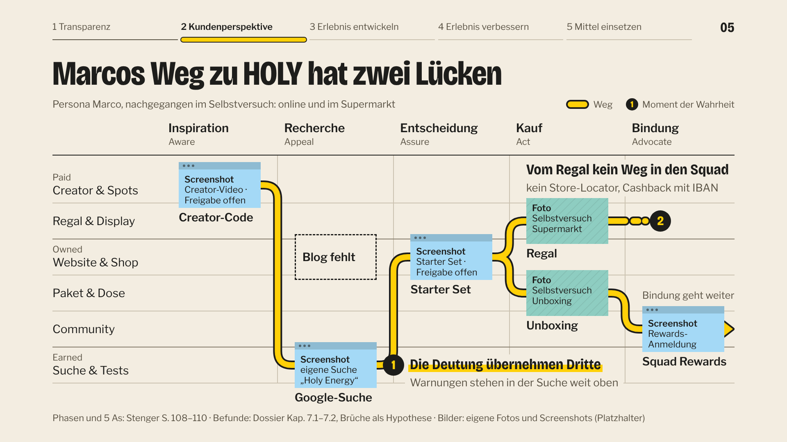
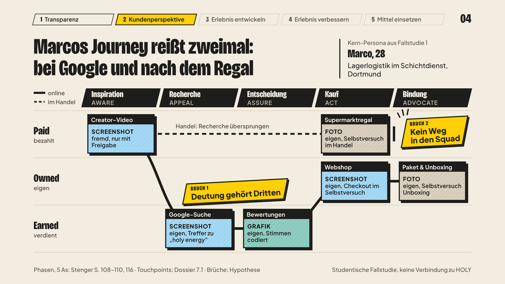
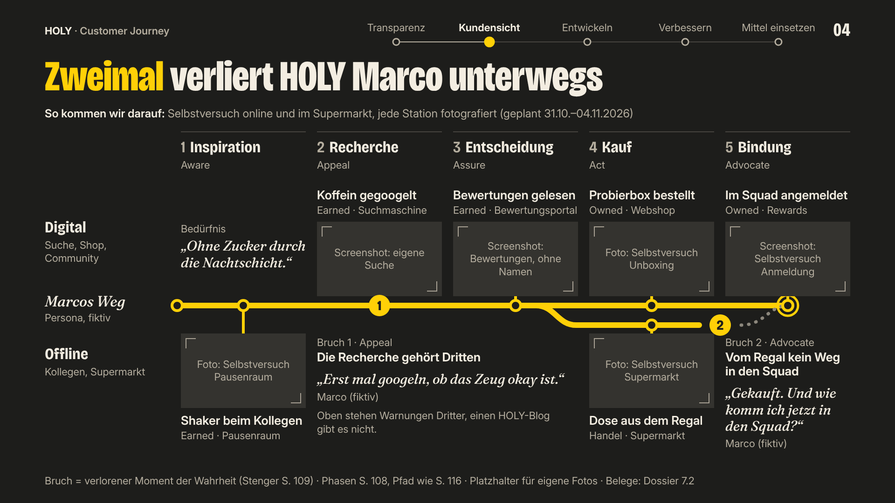

<!-- Erzeugt am 30.10.2026 im Workflow zu Fallstudie 2 (KI-Nachweis FS2, Eintrag 04 / Delegation D02), nach den
Urteilen zweier Jurys über drei Gestaltungsrichtungen. KI-gestützt erstellt, Prüfung durch die Gruppe offen.
Klicks, Sollzeiten, Jury-Punkte und Kontraste sind per Skript nachgerechnet (Abschnitt 14.4).
Die Korrekturen der Schlussprüfung vom 30.10.2026 sind danach eingearbeitet und in Abschnitt 15 aufgeführt. -->

Modul Unternehmenskommunikation · Prof. Dr. Daniel Stenger · Hochschule Kaiserslautern

# Gestaltungsplan – Präsentation Fallstudie 2 „Customer Journey & Blog-Beitrag“

HOLY · Persona Marco (FS1) · Präsentation Mo, 09.11.2026, 15 Minuten · Stand Fr, 30.10.2026 · Schlussprüfung
eingearbeitet (Abschnitt 15) · **Entwurf, Prüfung durch die Gruppe offen**

**KI-gestützt erstellt.** Grundlage sind drei Gestaltungsentwürfe, zwei Jury-Urteile und das Recherche-Dossier
[`recherche-customer-journey.md`](recherche-customer-journey.md) (kurz: „Dossier“). Fakten über HOLY stehen nur mit
Befund-ID und Status aus dem Dossier (✔ bestätigt · ✎ korrigiert · ~ unsicher · **H** Hypothese). „Vorl. S. n“ =
Vorlesung Prof. Stenger, Seite n. Literatur hinter den Vorlesungsseiten ist nur „zitiert nach Stenger“. Rechtliche
Einordnungen sind Einschätzungen von Studierenden und **keine Rechtsberatung**. **Für Fallstudie 2 ist noch nichts
verteilt:** Dieser Plan ordnet keiner Person Aufgaben zu; wer was übernimmt, legt die Gruppe fest.

**Inhalt**

0. Kurzfassung
1. Die Regeln für FS2 und wie der Plan sie umsetzt
2. Antwort auf jeden Kommentar von Prof. Stenger
3. Leitidee und Gestaltungssystem
4. Bildplan
5. Folienplan
6. Herzstück: die Journey-Map (Folie 05)
7. Blog-Beitrag als Mock-up (Folie 07)
8. Moodboard (Folie 03)
9. Interaktion und Vortrag
10. Zeitkonzept und Generalproben
11. Technik und Prüfung
12. Meilensteine bis Mo, 09.11.2026
13. Offene Entscheidungen und Fragen an Prof. Stenger
14. Herkunft
15. Korrekturen aus der Schlussprüfung (30.10.2026)

---

## 0 Kurzfassung

1. Wir bauen auf der Richtung **„Der Journey-Pfad – Editorial mit Bildern“** auf, die beide Jurys auf Platz 1 setzen
   (Jury „Bewertung nach Prof. Stenger“, simuliert: 8,60 nachgerechnet, laut Jury 8,65; Jury „Machbarkeit“: 7,6).
2. Damit die Folien nicht wieder „nüchtern“ wirken, übernehmen wir aus der Markenwelt als Pflicht: gelbe Vollflächen
   auf den Folien 01, 07 und 09, echte Fotos mit 4-px-Kontur, Farbproben mit Hex-Wert, den Handzeichen-Trichter mit
   der echten Dose, die Notiz „Handel: Recherche übersprungen“ (S. 108) und das Raster von S. 129 auf Folie 06.
3. Aus der Reise übernehmen wir die Herleitungszeile „So kommen wir darauf: …“, Bildunterschriften als Protokoll, das
   Moodboard mit Datencodierung, die Legende zum Moment der Wahrheit (S. 109), den HOLY heute verliert (eigene
   Deutung), die erneute Anfrage an den Gründer und den Zeitwächter mit Kürzungsplan.
4. Neun Hauptfolien, 22 Klicks und 11:40 Sollzeit plus 0:50 Reserve ergeben genau 12:30; die Journey-Map zeigt
   Marcos Weg mit zwei Lücken (beim Nachlesen antwortet HOLY nur knapp und verstreut, vom Regal führt kein Weg in den
   Squad), und der Blog-Beitrag „Koffein-Check“ und eine QR-Brücke schließen sie.
5. Jede Bildkachel hat einen Rückfall als eigene Grafik, Fakten stehen nur mit Dossier-Status auf den Folien, und
   der Plan hängt an drei Terminen: Freigaben bis Di 03.11., Bildschluss Mi 04.11., Änderungsstopp So 08.11., 20:00.

---

## 1 Die Regeln für FS2 und wie der Plan sie umsetzt

### 1.1 Festgelegte Regeln R1–R5

Herkunft aller fünf: Plan vom 27.10.2026, aus Stengers Kritik an FS1 abgeleitet (`ki-nachweis/ki-nachweis-fallstudie-2.md`,
Eintrag 01).

| Regel | Umsetzung im Plan | Abweichung (begründet) |
|---|---|---|
| **R1 Sofort klären:** Mail an Prof. Stenger, Bildfreigaben bei pr@holy.com und beim Gründer | Mail an Prof. Stenger heute mit den Fragen aus 13.2, zuerst nach der Aufgabe selbst (Frage 0: unsere Lesart der Aufgabe, Dossier 2.5 Nr. 1, **H** L35); Freigabe-Mail an pr@holy.com (nur Funktionsadresse, Dossier 12.3); Gründer über den Kontaktweg aus FS1 (`gruenderbefragung.md`) mit Bildfrage und zwei Journey-Fragen. Antwort erbeten bis **Di 03.11.** Jede Bildkachel kennt drei Zustände: frei · Freigabe offen · Rückfall (Abschnitt 4) | keine |
| **R2 Echtes Material statt KI** | Selbstversuch online und im Handel, jede Station fotografiert, Protokoll mit Datum, Ort, Kanal (Backup B1); eigene Produktfotos; 5 offene Kurzinterviews (mindestens 3), anonym, mit Einwilligung; 20–30 Bewertungen plus kritische, von zwei Personen nach K1–K11 codiert (Dossier 12.4, **H** B36). Keine KI-Bilder, keine KI-simulierte Befragung | Persona Marco bleibt die fiktive Kern-Persona aus FS1 und ist so gekennzeichnet. Ihre KI-gestützte Illustration erscheint nur in B7. Die Bewertungs-Stichproben im Dossier (A–E) stammen von einem Recherche-Agenten (~ B20–B24) und erscheinen höchstens im Backup, bis die eigene Codierung vorliegt |
| **R3 Gestaltung:** HOLY-Farben, ein Bild je Folie, Journey-Map mit Bildern wie S. 116, Moodboard, Blog als Mock-up, weniger Fußnoten | Gelb #FFD007, Schwarz #1D1D1B, Creme #F3EDE1 unverdünnt, **kein Ocker** (Ursache in FS1: Deckelung in `tokens.css`, ✔ G13). Je Hauptfolie ein großes eigenes Bild; Journey-Map mit sechs Bildkacheln (Folie 05); Moodboard (03); Blog-Mock-up (07). Je Folie **eine** Quellzeile (22 px), alle Einzelbelege in B8 | Journey-Map und Moodboard sind Bildwände mit mehreren Bildern: gewollt, so zeigt es Stenger auf S. 116 (✔ L15). Gelb nie als Schrift oder Linie auf Creme (1,26 : 1, ✔ G12). #1D1D1B ist HOLYs Logo- und Druck-Schwarz, im Web steht #000000 (✔ G07, ✎ G06); wir bleiben bei #1D1D1B wie in R3 festgelegt (Entscheidung 13.1 Nr. 4) |
| **R4 Inhalt nach S. 111 und Übung S. 128/129, Herleitungen sichtbar** | Laufleiste mit den fünf Schritten von S. 111 auf jeder Inhaltsfolie: 03 = Schritt 1, 04/05 = Schritt 2, 06 = Schritt 3, 07 = Schritte 3/4, 08 = Schritte 4/5. Folie 06 setzt die Übung im Raster von S. 129 um. Herleitungen: Zeile „So kommen wir darauf: …“ unter jedem Titel, Belegzeile an jedem Moment der Wahrheit, Kriterienzeile auf 06, Workshop-Foto | Der Blog sitzt in der Recherche-Phase. Stenger zeigt Content Marketing unter Inspiration und Recherche in der Earned-Zeile (✔ R95); unsere Wahl wird auf Folie 07 offen benannt. Die Zeilen der Journey-Map (05) sind gegenüber S. 129 verdichtet; die Zuordnung steht in 6.3 und B8 |
| **R5 Zeit:** ≤ 9 Hauptfolien, ≤ 25 Klicks, 12:30 Soll, Zeitwächter, zwei Generalproben, Änderungsstopp, Position neben der Leinwand | 9 Hauptfolien · 22 Klicks (Schritte + Folienwechsel, Zählweise wie FS1) · Soll 11:40 + 0:50 Reserve = 12:30 · Referentenuhr der FS1-Engine plus eine Person als Zeitwächter · Leseprobe Di 03.11., Generalproben Fr 06.11. und So 08.11. · Änderungsstopp So 08.11., 20:00 · sprechende Person links neben der Leinwand, Pfad läuft von links nach rechts | keine |

### 1.2 Bestehende Gruppenregeln

| Regel | Herkunft | Umsetzung im Plan | Abweichung (begründet) |
|---|---|---|---|
| Fakten über HOLY nur mit Quelle und Faktenstatus; keine Zahlen ohne Quelle | `CLAUDE.md` (Abschnitt Marke) | Jede Quellzeile nennt Dossier-IDs mit Symbol; die beiden Lücken sind als Hypothese markiert; eigene Zählungen stehen bis zur Erhebung als „n = …“ | keine |
| Social-Media-Bilder und Screenshots von HOLY-Social-Media nur nach Zustimmung des Betreuers | FS1 `praesentation/QUELLEN.md` §4; `kommunikationsanalyse.md` | Kachel „Creator-Video“ nur mit Zustimmung; sonst eigene Grafik mit Kanal, Datum, Beschreibung | keine |
| Keine HOLY-Produktfotos aus fremden Quellen ohne Freigabe | FS1 `QUELLEN.md` §4 (dort noch strenger: „Keine Produktfotos oder Social-Media-Bilder von HOLY“) | Nur eigene Fotos selbst gekaufter Ware. Shop- und Rewards-Screenshots zeigen HOLY-Produktfotos: im Hörsaal nur als Bildzitat mit Belegfunktion nach Stengers Antwort, öffentlich nur mit HOLY-Freigabe, sonst nachgezeichnetes Wireframe (**H** G32, ✔ G23) | Eigene Produktfotos sind in FS2 ausdrücklich gewollt (R2, R3). Ob Fotos mit **sichtbarer Verpackung** in öffentliche Exporte dürfen, ist offen (**H** G24) – die Gruppe legt heute eine Regel fest (13.1 Nr. 3). **Screenshots mit HOLY-Produktfotos** weichen von der Regel ab: nur im Hörsaal als Bildzitat nach Stengers Antwort; öffentlich nur mit Freigabe von HOLY (Einschätzung, keine Rechtsberatung) |
| Keine personenbezogenen Daten übernehmen oder in KI-Werkzeuge geben | KI-Richtlinie der HSKL Nr. 6 (`fallstudie-1-brand-persona/arbeitsplan.md` Z. 105) | Bon, Paketaufkleber, Rewards-Konto, Cashback-Formular schwärzen, bevor eine Datei in den Gruppenordner oder ins Repository geht; echte Fotos und Screenshots gehen gar nicht in KI-Werkzeuge (Arbeitsweise in Abschnitt 4, Regeln für alle Fotos); keine Gesichter, nur Hände; Bewertungen nur sinngemäß oder kurz und anonym; Rohdaten mit Vornamen nicht ins Repository (Dossier 5.3) | keine |
| KI-Simuliertes als „KI-simuliert“ kennzeichnen | FS1-Praxis, Workflow-Vorgabe | Keine simulierte Befragung geplant | keine |
| KI-Bilder kennzeichnen („Bild KI-generiert (Tool)“) | `prompts.md` Z. 113, `methoden.md` Z. 55 (laut **H** G31) | Keine KI-Bilder geplant. Die FS1-Illustration „Marco“ nur in B7, mit der Kennzeichnung aus FS1 `QUELLEN.md` §4 (Zeile `persona-marco.svg`): „Illustration: eigene Gestaltung, KI-gestützt (Claude Code), 19.10.2026 – als SVG-Code erzeugt; fiktive Person, kein Foto“ | Wortlaut wie in FS1 statt „Bild KI-generiert (Tool)“: Werkzeug und Datum stehen dabei, „als SVG-Code erzeugt“ sagt genauer, was die KI gemacht hat; keine Modellbezeichnung |
| Jede KI-Nutzung dokumentieren | `CLAUDE.md` (Pflicht: KI-Nachweis) | Einträge in `ki-nachweis-fallstudie-2.md`; Auszug in B9 | keine |
| Statista-Werte nur wie in `persona-daten.md` | Gruppenregel; ✔ P94 | Folie 04 nutzt nur „YouTube 73 %, Instagram 71 %, TikTok 58 % (Ø 63/58/41 %), Statista CI 2025“ (`persona-daten.md` Z. 25), Kategorie Energy Drinks, nicht HOLY | keine |
| Selbst gebaute Web-Präsentation mit der FS1-Engine | `CLAUDE.md`; FS1 `LIESMICH.md` | Abschnitt 11 | keine |
| Ansprache des Publikums mit „Sie“ | FS1 `LIESMICH.md` §8 (`anrede`) | Alle Folien und Sprechtexte siezen | Das Blog-Mock-up duzt, weil es HOLYs Stimme zeigt (Ton „frech im Rahmen, nüchtern im Kern“, **H** M32; HOLYs Tonregel für Agenten ✔ M90); es ist als Entwurf gekennzeichnet |
| Repository ist öffentlich | `CLAUDE.md`, FS1 `QUELLEN.md` §4; Startseite `index.html` („Gehostet bei GitHub Pages“) | Jeder Push veröffentlicht sofort (GitHub Pages, keine `.gitignore`; Commit und Push nach jedem Arbeitsschritt laut `CLAUDE.md`). Deshalb: Fußhinweis „Studentische Fallstudie, keine Verbindung zu HOLY“ auf jeder Folie; keine HOLY-Logos; nicht freigegebene Fotos und Screenshots sowie `blog.html` und `blog-lang.png` liegen nur im Gruppenordner oder im per `.gitignore` ausgeschlossenen Ordner `praesentation/intern/`, ins Repository kommen nur Rückfälle und Freigegebenes; vor jedem Push `git status` prüfen (11.5). Der Schalter `data-status` ändert nur die Anzeige und hält nichts zurück | keine |
| Keine Bezeichnungen von KI-Modellen in Dateien | Workflow-Vorgabe | Auf Folien und in Dateien „KI-gestützt“; wo die Gruppenregel das Werkzeug verlangt (KI-Bilder), steht der Werkzeugname wie in FS1, nie eine Modellbezeichnung | keine |

### 1.3 Prinzipien aus „Der rote Faden“ (Vorschlag, geprüft)

Herkunft: Neugestaltung vom 29.10.2026 für ein anderes Modul (Kopf von `css/folien/recap.css`, `marke.js` der
Recap-Präsentation). Das Dossier rät: Methode übernehmen, Vokabular an HOLY anpassen (**H** G14).

| Prinzip | Umsetzung | Abweichung (begründet) |
|---|---|---|
| Ein durchgehendes Leitmotiv | **Der Journey-Pfad**: auf der Titelfolie Startstrich, in der Laufleiste die fünf Schritte (S. 111), auf 05 Marcos Ist-Weg mit Lücken, auf 06 der Soll-Pfad, auf 09 geschlossen von Rand zu Rand | keine; der Pfad trägt Inhalt (Ist → Soll), er ist kein Schmuck |
| Je Folie genau **eine** Schlüsselaussage in der Akzentfarbe | Gelbe Marker-Fläche unter schwarzer Schrift (11,48 : 1); auf gelben Bühnen umgekehrt: schwarzes Band, gelbe Schrift | Die Akzentfarbe ist eine Fläche, keine Schriftfarbe: Gelb auf Creme hat nur 1,26 : 1 |
| Magazin-Disziplin: Satz-Titel, Weißraum, asymmetrisches 12er-Raster, keine Kästen, keine Pillen, keine Versalien | Übernommen: Satz-Titel als Kernaussage, Raster wie recap.css §2d, keine Karten, Pillen, Icon-Abzeichen, Kicker | (a) Bildkacheln tragen eine 4-px-Kontur: ein Bildrahmen, kein Textkasten, abgeleitet von HOLYs schwarzen Konturen (✎ G10). (b) Die gestrichelte Leerstelle „Blog fehlt“ ist Inhalt. (c) Versalien nur für „HOLY“ und die 5 As, so wie sie auf S. 109 stehen (AWARE … ADVOCATE). (d) Harter Versatzschatten nur am Mock-up-Rahmen (07) und am Titelfoto (01), nie an Text |
| Geprüfte Kontraste (Text ≥ 4,5 : 1, Grafik ≥ 3 : 1, hell und dunkel) | Alle Paare per Skript nachgerechnet (3.3); zwei Paare fallen durch und sind deshalb verboten | keine |
| Bühne 1920 × 1080 | FS1-Engine (unverändert) | keine |
| Automatische Prüfung mit `werkzeuge/pruefen.mjs`, Wortbudget rund 40 | `pruefen.mjs` ist in FS1 und Recap zeilengleich und läuft unverändert (Abschnitt 11.3). Herleitungs-, Quell- und Fußzeile tragen `data-meta` | Folie 05 (rund 100 Wörter, seit der Schlussprüfung mit längerem Moment 1) und 06 (rund 80–90) liegen über dem Budget. Beide bauen sich in Schritten auf, je Schritt höchstens rund 30 neue Wörter; die Warnung von `pruefen.mjs` wird in `LIESMICH.md` als bewusste Ausnahme vermerkt |
| *Nicht übernommen* | – | Die Bildlosigkeit („keine Logos, keine fremden Bilder“, alles SVG) und die kühle Palette Kreide/Karmin: beides wäre wieder nüchtern und widerspräche R3 |

---

## 2 Antwort auf jeden Kommentar von Prof. Stenger

Kommentare im Wortlaut aus der FS1-Bewertung; „[...]“ wie im Bewertungsbogen.

| # | Kriterium (Punkte) | Kommentar | Maßnahme in FS2 | Folie |
|---|---|---|---|---|
| 1 | Problemverständnis (9/10) | „Problem der Fallstudie gut verstanden und strukturiert angegangen.“ | Beibehalten: Gliederung nach Stengers Prozess (S. 111) als Laufleiste; Vorgehen auf einer Folie | 02, alle |
| 2 | Modelle (8/10) | „Persona Modell gut angewendet.“ | Marco bleibt Blickwinkel (**H** P35); Mediennutzung und Markennutzung kommen dazu | 02, 04 |
| 3 | Modelle | „Detaillierte Analyse zur Mediennutzung, Markennutzung, etc. wäre hilfreich.“ | Eigene Hauptfolie: Statista-Werte nur aus `persona-daten.md`, dazu ARD/ZDF 2026 für 14- bis 29-Jährige (✔ P11, ✔ P18); Markennutzung aus Selbstversuch und Kurzinterviews; Mediennutzung je Phase in B7; Mediennutzung ist sichtbares Auswahlkriterium auf 06 (wie Persona Kathrin, S. 128, ✔ P01) | 04, 06, B7 |
| 4 | Modelle | „Limbic Map - Match zwischen Marke und Holy muss passen, sonst ist die Persona nicht richtig.“ | HOLY als Territorium zeigen, Marco liegt darin (wie S. 71, **H** P07); ein Satz auf 02, Herleitung in B7. Persona-Entscheidung bis Sa 31.10. (Dossier 12.4). Was „Marke und Holy“ meint, fragen wir nach (13.2 Nr. 5; **H** P06) | 02, B7 |
| 5 | Modelle | „Repertory Grid nicht ganz korrekt angewendet.“ | Jedes Modell genau wie auf der Vorlesungsseite und mit Seitenzahl: Phasen S. 108, 5 As S. 109 (Versalien wie dort), Prozess S. 111 mit vollen Begriffen, Raster S. 129 wörtlich. Abweichungen werden benannt (ASSURE statt „ask“ bei Kotler, ✔ L08; Paid/Owned/Earned in der Vorlesung uneinheitlich, ✔ L13) | 05, 06, B8 |
| 6 | Modelle | „Laddering korrekt umgesetzt.“ | Keine Maßnahme nötig; Laddering kommt in FS2 nicht vor | – |
| 7 | Modelle | „Assoziationstechnik gut und interaktiv umgesetzt.“ | Interaktiver Einstieg bleibt, jetzt als Handzeichen-Trichter nach den 5 As | 01, 09 |
| 8 | Modelle | „Die geschlossene Befragung zu Assoziationen gibt wenig Mehrwert.“ | Keine geschlossene Befragung; offene Kurzinterviews (Leitfaden, n, Codes in B5); auf Folien nur kurze anonyme O-Töne | 04, B5 |
| 9 | Modelle | „Kommunikationsanalyse umfassend umgesetzt.“ | Beibehalten: vollständige Touchpoint-Inventur nach dem Muster Intersport (S. 113): 13 Paid, 30 Owned (3 fehlen), 11 Earned (Dossier 4.2, Zuordnung **H**) | 03, B3 |
| 10 | Analyse (9/10) | „Interview mit Gründer super!“ | Gründer erneut anfragen: warum es keinen Blog gibt, wie Handelskunden in den Squad kommen sollen. Antwort als gekennzeichnete Innensicht (Selbstauskunft, n = 1), nur mit Freigabe wie in FS1 | 05/08 (falls Antwort) |
| 11 | Analyse | „Wie kommt ihr auf die Wettbewerber Monster und Coca Cola?“ | Herleitungszeile „**So kommen wir darauf:** …“ unter jedem Titel; Belegzeile an jedem Moment der Wahrheit; Begründung, warum genau zwei Lücken (6.5); Kriterienzeile auf 06; Workshop-Foto; Benchmark-Auswahl mit Kriterien und Vergleichsmarken begründet (Dossier 7, Backup B6); Sprungziele für Rückfragen | alle, 06, B2, B4, B6 |
| 12 | Lösung (7/10) | „Markenidentität viel viel ausführlicher darstellen in allen Facetten. [...]“ | In FS2 nicht Hauptthema. Die Gestaltung trägt die Identität sichtbar mit (Farben, Formen, eigene Produktfotos), das Blog-Mock-up zeigt die Tonalität; Verweis auf das FS1-Steuerrad in B7 | 03, 07 |
| 13 | Lösung | „Kommunikationsanalyse besser visualisieren“ | Moodboard statt Tabelle, nach Paid/Owned/Earned (S. 112), Bildgröße = wie oft die Kurzinterviews den Touchpoint nennen | 03 |
| 14 | Lösung | „und im Ergebnis in der Identität Farben/ Formen/ Produktabbildungen zeigen.“ | Farbproben mit Hex-Wert und Status, Formproben (Kontur, Kreis, Schachbrett), eigene Produktfotos; gelbe Bühnen 01, 07, 09 | 01, 03, 07 |
| 15 | Vermittlung (9/10) | „Guter interaktiver Einstieg, freier Vortrag.“ | Einstieg ohne Technik mit echter Dose; geringes Wortbudget stützt freies Sprechen | 01 |
| 16 | Vermittlung | „Position im Raum nicht optimal. Bessere Mimik und Interaktion mit der Folie möglich wenn neben den Folien positioniert.“ | Sprechende Person links neben der Leinwand; Pfad läuft von links nach rechts; nummerierte Knoten als Zeigeziele; keine Interaktion braucht die Tastatur | 05, 06, alle |
| 17 | Vermittlung | „Zeitmanagement schlecht 25 min statt 15.“ | 9 Folien, 22 Klicks, 11:40 + 0:50 Reserve; Kontrollpunkte, Kürzungsplan, Leseprobe, zwei Generalproben mit Stoppuhr, Änderungsstopp (Abschnitt 10) | alle |
| 18 | Visualisierung (9/10) | „Folien strukturiert und ansprechend gestaltet.“ | Beibehalten: festes Raster, Laufleiste, Satz-Titel | alle |
| 19 | Visualisierung | „Aber oft sehr nüchtern, da KI gestützt umgesetzt.“ | Echte eigene Fotos statt KI-Illustrationen; HOLY-Gelb unverdünnt als Fläche; keine Vorlagenmerkmale aus FS1 (Karten, Pillen, Icons, Kicker, Mini-Steuerrad); sichtbare Arbeitsspuren: Workshop-Foto, Handskizze, von Hand eingekreiste Treffer, Bildunterschrift als Protokoll | alle |

---

## 3 Leitidee und Gestaltungssystem

### 3.1 Leitidee

**Der Weg der Kundschaft ist ein gelber Pfad – und die Präsentation erzählt, wie er sich schließt.** Der Pfad ist
HOLY-Gelb mit schwarzer Kontur; die Bauweise ist vom gelben Oval mit schwarzem Rand des Logos abgeleitet (D1 §6.3 ✔),
das Logo selbst erscheint nicht. Auf Folie 05 ist er Marcos Ist-Weg über echte Fotos (Bildsprache wie S. 116) mit zwei
Lücken, auf 06 der Soll-Pfad durch die Top-Touchpoints, auf 09 läuft er geschlossen von Rand zu Rand.

Laut wird es durch drei Dinge, nicht durch Comic-Elemente: **gelbe Vollflächen** auf den Bühnenfolien 01, 07, 09 ·
**große eigene Fotos mit schwarzer 4-px-Kontur** · eine **schmale, fette Titelschrift**. Comic-Tiere, Sticker und
gedrehte Texte gibt es nicht: Der Comic-Stil würde die Kritik an HOLYs „kindlich wirkender Bildwelt“ verstärken
(Dossier Lücke 3 „Eltern“, **H** S35; Jury-Einwand gegen die Markenwelt).

Hinweis zur Herkunft der Farbe: #FFD007 ist auf de.holy.com die Aktionsfarbe der Buttons, keine Flächenfarbe (✎ G06).
Gelbe Flächen sind deshalb eine eigene Entscheidung; sie passen zum Press Kit, das Produkte vor kräftigen, einfarbigen
Hintergründen zeigt, darunter gelbe Fliesen (✔ G08).

### 3.2 Farben

| Rolle | Name | Hex | Herkunft | Einsatz |
|---|---|---|---|---|
| Papier (hell) | Creme | #F3EDE1 | HOLY: Menüs, Kollektionsbereiche, Press-Kit-Hintergrund (✎ G06, ✔ G08); R3 | Hintergrund aller Inhaltsfolien; Schrift im Dunkelmodus |
| Schrift, Kontur | Schwarz | #1D1D1B | HOLY Logo- und Druck-Schwarz (✔ G07); R3 | Schrift, Daten, Pfadkontur, Bildkontur; Papier im Dunkelmodus |
| Leitmotiv | Gelb | #FFD007 | HOLY „CTA yellow“ (✎ G06); R3 | Pfad (Füllung), aktueller Laufleisten-Schritt, Marker unter der einen Schlüsselaussage, Vollfläche der Bühnen 01/07/09. **Nie** Schrift oder konturlose Linie auf Creme |
| Nebentext (hell) | Schiefer warm | #5C5547 | eigener Wert | Herleitungs-, Beleg-, Quellzeile, 5 As, erledigte Laufleisten-Stücke; auch Nebentext auf Gelb |
| Grafik zweiten Ranges | Mittel warm | #857C6B | eigener Wert | Gruppengrenzen Paid/Owned/Earned, gestrichelter Handelsweg, Skalenstriche; **nicht auf Gelb** |
| Haarlinie (Deko) | Nebel warm | #CBC2B0 (dunkel #45413A) | eigener Wert | Zeilen- und Phasenraster, kommende Laufleisten-Stücke; trägt nie Information |
| Nebentext (dunkel) | Schiefer hell | #B9B0A0 | eigener Wert | nur im Dunkelmodus |
| Platzhalter „Foto“ | Türkis | #8ECDC1 | HOLY-Web, Stand 14.10.2026 (D1 §6.3 ✔); am 30.10. nicht erneut gefunden (G06 nennt andere Töne) | nur Platzhalter- und Rückfallflächen, mit Schraffur |
| Platzhalter „Screenshot“ | Hellblau | #A4D9F6 | wie Türkis | nur Platzhalterflächen, mit Fensterleiste |
| Reserve | Mint | #B3DBC4 | wie Türkis | dritte Bildfläche im Moodboard, sonst nicht |
| Nur Farbproben (Folie 03) | Lila · Pink · Violett · Logo-Gelb · Web-Schwarz | #C0ADE7 · #FCB4D9 · #B247FF · #FFED28 · #000000 | ✎ G06 · ✎ G06 · ✔ G91 · ✔ G07 · ✎ G06 | nur als Farbprobe mit 3-px-Kontur, Hex-Wert darunter auf Creme |

Die Web-Werte können sich mit der nächsten Kampagne ändern; vor dem 09.11. mit Abrufdatum sichern (Dossier 10).

### 3.3 Kontraste (nachgerechnet, WCAG 2.x)

Formel: relative Leuchtdichte nach WCAG 2.x, Kontrast = (L₁ + 0,05) / (L₂ + 0,05). Skript in 14.4.

| Paar | Vorne | Hinten | Kontrast | Soll | Ergebnis |
|---|---|---|--:|---|---|
| **Hell:** Schrift auf Papier | #1D1D1B | #F3EDE1 | 14,48 : 1 | 4,5 (Text) | ja |
| Hell: Nebentext auf Papier | #5C5547 | #F3EDE1 | 6,33 : 1 | 4,5 (Text) | ja |
| Hell: Mittel (Grafik) auf Papier | #857C6B | #F3EDE1 | 3,54 : 1 | 3 (Grafik) | ja |
| Hell: Nebel (Haarlinie) auf Papier | #CBC2B0 | #F3EDE1 | 1,52 : 1 | – (Deko) | nur Deko |
| Hell: Gelb auf Papier | #FFD007 | #F3EDE1 | 1,26 : 1 | 3 (Grafik) | **nein → verboten ohne Kontur** |
| Hell: Kontur Schwarz gegen Papier | #1D1D1B | #F3EDE1 | 14,48 : 1 | 3 (Grafik) | ja (trägt den Pfad) |
| Hell: Schrift auf Gelb-Marker | #1D1D1B | #FFD007 | 11,48 : 1 | 4,5 (Text) | ja |
| Hell: Schrift auf Türkis / Hellblau / Mint | #1D1D1B | #8ECDC1 / #A4D9F6 / #B3DBC4 | 9,37 / 11,12 / 11,13 : 1 | 4,5 (Text) | ja |
| Hell: Nebentext auf Türkis | #5C5547 | #8ECDC1 | 4,10 : 1 | 4,5 (Text) | **nein → dort nur Schwarz** |
| **Gelbe Bühne:** Schrift auf Gelb | #1D1D1B | #FFD007 | 11,48 : 1 | 4,5 (Text) | ja |
| Gelbe Bühne: Nebentext auf Gelb | #5C5547 | #FFD007 | 5,02 : 1 | 4,5 (Text) | ja |
| Gelbe Bühne: Mittel auf Gelb | #857C6B | #FFD007 | 2,80 : 1 | 3 (Grafik) | **nein → auf Gelb nur Schwarz oder Schiefer** |
| Gelbe Bühne, falls sie im Dunkelmodus die Dunkel-Tokens übernähme: Creme auf Gelb | #F3EDE1 | #FFD007 | 1,26 : 1 | 4,5 (Text) | **nein → feste Werte auf Gelb in beiden Modi (Schrift #1D1D1B, Nebentext #5C5547)** |
| Gelbe Bühne im Dunkelmodus: Schiefer hell auf Gelb | #B9B0A0 | #FFD007 | 1,46 : 1 | 4,5 (Text) | **nein → wie oben** |
| Gelbe Bühne: Laufleiste „kommend“ in Nebel auf Gelb | #CBC2B0 | #FFD007 | 1,20 : 1 | 3 (Grafik) | **nein → auf Gelb kommend in Schiefer (5,02 : 1), aktuell Schwarz (11,48 : 1)**; ein gelbes Stück auf Gelb wäre nur an der Kontur zu sehen |
| Rückfall `?buehne=schwarz`: gelbe Schrift auf Schwarz | #FFD007 | #1D1D1B | 11,48 : 1 | 4,5 (Text) | ja |
| Rückfall `?buehne=schwarz`: Schiefer warm auf Schwarz | #5C5547 | #1D1D1B | 2,29 : 1 | 4,5 (Text) | **nein → dort Nebentext #B9B0A0 (7,86 : 1)** |
| **Dunkel:** Schrift auf Papier | #F3EDE1 | #1D1D1B | 14,48 : 1 | 4,5 (Text) | ja |
| Dunkel: Nebentext auf Papier | #B9B0A0 | #1D1D1B | 7,86 : 1 | 4,5 (Text) | ja |
| Dunkel: Gelb (Pfad, Schrift) auf Papier | #FFD007 | #1D1D1B | 11,48 : 1 | 4,5 (Text) | ja |
| Dunkel: Mittel auf Papier | #857C6B | #1D1D1B | 4,09 : 1 | 3 (Grafik) | ja |
| Dunkel: Nebel auf Papier | #45413A | #1D1D1B | 1,66 : 1 | – (Deko) | nur Deko |
| Dunkel: Schiefer warm auf Papier | #5C5547 | #1D1D1B | 2,29 : 1 | 4,5 (Text) | **nein → im Dunkeln #B9B0A0** |
| Farbprobe: Hex-Text auf Violett | #1D1D1B | #B247FF | 4,21 : 1 | 4,5 (Text) | **nein → Hex-Werte stehen unter der Probe auf Creme** |
| Vergleich: Web-Schwarz auf Gelb | #000000 | #FFD007 | 14,28 : 1 | – | wie ✔ G12 |
| Vergleich: Gelb auf Website-Hintergrund #FCF8F0 · Weiß auf Gelb | – | – | 1,39 · 1,47 : 1 | – | wie ✔ G12 |
| Vergleich: Gelb auf Hellblau · auf Türkis | – | – | 1,03 · 1,23 : 1 | – | Pfad läuft hinter Kacheln, nie darauf |
| Vergleich: FS1-Ocker #785100 auf Creme | – | – | 6,05 : 1 | – | lesbar, aber nicht markenfarbig (die Markenwelt nannte irrtümlich 5,47) |

Alle Werte sind gerechnet, nicht am Beamer gemessen. Die Jury „Machbarkeit“ schätzt mit einem eigenen Streulicht-Modell
(Annahme, keine Messung), dass Nebentext im Dunkelmodus auf etwa 3 : 1 fällt; deshalb ist **hell der Standard**.

### 3.4 Typografie

Alle Schriften stehen unter der SIL Open Font License 1.1 und liegen lokal als woff2 vor (Fontsource 5.3.0,
`schriften/HERKUNFT.txt`; freie Ersatzschriften ✔ G05). HOLYs eigene Schriften (ObviouslyNarrow, PP Agrandir, Extra
Chunk Please) sind kommerziell und werden nicht eingebunden (✔ G01, ✎ G03, ✎ G04).

| Schrift | Einsatz | Größen und Schnitt |
|---|---|---|
| **Bricolage Grotesque** (variabel, wght 200–800, wdth 75–100) | Titel, Schlüsselzahlen, Knoten-Ziffern, Sätze der Momente, Foliennummer | Titel 84 px, Gewicht 750, Breite 82 %, Zeilenhöhe 1,0, höchstens 2 Zeilen, Satzschreibung · Moment/These 36 px, 700 · Schlüsselzahl 160–300 px · Frage auf Bühnen 96 px. Schmal und fett wie HOLYs Überschriftenstil, aber ohne Versalien und ohne Schräglage |
| **Libre Franklin** (variabel, wght 100–900, aufrecht) | Text, Daten, Beschriftungen, Meta | Inhalt 28–30 px (Zeilen- und Touchpoint-Namen 28 px/600, Phasen 29 px/600) · Belegzeilen 26 px · Meta 22–24 px · 5 As in Versalien 24 px/600, Laufweite 0,04 em. Liegt bisher nur im Recap-Ordner; beim Bau samt Lizenz und HERKUNFT-Eintrag kopieren (Meilenstein M5) |
| **Fraunces kursiv** („WONK“ 0, wie FS1) | nur echte, anonyme O-Töne aus Kurzinterviews und Bewertungen | 34–40 px; keine erfundenen Zitate |

Regeln: Mindestgrößen wie `pruefen.mjs` (Inhalt ≥ 28 px, Meta ≥ 22 px); Zahlen tabellarisch; keine gesperrten Kicker;
keine künstlich schräg gestellte Schrift.

### 3.5 Raster

Wie „Der rote Faden“ (recap.css §2d), damit `pruefen.mjs` unverändert prüft:

- Bühne 1920 × 1080; 12 Spalten à 109,33 px, Rinne 32 px, Rand 128 px links und rechts, 52 px oben, 44 px unten;
  Spalte n beginnt bei x = 128 + (n − 1) · 141,33.
- Senkrecht: Laufleiste y 52–100 → Titel ab y 138 (84 px) → Herleitungszeile y 240 (24 px) → Inhalt ab y ≈ 296 →
  unten Quellzeile (Spalten 1–8) und Fußhinweis (Spalten 9–12), je 22 px, eine Zeile.
- Felder: Haupt 1–8 / Seite 9–12; Bild im Anschnitt bis zum Bühnenrand erlaubt. Pfade, Notizen und Text bleiben im
  Satzspiegel (x = 128 bis 1792). Einzige Ausnahme ist der geschlossene Pfad auf 09, der bewusst von Rand zu Rand läuft:
  Endpunkte genau x = 0 und 1920, `data-ueberlauf-ok`, vermerkt in 11.3 und `LIESMICH.md`.
- Journey-Raster (05, 06): Spalten 1–2 Zeilennamen, Spalten 3–12 fünf Phasen à 2 Spalten (250,67 px).

### 3.6 Komponenten (Präfix `p-`)

| Komponente | Gestaltung |
|---|---|
| Laufleiste | Fünf Stücke mit den vollen Begriffen von S. 111 („1 Transparenz schaffen“ … „5 Mittel zielorientiert einsetzen“); Breite nach Textlänge. Erledigt = 2 px Schiefer, aktuell = 10 px Gelb mit 2-px-Kontur, kommend = 2 px Nebel. **Auf gelber Bühne (07, 09):** erledigt = 2 px Schwarz, aktuell = 10 px Schwarz, kommend = 2 px Schiefer; kein Nebel auf Gelb (3.3). Rechts Foliennummer (Bricolage). Auf 09 schließen sich die Stücke zu einem Pfad |
| Pfad | SVG über der Bühne im Linienplan-Stil: waagerecht in der Zeile, senkrecht in der Rinnenmitte, Eckradius 34 px; Gelb 14 px auf schwarzer Kontur 22 px (dunkel: nur Gelb; auf Gelb: Schwarz). Läuft hinter den Kacheln; berechnet aus den Kachelmitten (Daten als Objekt). Zeichnet sich in 900 ms, bei „Bewegung reduzieren“ sofort. Endet spätestens an der Satzspiegelkante x = 1792; geht der Weg weiter, mit Pfeilspitze (Gelb mit Kontur) und Notiz am Weg. Rand und Anschnitt nur auf 09 (3.5) |
| Handelsweg | 6 px gestrichelt (16/12) in Mittel warm, mit Notiz am Weg (24 px Schiefer) |
| Knoten = Moment der Wahrheit, den HOLY heute verliert (eigene Deutung) | Kreis 52 px, schwarz mit gelber Ziffer (dunkel umgekehrt), sitzt auf dem Pfad |
| Offenes Ende | Pfad endet vor der Rinne, zwei kurze Reste, danach der Knoten |
| Marker | Gelbe Fläche im unteren Drittel der Zeile unter der einen Schlüsselaussage; auf gelber Bühne: schwarzes Band, gelbe Schrift |
| Bildkachel | 16:9 bzw. Großbild im Anschnitt, **4-px-Kontur Schwarz**; drei Zustände über `data-status`: `frei` (Foto) · `offen` (Platzhalter Hellblau/Türkis mit „Freigabe offen“) · `rueckfall` (eigene Grafik); der Schalter ändert nur die Anzeige, nicht freigegebene Dateien liegen nicht im Repository (11.5). Unterschrift als Protokoll: „was · Paid/Owned/Earned · Ort/Kanal, Datum“; bei Screenshots eine zweite Zeile (`data-meta`) mit Urheber und Fundstelle nach dem Muster aus FS1 `QUELLEN.md` §4, z. B. „Screenshot © HOLY Softdrinks GmbH, de.holy.com/…, Abruf TT.MM.2026“ (§ 63 UrhG: Quelle „deutlich“, sicher ist der Vermerk am Bild, ✔ G93) |
| Leerstelle | gestrichelter 3-px-Rahmen in Schriftfarbe mit „Blog fehlt“: zeigt, was fehlt |
| Herleitungszeile | „**So kommen wir darauf:** …“, 24 px, Anfang fett, Rest Schiefer, eine Zeile, `data-meta` |
| Belegzeile | 26 px Schiefer unter dem Satz eines Moments; Inhalt, zählt zum Wortbudget |
| Notiz am Element | 24 px Schiefer, direkt am Element (z. B. „Handel: Recherche übersprungen“) |
| Strichskala | wie r-Strichskala in recap.css §5.6; Daten in Schwarz, Schlüsselzahl mit Marker |
| O-Ton | Fraunces kursiv, ohne Anführungskasten, Kürzel „I1“ … darunter |
| Farbprobe | Quadrat 96 px mit 3-px-Kontur, Hex-Wert und Status darunter (22 px) |
| Bühne „gelb“ | Attribut `data-buehne="gelb"` an Folie 01, 07, 09: Fläche #FFD007, Schrift #1D1D1B, Nebentext #5C5547, **fest in beiden Modi** (die Dunkel-Tokens gelten auf Gelb nicht, sonst 1,26 bzw. 1,46 : 1, 3.3); Rückfall über `?buehne=schwarz` (schwarze Fläche, gelbe Schrift 11,48 : 1, Nebentext #B9B0A0 7,86 : 1) |
| Mock-up-Rahmen | Smartphone-Rahmen als eigene CSS-Grafik ohne Gerätemarke: schwarz, Radius 56 px, harter Schatten 8/8 px |
| Quellzeile / Fußhinweis | je eine Zeile, 22 px, `data-meta`; Fußhinweis: „Studentische Fallstudie, keine Verbindung zu HOLY“ |

### 3.7 Was es NICHT gibt

- keine Karten, Pillen, Chips, Icon-Abzeichen, Mini-Steuerräder, Versalien-Kicker (die Vorlagenmerkmale aus FS1)
- keine Sticker, keine gedrehten Texte, keine weichen Schatten, keine Verläufe, kein Glas
- keine HOLY-Logos, keine HOLY-Schriften, kein Raptor und keine Comic-Tiere, kein nachgezeichnetes Verpackungsdesign
- keine KI-Illustrationen auf Hauptfolien, keine KI-Bilder
- kein Gelb als Schrift oder konturlose Linie auf Creme; kein Mittel warm, Nebel, Creme oder Schiefer hell auf Gelb
- kein Pfad und keine Notiz im 128-px-Rand (Ausnahme: geschlossener Pfad auf 09, 3.5)
- keine Fußnoten über eine Zeile; keine Zahl ohne Quelle; keine erfundenen Zitate (auch nicht „Marco (fiktiv)“) auf
  Analysefolien
- keine Folie mit eigenem `data-modus="dunkel"` (sonst greift die Taste D dort nicht, `deck.js` Z. 1098–1101)
- keine Live-Abstimmung per QR, keine Stimmenzählung über Tasten, kein `iframe`

---

## 4 Bildplan

Für Fallstudie 2 ist noch nichts verteilt; die Tabelle nennt Termine, keine Personen. Rechtliche Einordnungen sind
Einschätzungen, **keine Rechtsberatung** (Grundlage Dossier 10.6). Kurzform: Im Hörsaal sind fremde Abbildungen
voraussichtlich durch § 60a UrhG gedeckt (✔ G20). § 60a Abs. 1 Nr. 3 erlaubt die Präsentation von Lernergebnissen
für Dritte „an der Bildungseinrichtung“; für ein dauerhaft öffentliches Repository spricht der Wortlaut eher dagegen,
bis zur Freigabe also nicht veröffentlichen (✎ G21, ✔ R30; Einschätzung **H**). Quelle „deutlich“ am Bild nennen,
bei Screenshots mit Urheber und Fundstelle in der zweiten Zeile der Unterschrift (✔ G93, Muster 3.6).

**Ablage:** Nicht freigegebene Fotos und Screenshots liegen nur im Gruppenordner oder im per `.gitignore`
ausgeschlossenen Ordner `praesentation/intern/`; die interne Fassung lädt sie von dort. Ins Repository, das über
GitHub Pages sofort öffentlich ist, kommen nur Rückfälle und Freigegebenes (11.5).

| Nr. | Bild | Folie | Art | Rechtestatus (keine Rechtsberatung) | Rückfall, falls Freigabe fehlt | Zu tun bis wann |
|---|---|---|---|---|---|---|
| b01 | Hand mit selbst gekaufter Dose und Shaker vor gelbem Karton; dazu die echte Dose als Requisit | 01 (auch 09) | eigenes Produktfoto | Foto eigen; die illustrierte Verpackung ist vermutlich ein Werk (**H** G24) → Freigabe bei pr@holy.com angefragt | Variante mit gedrehtem Etikett (nur Deckel, Shaker, Pulver), in derselben Sitzung aufgenommen; in öffentlichen Exporten bis zur Freigabe nur diese | Kauf Sa 31.10.; Foto So 01.11. bei Tageslicht, quer und hoch, beide Varianten. Den Shaker liefert vermutlich erst das Starter Set (**H**): fehlt er am So 01.11., zuerst Hand mit Dose, Variante mit Shaker nach der Lieferung; findet sich im Handel keine Dose, b01 ganz mit der Lieferung nachholen |
| b02 | Flatlay „unser Einkauf“: Paket, Dose, Shaker, Bon und Bestellbestätigung geschwärzt | 02 | eigenes Foto | eigen; personenbezogene Daten schwärzen; Verpackung wie b01 | nur Handelskauf mit Bon (falls das Paket fehlt); Etikett gedreht | Handelsteil Sa 31.10.; Paketteil nach Lieferung (HOLY nennt 1–3 oder 3–6 Werktage, ✎ T24; bei Bestellung Fr 30.10. und 6 Werktagen erst Fr 06.11., ohne Samstag erst Mo 09.11., eigene Rechnung). **Kommt die Lieferung nach Mi 04.11., gilt der Rückfall** |
| b03 | Moodboard: 9–12 Kacheln aus eigenen Fotos und Screenshots (Liste in 8.2) | 03 | gemischt | je Einzelbild (b05–b11, b18) | je Einzelbild; Farb- und Formproben (b18) gehen immer | Mi 04.11. |
| b04 | Gestellte Szene „vor der Schicht“: Spind, Warnweste, Shaker auf der Bank, ohne Person | 04 | eigenes Foto, als „gestellt“ gekennzeichnet | eigen; keine Person, kein Firmengelände ohne Erlaubnis; Produkt nur am Rand | Detailfoto Shaker beim Anrühren | Mo 02.11. |
| b05 | Creator-Video mit Rabattcode (Ausschnitt ohne Gesicht) | 05, 03 | eigener Screenshot, Social Media | nur nach Zustimmung des Betreuers (Gruppenregel); erkennbare Person → § 22 KUG (✔ G25) | **eigene Grafik** „Creator-Video mit Code“ mit Kanal, Datum, Beschreibung | Screenshot mit Datum Sa 31.10.; Grafik bis Di 03.11. |
| b06 | Eigene Suche „holy energy koffein“, Treffer von Hand eingekreist | 05, 03 | eigener Screenshot | eigener Bildschirm mit Inhalten Dritter: Bildzitat mit Belegfunktion (**H** G32); Datum, Gerät, Anmeldestatus nennen. Nur Text-Treffer zeigen: Bild- und Video-Karussells (Vorschaubilder von HOLY-Social-Media, Produktbilder) abschneiden oder vorher die Zustimmung des Betreuers einholen (Gruppenregel) | **eigene Grafik**: nachgesetzte Titelzeilen der ersten Treffer mit Quelle | SERP-Selbstversuch Sa 31.10.: privates Fenster, zwei Geräte (Dossier 12.4) |
| b07 | Leerstelle „Blog fehlt“ | 05 | eigene Grafik | eigen | – | beim Bau |
| b08 | Shop-Seite Starter Set | 05, 03 | eigener Screenshot | zeigt HOLY-Produktfotos; HOLY räumt in den AGB keine Nutzungsrechte ein (✔ G19) → im Hörsaal Bildzitat nach Stengers Antwort, öffentlich nur mit Freigabe von HOLY (Abweichung in 1.2) | **eigene Grafik**: nachgezeichnetes Wireframe, oder eigenes Foto des gelieferten Sets | Screenshot Fr 30.10. bei der Bestellung; Wireframe bis Di 03.11. |
| b09 | Regal im Supermarkt | 05, 03, 08 | eigenes Foto | Hausrecht: Marktleitung vorher fragen; keine Personen (✔ G25; Hausrecht nur Modellwissen) | gekaufte Dose mit Bon zu Hause (Bon geschwärzt). **Wird kein Regal gefunden:** die Suche selbst als Station K4 dokumentieren (Märkte, Datum, Uhrzeit; Foto ohne Personen), das ist selbst ein Beleg für Lücke 2 (**H**; kein Store-Locator ✔ B01) | Sa 31.10.; welche Ketten HOLY führen, ist nicht geprüft (Dossier 12.1) |
| b10 | Unboxing in drei Bildern (geschlossen, geöffnet, Inhalt) | 05, 03 | eigenes Foto | eigen; Adressaufkleber schwärzen; Verpackung wie b01 | Foto der Versandbestätigung (geschwärzt) bzw. Wireframe | Bestellung heute Fr 30.10.; Fotos am Liefertag, Bildschluss Mi 04.11.; **kommt die Lieferung nach Mi 04.11., gilt der Rückfall** (Lieferzeit wie b02) |
| b11 | Anmeldung bei SQUAD Rewards (eigenes Konto) | 05, 03 | eigener Screenshot | HOLY-Seite → wie b08; eigene Kontodaten ausblenden | **eigene Grafik** (Wireframe) | nach der Bestellung, bis Mi 04.11. |
| b12 | Unser Übungsraster nach S. 129 mit Haftnotizen | 06 | eigenes Foto (Workshop) | eigen; keine Gesichter, keine Namen auf Notizen | Raster nur als Grafik (Foto entfällt) | Workshop Mo 02.11.; Foto direkt danach |
| b13 | Aufmacher im Blog: Pulver im Shaker, Dosierlöffel, 500-ml-Messbecher | 07 | eigenes Produktfoto | eigen; Etikett möglichst nicht frontal | **eigene Infografik** „Koffein im Vergleich“ (EFSA-Werte nach Kategorie, ✔ M91) | So 01.11.; Shaker und Dosierlöffel kommen vermutlich erst mit der Lieferung (wie b01), dann nachholen |
| b14 | Blog-Mock-up (Bild der eigenen `blog.html`) | 07 | eigene Gestaltung | eigen; kein Logo, keine HOLY-Schrift, keine echte Domain; Kennzeichnung als Entwurf; bis zur Freigabe nur in der internen Fassung, nicht im Repository (✔ R30, 7.4, 11.5) | nur Kopf, „Kurz gesagt“ und Gliederung (Abschnitt 7.4) | Text Mi 04.11.; Bild Do 05.11. |
| b15 | Handskizze: Regal-Aufsteller mit QR-Code als Brücke in den Squad | 08 | eigene Zeichnung, gescannt | eigen; ohne HOLY-Verpackungsdesign und Logo | Skizze als eigene Vektorgrafik | Mi 04.11. |
| b16 | Bildleiste der Selbstversuch-Fotos auf dem geschlossenen Pfad | 09 | Wiederverwendung | wie b05–b11 | nur Bilder mit Status „frei“, sonst deren Rückfall | beim Bau |
| b17 | Persona-Illustration Marco (FS1) | nur B7 | Illustration, KI-gestützt (FS1) | eigene Gestaltung laut FS1 `QUELLEN.md` §4; Kennzeichnung mit Werkzeug und Datum wie dort (1.2) | – | – |
| b18 | Farb- und Formproben (Hex-Werte, Kontur, Kreis, Schachbrett) | 03 | eigene Grafik | eigen; Werte aus Dossier 10.1 mit Status | – | beim Bau |
| b19 | Leere Blog-Seite /blogs/news („noch keine Beiträge“, ✔ M01, ✔ L39) | 03, B4 | eigener Screenshot | HOLY-Seite: Bildzitat mit Belegfunktion (**H** G32), Quellzeile wie 3.6; Seitenkopf mit HOLY-Logo abschneiden (3.7) | **Textgrafik** „/blogs/news · 0 Beiträge“ mit Abrufdatum | Screenshot Fr 30.10. mit Datum; Textgrafik beim Bau |

**Regeln für alle Fotos:** nur Hände, keine Gesichter, keine Dritten; jedes Motiv quer und hoch aufnehmen; Datum,
Uhrzeit und Ort notieren (wird zur Bildunterschrift und zum Protokoll in B1); Fotos von Plakaten oder DOOH nur nach
Klärung (keine Panoramafreiheit in Innenräumen und für befristete Plakate, **H** G26). Keine HOLY-Inhalte in
KI-Werkzeuge geben (Dossier 10.6, Regel der Gruppe **H**; HOLY behält sich Text- und Data-Mining vor, ✔ G19).

**Arbeitsweise dazu:** KI-gestützt wird nur mit Platzhaltern und Rückfällen gebaut. Echte Fotos und Screenshots setzt
die Gruppe selbst ein (nur in der internen Fassung, nicht im Repository, siehe Ablage oben), prüft sie ohne KI
(`pruefen.mjs` startet sie selbst; Bericht und Bilder gehen nicht in KI-Werkzeuge) und vermerkt das im KI-Nachweis.

---

## 5 Folienplan

### 5.1 Hauptfolien

Klicks = Aufbauschritte + Weiterschalten (Zählweise FS1: 67 = 53 Schritte + 14 Folienwechsel, `VORTRAGSREIFE.md` Z. 33);
auf Folie 09 nur der Klick zu „Fragen?“. Wortziel = sichtbare Wörter ohne `data-meta`.

| Nr. | Titel als Kernaussage | Stichpunkte | Visualisierung | Bild | Modell + Vorlesungsseite | Befund-IDs (Dossier) | Klicks | Soll |
|---|---|---|---|---|---|---|--:|--:|
| **01** (gelbe Bühne) | erst die Frage, nach Klick: **„Wir sind Marcos Weg zu HOLY selbst gegangen“** | · Schritt 0: „Haben Sie HOLY schon gesehen? Nachgelesen? Gekauft?“ als drei schwarze Stufen (Trichter, ohne Zahlen); Handzeichen je Stufe, die sprechende Person hält die gekaufte Dose · Abbruchregel: keine Hände → eigene Antwort nennen, weiter · Klick 1: Titel; Pfad startet am Foto · Unterzeile: Customer Journey & Blog-Beitrag · HOLY · Gruppe · 09.11.2026 · Fußhinweis keine Verbindung zu HOLY | Spalten 1–7 Gelb mit Frage (Bricolage 96 px) und Stufen; Spalten 8–12 Foto im Anschnitt mit 4-px-Kontur und hartem Schatten. Keine Laufleiste | b01 + echte Dose | 5 As AWARE → APPEAL/ASSURE → ACT (S. 109, Kotler et al. 2017 zit. n. Stenger); Definition Customer Journey (S. 107, Bruhn 2016 zit. n. Stenger) im Sprechtext | ✎ L07 · ✔ L01 · ~ L02 (Werk unklar, deshalb „zit. n. Stenger“) | 2 | 50 s |
| **02** | **Fünf Schritte, ein echter Einkauf: So sind wir vorgegangen** | · Prozess als großer Pfad mit fünf Knoten: Transparenz schaffen · Kundenperspektive verstehen · Kundenerlebnis entwickeln · Kundenerlebnis verbessern · Mittel zielorientiert einsetzen · Klick 1: unter jedem Knoten unser Material (Inventur · Selbstversuch online und im Markt · Kurzinterviews n = … · Bewertungen codiert n = … · Workshop Übung) · Persona Marco, 28, Lager im Schichtdienst (FS1, fiktiv); ein Satz: HOLY als Limbic-Territorium, Marco liegt darin · Marker: „an einem echten Einkauf“ | Spalten 1–8: Pfad mit Knoten 1–5, Material als 28-px-Zeile darunter, ohne Kästen; Spalten 9–12 Foto im Anschnitt | b02 | Touchpoint-Managementprozess (S. 111, Esch et al. 2016 zit. n. Stenger); Phasen (S. 108) | ✔ L11 · **H** L35 · **H** P35 · **H** P07 · ✔ P05 | 2 | 45 s |
| **03** | **Viele Kontaktpunkte – aber kein Blog und kein Filialenfinder** | · Moodboard der Inventur in drei Bändern Paid · Owned · Earned; Bildgröße = Nennungen in unseren Kurzinterviews · Zählung: 13 Paid · 30 Owned (3 fehlen: Blog, Filialenfinder, App) · 11 Earned (eigene Zuordnung nach Intersport, H) · Farb- und Formproben mit Hex-Wert · Schlüsselzahl **0** Beiträge im HOLY-Blog (Stand 30.10.2026) · Herleitung: „Inventur aus Website, Shop, Social Media, Handel und Selbstversuch, Stand …“ | Abschnitt 8. Schritt 1: Paid und Owned; Schritt 2: Earned, Proben und die 0 | b03, b18, b19 | Touchpoint-Analyse und Kategorisierung (S. 112, Esch et al. 2016 S. 335 ff. zit. n. Stenger); Intersport-Liste (S. 113); Paid/Owned/Earned (S. 121); Schritt 1 (S. 111) | ✔ L12 · ✎ L14 · ✔ L13 · ✔ M01 · ✔ L39 · ✔ B06 · ✔ B01 · ✎ T28 · ✎ M30 · ✎ G06 · ✔ G07 · ✔ G91 · ✎ G10 | 3 | 75 s |
| **04** | **Marco entdeckt HOLY in Videos – und prüft es in der Suchmaschine (Hypothese)** | · Kategorie Energy Drinks, regelmäßig genutzt: YouTube 73 %, Instagram 71 %, TikTok 58 % (Ø 63/58/41 %; Statista CI 2025, nur wie in `persona-daten.md`) · 14- bis 29-Jährige, mindestens wöchentlich: Suchmaschinen **92 %** (Marker), KI-Tools 68 %, Social Media 91 % (ARD/ZDF 2026) · Klick 1: zwei anonyme O-Töne (n = …) zu Anlass, Infoquelle und „Wann sind Sie online, wann kaufen Sie ein?“ · Einzeiler Persona; Mediennutzung je Phase in B7 | Spalten 1–5 Foto im Anschnitt; Spalten 6–12 zwei getrennt beschriftete Gruppen von Strichskalen (Basen nicht mischen), Schlüsselzahl mit Marker, darunter O-Töne in Fraunces kursiv | b04 | Mediennutzung (S. 122–126); Schritt 2 (S. 111); AWARE/APPEAL (S. 109); Persona Kathrin mit Block Mediennutzung (S. 128) | ✔ P11 · ✔ P18 · ✔ P94 · ✔ P01 · ✔ P02 · **H** P29 · **H** P30 · **H** P28 | 2 | 75 s |
| **05** | **Marcos Weg zu HOLY hat zwei Lücken** | · Fünf Phasen mit den 5 As als Spalten, Touchpoints nach Paid/Owned/Earned als Zeilen · Je Station ein Foto aus dem Selbstversuch, verbunden durch den Pfad · Knoten 1 (Recherche): „HOLY antwortet hier knapp, verstreut und oft nur als Bild“ (Schlüsselaussage) – kein Blog; im Shop Koffein nur im Etikettbild; Help-Center knapp auf alter Domain; Kritik Dritter daneben · Knoten 2 (Kauf → Bindung): „Vom Regal kein Weg in den Squad“ – kein Store-Locator, Cashback nur mit Bon-Foto und IBAN · Gestrichelter Handelsweg „Handel: Recherche übersprungen“ | Abschnitt 6 (Musterfolie gebaut) | b05–b11 | Phasen (S. 108, Kroeber-Riel/Gröppel-Klein 2013, Kortum 2017 zit. n. Stenger); 5 As und Momente der Wahrheit (S. 109/110); Fallbeispiel Armbanduhr (S. 116); Customer Journey Mapping = Schritt 2 (S. 111); Paid/Owned/Earned (S. 112) | Lücke 1: ✔ L39 · ✔ B06 · ✔ S27 · ✎ S31 · ✎ S10 · ✎ S28 · ✎ B07 · ~ S91 · **H** S38 · Lücke 2: ✔ B01 · ✎ T28 · ✔ T95 · ✔ B03 · ✔ B15 · **H** D1 §7.2 · Weg: ✔ T02 · ✔ T20 · ✔ T32 · **H** L05 | 4 | 120 s |
| **06** | **Zuerst schließen wir die Lücke beim Nachlesen, dann die am Regal** | · Raster wie S. 129: Zeilen Search/Partner · Media-Werbung · Webseite · Handel/POS (statt Filiale) · Webshop · E-Mail · Social Media; Spalten fünf Phasen · Kriterienzeile: je Phase die Zielfrage der 5 As (S. 109) plus Mediennutzung aus 04 · Je Phase Top 2 als Knoten auf dem gelben Soll-Pfad, je Touchpoint 2 Aktivitäten als Balken (2–3 Wörter, wie S. 117), 20 insgesamt (5.2) · Marker auf Priorität 1 „Koffein-Check“, Priorität 2 „QR-Brücke“ · Workshop-Foto „so ist es entstanden“ | Raster mit Haarlinien, schwarze Knoten, durchgehender gelber Pfad ohne Lücke. Schritt 1: Phasen 1–3; Schritt 2: Phasen 4–5 und Marker. Workshop-Foto als schmaler Anschnitt oben rechts (Spalten 10–12) | b12 | Übung „Top 2 Touchpoints pro Phase, jeweils 2 Aktivitäten“ (S. 128/129); Aktivitäten je Touchpoint und Phase (S. 117); Ziele je Phase (S. 109); Schritt 3 (S. 111) | ✔ L19 · ✎ L07 · ✔ P02 · **H** L36 · ✎ L16 · ✔ L13 · ✔ R95 · Dossier Kap. 9 (**H**) | 3 | 110 s |
| **07** (gelbe Bühne) | **Ein eigener Koffein-Check gibt Kontext statt Kurzantworten** | · Smartphone-Mock-up „Koffein-Check: Wie viel HOLY Energy ist okay?“ · Klick 1: Anmerkungen (1) beantwortet Fragen, die die Google-Autovervollständigung vorschlägt: Koffein, Alter, Tagesmenge (2) nur Etikett- und EFSA-Zahlen, keine Fokus- oder Gesundheitsversprechen · Klick 2: Rahmen fährt zum Schluss, Anmerkung (3) „Im Markt gekauft? So kommst du in den Squad“ (Brücke zu Lücke 2); Marker „eigener Kontext dort, wo heute Kurzantworten und Kritik Dritter stehen“ · Kennzeichnung wie 7.3 (studentischer Entwurf, Text KI-gestützt, kein Beitrag der HOLY Softdrinks GmbH) · Herleitung: Suchvorschläge → Lücke → Beitrag (wie groß der Koffein-Cluster ist, belegt erst der Volumen-Selbstversuch, B1) | Abschnitt 7 | b13, b14 | Content Marketing, Blog „Whole Story“ (S. 117/118); Owned (S. 112, 121); APPEAL/ASSURE (S. 109); Schritte 3/4 (S. 111) | ✔ S04 · ✎ S03 · ✔ S27 · **H** S33 · ✔ S92 · ✔ R16 · ✔ R17 · ✎ R10 · ✔ R91 · ✔ M90 · **H** M31 · **H** M32 · ✎ L16 · ✔ M29 · ✔ R95 · ✔ R90 | 3 | 100 s |
| **08** | **Ein QR-Code am Regal schließt die zweite Lücke – gemessen an Squad-Anmeldungen** | · Drei Maßnahmen als Knoten auf dem Pfad: 1 Koffein-Check (Lücke 1) · 2 QR-Brücke auf Handelspackung und Display → Händlersuche, Rewards, Cashback in einem Schritt (Lücke 2) · 3 Koffein, Alter, Tagesportion auf den Produktseiten als Text statt nur im Etikettbild (Lücke 1) · Aufwand und Wirkung je Maßnahme als Strichskala (eigene Einschätzung, H) · Klick 1: Messung nach Schritt 5: Klicks aus der Suche, Lesetiefe · Squad-Anmeldungen über QR · Wiederkauf, Cross-Selling, Weiterempfehlung · falls vorhanden: Innensicht des Gründers als gekennzeichnete Zeile (n = 1) | Spalten 1–8 drei Knoten auf waagerechtem Pfad, darunter je zwei Strichskalen; Spalten 9–12 Handskizze im Anschnitt; Marker auf „QR-Brücke“ | b15 | Schritte 4 und 5 mit Effizienzkontrolle; Kundenerlebnis: Wiederkauf/Loyalität, Cross-Selling, Weiterempfehlung (S. 111); Kontrolle (S. 120); Zielsystem (S. 101, 104, 127) | ✔ L11 · ✔ L22 · ✔ B03 · ✎ T28 · ✔ T95 · ✎ S31 · ✎ S30 · Dossier 8.5 und Kap. 9 (**H**) | 2 | 75 s |
| **09** (gelbe Bühne) | **Mit zwei Brücken wird aus Marcos Weg ein geschlossener Pfad** | · Schwarzer Pfad auf Gelb von Rand zu Rand, darauf die Bildleiste der Selbstversuch-Fotos; Knoten 1 und 2 geschlossen · Drei Sätze Fazit: Kontext statt Kurzantworten beim Nachlesen · Brücke vom Regal in den Squad · messen nach Schritt 5 · Rückgriff auf den Trichter vom Anfang („Viele haben HOLY gesehen, weniger nachgelesen …“) · Klick: „Fragen?“ und Sprungliste B1–B9; QR zum Blog nur, wenn die Seite freigegeben ist | Laufleiste schließt sich zum Pfad (wie f18 in „Der rote Faden“); der Pfad läuft hier als einzige Ausnahme bis an beide Bühnenränder (3.5) | b16 | „Das Zusammenspiel aller Touchpoints prägt das Markenerlebnis“ (S. 107); Kundenerlebnis als Ziel des Prozesses (S. 111: Schritte 1–5 führen zum „Kundenerlebnis“) | ✔ L01 · ✔ L11 | 1 | 50 s |
| **Summe** | | | | | | | **22** | **700 s = 11:40** |

**Nachgerechnet (Skript 14.4):** Klicks 2 + 2 + 3 + 2 + 4 + 3 + 3 + 2 + 1 = **22 ≤ 25** (3 Reserve). Sollzeit
50 + 45 + 75 + 75 + 120 + 110 + 100 + 75 + 50 = **700 s = 11:40**; dazu **0:50 Reserve** für die Handzeichen (01) und
Rückgriffe = **12:30**. Bis 15:00 bleiben 2:30 Puffer (ob Fragen in die 15 Minuten fallen, klärt 13.2 Nr. 8).

**Wortziele:** 01, 02, 03, 04, 07, 08, 09 je ≤ 40 Wörter; 05 rund 100 und 06 rund 80–90 als bewusste Ausnahmen (je
Schritt ≤ 30 neue Wörter).

### 5.2 Top 2 je Phase und 20 Aktivitäten (Folie 06)

Vorschlag aus Dossier Kap. 9 (**H**), im Workshop zu prüfen. Das Dossier nennt je Phase zwei Aktivitäten; die Folie
plant zwei je Touchpoint (Lesart von „jeweils“ in S. 128/129, Frage 13.2 Nr. 10). Zeilen wörtlich nach S. 129, nur
„Filiale“ heißt bei HOLY „Handel/POS“ (Partner-Touchpoint, POS-Promotion ist bei Stenger Paid, S. 112).

| Phase · Zielfrage (S. 109) | Top 1 → Zeile S. 129 | Aktivitäten (Kurzform) | Top 2 → Zeile S. 129 | Aktivitäten (Kurzform) | Herleitung (Dossier) |
|---|---|---|---|---|---|
| Inspiration · AWARE: Worüber werden Kunden aufmerksam? | YouTube (Creator, Shorts) → Social Media | „Shorts Schichtwechsel“ · „Endkarte Wo gibt's HOLY?“ | Instagram/TikTok mit Creator-Code → Search/Partner | „Creator aus Logistik und Pflege“ · „Werbung oben kennzeichnen“ | ✔ P11 · ✎ P14 · ✔ P13 · ✔ T02 · ✔ R25 · **H** P29 |
| Recherche · APPEAL: Was wird am häufigsten zur Information genutzt? | Suchmaschine bzw. KI-Chat → Search/Partner | „FAQ-Daten auszeichnen“ · „Koffein in KI-Dateien“ | HOLY-Website mit Help-Center → Webseite | **„Blog Koffein-Check“** (Priorität 1) · „Help-Center bereinigen“ | ✔ P18 · ✔ S04 · ✎ S03 · ✔ S27 · ✎ S30 · ✎ S31 · ✎ S28 · **H** P30 |
| Entscheidung · ASSURE: Was ist am vertrauenswürdigsten? | Bewertungen (Trustpilot, REVIEWS.io) → Social Media (Earned) | „Süße-Kritik beantworten“ · „Echtheitsprüfung nennen“ | Probierangebot mit Garantie → Webshop | „Garantie einheitlich“ · „1 Portion für 1,99 € zeigen“ | ✔ T17 · ✔ B10 · ~ B24 · ✎ B29 · ✎ R27 · ✎ T18 · ✔ T20 · **H** P31 nur als Ausgangsvorschlag (Abweichung unten) |
| Kauf · ACT: Was hilft beim Kauf am meisten? | Onlineshop auf dem Smartphone → Webshop | „Finder Wo gibt's HOLY?“ · „Grundpreis je Portion“ | Supermarktregal → Handel/POS | **„QR-Brücke in den Squad“** (Priorität 2) · „Cashback vereinfachen“ | ✔ P25 · ✔ S90 · ✎ T28 · ✔ R98 · ✔ B03 · **H** P32 |
| Bindung · ADVOCATE: Was hat den höchsten Empfehlungswert? | Service nach dem Kauf (WhatsApp, Help-Center) → E-Mail | „Nachkauf-Mail mit Anleitung“ · „Danke-Seite reparieren“ | SQUAD Rewards mit Discord → Social Media | „Squad-Rezept-Challenge“ · „Freunde werben einheitlich“ | **H** B25 · ~ B20 · ✔ B27 · ✔ B28 · ✎ T31 · ✔ T32 · ✔ T35 · ✔ B13 · ✔ L93 · **H** P33 nur als Ausgangsvorschlag (Abweichung unten) |

**Abweichungen vom Ausgangsvorschlag** (Dossier 3.5, dort als Vorstufe gekennzeichnet; Begründung aus Dossier Kap. 9,
**H**), sichtbar in B2 als Antwort auf „Wie kommt ihr auf die Top 2?“:

- **Entscheidung:** 3.5 nennt „Bewertungen und Empfehlungen“ (**H** P31). Empfehlungen kann HOLY kaum steuern, das
  Probierangebot mit Garantie ist ein Owned-Touchpoint, an dem sich Aktivitäten ansetzen lassen; Empfehlungen kommen
  über ADVOCATE zurück (**H**).
- **Bindung:** 3.5 nennt „Rewards/Discord und Limited Drops“ (**H** P33). Service rückt auf Platz 1, weil sich die
  Kritik nach dem Kauf ballt (**H** B25) und Service-Recovery ein positiver Moment sein kann (~ B20); Limited Drops sind
  als Empfehlungsanlass nicht belegt (**H**).

Leer bleibt die Zeile Media-Werbung: Lineares TV erreicht 14- bis 29-Jährige nur zu 44 % pro Woche (✎ P14), und
HOLYs Spots in TV, Streaming und DOOH liefen seit 01/2026; ob auch im Herbst 2026, ist offen (✎ T01). Keine der beiden
Lücken liegt dort. Das sagt die
Kriterienzeile. Die Einordnung von Social Media und Blog ist in der Vorlesung uneinheitlich
(✔ L13); wir folgen auf 06 der Zeile von S. 129 und nennen das in B8.

### 5.3 Backup-Folien (neun statt zehn)

| Nr. | Inhalt | Sprungziel für Rückfragen |
|---|---|---|
| B1 | Selbstversuch-Protokoll: Stationen mit Datum, Ort, Kanal, Foto-Nr., Beobachtung; SERP-Methode (Gerät, privates Fenster, Abrufdatum; Ergebnisse standort- und personalisierungsabhängig); **Volumen-Selbstversuch:** Suchinteresse der Anfragen aus Dossier 6.1 im Vergleich (z. B. Google Trends) mit Datum, Gerät und Anmeldestatus, als Beleg für die Größe des Koffein-Clusters (Dossier 12.4; die Autovervollständigung zeigt kein Volumen, ✎ S03) | „Wie habt ihr das erhoben?“ |
| B2 | Übung S. 128/129 vollständig: 10 Touchpoints, 20 Aktivitäten mit Begründung, auch der Abweichungen vom Ausgangsvorschlag (5.2), Workshop-Foto | „Wie kommt ihr auf die Top 2?“ |
| B3 | Touchpoint-Liste HOLY nach dem Muster Intersport (Dossier 4.2) mit Status und Stand | „Welche Touchpoints gibt es?“ |
| B4 | Alle sieben Brüche aus Dossier 5.1 und warum wir zwei priorisieren: zwei der drei fehlenden Owned-Touchpoints (Blog, Filialenfinder); die App fehlt auch, liegt aber an keinem Moment der Wahrheit von Marcos Weg (Begründung **H**); dazu b19 (leere Blog-Seite) | „Warum nur zwei Lücken?“ |
| B5 | Kurzinterviews und Bewertungen: Leitfaden, n, Codebuch K1–K11 (**H** B36), Häufigkeiten, anonyme Kurzzitate | „Wie viele Interviews?“ |
| B6 | Blog-Beitrag im Volltext mit Do/Don't-Liste (Dossier 8.3) und Quelle jeder Zahl; **Benchmark:** Auswahlkriterien und die 14 Vergleichsmarken aus Dossier 7.1 (Formatnähe, Marktführer, Fitness-D2C, D2C-Lebensmittel, weitere D2C-Marken) mit der korrigierten Zählung „8 von 14 geprüften Marken veröffentlichen 2026“ (ohne air up, 3Bears nicht mitgezählt, ✎ M30); Koffein-Ratgeber der Wettbewerber (✔ S93, ✔ M05, ✔ M11) | „Wie sieht der Beitrag aus?“ · „Warum diese Wettbewerber?“ |
| B7 | Persona und Mediennutzung: Statista nur aus `persona-daten.md`, ARD/ZDF 2026, Limbic-Territorium HOLY mit Marco (**H** P07), Illustration Marco (gekennzeichnet mit Werkzeug und Datum wie in FS1, 1.2), Verweis FS1-Steuerrad | „Passt die Persona?“ |
| B8 | Quellen, Bildnachweis und Modellhinweise: alle IDs mit Status, Vorlesungsseiten, Bilder mit Datum, Urheber, Fundstelle und Freigabestatus; ASSURE statt „ask“ (✔ L08), Paid/Owned/Earned uneinheitlich (✔ L13), Zeilenzuordnung 05 ↔ S. 129 | „Woher stammt das?“ |
| B9 | KI-Kennzeichnung: was KI-gestützt ist und was echt (Fotos, Interviews, Codierung); Verweis auf den KI-Nachweis FS2 | „Was ist KI?“ |

---

## 6 Herzstück: die Journey-Map (Folie 05)

### 6.1 Musterfolie

Grundlage ist die gebaute Musterfolie der gewählten Richtung (Platzhalter statt Fotos):



Datei: [`_entwuerfe/faden/journey.html`](_entwuerfe/faden/journey.html) (mit ← → bzw. `?schritt=0` bis `3`
prüfbar). Die Kopie lädt Bricolage relativ aus `fallstudie-1-brand-persona/praesentation/schriften/`; Libre Franklin
liegt noch nicht im Repository, bis zum Bau (M5) erscheint der Text deshalb in „Segoe UI“/Arial. Verbindlich ist das PNG.
Nach der Schlussprüfung (30.10.2026) sind in Musterfolie und PNG nur das Pfadende korrigiert (6.2 Nr. 9); die Texte
stehen noch in der alten Fassung, gültig sind die Änderungen in 6.2.

### 6.2 Änderungen gegenüber der Musterfolie

1. **Bildkacheln größer:** 240 × 135 px statt 200 × 112 px (Jury-Übernahme aus der Reise), mit 4-px-Kontur; in jeder
   Phase bleiben die Nachbarzeilen einer Kachel frei (6.4).
2. **Herleitungszeile** statt Bezeichner: „**So kommen wir darauf:** Persona Marco, nachgegangen im Selbstversuch online
   und im Supermarkt (31.10.–04.11.2026)“.
3. **Legende:** „Weg“ · „① Moment der Wahrheit (S. 109), den HOLY heute verliert (eigene Deutung)“ · „– – Handel ohne
   Recherche“. Nach S. 109 sind Momente der Wahrheit die priorisierten Touchpoints jeder Phase („Priorisierung der
   „Momente der Wahrheit“ … in jeder Phase“); dass HOLY zwei davon verliert, ist unsere Deutung, nicht Stengers Begriff.
4. **Handelsweg (neu):** gestrichelt vom Creator-Video direkt zum Regal, Notiz „Handel: Recherche übersprungen“
   (S. 108 „Immer alle Phasen?“; begründet mit geringem Involvement und Gewohnheit, **H** L05).
5. **Moment 1 umformuliert** nach dem korrigierten Dossier (Kap. 1, Bruch 3): Statt „Die Deutung übernehmen Dritte“
   jetzt „HOLY antwortet hier knapp, verstreut und oft nur als Bild“. Grund: HOLYs Help-Center nennt 160 mg Koffein je
   Energy-Portion, die Tagesmenge und „ab 18“, aber knapp und auf der alten Domain (✔ S27); bei „holy energy koffein“
   steht es in einer deutschen Stichprobe vorn (✎ S10, ~ S91); daneben gibt es Owned-Inhaltsseiten (✔ L95). „Nur im
   Etikettbild“ gilt nur für die Produktseiten im Shop (✎ S31). Die Aussage „Warnungen Dritter überwiegen“ ist nur im
   US-Index gestützt (✎ B07); die Gesamtdeutung „gehört Dritten“ ist zu stark (**H** S38). Auch die Zwischenfassung
   „HOLY erklärt sich hier kaum selbst“ war zu stark: Ein Beitrag bringt vor allem Kontext, nicht bloße Präsenz
   (**H** S33).
6. **5 As in Versalien** wie auf S. 109 (24 px).
7. **Zeilennamen** näher an S. 129 und S. 116 (6.3); **Fußhinweis** und **Quellzeile mit IDs**.
8. **Rückfälle als eigene Grafiken** statt beschrifteter Flächen (Bedingung der Jury „Machbarkeit“).
9. **Pfadende im Satzspiegel (Korrektur der Schlussprüfung):** Die Musterfolie ließ den Online-Weg bis x = 1950 über
   den rechten Bühnenrand laufen (Bühne 1920 breit, ohne `data-ueberlauf-ok`). `pruefen.mjs` meldet jedes sichtbare
   Element mit rechtem Rand über 1921 als Fehler „außerhalb der Bühne“; damit wären das Ziel „0 Fehler“ (11.3) und M5
   verfehlt, und Folie 05 nähme das Motiv „von Rand zu Rand“ von Folie 09 vorweg. **Entschieden:** Der Pfad endet an
   der Satzspiegelkante x = 1792 mit einer Pfeilspitze (Gelb mit Kontur), dazu die Notiz am Weg „Bindung geht weiter“.
   Musterfolie und PNG sind so korrigiert (Pfeilspitze rechts an K6, Notiz über K6). Mit den größeren Kacheln (Nr. 1)
   reicht K6 bis x ≈ 1787; beim Bau prüfen, dass die Spitze sichtbar bleibt, sonst bleibt K6 bei 200 px Breite.

### 6.3 Raster

- Spalten: fünf Phasen nach S. 108 (Inspiration · Recherche · Entscheidung · Kauf · Bindung; 29 px/600), darunter die
  5 As nach S. 109 (AWARE · APPEAL · ASSURE · ACT · ADVOCATE; 24 px Schiefer). Unter dem Kopf eine schwarze 2-px-Linie,
  Phasengrenzen als Nebel-Haarlinie in der Rinnenmitte.
- Zeilen: sechs Zeilen à 88 px, gruppiert nach Paid/Owned/Earned (S. 112). Zeilennamen 28 px, Gruppennamen 22 px
  darüber; Gruppengrenzen Mittel warm, übrige Zeilen Nebel.

| Zeile auf 05 | Gruppe | entspricht |
|---|---|---|
| Creator & Werbung | Paid | S. 129 „Search/Partner“ (Influencer, S. 117) und „Media-Werbung“ |
| Handel & Display | Paid | S. 129 „Filiale“; bei HOLY Partnerfläche, POS-Promotion ist Paid (S. 112) |
| Website & Shop | Owned | S. 129 „Webseite“ und „Webshop“ |
| Paket & Dose | Owned | S. 116 „Paket“ (Offline) |
| Squad & E-Mail | Owned | S. 129 „Email“; Kundenkarte (S. 117) |
| Suche & Bewertungen | Earned | S. 129 „Social Media“; bei HOLY Suchtreffer Dritter, Tests, Bewertungen (S. 112) |

### 6.4 Kacheln und Stationen

| Station | Phase | Zeile | Bild | Unterschrift (Protokoll) | Rückfall |
|---|---|---|---|---|---|
| K1 Creator-Video mit Code | Inspiration | Creator & Werbung | b05 | „Creator-Video mit Code · Paid · [Kanal], [Datum]“ | eigene Grafik |
| K2 Eigene Suche | Recherche | Suche & Bewertungen | b06 | „Google-Suche · Earned · [Gerät], [Datum]“ | Textgrafik der Titelzeilen |
| L1 Leerstelle „Blog fehlt“ | Recherche | Website & Shop | b07 | – | – |
| K3 Starter Set im Shop | Entscheidung | Website & Shop | b08 | „Starter Set · Owned · Webshop, [Datum]“ | Wireframe oder Foto des Sets |
| K4 Regal | Kauf | Handel & Display | b09 | „Regal · Paid · Supermarkt, [Datum]“ | Dose und Bon zu Hause |
| K5 Unboxing | Kauf | Paket & Dose | b10 | „Unboxing · Owned · Paket, [Datum]“ | Versandbestätigung geschwärzt |
| K6 SQUAD Rewards | Bindung | Squad & E-Mail | b11 | „Squad Rewards · Owned · eigenes Konto, [Datum]“ | Wireframe |

Bei Screenshots (K1, K2, K3, K6) trägt die Unterschrift eine zweite Zeile mit Urheber und Fundstelle (`data-meta`),
z. B. „Screenshot © HOLY Softdrinks GmbH, de.holy.com/…, Abruf TT.MM.2026“; bei Social Media nach dem FS1-Muster mit
Rechteinhaber, Plattform, Konto und Beitragsdatum (FS1 `QUELLEN.md` §4; ✔ G93).
Wird im Handel kein Regal gefunden, zeigt K4 die dokumentierte Suche (b09).

Belegt sind die Stationen selbst: Creator-Programm ab 18 mit Codes (✔ T02), Starter Sets und Probier-Boxen (✔ T20),
SQUAD Rewards ab 16 (✔ T32). Jede Kachel steht mittig in ihrer Phase auf der Mittellinie ihrer Zeile; in derselben
Phase liegen Kacheln mindestens zwei Zeilen auseinander (K4/K5, L1/K2).

### 6.5 Pfad und Momente der Wahrheit

- **Online-Weg** (Gelb mit Kontur): K1 → Rinne P1/P2 abwärts → K2 → Rinne P2/P3 aufwärts → K3 → Verzweigung in der
  Rinne P3/P4: aufwärts zu K4, abwärts zu K5 → von K5 über die Rinne P4/P5 zu K6 → endet an der Satzspiegelkante
  x = 1792 mit Pfeilspitze, Notiz am Weg „Bindung geht weiter“ (6.2 Nr. 9; kein Anschnitt, „von Rand zu Rand“ bleibt
  Folie 09 vorbehalten).
- **Handelsweg** (gestrichelt): K1 → waagerecht im Paid-Band → K4; Notiz am Weg „Handel: Recherche übersprungen“.
- **Knoten 1** an der Ecke rechts von K2. Daneben die **eine Schlüsselaussage** mit gelbem Marker: „HOLY antwortet
  hier knapp, verstreut und oft nur als Bild“ (Wortlaut des Dossiers, Kap. 1, Bruch 3). Belegzeile: „kein Blog; im
  Shop Koffein nur im Etikettbild; Help-Center knapp auf alter Domain; Kritik Dritter daneben“ (✔ L39 · ✔ S27 ·
  ✎ S31 · ✎ S10 · ~ S91 · **H** S38). Zusammen mit der Leerstelle „Blog fehlt“ ergibt das Lücke 1. Satz und Belegzeile
  sind länger als in der Musterfolie: den Satz zweizeilig setzen (endet vor K6); reicht der Platz über der Quellzeile
  nicht, kommt die Belegzeile in Kurzform auf die Folie („kein Blog · Shop nur Etikettbild · Help-Center knapp · Kritik
  Dritter“) und der Rest in den Sprechtext (Prüfung mit `pruefen.mjs`, Überlauf und Überlappung).
- **Knoten 2** am offenen Ende nach K4. Im freien Band darüber (Zeile 1, P4/P5): „Vom Regal kein Weg in den Squad“
  (36 px). Belegzeile: „kein Store-Locator, Cashback nur mit Bon-Foto und IBAN“ (✎ T28, ✔ B03). Stütze im Sprechtext,
  nur mit Abrufdatum: „Unter den 1.000 neuesten REVIEWS.io-Bewertungen (07.–29.10.2026, Abruf 30.10.2026) sind 588 aus
  dem deutschen Shop; alle tragen eine Bestellnummer, 587 sind als ‚verified buyer‘ markiert (✔ B15). Wer im Handel
  kauft, kommt dort also kaum vor (**H**).“ Das Fenster verschiebt sich mit jeder neuen Bewertung; vor dem Vortrag neu
  abrufen. Werden die größeren Kacheln zu hoch für das freie Band über K4, rückt der Satz nach rechts in die Bindung
  (Prüfung mit `pruefen.mjs`, Überlappung).
- **Warum genau diese zwei:** Es sind zwei der drei fehlenden Owned-Touchpoints der Inventur (Blog, Filialenfinder;
  Dossier 4.2). Die App fehlt auch, liegt aber an keinem Moment der Wahrheit von Marcos Weg (Begründung **H**). Die
  zwei liegen dort, wo Koffein- und Gesundheitsfragen gestellt werden (✔ S04; wie groß dieser Cluster ist, ist **H**,
  ✎ S03), bzw. wo der Handel in die Bindung übergehen müsste (**H** D1 §7.2 · ✔ B03). Die übrigen fünf Brüche
  (Altersgrenzen, Preis, Versprechen, Claims, Nachkauf) stehen in B4 und fließen als Leitplanken in den Blog ein.
- **Quellzeile:** „Stenger S. 108–110, 116 · Dossier FS2: ✔ L39, S27, B03 · ✎ S31, S10, T28 · ~ S91 · Lücken = Hypothese“.
  Fußhinweis rechts.

### 6.6 Aufbau in Klicks

| Schritt | Was erscheint | Neue Wörter (Ziel) | Zeit |
|---|---|--:|--:|
| 0 | Kopf, Titel, Herleitung, Phasen mit 5 As, Zeilen, K1 | ≤ 30 | 25 s |
| 1 (Klick 1) | Pfad zu K2, Leerstelle „Blog fehlt“, Knoten 1 mit Satz, Marker, Belegzeile | ≤ 30 | 35 s |
| 2 (Klick 2) | K3, Verzweigung, K4 und K5, gestrichelter Handelsweg mit Notiz | ≤ 15 | 30 s |
| 3 (Klick 3) | K6, Pfad bis zur Satzspiegelkante mit Pfeilspitze und Notiz „Bindung geht weiter“, offenes Ende nach K4, Knoten 2 mit Satz und Belegzeile | ≤ 20 | 30 s |
| Weiter (Klick 4) | Folie 06 | – | – |

Summe 4 Klicks, 120 s, rund 100 Inhaltswörter (geschätzt: Musterfolie 75, dazu Notizen, Legende und der längere
Moment 1 nach der Schlussprüfung). Die sprechende Person steht
links, zeigt Station für Station und bleibt an Knoten 1 und 2 kurz stehen. Dunkelmodus (D): reines Gelb auf Schwarz,
geprüft an der Musterfolie.

---

## 7 Blog-Beitrag als Mock-up (Folie 07)

### 7.1 Thema und Herleitung

Hauptbeitrag nach Dossier 8.4 (**H**): **„Koffein-Check: Wie viel HOLY Energy ist okay?“** mit der Nachtschicht als
Abschnitt und einem Link auf „Wo gibt's HOLY?“. Herleitung in einem Satz auf der Folie: Suchvorschläge → Lücke →
Beitrag. Koffein- und Gesundheitsfragen sind in der Autovervollständigung breit vertreten (✔ S04); dass der
Koffein-Cluster der größte ist, ist **H** (keine Volumendaten, ✎ S03; Beleg erst durch den Volumen-Selbstversuch, B1).
Koffein steht bei HOLY im Shop nur auf Etikettbildern, im Help-Center nur knapp (✎ S31, ✔ S27); der Beitrag bringt
deshalb vor allem Kontext (EFSA, Kaffee-Vergleich, Timing), nicht bloße Präsenz (**H** S33). Wettbewerber haben eigene
Koffein-Ratgeber (✔ S93, ✔ M05, ✔ M11).
Einordnung: Owned (S. 121) mit Earned-Verlängerung durch Teilen (✔ M29); Content Marketing wie „Whole Story“
(S. 117/118, ✎ L16); die Recherche-Phase ist unsere Wahl (✔ R95).

### 7.2 Wie es gezeigt wird

- Gelbe Bühne. Links (Spalten 1–5) ein Smartphone-Mock-up, rund 880 px hoch, unten angeschnitten; schwarzer Rahmen,
  harter Schatten. Rechts (Spalten 7–12) Titel und drei Anmerkungen mit dünnen schwarzen Leitlinien zu den Stellen im
  Mock-up.
- Der Bildschirminhalt ist **ein langes PNG der eigenen Seite `blog.html`**. Klick 2 verschiebt es im Rahmen per CSS
  nach oben zum Schluss. Kein `iframe` (Jury „Machbarkeit“; `file://`-Seiten gelten in Chrome als getrennte Ursprünge,
  laut Jury Modellwissen).
- Der gelbe Pfad läuft von links in den Bildschirm und verlässt ihn am Squad-Link.

### 7.3 Welche Teile (Inhalt des Mock-ups)

| Teil | Inhalt | Beleg |
|---|---|---|
| Kopf | nur Text „Blog-Entwurf“ in Bricolage; kein Logo, keine HOLY-Schrift, keine echte Domain | Gruppenregel |
| Aufmacher | eigenes Foto b13 | – |
| H1 und Teaser | „Wie viel Koffein steckt in HOLY Energy – und wie viel ist okay?“; Teaser im Du-Ton, „frech im Rahmen, nüchtern im Kern“ | **H** S33 · **H** M32 |
| „Kurz gesagt“ | „Eine Portion HOLY Energy Raspberry Raptor (7 g auf 500 ml) enthält laut Etikett 160 mg Koffein, also 32 mg pro 100 ml; laut HOLY-Help-Center gilt das für alle Energys.“ Laut Etikett eine Portion pro Tag. Geprüft ist das Etikett nur für Raspberry Raptor (Dossier 8.3, Do 1; 32 mg gerechnet) | ✔ S92 · ✔ S27 · ✔ R16 · ✔ R19 |
| Einordnung | EFSA: bis 200 mg auf einmal, bis 400 mg am Tag für gesunde Erwachsene, aus allen Quellen zusammen | ✔ R17 |
| „Für wen nicht?“ | laut Etikett nicht für Kinder unter 18, Schwangere, Stillende; nicht auf nüchternen Magen. **Kein** „erst ab 18 erlaubt“: eine gesetzliche Altersgrenze gibt es nicht, und HOLYs zwei AGB-Fassungen nennen 18 bzw. 16 | ✔ S92 · ✔ R19 · ✎ R20 · ✔ R90 |
| Abschnitt Nachtschicht | DGUV: im letzten Drittel der Schicht keine koffeinhaltigen Getränke mehr | ✎ S22 · ✔ S97 · **H** S34 |
| Schluss | „Wo gibt's HOLY?“ und „Im Markt gekauft? So kommst du in den Squad“ | **H** B99 |
| Kennzeichnung oben und unten | „Studentischer Entwurf im Modul Unternehmenskommunikation, HSKL; kein Beitrag der HOLY Softdrinks GmbH. Keine Ernährungs- oder Rechtsberatung.“ Dazu Verfasserzeile, Datum und KI-Offenlegung: „Text KI-gestützt entworfen und von der Gruppe geprüft · studentische Gruppe · Stand TT.MM.2026“ | Dossier 8.3 Do 13 und „Außerdem“ (✔ L31); Gruppenregel: jede KI-Nutzung dokumentieren |

**Leitplanken:** keine Fokus-, Konzentrations- oder Wachheitsaussagen, kein „Nootropics“ (✎ R10, ✔ R91); keine
Gesundheits-, Abnehm- oder Diabetes-Aussagen (✎ R32); vollständige Do/Don't-Liste in Dossier 8.3, vor dem
Änderungsstopp abhaken. Rechtliche Hinweise sind keine Rechtsberatung.

### 7.4 Rückfall

- **Text nicht fertig bis Mi 04.11.:** Mock-up zeigt nur Kopf, H1, „Kurz gesagt“ und die Gliederung aus Dossier 8.2 A;
  Volltext folgt in B6.
- **Aufmacherfoto fehlt:** eigene Infografik „Koffein im Vergleich“ (Espresso, Filterkaffee, Cola, Energiegetränk nach
  EFSA-Kategorien, keine Marken; ✔ M91).
- **Prof. Stenger verlangt eine eigene Seite oder einen Volltext:** `blog.html` als Datei der internen Fassung (im
  ausgeschlossenen Ordner `praesentation/intern/` bzw. im Gruppenordner, 11.5) und als PDF im Backup. Ins Repository und
  damit auf GitHub Pages (QR auf 09) erst nach seiner Antwort und ohne nicht freigegebene Bilder, dann mit Hinweis oben
  und unten (✔ R30: Mock-up im Seminar, nicht im öffentlichen Repository).

---

## 8 Moodboard (Folie 03)

### 8.1 Aufbau

- Spalten 1–8: Bildwand in drei waagerechten Bändern **Paid · Owned · Earned**, getrennt durch Linien in Mittel warm;
  Gruppennamen als Bezeichner. Bilder in drei Größen: groß = von den Kurzinterviews oft genannt, mittel = manchmal,
  klein = nie (Legende 22 px, n nennen). Jede Kachel mit 4-px-Kontur und einzeiliger Unterschrift.
- Darunter ein Streifen **Farbproben** (b18): Gelb #FFD007 · Creme #F3EDE1 · Schwarz #1D1D1B (Logo) · #000000 (Web) ·
  Logo-Gelb #FFED28 · Lila #C0ADE7 · Violett #B247FF, je mit Status; dazu drei **Formproben**: dicke schwarze Kontur,
  Kreis, Schachbrett (✎ G10).
- Spalten 9–12: die Zahl **„0“** (Bricolage 300 px) mit gelbem Marker und einem Satz: „Beiträge im HOLY-Blog, Stand
  30.10.2026“ (✔ M01, ✔ L39). Darunter die Zählung 13 · 30 · 11.
- Herleitungszeile: „So kommen wir darauf: Inventur aus Website, Shop, Social Media, Handel und Selbstversuch, Stand …“.

### 8.2 Bilder

| Band | Bild | Quelle | Rückfall |
|---|---|---|---|
| Paid | Creator-Video mit Code | b05 | eigene Grafik |
| Paid | Regal / Display im Markt | b09 | Dose und Bon |
| Owned | Shop-Seite Starter Set | b08 | Wireframe |
| Owned | leere Blog-Seite /blogs/news | b19 (eigener Screenshot ohne Seitenkopf, Beleg der Lücke) | Textgrafik „/blogs/news · 0 Beiträge“ |
| Owned | Paket und Unboxing | b10 | Versandbestätigung |
| Owned | Dose und Shaker | b01 (Ausschnitt) | Variante mit gedrehtem Etikett |
| Owned | SQUAD Rewards | b11 | Wireframe |
| Earned | eigene Suche | b06 | Textgrafik |
| Earned | Bewertungen | eigene Grafik der codierten Stimmen (nach der eigenen Codierung) | – |
| Earned | Empfehlung unter Kollegen | anonymer O-Ton als Textkachel | – |

Belege zu den Touchpoints: Dossier 4.1 (u. a. ✔ T02, ✔ T13, ✔ T17, ✔ T32, ✔ T35, ✎ T01). Aufbau: Schritt 1 Paid und
Owned, Schritt 2 Earned, Proben und die 0. Wortziel ≤ 40 (Unterschriften als `data-meta`).

---

## 9 Interaktion und Vortrag

### 9.1 Einstieg (Folie 01, 50 s)

1. Die sprechende Person steht **links neben der Leinwand** (vom Publikum aus), die echte, im Selbstversuch gekaufte
   Dose in der Hand. Auf Gelb steht die Frage mit drei Stufen.
2. Drei Handzeichen: „Wer hat HOLY schon gesehen?“ (AWARE) – „… schon einmal darüber nachgelesen?“ (APPEAL/ASSURE) –
   „… schon einmal gekauft?“ (ACT). Die Person nennt das Ergebnis frei („etwa die Hälfte …“); auf der Folie stehen
   keine Zahlen.
3. **Timebox 30 s.** Melden sich keine Hände, nennt die Person die Antwort der Gruppe und klickt weiter.
4. Klick: Titel. Überleitung: „Genau diesen Weg sind wir mit Marco selbst gegangen.“
5. Auf Folie 09 greift die Person das Ergebnis wieder auf.

Keine Live-Abstimmung per QR (kostet Zeit, braucht Netz) und keine Stimmenzählung über Tasten (bindet eine Person an
den Laptop und widerspricht der Position neben der Leinwand; FS1 `LIESMICH.md` §2, §5).

### 9.2 Position und Zeigen

- Wer spricht, steht links neben der Leinwand und hat den Clicker in der Hand. Der Laptop mit Referentenansicht steht
  links vorne, schräg zur sprechenden Person; Notizen nur zum Nachsehen, nicht zum Ablesen.
- Die beiden anderen stehen rechts hinten oder sitzen am Rand, nie vor der Leinwand.
- Zeigen mit offener Hand, einen halben Schritt zur Leinwand, danach zurück; nie im Lichtkegel stehen. Feste
  Zeigeziele: Kacheln K1–K6 und Knoten 1/2 auf 05 („Hier, am ersten Knoten …“), Marker auf 06, Leitlinien auf 07.
- Rhetorische Frage auf 07 ohne Antwortrunde: „Was würden Sie in diesem Moment googeln?“ → Antwort ist die Überschrift.

### 9.3 Sprecherwechsel (zwei)

| Block | Folien | Soll | Wechsel |
|---|---|--:|---|
| A | 01–04 | 4:05 | nach 04 mit Übergabesatz („… und diesen Weg zeigt Ihnen jetzt [Name] auf der Karte.“) |
| B | 05–06 | 3:50 | nach 06 („… wie der erste Baustein aussieht, zeigt [Name].“) |
| C | 07–09 | 3:45 | Fragerunde gemeinsam |

Wer welchen Block spricht, legt die Gruppe fest. Clicker wird während des Übergabesatzes übergeben; die nächste Person
wartet schon am linken Rand. **Zeitwächter:** Eine Person, die gerade nicht spricht, hat die Kontrollpunkte (10.2) und
gibt ein vereinbartes Handzeichen.

### 9.4 Fragerunde

Sprungliste B1–B9 auf Folie 09 (wie FS1, Folie 12). Wahrscheinliche Rückfragen mit Ziel in den Notizen:
„Wie kommt ihr auf die Top 2?“ → B2 · „Warum nur zwei Lücken?“ → B4 · „Wie viele Interviews?“ → B5 · „Warum steht der
Blog in der Recherche?“ → 07/B8 · „Warum diese Wettbewerber?“ → B6 · „Passt die Persona?“ → B7 · „Dürft ihr die Bilder
zeigen?“ → B8 · „Was ist KI?“ → B9.

---

## 10 Zeitkonzept und Generalproben

### 10.1 Sollzeiten

| Folie | 01 | 02 | 03 | 04 | 05 | 06 | 07 | 08 | 09 | Summe |
|---|--:|--:|--:|--:|--:|--:|--:|--:|--:|--:|
| Soll (s) | 50 | 45 | 75 | 75 | 120 | 110 | 100 | 75 | 50 | **700 = 11:40** |
| kumuliert | 0:50 | 1:35 | 2:50 | 4:05 | 6:05 | 7:55 | 9:35 | 10:50 | 11:40 | + 0:50 Reserve = **12:30** |
| Klicks | 2 | 2 | 3 | 2 | 4 | 3 | 3 | 2 | 1 | **22** |
| Sprechtext bei 1,9 W/s (Planwert) | 95 | 86 | 142 | 142 | 228 | 209 | 190 | 142 | 95 | rund 1.330 Wörter |

**Achtung:** 1,9 Wörter/s ist ein Planwert aus FS1, kein Messwert („das Tempo hat niemand gemessen“,
`VORTRAGSREIFE.md` Z. 522). FS1 war mit 14:05 geplant und dauerte 25 Minuten. Deshalb wird das Tempo bis **Di 03.11.**
per Leseprobe mit Stoppuhr gemessen und die Wortzahlen danach angepasst.

### 10.2 Kontrollpunkte und Kürzungsplan

| Kontrollpunkt | Soll | Toleranz | Handlung bei Überschreitung |
|---|--:|--:|---|
| nach 03 | 2:50 | 3:20 | Kürzung 1 und 4 |
| nach 05 | 6:05 | 6:35 | Kürzung 2 |
| nach 07 | 9:35 | 10:05 | Kürzung 3 |

Kürzungsplan (in beiden Generalproben geprobt): (1) 04: O-Töne nur zeigen, nicht vorlesen, −20 s · (2) 06:
Aktivitäten nur zeigen, nur die zwei Marker erklären, −30 s · (3) 08: nur Maßnahme 2 ausführlich, −20 s · (4) 03:
Farbproben nur zeigen, −10 s. Zusammen −80 s. Die Klickzahl ändert sich dadurch nicht.

Referentenuhr der FS1-Engine unverändert: Gesamtuhr, Planzeile („im Plan“, „0:20 hinter Plan“), Folienuhr ab 85 % der
Sollzeit gelb, darüber rot (FS1 `LIESMICH.md` §4). Sollzeiten als `data-zeit` je Folie. Auf dem Beamer keine Uhr.

### 10.3 Proben

| Termin | Probe | Messung | Danach |
|---|---|---|---|
| Di 03.11. | **Leseprobe** je Block mit den Sprechtext-Entwürfen (M5a) | Sekunden je Folie, Wörter je Sekunde | Sprechtexte an das gemessene Tempo anpassen |
| Fr 06.11. | **Generalprobe 1** mit Clicker, Referentenansicht, Position links | Stoppuhr je Folie, Klickzähler, Kontrollpunkte | jede Folie > Soll + 10 s kürzen; Umbau Sa 07.11. |
| So 08.11. | **Generalprobe 2**, Ablauf wie am Vortragstag | Gesamtzeit ≤ 12:30, Kontrollpunkte eingehalten | **Änderungsstopp 20:00**; danach nur Tippfehler mit Vermerk |
| Mo 09.11. | Beamer-Test im Raum vor Beginn (11.4) | Sichtprüfung letzte Reihe | nur Rückfall-Schalter, keine Inhaltsänderung |

---

## 11 Technik und Prüfung

### 11.1 Engine aus FS1: was übernommen wird

Neuer Ordner `fallstudie-2-customer-journey/praesentation/` als Kopie von `fallstudie-1-brand-persona/praesentation/`;
der FS1-Ordner bleibt unverändert.

- **Unverändert übernommen:** `js/deck.js` (zeilengleich mit der Recap-Präsentation), `js/komponenten.js`,
  `css/deck.css`, `css/komponenten.css`, Referentenansicht (P) mit Referentenuhr, Übersicht (O), Schwarzbild (B),
  Hilfe (H), Druckansicht `index.html?druck`, `?bewegung=reduziert`, Tasten D (hell/dunkel) und T,
  `werkzeuge/pruefen.mjs` (in FS1 und Recap identisch), `werkzeuge/uebersicht.mjs`, `werkzeuge/referent-test.mjs`,
  Schriften Bricolage und Fraunces, Aufbau von `LIESMICH.md`, `QUELLEN.md`, `AUTOREN.md`.
- **Nicht übernommen:** die FS1-Folien und ihre CSS-Dateien, Live-Abstimmung (`abstimmen.html`, `live-abstimmung/`),
  Wortwolke, Mini-Steuerrad, Umfrage mit Ziffernzählung, HOLY-Logos und das Sponsorlogo in `bilder/`.

### 11.2 Was neu ist

| Datei / Baustein | Inhalt |
|---|---|
| `css/folien/pfad.css` | Thema „Pfad“: Tokens hell/dunkel aus 3.2; überschreibt die `--f-…`-Tokens mit höherer Spezifität wie recap.css §2b, sonst rechnet `tokens.css` das Gelb wieder zu Ocker (✔ G13); eigenes Token „Gelb-Fläche“; Komponenten aus 3.6 |
| `css/folien/01-…css` bis `09-…css` | je Folie eine Datei (Muster FS1) |
| `marke.js` | primaer #FFD007, sekundaer #1D1D1B, `anrede` „Sie“, `logo` leer |
| Pfad-Skript | berechnet den Pfad aus den Kachelmitten (Daten als Objekt in `index.html`, wie in der Musterfolie); neue Fotos oder geänderte Stationen verschieben den Pfad selbst |
| Bühne „gelb“ | `data-buehne="gelb"` und Rückfall `?buehne=schwarz` (ein Selektor, im Beamer-Test zu prüfen) |
| Bildkachel mit `data-status` | `frei` · `offen` · `rueckfall`; für den öffentlichen Export ein Schalter, der alle Kacheln ohne Freigabe auf `rueckfall` setzt. Der Schalter ändert nur die Anzeige: nicht freigegebene Bilder liegen gar nicht im Repository, sondern in `praesentation/intern/` oder im Gruppenordner; die interne Fassung lädt sie von dort, fehlt der Ordner, zeigt jede Kachel ihren Rückfall |
| `schriften/` | Libre Franklin (latin, latin-ext) aus dem Recap-Ordner mit `LIZENZ-libre-franklin-OFL.txt` und Eintrag in `HERKUNFT.txt` |
| `blog.html` und `blog-lang.png` | eigene Blog-Seite (gleiche Tokens, am Handy lesbar) und ihr langes Bild für Folie 07; bis zur Freigabe nur in `praesentation/intern/` (nicht im Repository, 7.4, 13.1 Nr. 9); die öffentliche Fassung zeigt auf 07 den Rückfall aus 7.4 |
| `.gitignore` (im Wurzelordner des Repositorys) | schließt `fallstudie-2-customer-journey/praesentation/intern/` und `fallstudie-2-customer-journey/praesentation/_test/` aus; spätestens mit M5 anlegen, vor dem ersten echten Foto im Präsentationsordner |

Keine Folie bekommt ein eigenes `data-modus`: Ein `data-modus` an der Folie hat Vorrang vor dem Dokument
(`deck.js` Z. 1098–1101), die Taste D würde dort nicht greifen.

### 11.3 Prüfung mit `pruefen.mjs`

Aufruf im Ordner `praesentation/` (Voraussetzung Node.js und playwright-core, siehe Kopf der Datei):
`node werkzeuge/pruefen.mjs index.html --ausgabe _test/pruefung --schritte`.

- **Ziel:** 0 Fehler (Konsole, fehlende Dateien, Netzwerkanfragen, Schriften, Überlauf, abgeschnittener Text,
  Überlappung, Schriftgröße, Kontrast in jedem Schritt). Der über den Rand laufende Pfad der Musterfolie ist korrigiert
  (6.2 Nr. 9). Einzige Ausnahme von der Überlaufprüfung: der geschlossene Pfad auf 09 mit `data-ueberlauf-ok`
  (Endpunkte genau x = 0 und 1920, 3.5), in `LIESMICH.md` vermerkt.
- **Erlaubte Warnungen:** Wortbudget auf 05 und 06, in `LIESMICH.md` vermerkt.
- **Interne Fassung:** Mit echten Fotos startet die Gruppe `pruefen.mjs` selbst; Bericht und Screenshots gehen nicht in
  KI-Werkzeuge (Abschnitt 4, Arbeitsweise).
- **Meta sauber auszeichnen:** Herleitungs-, Quell- und Fußzeile sowie Bildunterschriften mit `data-meta`; Inhalt nie
  unter 28 px (Warnung ab < 27,5 px für Nicht-Meta, `pruefen.mjs` Z. 663–665).
- **Zusätzliche Sichtprüfung**, weil `pruefen.mjs` SVG-Linien nicht auf Kontrast prüft: kein Gelb ohne schwarze Kontur
  auf Creme; kein Mittel warm auf Gelb; kein Ocker (#785100) in den Screenshots.
- Nach jedem größeren Schritt und vor beiden Generalproben laufen lassen; Bericht in `_test/` (nicht einchecken).

### 11.4 Beamer-Test

So früh wie möglich im Vortragsraum (Zugang in der Mail an Prof. Stenger erfragen), spätestens Mo 09.11. vor Beginn
(Aufbau ca. 10 Minuten, FS1 `LIESMICH.md` §4). Prüfen:

- Gelbe Bühnen: überstrahlt das Gelb? Sonst `?buehne=schwarz`.
- Creme: wirkt es grau oder gelbstichig? Ist die schwarze Pfadkontur auf Creme gut sichtbar?
- Aus der letzten Reihe: Meta 22 px und Inhalt 28 px lesbar, Fotos auf der Journey-Map erkennbar.
- Technik: Bildschirme erweitern, Referentenansicht verbunden, Clicker (Bild↑/Bild↓, Schwarzbild), Schriften offline
  geladen, Adapter.
- Dunkelmodus (D) nur als Ausnahme für einen sehr dunklen Raum.

### 11.5 Notfall-PDF und Exporte

- PDF über `index.html?druck` → Strg + P → „Als PDF speichern“ (FS1 `LIESMICH.md` §11 Nr. 6), alle Hauptfolien im
  Endzustand plus Backup; Zuordnung PDF-Seite ↔ Folie auf den Spickzettel.
- **Zwei Fassungen:** intern (alle Fotos) und öffentlich (Kacheln ohne Freigabe als Rückfall). Nur die öffentliche
  Fassung kommt ins Repository. Das Repository wird über GitHub Pages ausgeliefert, jeder Push ist sofort öffentlich;
  ein Anzeigeschalter allein hält nichts zurück. Deshalb liegen nicht freigegebene Fotos und Screenshots, `blog.html`,
  `blog-lang.png` und die PDF der internen Fassung nur im Gruppenordner oder in `praesentation/intern/` (per
  `.gitignore` ausgeschlossen); die interne Fassung lädt sie von dort. Ins Repository kommen nur Rückfälle und
  Freigegebenes. **Vor jedem Commit und Push `git status` prüfen**: Taucht eine solche Datei auf, nicht pushen.
  Einschätzung, keine Rechtsberatung (Dossier 10.6, ✔ R30, ✎ G21, Don't 19).
- Ablage: USB-Stick (entpackter Ordner und PDF), Gruppenordner, Mail an sich selbst.

---

## 12 Meilensteine bis Mo, 09.11.2026

Ohne Personen; die Gruppe verteilt die Aufgaben.

| Nr. | Datum | Meilenstein | Fertig, wenn |
|---|---|---|---|
| M1 | **Fr 30.10.** | Plan bestätigt; Mail an Prof. Stenger (mit Frage 0 zur Aufgabe); Freigabe-Mail an pr@holy.com; Anfrage an den Gründer; Online-Bestellung; Regel für Fotos mit Verpackung; Ablage nicht freigegebener Dateien (13.1 Nr. 11) | Mails versendet, Bestellnummer notiert, Regel im FS2-`README.md` und im KI-Nachweis (`QUELLEN.md` entsteht erst mit M5) |
| M2 | Sa 31.10. | Persona entschieden; Kauf im Handel mit Regalfoto (Erlaubnis); wird kein Regal gefunden, die Suche als Station K4 dokumentieren (b09); SERP-Selbstversuch; **Volumen-Selbstversuch** (Suchinteresse z. B. bei Google Trends, mit Datum, Gerät und Anmeldestatus, Dossier 12.4); Screenshots mit Datum; Interviewleitfaden | Protokoll B1 begonnen |
| M3 | So 01.11. | Produktfotos b01, b13 (Shaker vermutlich erst mit der Lieferung, dann nachholen); Szene b04; erste Kurzinterviews | Fotos quer und hoch, Daten notiert |
| M4 | Mo 02.11. | Workshop Übung S. 128/129 mit Foto b12; Codierung der Bewertungen begonnen (zwei Personen) | Raster mit 10 Touchpoints, 20 Aktivitäten |
| M5 | Mo 02.11. | Engine-Kopie, `pfad.css`-Grundgerüst, Libre Franklin mit Lizenz kopiert, `.gitignore` angelegt (11.2); Journey-Map aus der Musterfolie übernommen | `pruefen.mjs` läuft ohne Fehler auf 05 |
| M5a | Mo 02.11. | Sprechtexte je Block im Entwurf (Grundlage der Leseprobe M6) | je Block ein Text mit Wortzahl |
| M6 | **Di 03.11.** | Antwortfrist Freigaben und Prof. Stenger; Leseprobe Sprechtempo; Rückfall-Grafiken fertig; Blogtext im Entwurf | Tempo gemessen, alle Kacheln haben einen Rückfall |
| M7 | **Mi 04.11.** | **Bildschluss**; Kurzinterviews abgeschlossen; Blogtext fertig, Leitplanken abgehakt; ist die Lieferung bis dahin nicht da, gilt für b02 und b10 der Rückfall | jede Kachel `frei` oder `rueckfall` |
| M8 | Do 05.11. | **Datenschluss** (Codierung, Zählungen); Titel und Knoten nach den Daten geprüft; alle 9 Folien und B1–B9 gebaut; erster PDF-Export | `pruefen.mjs`: 0 Fehler |
| M9 | Fr 06.11. | Generalprobe 1 | Zeiten je Folie protokolliert |
| M10 | Sa 07.11. | Umbau nach GP1; öffentliche und interne Fassung getrennt (interne Dateien nur in `praesentation/intern/` bzw. im Gruppenordner, 11.5) | Kürzungen eingearbeitet; `git status` zeigt keine nicht freigegebene Datei |
| M11 | **So 08.11.** | Generalprobe 2; **Änderungsstopp 20:00**; Exporte, USB-Stick, KI-Nachweis | ≤ 12:30, Exporte geprüft |
| M12 | Mo 09.11. | Beamer-Test vor Beginn; Vortrag | – |

**Wichtig:** Die Lücken sind Hypothesen. Widerlegt der Selbstversuch sie (z. B. eine ausführliche HOLY-Seite zu Koffein
oben in der Google-Suche, ein neuer Store-Locator), werden Titel und Knoten bis M8 nach den Daten geändert, nicht
schöngeredet. Auch die Größe des Koffein-Clusters bleibt bis zum Volumen-Selbstversuch eine Hypothese (✎ S03).
Suchergebnisse hängen von Standort und Personalisierung ab: Datum, Gerät und Anmeldestatus notieren.

---

## 13 Offene Entscheidungen und Fragen an Prof. Stenger

### 13.1 Entscheidungen der Gruppe

| Nr. | Entscheidung | Vorschlag | Bis |
|---|---|---|---|
| 1 | Grundlage und Übernahmen bestätigen | wie dieser Plan | Fr 30.10. |
| 2 | Persona | Marco bleibt, Limbic-Passung als Territorium zeigen; Lena höchstens als kurzer Handelspfad im Backup (**H** P35) | Sa 31.10. |
| 3 | Regel für eigene Fotos mit sichtbarer Verpackung (die drei Entwürfe unterscheiden sich) | Hörsaal: ja; öffentliche Exporte: erst nach Freigabe, sonst Variante mit gedrehtem Etikett (Einordnung, keine Rechtsberatung) | Fr 30.10. |
| 4 | Schwarz-Norm und Papier | #1D1D1B (Logo/Druck, R3) und #F3EDE1 (Press Kit, R3); Herkunft in `QUELLEN.md` | Mo 02.11. |
| 5 | Blog-Thema | Koffein-Check mit Abschnitt Nachtschicht und Link „Wo gibt's HOLY?“ (Dossier 8.4) | Sa 31.10. |
| 6 | 20 oder 10 Aktivitäten auf Folie 06 | 20 (je Touchpoint zwei), bis Prof. Stenger anders antwortet | Mo 02.11. |
| 7 | Wer spricht welchen Block, wer ist Zeitwächter | – (Gruppe) | Di 03.11. |
| 8 | Gründer erneut anfragen | ja, zwei Journey-Fragen und Bildfreigabe; Antwort nur mit Freigabe zeigen | Fr 30.10. |
| 9 | `blog.html` veröffentlichen, QR auf Folie 09 | erst nach Stengers Antwort; bis dahin nur in `praesentation/intern/` bzw. im Gruppenordner, nicht im Repository (11.5) | Di 03.11. |
| 10 | Versalien-Ausnahme für die 5 As | ja, wie S. 109 | Mo 02.11. |
| 11 | Ablage nicht freigegebener Fotos, Screenshots und des Blog-Mock-ups | Gruppenordner bzw. `praesentation/intern/` (per `.gitignore` ausgeschlossen); ins Repository nur Rückfälle und Freigegebenes; vor jedem Push `git status` (11.5) | Fr 30.10. |

### 13.2 Fragen an Prof. Stenger (eine Mail, heute)

Aus Dossier 2.5 und 12.2, ergänzt um Fragen aus diesem Plan:

0. Zu FS2 gibt es keine Aufgabenfolie. Wir verstehen die Aufgabe so: Prozess S. 111 und Übung S. 128/129 auf die
   Persona Marco angewandt (Ist-Touchpoints nach Paid/Owned/Earned → Journey-Map → Top 2 je Phase mit je 2
   Aktivitäten → Blog als ausgearbeitete Aktivität → Kennzahlen). Ist das richtig, und gelten die Kriterien von S. 58
   unverändert? (Dossier 2.5 Nr. 1, **H** L35; der ganze Folienplan baut auf dieser Lesart auf.)
1. Form des Blog-Beitrags: Text, Mock-up oder Konzept; Umfang; Platz in den 15 Minuten; Absender HOLY oder Creator?
2. Journey-Map als Ist, Soll oder beides? Touchpoint-Tabelle in interner Sicht (S. 113) oder Kundensicht (S. 116)?
3. Einordnung von eigenem Social-Media-Auftritt, eigenem Blog, im Shop eingebundenen Bewertungen und organischen
   Suchtreffern; Unboxing in Kauf oder Bindung?
4. ASSURE (Folie) statt Kotlers „ask“ – so gewollt? Dürfen aktuelle Mediendaten (ARD/ZDF 2026) die Folienwerte ersetzen?
5. Was meint „Match zwischen Marke und Holy“? Persona Marco weiterführen oder zweite Persona für den Handel?
6. Dürfen wir Screenshots echter HOLY-Touchpoints, von Google-Trefferlisten und anonyme Kurzzitate aus Bewertungen
   zeigen – im Vortrag und im öffentlichen Repository? Muss die Präsentation öffentlich abrufbar sein?
7. Eigene Fotos selbst gekaufter Produkte mit sichtbarer Verpackung: im Vortrag und im Repository in Ordnung?
8. Zählweise der 15 Minuten (mit oder ohne Fragen, Aufbau); Backup mit dokumentierten Prompts wie in FS1?
9. Ist ein Kritik-Thema wie Koffein als Blog-Beitrag erwünscht, oder eher Inspiration/Community?
10. Übung S. 128/129: „jeweils 2 Aktivitäten“ je Touchpoint (20) oder je Phase (10)?
11. Können wir den Beamer im Vortragsraum vorher testen? Gibt es dort HDMI, Clicker, einen Tisch links der Leinwand?
12. Sponsorhinweis auf der Titelfolie und HOLY-Logos aus FS1 (`LIESMICH.md` 12.1) – in FS2 lassen wir beides weg; passt das?
13. Vollständige Titel hinter „Bruhn 2016“ und „Kreutzer 2018“ (~ L02, ~ L09)?

### 13.3 Fragen an HOLY (pr@holy.com) und an den Gründer

- Freigabe für eigene Fotos der Verpackung und für Screenshots von Shop und Rewards, auch für ein öffentliches
  Repository (Dossier 12.3).
- Gibt es einen Store-Finder oder Handelsdaten je Kette? Welche AGB-Fassung gilt beim Alter (18 oder 16)?
- Gründer: Warum hat der Blog keine Beiträge (Blog-Seite seit 2020, ✔ B06), gibt es Pläne? Wie sollen Handelskunden in den Squad kommen?

---

## 14 Herkunft

### 14.1 Wie dieser Plan entstanden ist

KI-gestützt erstellt im Workflow zu Fallstudie 2 (KI-Nachweis FS2, Eintrag 04, Delegation D02; Skript
`ki-nachweis/workflows/2026-10-30_fs2-recherche-gestaltung-fortsetzung.js`):

1. Recherche in acht Bereichen mit unabhängiger Gegenprüfung → Dossier (353 Befunde; Schlussprüfung am 30.10.2026,
   Korrekturen im Dossier-Anhang A.9).
2. Drei Gestaltungsrichtungen mit je einer gebauten Musterfolie (Journey-Map).
3. Zwei Jurys bewerten die Richtungen: „Bewertung nach Prof. Stenger“ (simulierte Einordnung nach Vorl. S. 58 und den
   FS1-Kommentaren, keine Aussage von Prof. Stenger) und „Machbarkeit und Zeit“.
4. Dieser Plan: Richtung gewählt, Übernahmen eingearbeitet, Inhalte an den Dossier-Status angepasst, Musterfolien
   kopiert, Zahlen nachgerechnet.
5. Schlussprüfung des Plans durch einen weiteren Unteragenten (30.10.2026) und Einarbeitung der bestätigten Befunde,
   abgeglichen mit dem korrigierten Dossier (Abschnitt 15).

Herkunft der Aussagen: Dossier (mit ID und Status), Vorlesung (Seite), Repository (Datei, Zeile) oder eigene Rechnung.
Einordnungen zu Wirkung und Gestaltung sind Modellwissen ohne Zahlen. Keine Websuche für den Plan; für die
Schlussprüfung wurden zwei Seiten per Abruf nachgesehen (Abschnitt 15).

### 14.2 Die drei Richtungen und die Jury-Punkte

| Richtung | Musterfolie | Sicht Prof. Stenger (laut Jury) | nachgerechnet | Machbarkeit (Mittel) |
|---|---|--:|--:|--:|
| Die Reise von Marco – Fotostrecke | [`_entwuerfe/reise/`](_entwuerfe/reise/journey.html) | 7,65 | 7,65 | 4,8 |
| HOLY-Markenwelt – laut und markennah | [`_entwuerfe/markenwelt/`](_entwuerfe/markenwelt/journey.html) | 8,55 | 8,55 | 7,0 |
| **Der Journey-Pfad – Editorial mit Bildern** | [`_entwuerfe/faden/`](_entwuerfe/faden/journey.html) | **8,65** | **8,60** | **7,6** |

Gewichtung der Stenger-Jury: Visualisierung 0,2 · Antwort auf die FS1-Kritik 0,2 · Modelle 0,3 · Vermittlung 0,2 ·
Markenpassung 0,1. Einzelpunkte Pfad: 8,5 · 8,5 · 9 · 8,5 · 8 → 8,60 (die Jury nennt 8,65; an der Rangfolge ändert
das nichts). Machbarkeit: ungewichtetes Mittel aus fünf Kriterien (Pfad 7 · 8 · 7 · 8 · 8).

**Warum diese Richtung:** Beide Jurys empfehlen sie. Sie ist am stärksten, wo die meisten Punkte liegen (Modelle und
Analyse je 20 %, Vorl. S. 58; in FS1 gingen Punkte vor allem bei Lösung 7/10 und Modellen 8/10 verloren): Die Lücken
sind auf der Karte sichtbar, Ist-Karte und Übung teilen die Spalten, die Top 2 folgen der 5-As-Logik, die
Mediennutzung hat eine eigene Folie, die Zeit hat Reserve. Ihr größtes Risiko – sie bleibt zu ruhig – deckt die
Pflicht-Übernahme aus der Markenwelt ab.

**Nicht übernommen:** erfundene Marco-Zitate auf Analysefolien (Reise), Zählen per Tasten 1–4 (Reise), dunkle
Grundbühne (Reise), Sticker, gedrehte Texte, Versal-Stempel und Comic-Stil (Markenwelt).

Die beiden anderen Musterfolien:





Die HTML-Kopien laden ihre Schriften relativ aus `fallstudie-1-brand-persona/praesentation/schriften/` und enthalten
nur eigene Gestaltung (CSS- und SVG-Platzhalter, keine Bilder, keine Logos; geprüft).

### 14.3 Was geprüft ist und was nicht

- **Geprüft:** Klicks, Sollzeiten, Blöcke, Jury-Punkte und alle Kontrastpaare per Skript (14.4); Befund-IDs und Status
  am Dossier (Anhang A); Vorl. S. 108–111, 116, 117, 129 am Text bzw. Seitenbild; die drei kopierten Musterfolien im
  Browser geöffnet (Reise und Markenwelt: Schriften geladen, keine Fehler; Pfad: Libre Franklin fehlt erwartungsgemäß).
  Nach der Schlussprüfung: Pfadende der Musterfolie im Browser gemessen (kein Element rechts über 1792), PNG neu
  gerendert; die drei zusätzlichen Kontrastfälle nachgerechnet (14.4).
- **Nicht geprüft:** Beamer im Vortragsraum, echte Fotos, Sprechtempo, Google-Ranking in Deutschland, die Literatur
  hinter den Vorlesungsseiten (nur „zit. n. Stenger“).
- **Prüfung durch die Gruppe:** ☐ offen.

### 14.4 So nachrechnen

```python
# Kontrast nach WCAG 2.x, Klicks und Sollzeiten des Folienplans
def lum(h):
    r, g, b = (int(h[i:i+2], 16) / 255 for i in (1, 3, 5))
    f = lambda c: c / 12.92 if c <= 0.04045 else ((c + 0.055) / 1.055) ** 2.4
    return 0.2126 * f(r) + 0.7152 * f(g) + 0.0722 * f(b)
def kontrast(a, b):
    x, y = sorted((lum(a), lum(b)), reverse=True)
    return (x + 0.05) / (y + 0.05)
print(round(kontrast('#1D1D1B', '#FFD007'), 2))   # 11.48
print(round(kontrast('#FFD007', '#F3EDE1'), 2))   # 1.26
# Nachtrag Schlussprüfung: gelbe Bühne im Dunkelmodus, Rückfall „schwarz“, Laufleiste auf Gelb
print(round(kontrast('#B9B0A0', '#FFD007'), 2))   # 1.46
print(round(kontrast('#5C5547', '#1D1D1B'), 2))   # 2.29
print(round(kontrast('#B9B0A0', '#1D1D1B'), 2))   # 7.86
print(round(kontrast('#CBC2B0', '#FFD007'), 2))   # 1.2
print(round(kontrast('#5C5547', '#FFD007'), 2))   # 5.02
klicks = [2, 2, 3, 2, 4, 3, 3, 2, 1]
soll = [50, 45, 75, 75, 120, 110, 100, 75, 50]
print(sum(klicks), sum(soll), 750 - sum(soll))    # 22 700 50
```

---

## 15 Korrekturen aus der Schlussprüfung (30.10.2026)

Ein weiterer Unteragent hat den Plan am 30.10.2026 geprüft: 18 Befunde, davon 7 „muss“ und 11 „sollte“, dazu
Stichproben (Klicks, Zeiten, alle Kontrastpaare, 232 Status-ID-Zitate, Termine: bestätigt). Jeder Befund wurde vor der
Einarbeitung selbst
nachgesehen: am korrigierten Dossier (Anhang A und A.9), an der Vorlesung (S. 109, Seitenbild S. 111), an FS1
`QUELLEN.md` §4, `prompts.md` Z. 113 und `methoden.md` Z. 55, an `pruefen.mjs` (Überlaufprüfung `r.r > 1921`), an der
Musterfolie (Pfad im Browser gemessen), am Repository (`index.html`: GitHub Pages; keine `.gitignore`; `CLAUDE.md`
Pflicht Nr. 6), per eigener Rechnung (Kontraste nach 14.4, Wochentage) und per Abruf am 30.10.2026 (Websuche/Abruf):
de.holy.com/blogs/news (HTTP 200, „noch keine Beiträge“, Seitenkopf mit HOLY-Logo) und der Help-Center-Artikel
help.de.weareholy.com/de-DE/wie-viel-koffein-enthalten-die-produkte-692203 („Unsere Energys enthalten pro Portion
160 mg Koffein …“, „erst ab 18 Jahren“). Alle Befunde haben sich bestätigt. Rechtliche Punkte sind Einschätzungen,
keine Rechtsberatung.

| Nr. | Befund (Schwere) | Geändert in |
|---|---|---|
| 1 | „größter Cluster“, „häufigste“ und „meiste Suchfragen“ als Tatsache (muss) | 7.1, Folie 07, 6.5 (✔ S04, Größe **H**, ✎ S03); Volumen-Selbstversuch in B1 und M2; Hinweis in 12 |
| 2 | Lücke 1 als „eigene Erklärung fehlt“, „erklärt sich kaum selbst“ (muss) | 0 Nr. 4, Folie 05 und 07, 6.2 Nr. 5, 6.5, 7.1, Folie 08 und 09; Wortlaut wie Dossier Kap. 1, Bruch 3 (✔ S27, ✎ S10, ✔ L95) |
| 3 | REVIEWS.io „587 von 588 … Bestellnummer“ (muss) | 6.5: alle 588 mit Bestellnummer, 587 „verified buyer“, mit Abrufdatum (✔ B15) |
| 4 | „die beiden fehlenden Owned-Touchpoints“ (muss) | 6.5, B4: zwei der drei (App fehlt auch); Titel Folie 03 |
| 5 | Pfad der Musterfolie läuft bis x = 1950 über den Rand (muss) | 6.2 Nr. 9, 3.5, 3.6, 3.7, 6.5, 6.6, 11.3; Musterfolie und PNG korrigiert |
| 6 | Repository über GitHub Pages öffentlich, Anzeigeschalter hält nichts zurück (muss) | 1.2, 3.6, 4 (Ablage, b14), 7.4, 11.2 (`.gitignore`), 11.5, 13.1 Nr. 9 und 11, M5, M10 |
| 7 | Frage nach der Aufgabe FS2 fehlt in der Mail (muss) | 13.2 Frage 0; 1.1 R1; M1 |
| 8 | **H** P33 als Beleg für Lücke 2 (sollte) | Folie 05, 6.5: **H** D1 §7.2 · ✔ B03 |
| 9 | Abweichung der Top 2 von Dossier 3.5 ohne Begründung (sollte) | 5.2 (Absatz „Abweichungen“), B2 |
| 10 | § 60a „offen“; Screenshots ohne Urheber (sollte) | 4 (Einleitung), 3.6 Bildkachel, 6.4 |
| 11 | Bildplan: leere Blog-Seite, Google-Karussells, Abweichungsspalte (sollte) | b19 neu, b06, b08, 1.2, 8.2, Folie 03 |
| 12 | Kontraste der gelben Bühne im Dunkelmodus, Rückfall „schwarz“, Laufleiste auf Gelb (sollte) | 3.3 (sechs Zeilen), 3.6, 3.7, 14.4 |
| 13 | „Kreislauf“ S. 111, „verlorener“ Moment, „laufen bereits“, „seit 2020 leer“ (sollte) | Folie 09, 0 Nr. 3, 3.6, 6.2 Nr. 3, 5.2, 13.3 |
| 14 | Mock-up ohne KI-Offenlegung, Verfasser, Datum; 160 mg ohne Sorte (sollte) | 7.3, Folie 07 |
| 15 | Marco-Illustration ohne Werkzeug (sollte) | 1.2, b17, B7 |
| 16 | Backup zur Auswahl der Wettbewerber fehlt (sollte) | B6, 9.4, 2 Nr. 11 |
| 17 | Meilensteine: Sprechtexte, Handelskauf, Lieferzeit, `QUELLEN.md` (sollte) | M5a neu, M1–M3, M7, 10.3, b01, b02, b09, b10, b13 |
| 18 | HOLY-Inhalte in KI-Werkzeugen (sollte) | 4 (Arbeitsweise), 1.2, 11.3 |

**Anders übernommen**

- Nr. 2: Titel von Folie 07 kürzer als der Vorschlag („Ein eigener Koffein-Check gibt Kontext statt Kurzantworten“),
  weil der Titel höchstens zwei Zeilen hat. Satz und Belegzeile von Knoten 1 sind länger als in der Musterfolie; die
  Wortzahl von 05 steigt auf rund 100 (Schritt 1 ≤ 30 neue Wörter), mit Kurzform als Rückfall (6.5).
- Nr. 5: Vorzugslösung gewählt (Ende an x = 1792 mit Pfeilspitze und Notiz). Mit 240-px-Kacheln reicht K6 bis
  x ≈ 1787; ob die Spitze sichtbar bleibt, ist beim Bau zu prüfen. In der Musterfolie sind nur Pfadende und Notiz
  geändert, die übrigen Texte stehen noch in der alten Fassung (6.1).
- Nr. 6: Ordnername `praesentation/intern/` statt des Beispiels `bilder-intern/`, weil dort auch `blog.html` liegt.
- Nr. 12: Für die Laufleiste auf Gelb zusätzlich „erledigt = 2 px Schwarz“ festgelegt, damit sich erledigt und kommend
  unterscheiden.
- Nr. 15: Wortlaut aus FS1 übernommen („KI-gestützt (Claude Code), 19.10.2026 – als SVG-Code erzeugt“); die Abweichung
  vom Wortlaut „Bild KI-generiert (Tool)“ ist in 1.2 begründet.

**Abgleich mit dem korrigierten Dossier (A.9):** Aussagen, Status und IDs des Plans entsprechen jetzt den korrigierten
Fassungen von Bruch 3, 5.2, 5.3, 6.4, 8.3 Do 1, 8.4 Nr. 1, Kap. 9 (Herleitungen Recherche, Entscheidung, Kauf,
Bindung), 10.6 und 12.4. A.9 hat keinen Status in Anhang A geändert. Neu oder an weiteren Stellen zitiert: ✎ S03,
✎ S10, ✔ S27, ✔ L95, ~ B20, ✔ B01, ✔ R30, ✔ G19; **H** D1 §7.2 ersetzt **H** P33 als Beleg für Lücke 2.
**Offen:** Ein Beleg für die Größe des Koffein-Clusters fehlt weiter (Dossier A.9, „SP 1, offen“); ihn liefert erst
der Volumen-Selbstversuch der Gruppe (M2).
